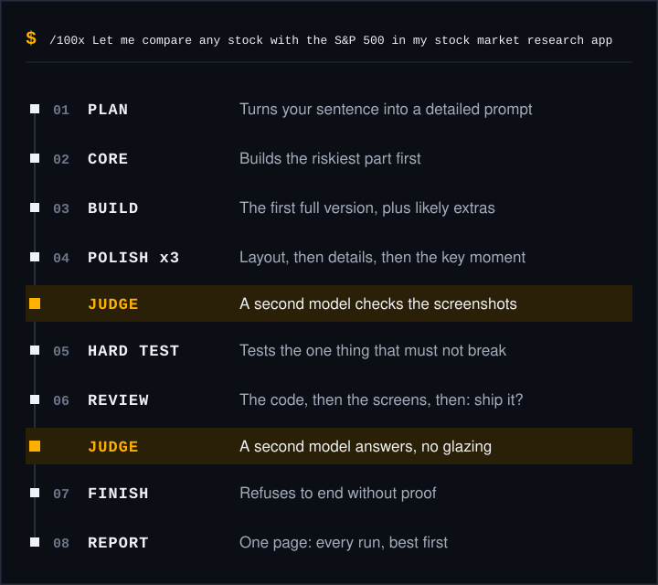

# The pipeline

What each stage does, what `100x finish` proves, and the final message. Back to the [README](../README.md).

## The final message

`100x finish` prints this, and the agent sends it as its last message. It is short on purpose, and the report has the rest. The run here is made up, and the code printed the message.

```text
Ledgerline: ready to ship.
The numbers add up to the cent and the first screen answers the question the owner came with. The second day is thin.

The moment: Move a late invoice and the whole forecast redraws, with the low point marked
Run: npm run dev, then open http://localhost:5173
Try first:
1) Open the sample business and read the months of runway
2) Move a late invoice back two weeks and watch the low point
3) Add a one-off expense of 12000

Must not break: numbers passed (The balance after 24 months matches a hand-worked ledger to the cent on 5000 random invoice sets, 0 failing)
Review (claude-opus-5-5): 14 flagged, 11 fixed, 2 rejected, 1 deferred
Judge rounds: 5 of 5 done, and the last word was ready to ship
Looked at: the code and how it behaves, the UI and UX and whether it is ready to ship
Screen sizes: 0 broken, 3 weak, 15 sizes and 212 elements checked
Asks: 6 of 6 closed
Work: 10 h of 10 h asked for, 14 rounds

Report: file:///Users/you/projects/ledgerline/.100x/REPORT.html
Next likely asks: Import invoices from a CSV file; Show a best case and a worst case
```
## The pipeline

<p align="center">
  
</p>

| Stage | Name | What happens |
|---|---|---|
| 0 | Open | Reads your profile and settings and your global and local agent rules (`CLAUDE.md`, `AGENTS.md`). A rule that forbids something the run needs, such as "never use subagents" against the judge, gets one question when you are here, and the stricter reading, logged, when you are away. Then reads what your brief names and writes the longer prompt you would have written: the rules, the riskiest unknown, the asks with a proof for each claim, the scope, what not to do, the moment and the one thing that must not break. It checks the prompt, sends a short pre-flight and keeps working. |
| 1 | Core | A fast first build of the riskiest part, scored out of six, with a verdict of ready to ship, fine or needs work, and screenshots as evidence. A needs-work verdict pivots the idea, the mechanic or the visual world, at most twice. If it still needs work after that, the run finishes cheaply and honestly. |
| 2 | Build | The first full version. Quick test only. |
| 3 | Depth | The next asks you would probably make, built behind seams. Taste forks become switches. |
| 4 | Polish | Three passes on look and feel. Each pass is measured with screenshots, and a fresh judge from a different model grades every pass and has to be answered. |
| 5 | Must not break | The one thing that must not break, tested hard once. Scaling across resolutions for a mobile game, money math for a finance app, fresh-data for a dashboard, asset quality for an art pack. |
| 6 | Review | A different model judges it in rounds, asked "is this ready to ship, be brutal". The code first, then the UI and UX, last the ship test. Every finding gets an accept, reject or defer with a reason, and each round checks the last one's fixes. |
| 7 | Ship | A preview deploy if the project already has one configured. Production never, unless you say so. |
| 8 | Finish | `100x finish` computes what it can instead of trusting notes. It refuses a hero that is not a real, non-blank PNG screenshot inside the project, a matrix from before the run started or one `100x shots` did not sign, a `ship` with broken findings, a must-not-break check with no output behind it (a `screen-sizes` check needs its signed all-rotate run), polish passes that are not on disk, a mockup that was polished, a prompt section left unwritten, an ask closed without evidence, an untriaged finding, a polish pass or fill round with no judge behind it, and a pitch or verdict reason too long to read on a phone. Then it writes the report and registers the run. |

What `100x finish` proves, and what it only checks. The tool measures screen runs and signs them, so a number typed by hand does not pass. Finish also checks that they looked at this prototype and not at another page.

The agents that did the work write the judge's findings, the must-not-break output and the closed asks. For those, finish checks that they exist and that each points at a commit, a file, a command or a number. It checks that the counts agree. It checks that the run's own facts agree with each other: the polish passes on disk, the run command in the folder, the address.

An agent set on faking them still can, because the agents and the tool share a machine. So the report and the report page put the screens, the check and the judge's last word in front of you. Your look is the last check.
