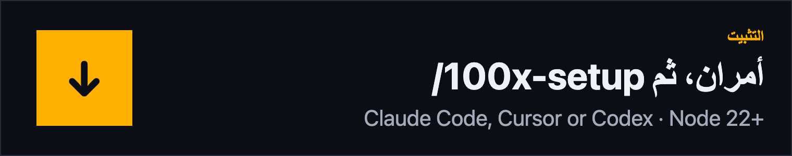

<div align="center">

<picture>
  <source media="(prefers-color-scheme: dark)" srcset="../docs/img/brand/mask-dark.png">
  
</picture>

# 100× ENGINEER SKILL

### وداعًا للبرمجة بالوكلاء التي «تكاد تعمل»

[](https://github.com/DeadInternetStudios/100x-engineer-skill/actions/workflows/ci.yml)
[](https://github.com/DeadInternetStudios/100x-engineer-skill/stargazers)
[](https://github.com/DeadInternetStudios/100x-engineer-skill/releases)
[](../LICENSE)


<sub><a href="../README.md">English</a> · <a href="README.es.md">Español</a> · <a href="README.zh.md">中文</a> · <a href="README.pt.md">Português</a> · <a href="README.ru.md">Русский</a> · <a href="README.ja.md">日本語</a> · <a href="README.fr.md">Français</a> · <a href="README.de.md">Deutsch</a> · <b>العربية</b> · <a href="README.hi.md">हिन्दी</a> · <a href="README.ko.md">한국어</a> · <a href="README.id.md">Bahasa Indonesia</a> · <a href="README.tr.md">Türkçe</a> · <a href="README.vi.md">Tiếng Việt</a> · <a href="README.bn.md">বাংলা</a> · <a href="README.it.md">Italiano</a> · <a href="README.pl.md">Polski</a> · <a href="README.th.md">ไทย</a> · <a href="README.uk.md">Українська</a> · <a href="README.nl.md">Nederlands</a></sub>

</div>

<div dir="rtl">

> **100x engineer**<br>
> /ˈwən ˈhən-drəd eks ˌen-jə-ˈnir/<br>
> *اسم*
>
> مهندس برمجيات يُقال إنه ينجز ما ينجزه مئة مهندس عادي، بلا اجتماعات ولا أسئلة ولا اختبارات فاشلة.

يقول لك الوكيل إنه انتهى. تفتح العمل فتجده يعمل *نوعًا ما*. يبدو دائمًا جيدًا، لكنه لا يصل أبدًا إلى أن يكون جاهزًا للإطلاق.

**100x يجعل وكيل البرمجة لديك يُنهي آخر 10% من التطوير.**

إنه مهارة مفتوحة المصدر لـ Claude Code وCursor وCodex. أعطه مهمة واحدة، مثل إضافة ميزة إلى تطبيقك أو بناء تطبيق صغير من الصفر. يخطط للعمل ويبنيه ويصقله ويختبر الجزء الأهم فيه. ويراجعه نموذج ذكاء اصطناعي ثانٍ. وتحصل في النهاية على تقرير فيه لقطات شاشة ونتائج الاختبارات وكل ما بقي مفتوحًا.

<p align="center">
  <a href="#التثبيت"></a>
</p>

<!-- Benchmark headline goes here: one line and one picture, the same agent with and without 100x, with a link to the method. -->

## لماذا يتوقف الوكلاء عند «تكاد تعمل»

ثلاثة أشياء تسوء، ولدى 100x حل لكل منها. كل الأمثلة أدناه تستخدم الطلب نفسه:

> أريد أن أقارن أي سهم بمؤشر S&P 500 في تطبيقي لأبحاث سوق الأسهم

### 1. لم يكتب أحد ما معنى «تعمل» فعلًا

الطلب سطر واحد. قبل أن يبني 100x أي شيء، يكتب البرومبت الذي كنت ستكتبه لو كان لديك ساعة فراغ. يحدد الهدف والقواعد والجزء الأخطر وطريقة التحقق من كل مطلب. وهنا يكتشف الفخ مبكرًا: تجزئة السهم تبدو خسارةً ما لم يأخذها الرسم البياني في الحسبان.

<p align="center">
  
</p>

<p align="center"><a href="../docs/examples/stock-comparison-prompt.md">اقرأ البرومبت كاملًا</a></p>

### 2. الوكيل يراجع عمله بنفسه

النموذج الذي يراجع عمله بنفسه لا يرى أخطاءه. لذلك يكلّف 100x نموذجًا ثانيًا بمراجعة الكود والشاشات على جولات. يصلح النموذج الباني كل ملاحظة أو يكتب سبب اعتراضه عليها. في هذا المثال ذكر البرومبت حالة سهم أُدرج حديثًا وطلب من المراجع التركيز عليها، لكن اختبارات الباني لم تستخدم إلا أسهمًا قديمة. جرّب المراجع سهمًا أُدرج هذا العام فوجد خط المؤشر يبدأ قبل خمسة أشهر.

<p align="center">
  
</p>

هذا المثال توضيحي. وإليك مثالًا حقيقيًا: مرّ ملف README هذا عبر 100x قبل أن تقرأه. نبّه مراجعه إلى 9 مشكلات في الجولة الأولى، من 20 رابط لغة معطّلًا إلى تسميات أصغر من أن تُقرأ على الهاتف. أُصلحت 7 منها، وأُجّلت 2 إلى الإطلاق العام. [اقرأ ما وجده](../docs/examples/readme-review.md).

### 3. الملخص يُكتب من الذاكرة

حين يقول الوكيل «انتهيت»، فهو ينقل ما يتذكره. أما 100x فيحفظ الأدلة أولًا بأول: لقطات الشاشة ومخرجات الاختبارات وملاحظات المراجع. وفي النهاية يكتب الكود الملخص من تلك الملفات، ويرفض `100x finish` كتابته ما دام هناك مطلب بلا دليل أو فحص ناقص. هذه هي الرسالة في نهاية تشغيل رسم الأسهم. تطبيق الأبحاث متخيَّل، لذا فالتشغيل توضيحي.

<p align="center">
  
</p>

<details>
<summary>الرسالة نفسها كنص عادي</summary>

```text
Compare with the S&P 500: A chart in a research app that shows how any stock has moved against the S&P 500 since the first day both have prices. Verdict: ready to ship. The split math matches a hand count and both lines start on the same day. Dividends are not counted yet.
The moment: Type a ticker and both lines start at 0% on the same day, so the gap is the whole story
Run: npm run dev, then open http://localhost:5173/compare
Try first: 1) Type a ticker you hold and read the gap to the index 2) Pick a stock that split two for one and check the split day shows no drop 3) Pick a stock listed this year and see where both lines start
Must not break: numbers passed (Percent change across a two-for-one split matches a hand count on 40 split cases, 0 failing)
Review (claude-opus-5-5): 9 flagged, 7 fixed, 1 rejected, 1 deferred
Judge rounds: 5 of 5 done, on the code and how it behaves, the UI and UX and whether it is ready to ship, and the last word was ready to ship
Screen sizes: 0 broken, 2 weak, 15 sizes and 148 elements checked
Asks: 9 of 9 closed
Report: file:///Users/you/projects/research-app/.100x/REPORT.html
Next likely asks: Count dividends in the comparison; Show the gap for several stocks in one table
```

</details>

- **اللحظة:** الشيء الوحيد الذي يجب أن يجعلك تريده
- **ما يجب ألا ينكسر:** الاختبار الصعب، وهل نجح
- **المراجعة:** ما نبّه إليه النموذج الثاني، وما فعله الباني به
- **المطالب:** متطلبات البرومبت، ولا يُغلق أيٌّ منها إلا بدليل
- **المطالب المتوقعة تاليًا:** ما ستطلبه على الأرجح بعد ذلك، وقد بُني أو أُدرج في القائمة مسبقًا

## أرسل رسالة واحدة وانصرف

الطلب نفسه على خط زمني. حين تعمل يدويًا، تظل تعود لتجيب عن الأسئلة وتلتقط الأخطاء. مع 100x، ترسل رسالة واحدة وتقرأ التقرير حين تعود. الأزرق أنت والكهرماني النموذج الثاني. الأوقات من تأليفنا.

<p align="center">
  
</p>

<details>
<summary>الأمر نفسه مع تطبيق صغير يُبنى من الصفر</summary>

<p align="center">
  
</p>

برومبت تطبيق الميزانية، مكتوب من أربع كلمات: [اصنع لي تطبيق ميزانية](../docs/examples/budget-app-prompt.md).

</details>

<details>
<summary>خطوات التشغيل الثماني كلها</summary>

| الخطوة | ما يحدث |
|---|---|
| 1. التخطيط | يكتب وكيلك برومبت مفصّلًا. يوضّح فيه ما سيُبنى وكيف يُتحقق من كل طلب. |
| 2. الجوهر | يجرّب الجزء الأخطر أولًا، ما دام هناك وقت لتغيير الخطة. |
| 3. البناء | يبني النسخة الأولى والإضافات التي يُرجَّح أن تطلبها تاليًا. |
| 4. الصقل | يعمل على التصميم والتفاصيل. ينظر نموذج ثانٍ إلى لقطات الشاشة بعد كل جولة ويشير إلى مواضع الضعف. |
| 5. الاختبار | يختبر الوكيل الشيء الوحيد الذي يُفسد العمل لو انكسر، مثل رسم بياني يخطئ في حساب التجزئة. ويُثبت أولًا أن الاختبار قادر على اكتشاف الخطأ. |
| 6. المراجعة | يراجع النموذج الثاني الكود والشاشات. يصلح الباني كل مشكلة أو يكتب لماذا يمكن تأجيلها أو لماذا يعترض عليها. |
| 7. الإنهاء | يتحقق الأمر `100x finish` من الأدلة المحفوظة قبل أن يكتب التقرير. |
| 8. التقرير | ترى النتيجة وتجرّبها بنفسك وتقرأ ما وجده المراجع. |

إن كنت غائبًا، يدوّن الوكيل كل قرار يتخذه ويواصل العمل. [اقرأ سير العمل كاملًا](../docs/pipeline.md).

</details>

## ما تحصل عليه

<div align="center">


<sub>صفحة التقرير، مرسومة من ثلاثة تشغيلات متخيَّلة. التشغيل الحقيقي يضع لقطات شاشته على كل بطاقة.</sub>

</div>

- **الميزة أو التطبيق**، وطريقة تجربته بنفسك
- **لقطات شاشة بمقاسات شاشات كثيرة**، تُفحص بحثًا عن نص يخرج عن مكانه وأزرار صغيرة جدًا وصور ضبابية وأخطاء المتصفح
- **صفحة تقرير** (`.100x/REPORT.html`) ومعرض لكل تشغيل مكتمل في `~/.100x`
- **سجل قرارات**: كل خيار اتخذه 100x أثناء غيابك، وسببه
- **الرسالة الأخيرة** المعروضة أعلاه

لكل تشغيل حكم واحد: **جاهز للإطلاق** أو **مقبول** أو **يحتاج إلى عمل**. وحين يمنع شيءٌ الحكم، تذكر البطاقة ما هو، بالأحمر حين يجد 100x مشكلة وبالكهرماني حين يكون هناك فحص ناقص.

---

<div align="center">

## منتجات حقيقية بُنيت باستخدام 100x

<table align="left"><tr><td>
<a href="https://dollarflow.com/"></a><br>
<a href="https://dollarflow.com/"><b>DollarFlow</b></a><br>
أداة لفرز الأسهم، بُنيت<br>
بمساعدة 100x
</td></tr></table>
<table align="left"><tr><td>
<a href="https://springtails.wiki/"></a><br>
<a href="https://springtails.wiki/"><b>Springtails Wiki</b></a><br>
موسوعة عن ذيليات القفز،<br>
بُنيت بالكامل باستخدام 100x
</td></tr></table>
<br clear="all">

<table align="left"><tr><td>
<a href="https://bubblewrapapp.com/"></a><br>
<a href="https://bubblewrapapp.com/"><b>BubbleWrap</b></a><br>
تطبيق موسيقى بفن البكسل،<br>
بُني بالكامل باستخدام 100x
</td></tr></table>
<table align="left"><tr><td>
<a href="https://goldtraderdesk.com/"></a><br>
<a href="https://goldtraderdesk.com/"><b>Gold Trader Desk</b></a><br>
تطبيق لتداول الذهب، بُني<br>
بالكامل باستخدام 100x
</td></tr></table>
<br clear="all">

<table align="left"><tr><td>
<br>
<b>Phantom</b><br>
تطبيق Mac بلغة Swift يستخدمه<br>
خبراء الأدلة الجنائية لتحليل<br>
خط اليد، بُني بمساعدة<br>
100x
</td></tr></table>
<table align="left"><tr><td>
<br>
<b>OptionsFlow</b><br>
أداة لسلسلة الخيارات لحظيًا<br>
بـ React تستخدمها شركات التداول<br>
الكمي، بُنيت بمساعدة 100x
</td></tr></table>
<br clear="all">

<table align="left"><tr><td>
<br>
<b>Skynet</b><br>
أداة لإدارة المشاريع مبنية على<br>
Blueprint وEncore، بمساعدة<br>
100x
</td></tr></table>
<table align="left"><tr><td>
<br>
<b>Boneworks</b><br>
خط إنتاج من النص إلى 3D يصمم<br>
الشخصيات ويكسوها ويركّب هياكلها ويحرّكها،<br>
بُني بمساعدة 100x
</td></tr></table>
<br clear="all">

<p align="center">
  <a href="mailto:theory@deadinternet.com"></a>
</p>

</div>

---

## كم يكلّف

يدفع 100x الوقت والاستهلاك ثمنًا للإثبات.

- **التشغيل العادي يستغرق ساعات.** كل جولة صقل وكل جولة مراجعة تعني نموذجًا آخر يعمل، لذا يستهلك التشغيل جزءًا كبيرًا من خطة اشتراكك.
- **لنظرة أولى**، يستغرق `/100x-mockup` نحو 15 دقيقة. يتخطى المراجعة ويقول ذلك صراحة.
- **مع خطة أصغر**، ينفّذ `100x config preset lite --global` جولة صقل واحدة وجولتَي مراجعة بدلًا من ثلاث وخمس. وتبقى فحوص الإثبات كما هي.
- **ليس للأشياء الصغيرة.** لإصلاح سطر واحد أو لسؤال، اسأل وكيلك مباشرة. 100x لمهمة تستحق خطة واختبارًا ومراجعة.

## التثبيت

تحتاج إلى Claude Code أو Cursor أو Codex، وإلى Node.js 22 أو أحدث.

**1. ثبّت الأداة والمهارات**

```bash
npm install -g github:DeadInternetStudios/100x-engineer-skill
100x install
```

**2. الإعداد، داخل وكيلك**

```text
/100x-setup
```

يسألك عن خطتك (Claude Pro أو Max أو Ultra، أو OpenAI Go أو Plus أو Pro) ويختار النموذج الذي يبني والنموذج الذي يحكم. إن كانت خطتك صغيرة فقل ذلك، وسيفعّل الإعداد المسبق lite. المزيد: [docs/plans-and-setup.md](../docs/plans-and-setup.md).

**3. أعطه مهمة**

```text
/100x أريد أن أقارن أي سهم بمؤشر S&P 500 في تطبيقي لأبحاث سوق الأسهم
```

في Claude Code وCursor تبدأ المهارة بـ `/`. أما Codex فيستخدم `$`، كما في `$100x-setup` و`$100x`. استخدم `/100x-overnight` حين تغادر لليلة، أو `/100x-mockup` لنظرة أولى.

### طرق أخرى للتثبيت

**من نسخة مستنسخة** (الطريقة التي نختبر بها هذا المستودع)

```bash
./scripts/install.sh --dry-run   # preview
./scripts/install.sh
```

تستخدم skills.sh أصلًا؟ الأمر `npx skills add DeadInternetStudios/100x-engineer-skill --skill '*' -g` يضيف المهارات. لكنك ما زلت تحتاج إلى أداة سطر الأوامر من الخطوة 1.

يتكوّن 100x من جزأين: مهارات يقرؤها وكيلك، وأداة سطر الأوامر `100x`. تقوم الأداة بما لا يستطيع النموذج فعله وحده بشكل موثوق. تضبط الوقت، وتلتقط لقطات الشاشة، وتشغّل الحَكَم، وتتحقق من الإثبات، وتكتب التقرير. تعتمد لقطات الشاشة على Playwright. إن لم يكن مثبّتًا، فإن `100x browsers` يثبّته.

لا يُنشئ المثبّت إلا اختصارات (روابط رمزية)، وبضعة ملفات صغيرة ومجلداتها. ولا يكتب أبدًا فوق ملف حقيقي. يتحقق `100x doctor` من النتيجة، ويزيله `./scripts/install.sh --uninstall`. كل ملف يلمسه: [docs/cli.md](../docs/cli.md).

## الأوضاع

100x مجموعة من المهارات تُسمّى أوضاعًا. اكتب اسم الوضع لتستخدمه. الكلمات في رسالتك لا تختار وضعًا أبدًا، لذا فإن `/100x an overnight oats app` يبني تطبيقًا عن الشوفان.

| اكتب هذا | الغرض | ما يفعله |
|---|---|---|
| `/100x` | البناء | التشغيل العادي: بناء، صقل، اختبار، ومراجعة من نموذج ثانٍ. |
| `/100x-mockup` | البناء | نظرة أولى سريعة في نحو 15 دقيقة. وحدها اللحظة الأساسية تعمل. بلا مراجعة، ويقول ذلك (UNREVIEWED). |
| `/100x-overnight` | البناء | حين تغادر. يشغّل فكرة واحدة أو عدة أفكار لمدة محددة، وينبّه الوكيل إن توقف. |
| `/100x-wrapup` | البناء | للمواعيد النهائية. يجعل المسار الرئيسي يعمل ويخفي الباقي. |
| `/100x-judge` | المراجعة | يراجع شيئًا بُني بالفعل. لا يبني شيئًا جديدًا. |
| `/100x-grind` | المراجعة | مراجعة فإصلاح فمراجعة أخرى، حتى يقول الحَكَم إنه جاهز للإطلاق. يتوقف إن لم تجد ثلاث مراجعات متتالية شيئًا أفضل، أو عند 15 جولة، أو حين ينفد الوقت. |
| `/100x-status` | التشغيلات | أين وصل التشغيل، في ستة أسطر أو أقل. |
| `/100x-continue` | التشغيلات | يستأنف تشغيلًا توقف، مثلًا عند بلوغ حد الاستخدام. |
| `/100x-report` | التشغيلات | يعرض كل ما اكتمل، الأفضل أولًا. لا يبني شيئًا. |
| `/100x-adhd` | التخطيط | حوار قصير، سؤال واحد في كل مرة، يحوّل فكرة مبهمة إلى خطة. لا يُبنى شيء حتى تقول ابدأ. |
| `/100x-setup` | الإعداد | يسأل سؤالًا واحدًا عن خطتك، ثم يحدد أي نموذج يتولى أي مهمة. |
| `/100x-bakeoff` | اختبار 100x | يختبر 100x نفسه: الوكيل نفسه يبني الأفكار نفسها مع 100x ومن دونه، ويقارن بينها حَكَم لا يعرف أيّها أيّ. لا يبني شيئًا. |

### عبارات الأرقام

أضف هذه العبارات إلى رسالتك لتغيّر التشغيل. تعمل مع `/100x` و`/100x-overnight`. الكلمات الأخرى، مثل «سريع» أو «بسرعة»، لا تفعل شيئًا.

| تكتب | ما يحدث |
|---|---|
| `3 versions` | يبني 3 نسخ من الفكرة ويُكمل أفضلها. يصلح أي رقم. |
| `for 10 hours`، `for 2 days`، `until 6am` | يستخدم الوقت كله. لن ينتهي التشغيل مبكرًا. |
| `5 rounds of judging` | يشغّل هذا العدد من جولات المراجعة. |
| `max 5 subagents` | 5 وكلاء فرعيين على الأكثر في وقت واحد. الافتراضي 1. |

```text
/100x-overnight 3 versions of a farming game, for 8 hours, max 3 subagents
```

يبدأ كل تشغيل بسرد العبارات التي فهمها، لتكتشف أي سوء فهم.

أعطه مدة محددة وسيواصل العمل على جولات حتى ينتهي الوقت. كل جولة تنظر إلى المشروع بطريقة جديدة، وتُبقي التغيير إن أفاد وتتراجع عنه إن لم يُفد. ويتحقق نموذج ثانٍ جديد من كل جولة.

<p align="center">
  
</p>

## الأسئلة الشائعة

**لماذا نموذج ثانٍ؟** لكل نموذج نقاط عمياء مختلفة. إن لم يتوفر نموذج ثانٍ، يكتمل التشغيل مع ذلك ويقول UNREVIEWED. وإن كانت لديك خطة واحدة، يمكن لنموذج أصغر من الشركة نفسها أن يحكم، لكن فائدته أقل من نموذج شركة أخرى.

**هل سينشر مشروعي على الإنترنت؟** لا. لا يُنشئ معاينة إلا إن كانت للمشروع معاينة أصلًا. والنشر الفعلي لا يتم إلا إذا طلبته.

**ماذا لو بلغت حد الاستخدام في منتصف التشغيل؟** يحفظ 100x التقدم في `.100x/STATE.md`. حين يُعاد ضبط الحد، اكتب `/100x-continue` في المجلد نفسه.

**هل يغيّر نموذجي أو إعداداتي؟** لا. لا يبدّل أبدًا نموذجك أو مستوى الجهد أو تسجيل دخولك. لا يكتب `/100x-setup` إلا إعدادات 100x الخاصة.

**أين تُحفظ التشغيلات؟** في مجلد مخفي `.100x/` داخل كل مشروع (يتجاهله git)، ومعرض للتشغيلات المكتملة في `~/.100x`.

<p align="center">
  <a href="https://github.com/DeadInternetStudios/100x-engineer-skill/issues/new"></a>
</p>

## التوثيق

| الصفحة | ما فيها |
|---|---|
| [التثبيت بالتفصيل](../docs/install.md) | كل خيارات التثبيت، وكل ملف يلمسه المثبّت |
| [استخدام 100x](../docs/using.md) | ليلة غياب، وصفحة التقرير، والمهارة المساعدة |
| [خط العمل والرسالة الأخيرة](../docs/pipeline.md) | كل خطوة بالتفصيل، وما يتحقق منه `100x finish` |
| [الإعداد والخطط](../docs/plans-and-setup.md) | إعداد Claude Code الموصى به، والإعداد المسبق lite، وإعدادات لكل خطة |
| [الإعدادات](../docs/settings.md) | كل مفاتيح الإعداد |
| [سطر الأوامر وتنظيم الملفات](../docs/cli.md) | كل أوامر `100x`، وأين توجد الملفات |
| [داخل المهارات، والتحقق](../docs/contributing.md) | كيف نُظّم المستودع، وكيف تختبره |
| [ملاحظات التصميم](../docs/design.md) | لماذا يعمل 100x بهذه الطريقة |

## المساهمة

نرحّب بتقارير الأخطاء والإصلاحات والأفكار. يمكن أن تذهب الإصلاحات الصغيرة مباشرة في طلب سحب (pull request). لأي شيء أكبر، افتح issue أولًا لنتفق عليه. [كيف تساهم](../CONTRIBUTING.md).

<p align="center">
  <a href="../CONTRIBUTING.md"></a>
</p>

## الشكر

يقوم 100x على مبادئ العمل في [pstack](https://github.com/cursor/plugins/tree/main/pstack) من Lauren Tan (MIT)، بعد إعادة صياغتها للنماذج الأولية ولمحادثة واحدة مع وكيلك. ما الذي يختلف:

- ينتهي كل تشغيل بصفحة تقرير.
- يرفض `100x finish` الادعاءات التي لا يستطيع التحقق منها.
- يراجع نموذج ثانٍ العمل على جولات.

راجع [NOTICE.md](../NOTICE.md) و[UPSTREAM.md](../UPSTREAM.md).

MIT. راجع [LICENSE](../LICENSE).

<p align="center">
  <a href="https://star-history.com/#DeadInternetStudios/100x-engineer-skill&Date">
    <picture>
      <source media="(prefers-color-scheme: dark)" srcset="https://api.star-history.com/svg?repos=deadinternetstudios/100x-engineer-skill&type=Date&theme=dark">
      
    </picture>
  </a>
</p>

---

<sub>رسم القناع: <a target="_blank" href="https://www.vexels.com/png-svg/preview/229802/guy-fawkes-mask-bonfire-night-stroke">www.vexels.com</a></sub>

</div>
