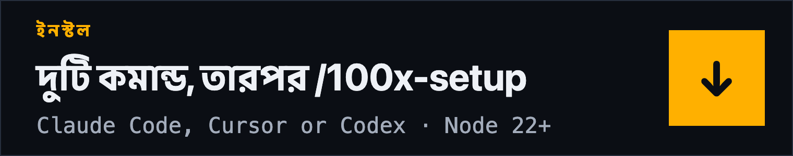
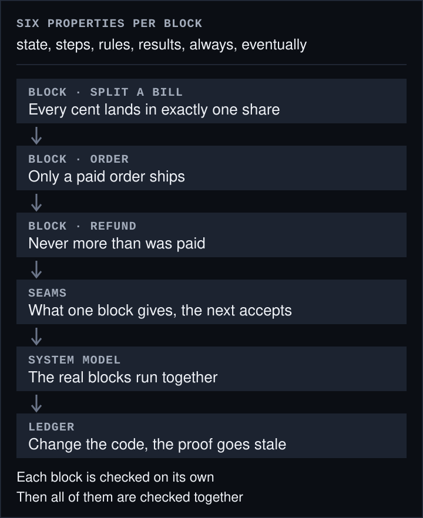
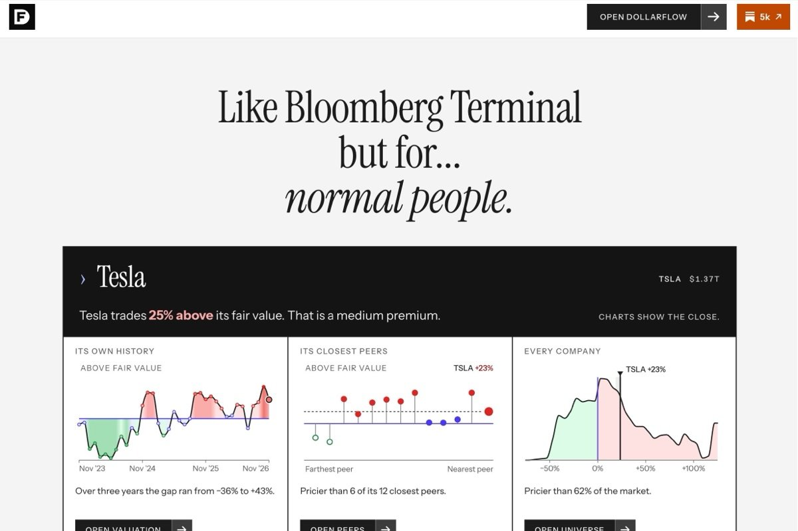
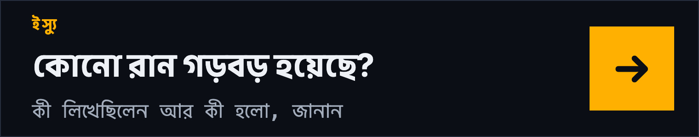
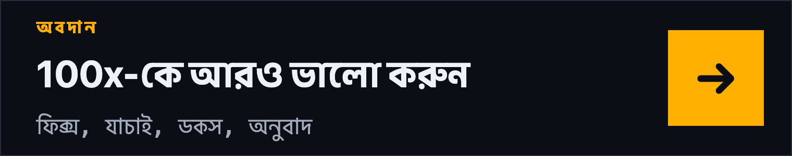

<div align="center">

<picture>
  <source media="(prefers-color-scheme: dark)" srcset="../docs/img/brand/mask-dark.png">
  
</picture>

# 100× ENGINEER SKILL

<p align="center">
  
  
</p>

<p align="center">
  <picture>
    <source media="(prefers-color-scheme: dark)" srcset="https://upstar.dev/badge/DeadInternetStudios/100x-engineer-skill/day/agent-skills-dark.svg">
    
  </picture>
</p>

### এজেন্টিক কোডিংয়ে আর "প্রায় চলে" নয়

[](https://github.com/DeadInternetStudios/100x-engineer-skill/actions/workflows/ci.yml)
[](https://github.com/DeadInternetStudios/100x-engineer-skill/releases)
[](https://nodejs.org/)
[](../LICENSE)

[](https://github.com/DeadInternetStudios/100x-engineer-skill/stargazers)

*100x হলো Cursor-এর একজন প্রাক্তন ইঞ্জিনিয়ারের একটি স্কিল, যা প্রম্পটকে ফর্মালি যাচাই করা, প্রোডাকশন-রেডি কোডে বদলে দেয়।<br>আমি এটি দিয়ে প্রতি মাসে 1,000-এর বেশি PR প্রোডাকশনে পাঠাই, রোলব্যাকের হার 2%-এর নিচে।*

<sub><a href="../README.md">English</a> · <a href="README.es.md">Español</a> · <a href="README.zh.md">中文</a> · <a href="README.pt.md">Português</a> · <a href="README.ru.md">Русский</a> · <a href="README.ja.md">日本語</a> · <a href="README.fr.md">Français</a> · <a href="README.de.md">Deutsch</a> · <a href="README.ar.md">العربية</a> · <a href="README.hi.md">हिन्दी</a> · <a href="README.ko.md">한국어</a> · <a href="README.id.md">Bahasa Indonesia</a> · <a href="README.tr.md">Türkçe</a> · <a href="README.vi.md">Tiếng Việt</a> · <b>বাংলা</b> · <a href="README.it.md">Italiano</a> · <a href="README.pl.md">Polski</a> · <a href="README.th.md">ไทย</a> · <a href="README.uk.md">Українська</a> · <a href="README.nl.md">Nederlands</a></sub>

</div>

> **100x engineer**<br>
> /ˈwən ˈhən-drəd eks ˌen-jə-ˈnir/<br>
> *বিশেষ্য*
>
> এমন একজন সফটওয়্যার ইঞ্জিনিয়ার, যিনি নাকি একশো সাধারণ ইঞ্জিনিয়ারের সমান কাজ করেন, কোনো মিটিং, প্রশ্ন বা ফেল করা টেস্ট ছাড়াই।

আপনার এজেন্ট বলে কাজ শেষ। খুলে দেখেন, *মোটামুটি* চলে। দেখতে সবসময় ঠিকঠাক লাগে, কিন্তু শিপ করার মতো পুরোপুরি তৈরি কখনোই হয় না।

**100x আপনার কোডিং এজেন্টকে দিয়ে ডেভেলপমেন্টের শেষ 10% শেষ করায়।**

**এটি কাজকে ছোট ব্লকে ভাগ করে, প্রতিটি ব্লককে ফর্মালি যাচাই করে, তারপর দেখে ব্লকগুলো একসঙ্গে কাজ করছে কি না।**

<p align="center">
  
</p>

<p align="center"><b>30 দিনে 136B টোকেন · 1 জন ইঞ্জিনিয়ার · গুরুতর প্রজেক্ট · 1,000-এর বেশি PR · $250k ক্যাশ সাশ্রয়</b></p>

এটি Claude Code, Cursor আর Codex-এর জন্য একটি ওপেন-সোর্স স্কিল। এটিকে একটা কাজ দিন, যেমন আপনার অ্যাপে একটা ফিচার যোগ করা বা শুরু থেকে একটা ছোট অ্যাপ বানানো। এটি কাজের পরিকল্পনা করে, বানায়, ঘষেমেজে ঠিক করে আর সবচেয়ে জরুরি অংশটা টেস্ট করে। একটা দ্বিতীয় AI মডেল সেটা রিভিউ করে। আপনি একটা রিপোর্ট পান, যাতে থাকে স্ক্রিনশট, টেস্টের ফল আর যা কিছু এখনো বাকি।

<p align="center">
  <a href="#ইনস্টল"></a>
</p>

<!-- Benchmark headline goes here: one line and one picture, the same agent with and without 100x, with a link to the method. -->

## ফর্মাল ভেরিফিকেশন, একবারে একটি ছোট ব্লক

পুরো একটা অ্যাপকে কেউ একসঙ্গে ফর্মালি যাচাই করে না। কিন্তু ভালোভাবে ডিজাইন করা প্রায় সব সফটওয়্যারই ছোট ব্লক দিয়ে তৈরি, আর একটি ছোট ব্লকের এমন কিছু বিষয় থাকে যা ঠিকঠাক বলা যায় এবং পুরোপুরি যাচাই করা যায়। 100x সেগুলো লিখে রাখে, প্রতিটি যাচাই করে, তারপর দেখে ব্লকগুলো একসঙ্গে কাজ করছে কি না। এটা ডিফল্টভাবেই হয়।

### প্রতিটি ব্লকের জন্য ছয়টি প্রশ্ন

| প্রশ্ন | যা লেখা হয় |
|---|---|
| স্টেট | কী থাকতে পারে |
| ট্রানজিশন | এটি কীভাবে বদলাতে পারে |
| প্রিকন্ডিশন | একটি ধাপ কখন অনুমোদিত |
| পোস্টকন্ডিশন | একটি ধাপের পরে কী সত্য |
| ইনভেরিয়েন্ট | কী সবসময় সত্য থাকে |
| লাইভনেস | শেষে কী ঘটতেই হবে, আর সেটা কী ধরে নেয় |

প্রম্পট ছয়টির উত্তরই সহজ বাক্যে দেয়। তারপর 100x একটি ছোট মডেল বানায় যা আপনার আসল ফাংশন চালায়, আর একটি চেকার মডেল যে সব অবস্থায় পৌঁছাতে পারে তার প্রতিটি দেখে। কিছু ভাঙলে সেখানে পৌঁছানোর সবচেয়ে ছোট ধাপের তালিকা ছাপে।

### ছোট ব্লক মিলে বড় সিস্টেম হয়

<p align="center">
  
</p>

প্রতিটি ব্লক আলাদাভাবে যাচাই হয়, তাই ব্যর্থতা একটি ছোট জায়গার দিকে আঙুল তোলে। জোড়াগুলোও যাচাই হয়: একটি ব্লক যা হস্তান্তর করে তা পরের ব্লকের নিয়ম মানতে হবে। তারপর আসল ব্লকগুলো একটি মডেলে একসঙ্গে চলে, আর চেকার পুরোটার প্রতিটি অবস্থা দেখে। যাচাই করা ব্লক আর যাচাই করা জোড়া মিলে এমন সফটওয়্যার হয় যার ওপর ভরসা করা যায়। ব্লকগুলো জোড়া বিনামূল্যে প্রমাণ করে না, তাই 100x দুটোই যাচাই করে।

### এটা সত্য থাকে

খাতাটি হলো `verify/ledger.tsv`, আপনার রিপোতে, তাই এটি প্রতিটি ব্রাঞ্চের সঙ্গে যায়। প্রতিটি সারি যে কোড কভার করে তার একটি হ্যাশ রাখে। সেই কোড বদলালে সারিটি পুরোনো হয়ে যায়, যতক্ষণ না কেউ বদলটা পড়ে, যাচাই চালিয়ে সেটা সিঙ্ক করে। প্রতিটি বৈশিষ্ট্যকে গণ্য হওয়ার আগে ইচ্ছে করে বসানো একটি বাগে একবার ব্যর্থ হতে হয়। `100x finish` এমন বৈশিষ্ট্য প্রত্যাখ্যান করে যা পুরোনো, ভাঙা বা কখনো ব্যর্থ হয়নি। কোনো এজেন্ট যে কোড কোনো নিয়মই কভার করে না তাতে হাত দিতে গেলে `100x verify cover` `NO RULE` বলে, আর তাতেই প্রক্রিয়া শুরু হয়।

```text
$ 100x verify run
pass  split-keeps-every-cent. invariant, exhaustive, exit 0

# someone swaps Math.floor for Math.round in the split
$ 100x verify status
stale   split-keeps-every-cent  the covered code changed after the last sync

$ 100x verify run
FAIL  inv:shares-keep-every-cent. a cent was lost or made. Steps: set-bill(1), set-people(2), compute
```

<sub>একটি ছোট টিপ স্প্লিটার থেকে, পরীক্ষামূলক রিপোতে হাতে চালানো</sub>

### এখানে যাচাই করা মানে কী

- **সর্বাঙ্গীণ** (`exhaustive`): মডেলের প্রতিটি অবস্থা দেখা হয়েছে, তাই বৈশিষ্ট্যটি ওই মডেল আর তার সীমার জন্য সত্য
- **সীমিত** (`bounded`): খোঁজ একটি সীমায় ঠেকে গেছে আর যা দেখেছে তাতে কিছু পায়নি, যা কোনো প্রমাণ নয়, আর লাইভনেস এর ভিত্তিতে কখনো ঠিক হয় না
- **নমুনা** (`sampled`): বেছে নেওয়া বা এলোমেলো কেস, বাগ খুঁজতে ভালো আর বাকিটা নিয়ে নীরব

পাস করা মানে মডেল আর যাচাইগুলো যে আসল ফাংশন চালায় সেগুলো কভার হয়েছে। লেআউট আর লেখায় বলার মতো কিছু নেই, তাই সেগুলো কারণসহ নথিবদ্ধ ছাড় পায়, আর `100x finish` প্রতিটি ছাড় যে কোডকে রেহাই দেয় তার নাম বলে। এসব বাদ দিতে আপনার বার্তায় `no verification` লিখুন বা `100x config set verify.enabled false` চালান। তখন রিপোর্ট বলবে কিছুই যাচাই হয়নি। [বিস্তারিত](../docs/verification.md)।

## এজেন্ট কেন "প্রায় চলে"-তে থেমে যায়

তিনটে জিনিস ভুল হয়, আর 100x-এর কাছে প্রতিটার উত্তর আছে। নিচের সব উদাহরণে একই অনুরোধ:

> আমার স্টক মার্কেট রিসার্চ অ্যাপে যেকোনো স্টকের সঙ্গে S&P 500-এর তুলনা করতে দাও

### 1. "চলে" মানে আসলে কী, কেউ লিখে রাখেনি

অনুরোধটা এক লাইনের। কিছু বানানোর আগে 100x সেই প্রম্পটটা লেখে, যেটা হাতে এক ঘণ্টা থাকলে আপনি লিখতেন। এতে ঠিক হয় লক্ষ্য, নিয়ম, সবচেয়ে ঝুঁকির অংশ, আর প্রতিটা চাহিদা কীভাবে যাচাই হবে। এখানে এটি ফাঁদটা আগেই ধরে ফেলে: চার্ট স্টক স্প্লিট হিসাবে না ধরলে স্প্লিটকে লোকসান বলে মনে হয়।

<p align="center">
  
</p>

<p align="center"><a href="../docs/examples/stock-comparison-prompt.md">পুরো প্রম্পটটা পড়ুন</a></p>

### 2. এজেন্ট নিজের কাজ নিজেই যাচাই করে

যে মডেল নিজের কাজ নিজে যাচাই করে, সে নিজের ভুলগুলোই ধরতে পারে না। 100x একটা দ্বিতীয় মডেলকে দিয়ে কোড আর স্ক্রিন রিভিউ করায়, কয়েক রাউন্ডে। বিল্ডার প্রতিটা ফাইন্ডিং ঠিক করে, নয়তো লিখে রাখে কেন সে একমত নয়। এখানে প্রম্পটে সদ্য তালিকাভুক্ত স্টকের কেসটা উল্লেখ ছিল আর রিভিউয়ারকে সেটা নিয়ে চেপে ধরতে বলা হয়েছিল, কিন্তু বিল্ডারের টেস্টে শুধু পুরোনো স্টক ছিল। রিভিউয়ার এ বছর তালিকাভুক্ত একটা স্টক চালিয়ে দেখল, ইনডেক্সের লাইন পাঁচ মাস আগে শুরু হচ্ছে।

<p align="center">
  
</p>

ওটা কাল্পনিক। একটা আসল উদাহরণ: আপনি পড়ার আগে এই README 100x-এর ভেতর দিয়ে গেছে। এর রিভিউয়ার প্রথম রাউন্ডে 9টি সমস্যা ধরেছিল, 20টি অচল ভাষার লিংক থেকে শুরু করে ফোনে পড়ার পক্ষে খুব ছোট লেবেল পর্যন্ত। 7টি ঠিক করা হয়েছে আর 2টি পাবলিক লঞ্চ পর্যন্ত রেখে দেওয়া হয়েছে। [দেখুন কী পেয়েছিল](../docs/examples/readme-review.md)।

### 3. সারাংশ লেখা হয় স্মৃতি থেকে

এজেন্ট যখন বলে "হয়ে গেছে", তখন সে যা মনে আছে তাই জানায়। 100x কাজের সঙ্গে সঙ্গে প্রমাণ জমিয়ে রাখে: স্ক্রিনশট, টেস্টের আউটপুট, রিভিউয়ারের ফাইন্ডিং। শেষে কোড ওই ফাইলগুলো থেকে সারাংশ লেখে, আর কোনো চাহিদার প্রমাণ না থাকলে বা কোনো যাচাই বাদ থাকলে `100x finish` সেটা লিখতে রাজি হয় না। স্টক চার্ট রানের শেষে এই বার্তাটাই আসে। রিসার্চ অ্যাপটা বানানো, তাই রানটাও কাল্পনিক।

<p align="center">
  
</p>

<details>
<summary>একই বার্তা সাধারণ টেক্সটে</summary>

```text
Compare with the S&P 500: ready to ship.
The split math matches a hand count and both lines start on the same day. Dividends are not counted yet.

The moment: Type a ticker and both lines start at 0% on the same day, so the gap is the whole story
Run: npm run dev
Open: http://localhost:5173/compare
Try first:
1) Type a ticker you hold and read the gap to the index
2) Pick a stock that split two for one and check the split day shows no drop
3) Pick a stock listed this year and see where both lines start

Must not break: numbers passed (Percent change across a two-for-one split matches a hand count on 40 split cases, 0 failing)
Review (claude-opus-5-5): 9 flagged, 7 fixed, 1 rejected, 1 deferred
Judge rounds: 5 of 5 done, and the last word was ready to ship
Looked at: the code and how it behaves, the UI and UX and whether it is ready to ship
Screen sizes: 0 broken, 2 weak, 15 sizes and 148 elements checked
Asks: 9 of 9 closed

Report: file:///Users/you/projects/research-app/.100x/REPORT.html
Next likely asks: Count dividends in the comparison; Show the gap for several stocks in one table
```

</details>

- **মুহূর্ত:** সেই একটা জিনিস, যেটা দেখে আপনার এটা চাইতে ইচ্ছে করবে
- **যা ভাঙা চলবে না:** কঠিন টেস্ট, আর সেটা পাস করেছে কি না
- **রিভিউ:** দ্বিতীয় মডেল কী ধরেছে, আর বিল্ডার তা নিয়ে কী করেছে
- **চাহিদা:** প্রম্পটের প্রয়োজনগুলো, প্রতিটা বন্ধ হয় শুধু প্রমাণ দিয়ে
- **পরের সম্ভাব্য চাহিদা:** আপনি সম্ভবত এরপর যা চাইবেন, আগেই বানানো বা তালিকায় রাখা

## একটা বার্তা পাঠিয়ে চলে যান

একই অনুরোধ, টাইমলাইন হিসেবে। হাতে করলে আপনাকে বারবার ফিরে এসে প্রশ্নের উত্তর দিতে আর ভুল ধরতে হয়। 100x দিয়ে আপনি একটা বার্তা পাঠান আর ফিরে এসে রিপোর্ট পড়েন। নীল আপনি, আর অ্যাম্বার দ্বিতীয় মডেল। সময়গুলো আমাদের বানানো।

<p align="center">
  
</p>

<details>
<summary>শুরু থেকে বানানো একটা ছোট অ্যাপেও একই</summary>

<p align="center">
  
</p>

বাজেট অ্যাপের প্রম্পট, চারটে শব্দ থেকে লেখা: [একটা বাজেট অ্যাপ বানাও](../docs/examples/budget-app-prompt.md)।

</details>

<details>
<summary>একটা রানের আটটা ধাপ</summary>

| ধাপ | কী হয় |
|---|---|
| 1. পরিকল্পনা | আপনার এজেন্ট একটা বিস্তারিত প্রম্পট লেখে। কী বানাতে হবে আর প্রতিটা অনুরোধ কীভাবে যাচাই হবে, সেখানে স্পষ্ট লেখা থাকে। |
| 2. মূল অংশ | সবচেয়ে ঝুঁকির অংশটা আগে চেষ্টা করে, যতক্ষণ পরিকল্পনা বদলানোর সময় আছে। |
| 3. বিল্ড | প্রথম ভার্সন বানায়, সঙ্গে সেই বাড়তি জিনিসগুলোও যা আপনি সম্ভবত এরপর চাইবেন। |
| 4. পলিশ | লেআউট আর খুঁটিনাটি নিয়ে কাজ করে। প্রতিটা পাসের পর একটা দ্বিতীয় মডেল স্ক্রিনশট দেখে দুর্বল জায়গাগুলো দেখিয়ে দেয়। |
| 5. টেস্ট | যে একটা জিনিস ভাঙলে পুরো কাজ নষ্ট হবে, এজেন্ট সেটা টেস্ট করে, যেমন চার্টের স্প্লিটের হিসাব ভুল করা। আগে দেখায় যে টেস্টটা ভুল ধরতে পারে। |
| 6. রিভিউ | দ্বিতীয় মডেল কোড আর স্ক্রিন রিভিউ করে। বিল্ডার প্রতিটা সমস্যা ঠিক করে, নয়তো লিখে রাখে কেন সেটা অপেক্ষা করতে পারে বা কেন সে একমত নয়। |
| 7. ফিনিশ | রিপোর্ট লেখার আগে `100x finish` কমান্ড সংরক্ষিত প্রমাণ যাচাই করে। |
| 8. রিপোর্ট | আপনি ফলটা দেখতে পারেন, নিজে চালিয়ে দেখতে পারেন, আর রিভিউয়ার কী পেয়েছে পড়তে পারেন। |

আপনি দূরে থাকলে এজেন্ট তার প্রতিটা সিদ্ধান্ত লিখে রাখে আর কাজ চালিয়ে যায়। [পুরো ওয়ার্কফ্লো পড়ুন](../docs/pipeline.md)।

</details>

## আপনি কী পান

<div align="center">


<sub>রিপোর্ট পেজ, তিনটি কাল্পনিক রান থেকে আঁকা। আসল রান প্রতিটা কার্ডে নিজের স্ক্রিনশট বসায়।</sub>

</div>

- **ফিচার বা অ্যাপ**, আর নিজে চালিয়ে দেখার উপায়
- **অনেক স্ক্রিন সাইজে স্ক্রিনশট**, যেখানে উপচে পড়া টেক্সট, খুব ছোট বোতাম, ঝাপসা ছবি আর ব্রাউজারের এরর যাচাই করা হয়
- **একটা রিপোর্ট পেজ** (`.100x/REPORT.html`) আর `~/.100x`-এ প্রতিটা শেষ হওয়া রানের গ্যালারি
- আপনার রিপোতে **একটি যাচাইয়ের খাতা**: প্রতিটি ব্লকের বৈশিষ্ট্য, প্রতিটি সত্য কি না, আর সেটি কোন কোড কভার করে
- **সিদ্ধান্তের লগ**: আপনি না থাকার সময় 100x যা যা বেছে নিয়েছে, আর কেন
- **শেষ বার্তা**, যা ওপরে দেখানো হয়েছে

প্রতিটা রান একটা রায় পায়: **শিপের জন্য তৈরি**, **চলনসই** বা **আরও কাজ দরকার**। কোনো কিছু রায় আটকে দিলে কার্ডে লেখা থাকে কী আটকাচ্ছে, 100x সমস্যা পেলে লাল রঙে আর কোনো যাচাই বাদ থাকলে অ্যাম্বার রঙে।

---

<div align="center">

## 100x দিয়ে বানানো আসল প্রোডাক্ট

<table align="left"><tr><td>
<a href="https://dollarflow.com/"></a><br>
<a href="https://dollarflow.com/"><b>DollarFlow</b></a><br>
একটা স্টক স্ক্রিনার, 100x-এর<br>
সাহায্যে বানানো
</td></tr></table>
<table align="left"><tr><td>
<a href="https://springtails.wiki/"></a><br>
<a href="https://springtails.wiki/"><b>Springtails Wiki</b></a><br>
স্প্রিংটেল নিয়ে একটা উইকি,<br>
পুরোটাই 100x দিয়ে বানানো
</td></tr></table>
<br clear="all">

<table align="left"><tr><td>
<a href="https://bubblewrapapp.com/"></a><br>
<a href="https://bubblewrapapp.com/"><b>BubbleWrap</b></a><br>
একটা পিক্সেল আর্ট মিউজিক অ্যাপ,<br>
পুরোটাই 100x দিয়ে বানানো
</td></tr></table>
<table align="left"><tr><td>
<a href="https://goldtraderdesk.com/"></a><br>
<a href="https://goldtraderdesk.com/"><b>Gold Trader Desk</b></a><br>
সোনা ট্রেডিংয়ের একটা অ্যাপ,<br>
পুরোটাই 100x দিয়ে বানানো
</td></tr></table>
<br clear="all">

<table align="left"><tr><td>
<br>
<b>Phantom</b><br>
Swift-এ লেখা একটা Mac অ্যাপ, যা দিয়ে<br>
ফরেনসিক বিশেষজ্ঞরা হাতের লেখা<br>
বিশ্লেষণ করেন, 100x-এর<br>
সাহায্যে বানানো
</td></tr></table>
<table align="left"><tr><td>
<br>
<b>OptionsFlow</b><br>
React-এ বানানো রিয়েল-টাইম অপশন<br>
চেইন টুল, যা কোয়ান্ট ফার্মগুলো ব্যবহার<br>
করে, 100x-এর সাহায্যে বানানো
</td></tr></table>
<br clear="all">

<table align="left"><tr><td>
<br>
<b>Skynet</b><br>
Blueprint আর Encore-এর ওপর বানানো<br>
একটা প্রজেক্ট ম্যানেজমেন্ট টুল, 100x-এর<br>
সাহায্যে
</td></tr></table>
<table align="left"><tr><td>
<br>
<b>Boneworks</b><br>
টেক্সট থেকে 3D পাইপলাইন, যা চরিত্রকে<br>
মডেল, স্কিন, রিগ আর অ্যানিমেট করে,<br>
100x-এর সাহায্যে বানানো
</td></tr></table>
<br clear="all">

<p align="center">
  <a href="mailto:theory@deadinternet.com"></a>
</p>

</div>

---

## খরচ কত

100x প্রমাণের বিনিময়ে সময় আর ইউসেজ নেয়।

- **একটা সাধারণ রানে কয়েক ঘণ্টা লাগে।** প্রতিটা পলিশ পাস আর প্রতিটা রিভিউ রাউন্ড মানে আরেকটা মডেল কাজ করছে, তাই একটা রান আপনার প্ল্যানের বেশ বড় একটা অংশ খরচ করে।
- **প্রথম ঝলকের জন্য**, `/100x-mockup`-এ প্রায় 15 মিনিট লাগে। এটি রিভিউ বাদ দেয়, আর সেটা জানিয়েও দেয়।
- **ছোট প্ল্যানে**, `100x config preset lite --global` তিন আর পাঁচের বদলে একটা পলিশ পাস আর দুটো রিভিউ রাউন্ড চালায়। প্রমাণের যাচাইগুলো থেকে যায়।
- **ছোট কাজের জন্য নয়।** এক লাইনের ফিক্স বা কোনো প্রশ্নের জন্য সরাসরি আপনার এজেন্টকে জিজ্ঞেস করুন। 100x এমন কাজের জন্য, যার জন্য একটা পরিকল্পনা, একটা টেস্ট আর একটা রিভিউ দরকার।

## ইনস্টল

আপনার লাগবে Claude Code, Cursor বা Codex, আর Node.js 22 বা তার নতুন।

**1. টুল আর স্কিলগুলো ইনস্টল করুন**

যেকোনো একটি বেছে নিন:

**npm**

```bash
npm install -g github:DeadInternetStudios/100x-engineer-skill
100x install
```

**skills.sh**

```bash
npm install -g github:DeadInternetStudios/100x-engineer-skill
npx skills add DeadInternetStudios/100x-engineer-skill --skill '*' -g
100x install
```

`skills` টুল শুধু স্কিলগুলো কপি করে, তাই `100x` টুল আসে npm থেকে। এরপর `100x install` কপিগুলো দেখে সেগুলো যেমন আছে তেমন রেখে দেয়। আপডেট করতে `npx skills update -g` চালান।

**2. আপনার এজেন্টে সেটআপ করুন**

```text
/100x-setup
```

এটি জিজ্ঞেস করে আপনি কোন প্ল্যানে আছেন (Claude Pro, Max বা Ultra, অথবা OpenAI Go, Plus বা Pro), আর ঠিক করে কোন মডেল বানাবে আর কোনটা বিচার করবে। ছোট প্ল্যান হলে সেটা বলুন, এটি lite প্রিসেট চালু করে দেবে। আরও: [docs/plans-and-setup.md](../docs/plans-and-setup.md)।

**3. একটা কাজ দিন**

```text
/100x আমার স্টক মার্কেট রিসার্চ অ্যাপে যেকোনো স্টকের সঙ্গে S&P 500-এর তুলনা করতে দাও
```

Claude Code আর Cursor-এ স্কিল শুরু হয় `/` দিয়ে। Codex ব্যবহার করে `$`, যেমন `$100x-setup` আর `$100x`। রাতের জন্য বেরিয়ে গেলে `/100x-overnight` ব্যবহার করুন, আর প্রথম ঝলকের জন্য `/100x-mockup`।

### ইনস্টলের অন্য উপায়

**ক্লোন থেকে** (এই রিপো আমরা এভাবেই টেস্ট করি)

```bash
./scripts/install.sh --dry-run   # preview
./scripts/install.sh
```

100x-এর দুটো অংশ: আপনার এজেন্ট যে স্কিলগুলো পড়ে, আর `100x` কমান্ড লাইন টুল। মডেল একা যা নির্ভরযোগ্যভাবে করতে পারে না, টুলটা সেটা করে। এটি সময়ের হিসাব রাখে, স্ক্রিনশট নেয়, বিচারক চালায়, প্রমাণ যাচাই করে আর রিপোর্ট লেখে। স্ক্রিনশটের জন্য Playwright লাগে। না থাকলে `100x browsers` সেটা ইনস্টল করে দেয়।

ইনস্টলার শুধু শর্টকাট (সিম্বলিক লিংক), কয়েকটা ছোট ফাইল আর সেগুলোর ফোল্ডার বানায়। এটি কখনো কোনো আসল ফাইলের ওপর লেখে না। `100x doctor` ফলটা যাচাই করে, আর `./scripts/install.sh --uninstall` সেটা সরিয়ে দেয়। এটি যত ফাইল ছোঁয়: [docs/cli.md](../docs/cli.md)।

## মোড

100x কয়েকটা স্কিলের একটা সেট, যেগুলোকে মোড বলে। কোনো মোড ব্যবহার করতে তার নাম লিখুন। আপনার বার্তার শব্দ কখনো মোড বেছে নেয় না, তাই `/100x an overnight oats app` ওটসের একটা অ্যাপ বানায়।

| এটা লিখুন | কীসের জন্য | কী করে |
|---|---|---|
| `/100x` | বিল্ড | সাধারণ রান: বিল্ড, পলিশ, টেস্ট, দ্বিতীয় মডেলের রিভিউ। |
| `/100x-mockup` | বিল্ড | প্রায় 15 মিনিটে দ্রুত প্রথম ঝলক। শুধু মূল মুহূর্তটা কাজ করে। রিভিউ নেই, আর সেটা জানিয়ে দেয় (UNREVIEWED)। |
| `/100x-overnight` | বিল্ড | আপনি যখন বেরিয়ে যাচ্ছেন। একটা বা কয়েকটা আইডিয়া নির্দিষ্ট সময় ধরে চালায়, আর এজেন্ট আটকে গেলে তাকে ঠেলে দেয়। |
| `/100x-wrapup` | বিল্ড | ডেডলাইনের জন্য। মূল পথটা চালু করে আর বাকিটা লুকিয়ে রাখে। |
| `/100x-solo` | বিল্ড | পুরো কাজ একটি চ্যাটে, কোনো সাবএজেন্ট বা সহকারী ছাড়া, দ্বিতীয় মডেল ছাড়া। নিজের কাজ নিজেই লিখে, অন্য দৃষ্টিকোণ থেকে যাচাই করে, আর রিপোর্টে লেখা থাকে যে আর কেউ দেখেনি। |
| `/100x-judge` | রিভিউ | আগে থেকে বানানো কিছু রিভিউ করে। নতুন কিছু বানায় না। |
| `/100x-grind` | রিভিউ | রিভিউ, ফিক্স, আবার রিভিউ, যতক্ষণ না বিচারক বলে শিপের জন্য তৈরি। থামে যদি পরপর তিনটে রিভিউয়ে ভালো কিছু না মেলে, 15 রাউন্ডে, বা সময় ফুরোলে। |
| `/100x-status` | রান | রান কোথায় আছে, ছয় লাইন বা তার কমে। |
| `/100x-continue` | রান | থেমে যাওয়া রান আবার শুরু করে, যেমন ইউসেজ লিমিটে থেমে গেলে। |
| `/100x-report` | রান | যা শেষ হয়েছে সব দেখায়, সেরাটা আগে। কিছু বানায় না। |
| `/100x-adhd` | পরিকল্পনা | ছোট ছোট আলাপ, একবারে একটা প্রশ্ন, যা একটা অস্পষ্ট আইডিয়াকে পরিকল্পনায় বদলে দেয়। আপনি শুরু করতে না বলা পর্যন্ত কিছু বানানো হয় না। |
| `/100x-setup` | সেটআপ | আপনার প্ল্যান নিয়ে একটা প্রশ্ন করে, তারপর ঠিক করে কোন মডেল কোন কাজ করবে। |
| `/100x-bakeoff` | 100x-এর টেস্ট | 100x নিজেকেই টেস্ট করে: একই এজেন্ট একই আইডিয়া 100x দিয়ে আর 100x ছাড়া বানায়, আর একজন ব্লাইন্ড বিচারক দুটো তুলনা করে। কিছু বানায় না। |

### সংখ্যার বাক্যাংশ

রান বদলাতে এগুলো আপনার বার্তায় যোগ করুন। এগুলো `/100x` আর `/100x-overnight`-এর সঙ্গে কাজ করে। অন্য শব্দ, যেমন "দ্রুত" বা "তাড়াতাড়ি", কিছুই করে না।

| আপনি লিখলে | কী হয় |
|---|---|
| `3 versions` | আইডিয়ার 3টি ভার্সন বানায় আর সেরাটা শেষ করে। যেকোনো সংখ্যা চলে। |
| `for 10 hours`, `for 2 days`, `until 6am` | পুরো সময়টা কাজে লাগায়। রান আগে শেষ হবে না। |
| `5 rounds of judging` | ততগুলো রিভিউ রাউন্ড চালায়। |
| `max 5 subagents` | একসঙ্গে সর্বোচ্চ 5টি সাবএজেন্ট। ডিফল্ট 1। |

```text
/100x-overnight 3 versions of a farming game, for 8 hours, max 3 subagents
```

প্রতিটা রান শুরুতে যে বাক্যাংশগুলো বুঝেছে তার তালিকা দেয়, যাতে আপনি ভুল বোঝা ধরতে পারেন।

একটা সময় বেঁধে দিন, সময় শেষ না হওয়া পর্যন্ত এটি রাউন্ডে রাউন্ডে কাজ করে যাবে। প্রতিটা রাউন্ড প্রজেক্টটাকে নতুনভাবে দেখে, পরিবর্তনে লাভ হলে রাখে, না হলে ফিরিয়ে নেয়। প্রতিটা রাউন্ড একটা নতুন দ্বিতীয় মডেল যাচাই করে।

<p align="center">
  
</p>

## সাধারণ প্রশ্ন

**দ্বিতীয় মডেল কেন?** আলাদা মডেলের ব্লাইন্ড স্পট আলাদা। কোনোটা না পাওয়া গেলেও রান শেষ হয় আর UNREVIEWED জানায়। একটাই প্ল্যান থাকলে একই কোম্পানির একটা ছোট মডেল বিচার করতে পারে, যদিও অন্য কোম্পানির মডেলের চেয়ে লাভ কম।

**এটা কি আমার প্রজেক্ট অনলাইনে তুলে দেবে?** না। প্রজেক্টে আগে থেকে প্রিভিউ থাকলে তবেই এটি প্রিভিউ বানায়। লাইভে যেতে হলে আপনাকে নিজে বলতে হবে।

**রানের মাঝে ইউসেজ লিমিটে পৌঁছালে?** 100x অগ্রগতি `.100x/STATE.md`-এ সংরক্ষণ করে। লিমিট রিসেট হলে একই ফোল্ডারে `/100x-continue` লিখুন।

**এটা কি আমার মডেল বা সেটিংস বদলায়?** না। এটি কখনো আপনার মডেল, effort লেভেল বা সাইন-ইন বদলায় না। `/100x-setup` শুধু 100x-এর নিজের সেটিংস লেখে।

**রানগুলো কোথায় থাকে?** প্রতিটা প্রজেক্টের একটা লুকোনো `.100x/` ফোল্ডারে (git এটা উপেক্ষা করে), আর শেষ হওয়া রানের গ্যালারি থাকে `~/.100x`-এ।

<p align="center">
  <a href="https://github.com/DeadInternetStudios/100x-engineer-skill/issues/new"></a>
</p>

## ডকস

| পেজ | এতে কী আছে |
|---|---|
| [ইনস্টল, বিস্তারিত](../docs/install.md) | ইনস্টলের সব উপায়, আর ইনস্টলার যত ফাইল ছোঁয় |
| [100x ব্যবহার](../docs/using.md) | এক রাতের অনুপস্থিতি, রিপোর্ট পেজ, হেল্পার স্কিল |
| [ফর্মাল ভেরিফিকেশন](../docs/verification.md) | ছয়টি বৈশিষ্ট্য, খাতা, যাচাই করা মানে কী, আর ব্লক কীভাবে মিলে সিস্টেম হয় |
| [পাইপলাইন আর শেষ বার্তা](../docs/pipeline.md) | প্রতিটা ধাপ বিস্তারিত, আর `100x finish` কী যাচাই করে |
| [সেটআপ আর প্ল্যান](../docs/plans-and-setup.md) | Claude Code-এর প্রস্তাবিত সেটআপ, lite প্রিসেট, প্রতিটা প্ল্যানের সেটআপ |
| [সেটিংস](../docs/settings.md) | প্রতিটা কনফিগ কি |
| [CLI আর ফাইলের বিন্যাস](../docs/cli.md) | প্রতিটা `100x` কমান্ড, আর ফাইল কোথায় থাকে |
| [স্কিলের ভেতরে, যাচাই](../docs/contributing.md) | রিপো কীভাবে সাজানো, আর কীভাবে টেস্ট করবেন |
| [ডিজাইন নোট](../docs/design.md) | 100x কেন এভাবে কাজ করে |

## অবদান

বাগ রিপোর্ট, ফিক্স আর আইডিয়া সবই স্বাগত। ছোট ফিক্স সরাসরি পুল রিকোয়েস্টে পাঠানো যায়। বড় কিছু হলে আগে একটা ইস্যু খুলুন, যাতে আমরা একমত হতে পারি। [কীভাবে অবদান রাখবেন](../CONTRIBUTING.md)।

<p align="center">
  <a href="../CONTRIBUTING.md"></a>
</p>

## কৃতজ্ঞতা

100x দাঁড়িয়ে আছে Lauren Tan-এর [pstack](https://github.com/cursor/plugins/tree/main/pstack) (MIT)-এর কাজের নীতির ওপর, যা প্রোটোটাইপ আর আপনার এজেন্টের সঙ্গে একটাই কথোপকথনের জন্য নতুন করে সাজানো হয়েছে। কী আলাদা:

- প্রতিটা রান শেষ হয় একটা রিপোর্ট পেজ দিয়ে।
- `100x finish` এমন দাবি মানে না, যা সে যাচাই করতে পারে না।
- একটা দ্বিতীয় মডেল কয়েক রাউন্ডে কাজটা রিভিউ করে।

দেখুন [NOTICE.md](../NOTICE.md) আর [UPSTREAM.md](../UPSTREAM.md)।

MIT। দেখুন [LICENSE](../LICENSE)।

<p align="center">
  <a href="https://star-history.com/#DeadInternetStudios/100x-engineer-skill&Date">
    <picture>
      <source media="(prefers-color-scheme: dark)" srcset="https://api.star-history.com/svg?repos=deadinternetstudios/100x-engineer-skill&type=Date&theme=dark">
      
    </picture>
  </a>
</p>
