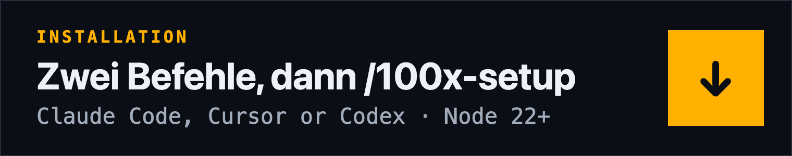
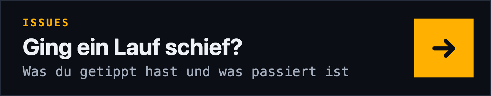
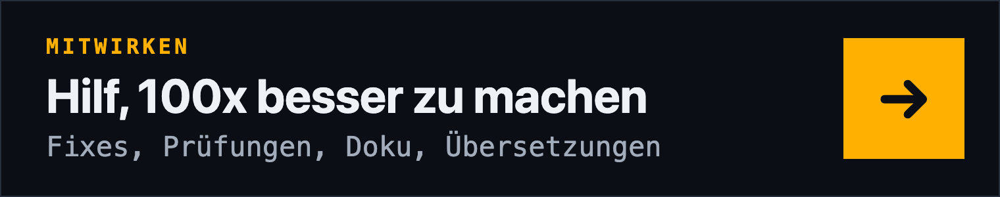

<div align="center">

<picture>
  <source media="(prefers-color-scheme: dark)" srcset="../docs/img/brand/mask-dark.png">
  
</picture>

# 100× ENGINEER SKILL

### SCHLUSS MIT AGENTIC CODING, DAS NUR „FAST FUNKTIONIERT“

[](https://github.com/DeadInternetStudios/100x-engineer-skill/actions/workflows/ci.yml)
[](https://github.com/DeadInternetStudios/100x-engineer-skill/stargazers)
[](https://github.com/DeadInternetStudios/100x-engineer-skill/releases)
[](../LICENSE)


<sub><a href="../README.md">English</a> · <a href="README.es.md">Español</a> · <a href="README.zh.md">中文</a> · <a href="README.pt.md">Português</a> · <a href="README.ru.md">Русский</a> · <a href="README.ja.md">日本語</a> · <a href="README.fr.md">Français</a> · <b>Deutsch</b> · <a href="README.ar.md">العربية</a> · <a href="README.hi.md">हिन्दी</a> · <a href="README.ko.md">한국어</a> · <a href="README.id.md">Bahasa Indonesia</a> · <a href="README.tr.md">Türkçe</a> · <a href="README.vi.md">Tiếng Việt</a> · <a href="README.bn.md">বাংলা</a> · <a href="README.it.md">Italiano</a> · <a href="README.pl.md">Polski</a> · <a href="README.th.md">ไทย</a> · <a href="README.uk.md">Українська</a> · <a href="README.nl.md">Nederlands</a></sub>

</div>

> **100x engineer**<br>
> /ˈwən ˈhən-drəd eks ˌen-jə-ˈnir/<br>
> *Substantiv*
>
> Ein Softwareentwickler, dem nachgesagt wird, so viel zu schaffen wie hundert gewöhnliche Entwickler, ohne die Meetings, die Rückfragen und die fehlschlagenden Tests.

Dein Agent sagt, er ist fertig. Du machst es auf, und es funktioniert *so halbwegs*. Es sieht immer gut aus, ist aber nie ganz bereit zum Ausliefern.

**100x sorgt dafür, dass dein Coding-Agent auch die letzten 10 % der Entwicklung schafft.**

100x ist ein Open-Source-Skill für Claude Code, Cursor und Codex. Gib ihm eine Aufgabe, etwa ein neues Feature für deine App oder eine kleine App von Grund auf. Er plant die Arbeit, baut sie, poliert sie und testet den Teil, auf den es am meisten ankommt. Ein zweites KI-Modell prüft das Ergebnis. Du bekommst einen Bericht mit Screenshots, Testergebnissen und allem, was noch offen ist.

<p align="center">
  <a href="#installation"></a>
</p>

<!-- Benchmark headline goes here: one line and one picture, the same agent with and without 100x, with a link to the method. -->

## Warum Agenten bei „funktioniert fast“ stehen bleiben

Drei Dinge gehen schief, und 100x hat für jedes eine Antwort. Alle Beispiele unten nutzen dieselbe Anfrage:

> Ich möchte in meiner Aktienrecherche-App jede beliebige Aktie mit dem S&P 500 vergleichen können

### 1. Niemand hat aufgeschrieben, was „funktioniert“ eigentlich heißt

Die Anfrage ist eine Zeile. Bevor 100x irgendetwas baut, schreibt es den Prompt, den du geschrieben hättest, wenn du eine Stunde übrig gehabt hättest. Er legt das Ziel fest, die Regeln, den riskantesten Teil und wie jede Anforderung geprüft wird. Hier erkennt 100x die Falle früh: Ein Aktiensplit sieht wie ein Verlust aus, wenn das Diagramm ihn nicht herausrechnet.

<p align="center">
  
</p>

<p align="center"><a href="../docs/examples/stock-comparison-prompt.md">Den ganzen Prompt lesen</a></p>

### 2. Der Agent prüft seine eigene Arbeit

Ein Modell, das seine eigene Arbeit prüft, übersieht seine eigenen Fehler. Bei 100x prüft ein zweites Modell den Code und die Oberflächen, in mehreren Runden. Der Builder behebt jeden Befund oder schreibt auf, warum er anderer Meinung ist. Hier hat der Prompt den Fall einer frisch an die Börse gegangenen Aktie genannt und den Prüfer angewiesen, genau dort nachzuhaken, aber die Tests des Builders nutzten nur ältere Aktien. Der Prüfer nahm eine Aktie, die dieses Jahr an die Börse kam, und stellte fest, dass die Indexlinie fünf Monate zu früh begann.

<p align="center">
  
</p>

Dieses Beispiel ist illustriert. Ein echtes: Diese README ist durch 100x gegangen, bevor du sie liest. Ihr Prüfer hat in der ersten Runde 9 Probleme gemeldet, von 20 toten Sprachlinks bis zu Beschriftungen, die für ein Handy zu klein waren. 7 wurden behoben, 2 warteten auf den öffentlichen Start. [Lies, was er gefunden hat](../docs/examples/readme-review.md).

### 3. Die Zusammenfassung kommt aus dem Gedächtnis

Wenn ein Agent „fertig“ sagt, berichtet er, woran er sich erinnert. 100x speichert die Belege unterwegs: Screenshots, Testausgaben, die Befunde des Prüfers. Am Ende schreibt Code die Zusammenfassung aus diesen Dateien, und `100x finish` weigert sich, sie zu schreiben, solange eine Anforderung keinen Beleg hat oder eine Prüfung fehlt. Das ist die Nachricht am Ende des Laufs mit dem Aktiendiagramm. Die Research-App ist erfunden, deshalb ist der Lauf illustriert.

<p align="center">
  
</p>

<details>
<summary>Dieselbe Nachricht als reiner Text</summary>

```text
Compare with the S&P 500: A chart in a research app that shows how any stock has moved against the S&P 500 since the first day both have prices. Verdict: ready to ship. The split math matches a hand count and both lines start on the same day. Dividends are not counted yet.
The moment: Type a ticker and both lines start at 0% on the same day, so the gap is the whole story
Run: npm run dev, then open http://localhost:5173/compare
Try first: 1) Type a ticker you hold and read the gap to the index 2) Pick a stock that split two for one and check the split day shows no drop 3) Pick a stock listed this year and see where both lines start
Must not break: numbers passed (Percent change across a two-for-one split matches a hand count on 40 split cases, 0 failing)
Review (claude-opus-5-5): 9 flagged, 7 fixed, 1 rejected, 1 deferred
Judge rounds: 5 of 5 done, on the code and how it behaves, the UI and UX and whether it is ready to ship, and the last word was ready to ship
Screen sizes: 0 broken, 2 weak, 15 sizes and 148 elements checked
Asks: 9 of 9 closed
Report: file:///Users/you/projects/research-app/.100x/REPORT.html
Next likely asks: Count dividends in the comparison; Show the gap for several stocks in one table
```

</details>

- **The moment:** das eine, was dich überzeugen soll
- **Must not break:** der harte Test und ob er bestanden wurde
- **Review:** was das zweite Modell gemeldet hat und was der Builder damit gemacht hat
- **Asks:** die Anforderungen aus dem Prompt, jede erst mit Beleg abgeschlossen
- **Next likely asks:** was du wahrscheinlich als Nächstes willst, schon gebaut oder schon notiert

## Eine Nachricht schicken und gehen

Dieselbe Anfrage als Zeitleiste. Von Hand kommst du immer wieder zurück, um Fragen zu beantworten und Fehler abzufangen. Mit 100x schickst du eine Nachricht und liest den Bericht, wenn du zurück bist. Blau bist du, Bernstein ist das zweite Modell. Die Zeiten haben wir erfunden.

<p align="center">
  
</p>

<details>
<summary>Dasselbe bei einer kleinen App von Grund auf</summary>

<p align="center">
  
</p>

Der Prompt der Budget-App, geschrieben aus vier Wörtern: [make me a budget app](../docs/examples/budget-app-prompt.md).

</details>

<details>
<summary>Alle acht Schritte eines Laufs</summary>

| Schritt | Was passiert |
|---|---|
| 1. Plan | Dein Agent schreibt einen ausführlichen Prompt. Darin steht, was gebaut wird und wie jede Anforderung geprüft wird. |
| 2. Kern | Er probiert zuerst den riskantesten Teil, solange noch Zeit ist, den Plan zu ändern. |
| 3. Bau | Er baut die erste Version und die Extras, nach denen du wahrscheinlich als Nächstes fragst. |
| 4. Feinschliff | Er arbeitet an Layout und Details. Ein zweites Modell sieht sich nach jedem Durchgang Screenshots an und zeigt, was schwach ist. |
| 5. Test | Der Agent testet das eine, das die Arbeit ruinieren würde, wenn es kaputtginge, etwa ein Diagramm, das einen Split falsch darstellt. Zuerst zeigt er, dass der Test einen Fehler überhaupt erkennen kann. |
| 6. Prüfung | Das zweite Modell prüft Code und Oberflächen. Der Builder behebt jedes Problem oder schreibt auf, warum es warten kann oder warum er anderer Meinung ist. |
| 7. Abschluss | Der Befehl `100x finish` prüft die gespeicherten Belege, bevor er den Bericht schreibt. |
| 8. Bericht | Du siehst das Ergebnis, kannst es selbst ausprobieren und liest, was der Prüfer gefunden hat. |

Wenn du weg bist, schreibt der Agent jede Entscheidung auf, die er trifft, und arbeitet weiter. [Den ganzen Ablauf lesen](../docs/pipeline.md).

</details>

## Was du bekommst

<div align="center">


<sub>Die Berichtsseite, erstellt aus drei erfundenen Läufen. Ein echter Lauf setzt seine eigenen Screenshots auf jede Karte.</sub>

</div>

- **Das Feature oder die App** und wie du es selbst ausprobierst
- **Screenshots in vielen Bildschirmgrößen**, geprüft auf überlaufenden Text, winzige Buttons, unscharfe Bilder und Browserfehler
- **Eine Berichtsseite** (`.100x/REPORT.html`) und eine Galerie aller fertigen Läufe in `~/.100x`
- **Ein Entscheidungsprotokoll**: jede Entscheidung, die 100x getroffen hat, während du weg warst, und warum
- **Die Abschlussnachricht** von oben

Jeder Lauf bekommt ein Urteil: **Bereit zum Ausliefern**, **In Ordnung** oder **Braucht Nacharbeit**. Wenn etwas ein Urteil blockiert, steht auf der Karte, was es ist: in Rot, wenn 100x ein Problem gefunden hat, und in Bernstein, wenn eine Prüfung fehlt.

---

<div align="center">

## Echte Produkte, gebaut mit 100x

<table align="left" width="48%"><tr><td>
<a href="https://dollarflow.com/"></a><br>
<a href="https://dollarflow.com/"><b>DollarFlow</b></a><br>
Ein Aktienscreener, gebaut<br>
mit Hilfe von 100x
</td></tr></table>
<table align="left" width="48%"><tr><td>
<a href="https://springtails.wiki/"></a><br>
<a href="https://springtails.wiki/"><b>Springtails Wiki</b></a><br>
Ein Wiki über Springschwänze,<br>
komplett mit 100x gebaut
</td></tr></table>
<br clear="all">

<table align="left" width="48%"><tr><td>
<a href="https://bubblewrapapp.com/"></a><br>
<a href="https://bubblewrapapp.com/"><b>BubbleWrap</b></a><br>
Eine Pixel-Art-Musik-App,<br>
komplett mit 100x gebaut
</td></tr></table>
<table align="left" width="48%"><tr><td>
<a href="https://goldtraderdesk.com/"></a><br>
<a href="https://goldtraderdesk.com/"><b>Gold Trader Desk</b></a><br>
Eine App für den Goldhandel,<br>
komplett mit 100x gebaut
</td></tr></table>
<br clear="all">

<table align="left" width="48%"><tr><td>
<br>
<b>Phantom</b><br>
Eine Mac-App in Swift, mit der<br>
Forensiker Handschriften<br>
analysieren, gebaut mit Hilfe<br>
von 100x
</td></tr></table>
<table align="left" width="48%"><tr><td>
<br>
<b>OptionsFlow</b><br>
Ein Echtzeit-Tool für Optionsketten<br>
in React, genutzt von Quant-Firmen,<br>
gebaut mit Hilfe von 100x
</td></tr></table>
<br clear="all">

<table align="left" width="48%"><tr><td>
<br>
<b>Skynet</b><br>
Ein Projektmanagement-Tool auf Basis<br>
von Blueprint und Encore, gebaut<br>
mit Hilfe von 100x
</td></tr></table>
<table align="left" width="48%"><tr><td>
<br>
<b>Boneworks</b><br>
Eine Text-zu-3D-Pipeline, die Figuren<br>
modelliert, mit Haut versieht, riggt und<br>
animiert, gebaut mit Hilfe von 100x
</td></tr></table>
<br clear="all">

<p align="center">
  <a href="mailto:theory@deadinternet.com"></a>
</p>

</div>

---

## Was es kostet

100x tauscht Zeit und Nutzung gegen Belege.

- **Ein normaler Lauf dauert Stunden.** Jeder Feinschliff-Durchgang und jede Prüfrunde ist ein weiteres Modell bei der Arbeit, also verbraucht ein Lauf einen guten Teil deines Abos.
- **Für einen ersten Eindruck** braucht `/100x-mockup` etwa 15 Minuten. Es lässt die Prüfung aus und sagt das auch.
- **Mit einem kleineren Abo** macht `100x config preset lite --global` einen Feinschliff-Durchgang und zwei Prüfrunden statt drei und fünf. Die Belegprüfungen bleiben.
- **Nicht für Kleinigkeiten.** Für einen Einzeiler-Fix oder eine Frage wendest du dich direkt an deinen Agenten. 100x ist für eine Aufgabe, die einen Plan, einen Test und eine Prüfung verdient.

## Installation

Du brauchst Claude Code, Cursor oder Codex und Node.js 22 oder neuer.

**1. Das Tool und die Skills installieren**

```bash
npm install -g github:DeadInternetStudios/100x-engineer-skill
100x install
```

**2. Einrichten, in deinem Agenten**

```text
/100x-setup
```

Es fragt, welches Abo du hast (Claude Pro, Max oder Ultra, oder OpenAI Go, Plus oder Pro), und legt fest, welches Modell baut und welches urteilt. Bei einem kleinen Abo sag das, dann schaltet es das Lite-Preset ein. Mehr: [docs/plans-and-setup.md](../docs/plans-and-setup.md).

**3. Gib ihm eine Aufgabe**

```text
/100x Ich möchte in meiner Aktienrecherche-App jede beliebige Aktie mit dem S&P 500 vergleichen können
```

Claude Code und Cursor starten einen Skill mit `/`. Codex nutzt `$`, wie in `$100x-setup` und `$100x`. Nimm `/100x-overnight`, wenn du über Nacht weg bist, oder `/100x-mockup` für einen ersten Eindruck.

### Andere Installationswege

**Aus einem Klon** (so testen wir dieses Repo)

```bash
./scripts/install.sh --dry-run   # preview
./scripts/install.sh
```

Du nutzt schon skills.sh? `npx skills add DeadInternetStudios/100x-engineer-skill --skill '*' -g` fügt die Skills hinzu. Das Kommandozeilen-Tool aus Schritt 1 brauchst du trotzdem.

100x besteht aus zwei Teilen: Skills, die dein Agent liest, und dem Kommandozeilen-Tool `100x`. Das Tool übernimmt, was ein Modell allein nicht zuverlässig kann. Es behält die Uhr im Blick, macht Screenshots, startet den Prüfer, prüft die Belege und schreibt den Bericht. Screenshots laufen über Playwright. Fehlt es, installiert `100x browsers` es.

Der Installer legt nur Verknüpfungen (symbolische Links), ein paar kleine Dateien und deren Ordner an. Er überschreibt nie eine echte Datei. `100x doctor` prüft das Ergebnis, und `./scripts/install.sh --uninstall` entfernt alles wieder. Jede Datei, die er anfasst: [docs/cli.md](../docs/cli.md).

## Modi

100x ist eine Sammlung von Skills, die Modi heißen. Tipp den Namen eines Modus, um ihn zu nutzen. Wörter in deiner Nachricht wählen nie einen Modus, also baut `/100x an overnight oats app` eine App für Overnight Oats.

| Tipp das | Wofür | Was es macht |
|---|---|---|
| `/100x` | Bauen | Der normale Lauf: bauen, Feinschliff, testen, Prüfung durch ein zweites Modell. |
| `/100x-mockup` | Bauen | Ein schneller erster Eindruck in etwa 15 Minuten. Nur der entscheidende Moment funktioniert. Keine Prüfung, und das steht auch dran (UNREVIEWED). |
| `/100x-overnight` | Bauen | Für wenn du gehst. Bearbeitet eine Idee oder mehrere über eine feste Zeit und stupst den Agenten an, wenn er hängt. |
| `/100x-wrapup` | Bauen | Für Deadlines. Bringt den Hauptpfad zum Laufen und versteckt den Rest. |
| `/100x-judge` | Prüfen | Prüft etwas, das schon gebaut ist. Baut nichts Neues. |
| `/100x-grind` | Prüfen | Prüfen, beheben, wieder prüfen, bis ein Prüfer sagt, dass es bereit zum Ausliefern ist. Hört auf, wenn drei Prüfungen in Folge nichts Besseres finden, nach 15 Runden oder wenn die Zeit abläuft. |
| `/100x-status` | Ein Lauf | Wo der Lauf steht, in höchstens sechs Zeilen. |
| `/100x-continue` | Ein Lauf | Setzt einen Lauf fort, der angehalten hat, zum Beispiel an einem Nutzungslimit. |
| `/100x-report` | Ein Lauf | Zeigt alles, was fertig ist, das Beste zuerst. Baut nichts. |
| `/100x-adhd` | Planen | Ein kurzes Hin und Her, eine Frage nach der anderen, das aus einer vagen Idee einen Plan macht. Gebaut wird erst, wenn du „los“ sagst. |
| `/100x-setup` | Einrichtung | Stellt eine Frage zu deinem Abo und legt dann fest, welches Modell welche Aufgabe übernimmt. |
| `/100x-bakeoff` | 100x testen | Testet 100x selbst: Derselbe Agent baut dieselben Ideen mit und ohne 100x, und ein blinder Prüfer vergleicht sie. Baut nichts. |

### Zahlenangaben

Füg sie deiner Nachricht hinzu, um einen Lauf zu ändern. Sie funktionieren mit `/100x` und `/100x-overnight`. Andere Wörter wie „schnell“ oder „zügig“ bewirken nichts.

| Du schreibst | Was passiert |
|---|---|
| `3 versions` | Baut 3 Versionen der Idee und stellt die beste fertig. Jede Zahl geht. |
| `for 10 hours`, `for 2 days`, `until 6am` | Nutzt die ganze Zeit. Der Lauf endet nicht früher. |
| `5 rounds of judging` | Fährt so viele Prüfrunden. |
| `max 5 subagents` | Höchstens 5 Subagenten gleichzeitig. Standard ist 1. |

```text
/100x-overnight 3 versions of a farming game, for 8 hours, max 3 subagents
```

Jeder Lauf beginnt mit einer Liste der Angaben, die er verstanden hat, damit du ein Missverständnis sofort siehst.

Gib ihm eine Zeitvorgabe, und er arbeitet in Runden weiter, bis die Zeit um ist. Jede Runde betrachtet das Projekt auf eine neue Art, behält die Änderung, wenn sie geholfen hat, und nimmt sie zurück, wenn nicht. Ein frisches zweites Modell prüft jede Runde.

<p align="center">
  
</p>

## Häufige Fragen

**Warum ein zweites Modell?** Verschiedene Modelle haben verschiedene blinde Flecken. Ist keins verfügbar, wird der Lauf trotzdem fertig und meldet UNREVIEWED. Mit nur einem Abo kann ein kleineres Modell desselben Anbieters urteilen, das bringt aber weniger als ein Modell eines anderen Anbieters.

**Stellt es mein Projekt online?** Nein. Es erstellt nur dann eine Vorschau, wenn das Projekt schon eine hat. Live geht es nur, wenn du es ausdrücklich sagst.

**Was, wenn ich mitten im Lauf an ein Nutzungslimit stoße?** 100x speichert den Fortschritt in `.100x/STATE.md`. Wenn das Limit zurückgesetzt ist, tipp `/100x-continue` im selben Ordner.

**Ändert es mein Modell oder meine Einstellungen?** Nein. Es wechselt nie dein Modell, deine Effort-Stufe oder deine Anmeldung. `/100x-setup` schreibt nur die eigenen Einstellungen von 100x.

**Wo liegen die Läufe?** In einem versteckten Ordner `.100x/` in jedem Projekt (Git ignoriert ihn) und in einer Galerie der fertigen Läufe in `~/.100x`.

<p align="center">
  <a href="https://github.com/DeadInternetStudios/100x-engineer-skill/issues/new"></a>
</p>

## Doku

| Seite | Was drinsteht |
|---|---|
| [Installation im Detail](../docs/install.md) | alle Installationsoptionen und jede Datei, die der Installer anfasst |
| [100x benutzen](../docs/using.md) | eine Nacht weg, die Berichtsseite, der Helfer-Skill |
| [Pipeline und Abschlussnachricht](../docs/pipeline.md) | jeder Schritt im Detail und was `100x finish` prüft |
| [Setup und Abos](../docs/plans-and-setup.md) | empfohlenes Setup für Claude Code, das Lite-Preset, Setups für jedes Abo |
| [Einstellungen](../docs/settings.md) | jeder Konfigurationsschlüssel |
| [CLI und Dateistruktur](../docs/cli.md) | jeder `100x`-Befehl und wo die Dateien liegen |
| [Die Skills von innen, Verifikation](../docs/contributing.md) | wie das Repo aufgebaut ist und wie man es testet |
| [Designnotizen](../docs/design.md) | warum 100x so funktioniert |

## Mitwirken

Bug-Reports, Fixes und Ideen sind willkommen. Kleine Fixes können direkt als Pull Request kommen. Für alles Größere eröffne zuerst ein Issue, damit wir uns abstimmen können. [So kannst du mitwirken](../CONTRIBUTING.md).

<p align="center">
  <a href="../CONTRIBUTING.md"></a>
</p>

## Danksagung

100x baut auf den Arbeitsprinzipien von [pstack](https://github.com/cursor/plugins/tree/main/pstack) von Lauren Tan (MIT) auf, überarbeitet für Prototypen und für ein einziges Gespräch mit deinem Agenten. Was anders ist:

- Jeder Lauf endet mit einer Berichtsseite.
- `100x finish` lehnt Behauptungen ab, die es nicht prüfen kann.
- Ein zweites Modell prüft die Arbeit in Runden.

Siehe [NOTICE.md](../NOTICE.md) und [UPSTREAM.md](../UPSTREAM.md).

MIT. Siehe [LICENSE](../LICENSE).

---

<sub>Grafik der Maske: <a target="_blank" href="https://www.vexels.com/png-svg/preview/229802/guy-fawkes-mask-bonfire-night-stroke">www.vexels.com</a></sub>
