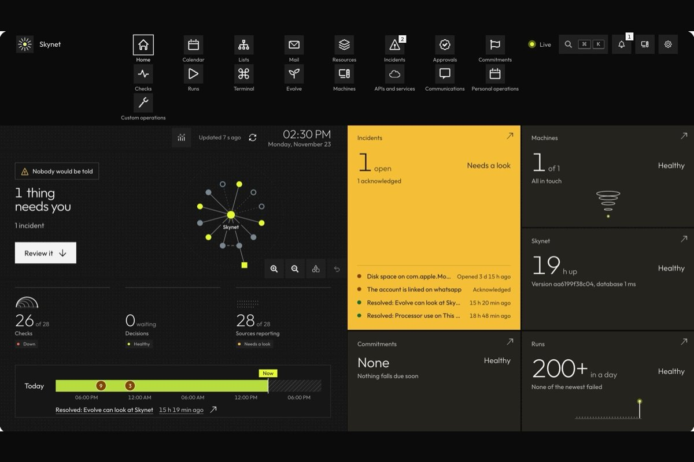
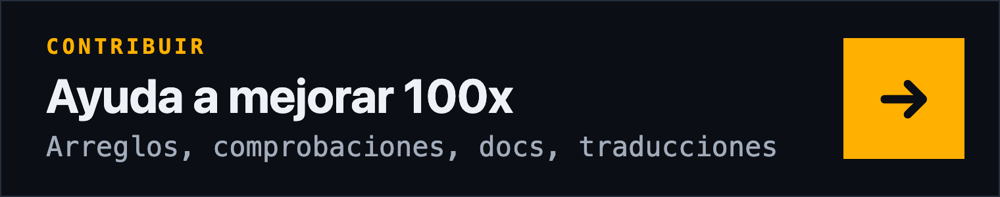

<div align="center">

<picture>
  <source media="(prefers-color-scheme: dark)" srcset="../docs/img/brand/mask-dark.png">
  
</picture>

# 100× ENGINEER SKILL

### Se acabó el código con agentes que "casi funciona"

[](https://github.com/DeadInternetStudios/100x-engineer-skill/actions/workflows/ci.yml)
[](https://github.com/DeadInternetStudios/100x-engineer-skill/releases)
[](https://nodejs.org/)
[](../LICENSE)

[](https://github.com/DeadInternetStudios/100x-engineer-skill/stargazers)

*100x es una skill inspirada en pstack que convierte prompts en software listo para producción, probado y revisado.<br>Yo la uso para llevar más de 1.000 PRs a producción cada mes, con una tasa de rollback inferior al 2%.*

<sub><a href="../README.md">English</a> · <b>Español</b> · <a href="README.zh.md">中文</a> · <a href="README.pt.md">Português</a> · <a href="README.ru.md">Русский</a> · <a href="README.ja.md">日本語</a> · <a href="README.fr.md">Français</a> · <a href="README.de.md">Deutsch</a> · <a href="README.ar.md">العربية</a> · <a href="README.hi.md">हिन्दी</a> · <a href="README.ko.md">한국어</a> · <a href="README.id.md">Bahasa Indonesia</a> · <a href="README.tr.md">Türkçe</a> · <a href="README.vi.md">Tiếng Việt</a> · <a href="README.bn.md">বাংলা</a> · <a href="README.it.md">Italiano</a> · <a href="README.pl.md">Polski</a> · <a href="README.th.md">ไทย</a> · <a href="README.uk.md">Українська</a> · <a href="README.nl.md">Nederlands</a></sub>

</div>

> **100x engineer**<br>
> /ˈwən ˈhən-drəd eks ˌen-jə-ˈnir/<br>
> *sustantivo*
>
> Ingeniero de software al que se le atribuye el rendimiento de cien ingenieros normales, sin las reuniones, las preguntas ni los tests que fallan.

Tu agente dice que ha terminado. Lo abres y *más o menos* funciona. Siempre parece que está bien, pero nunca está del todo listo para publicar.

**100x hace que tu agente de programación resuelva el último 10% del desarrollo.**

<p align="center">
  
</p>

<p align="center"><b>136B tokens en 30 días · 1 ingeniero · Proyectos serios · Más de 1.000 PRs · $250k de ahorro en caché</b></p>

Es una skill de código abierto para Claude Code, Cursor y Codex. Dale un trabajo, como añadir una función a tu app o crear una app pequeña desde cero. Planifica el trabajo, lo construye, lo pule y prueba la parte que más importa. Un segundo modelo de IA lo revisa. Recibes un informe con capturas de pantalla, resultados de los tests y todo lo que siga pendiente.

<p align="center">
  <a href="#instalación"></a>
</p>

<!-- Benchmark headline goes here: one line and one picture, the same agent with and without 100x, with a link to the method. -->

## Por qué los agentes se quedan en "casi funciona"

Fallan tres cosas, y 100x tiene una respuesta para cada una. Todos los ejemplos de abajo usan la misma petición:

> Déjame comparar cualquier acción con el S&P 500 en mi app de análisis bursátil

### 1. Nadie dejó por escrito qué significa "funciona"

La petición es una línea. Antes de construir nada, 100x escribe el prompt que tú habrías escrito con una hora libre. Fija el objetivo, las reglas, la parte más arriesgada y cómo comprobar cada requisito. Aquí detecta pronto la trampa: un split de acciones parece una pérdida si el gráfico no lo ajusta.

<p align="center">
  
</p>

<p align="center"><a href="../docs/examples/stock-comparison-prompt.md">Lee el prompt completo</a></p>

### 2. El agente revisa su propio trabajo

Un modelo que revisa su propio trabajo no ve sus propios errores. 100x hace que un segundo modelo revise el código y las pantallas, por rondas. El que construye corrige cada hallazgo o deja por escrito por qué no está de acuerdo. Aquí el prompt mencionaba el caso de una acción recién salida a bolsa y le pedía al revisor que insistiera en él, pero los tests del constructor solo usaban acciones antiguas. El revisor probó una acción que salió a bolsa este año y vio que la línea del índice empezaba cinco meses antes.

<p align="center">
  
</p>

Ese ejemplo es ilustrado. Uno real: este README pasó por 100x antes de que lo leyeras. Su revisor señaló 9 problemas en la primera ronda, desde 20 enlaces de idioma rotos hasta etiquetas demasiado pequeñas para un móvil. Se corrigieron 7 y 2 se dejaron para el lanzamiento público. [Lee lo que encontró](../docs/examples/readme-review.md).

### 3. El resumen sale de memoria

Cuando un agente dice "listo", cuenta lo que recuerda. 100x guarda las pruebas sobre la marcha: capturas, salida de los tests, los hallazgos del revisor. Al final, el código escribe el resumen a partir de esos archivos, y `100x finish` se niega a escribirlo si a algún requisito le faltan pruebas o falta alguna comprobación. Este es el mensaje del final de la ejecución del gráfico de acciones. La app de análisis es inventada, así que la ejecución es ilustrada.

<p align="center">
  
</p>

<details>
<summary>El mismo mensaje como texto plano</summary>

```text
Compare with the S&P 500: A chart in a research app that shows how any stock has moved against the S&P 500 since the first day both have prices. Verdict: ready to ship. The split math matches a hand count and both lines start on the same day. Dividends are not counted yet.
The moment: Type a ticker and both lines start at 0% on the same day, so the gap is the whole story
Run: npm run dev, then open http://localhost:5173/compare
Try first: 1) Type a ticker you hold and read the gap to the index 2) Pick a stock that split two for one and check the split day shows no drop 3) Pick a stock listed this year and see where both lines start
Must not break: numbers passed (Percent change across a two-for-one split matches a hand count on 40 split cases, 0 failing)
Review (claude-opus-5-5): 9 flagged, 7 fixed, 1 rejected, 1 deferred
Judge rounds: 5 of 5 done, on the code and how it behaves, the UI and UX and whether it is ready to ship, and the last word was ready to ship
Screen sizes: 0 broken, 2 weak, 15 sizes and 148 elements checked
Asks: 9 of 9 closed
Report: file:///Users/you/projects/research-app/.100x/REPORT.html
Next likely asks: Count dividends in the comparison; Show the gap for several stocks in one table
```

</details>

- **The moment:** lo único que debería hacer que lo quieras
- **Must not break:** el test difícil, y si pasó
- **Review:** lo que señaló el segundo modelo y lo que hizo con ello el constructor
- **Asks:** los requisitos del prompt, cada uno cerrado solo con pruebas
- **Next likely asks:** lo que probablemente pedirías después, ya construido o apuntado

## Envía un mensaje y desentiéndete

La misma petición como línea de tiempo. A mano, tienes que volver una y otra vez para responder preguntas y cazar errores. Con 100x, envías un mensaje y lees el informe cuando vuelves. El azul eres tú y el ámbar es el segundo modelo. Los tiempos son inventados.

<p align="center">
  
</p>

<details>
<summary>Lo mismo con una app pequeña creada desde cero</summary>

<p align="center">
  
</p>

El prompt de la app de presupuestos, escrito a partir de cuatro palabras: [make me a budget app](../docs/examples/budget-app-prompt.md).

</details>

<details>
<summary>Los ocho pasos de una ejecución</summary>

| Paso | Qué pasa |
|---|---|
| 1. Plan | Tu agente escribe un prompt detallado. Explica qué construir y cómo comprobar cada petición. |
| 2. Núcleo | Prueba primero la parte más arriesgada, mientras aún hay tiempo para cambiar el plan. |
| 3. Construcción | Construye la primera versión y los extras que probablemente pedirás después. |
| 4. Pulido | Trabaja el diseño y los detalles. Un segundo modelo mira capturas tras cada pasada y señala lo que flojea. |
| 5. Test | El agente prueba lo único que arruinaría el trabajo si fallara, como un gráfico que calcula mal un split. Primero demuestra que el test puede detectar un error. |
| 6. Revisión | El segundo modelo revisa el código y las pantallas. El constructor corrige cada problema o deja por escrito por qué puede esperar o por qué no está de acuerdo. |
| 7. Cierre | El comando `100x finish` comprueba las pruebas guardadas antes de escribir el informe. |
| 8. Informe | Puedes ver el resultado, probarlo tú mismo y leer lo que encontró el revisor. |

Si no estás, el agente anota cada decisión que toma y sigue trabajando. [Lee el flujo de trabajo completo](../docs/pipeline.md).

</details>

## Qué obtienes

<div align="center">


<sub>La página del informe, generada a partir de tres ejecuciones inventadas. Una ejecución real pone sus propias capturas en cada tarjeta.</sub>

</div>

- **La función o la app**, y cómo probarla tú mismo
- **Capturas en muchos tamaños de pantalla**, revisadas en busca de texto desbordado, botones diminutos, imágenes borrosas y errores del navegador
- **Una página de informe** (`.100x/REPORT.html`) y una galería con todas las ejecuciones terminadas en `~/.100x`
- **Un registro de decisiones**: cada elección que hizo 100x mientras no estabas, y por qué
- **El mensaje final** que se muestra arriba

Cada ejecución recibe un veredicto: **Listo para publicar**, **Bien** o **Le falta trabajo**. Cuando algo bloquea un veredicto, la tarjeta dice qué, en rojo si 100x encontró un problema y en ámbar si falta una comprobación.

---

<div align="center">

## Productos reales hechos con 100x

<table align="left"><tr><td>
<a href="https://dollarflow.com/"></a><br>
<a href="https://dollarflow.com/"><b>DollarFlow</b></a><br>
Un buscador de acciones, hecho<br>
con ayuda de 100x
</td></tr></table>
<table align="left"><tr><td>
<a href="https://springtails.wiki/"></a><br>
<a href="https://springtails.wiki/"><b>Springtails Wiki</b></a><br>
Una wiki de colémbolos, hecha<br>
por completo con 100x
</td></tr></table>
<br clear="all">

<table align="left"><tr><td>
<a href="https://bubblewrapapp.com/"></a><br>
<a href="https://bubblewrapapp.com/"><b>BubbleWrap</b></a><br>
Una app de música en pixel art,<br>
hecha por completo con 100x
</td></tr></table>
<table align="left"><tr><td>
<a href="https://goldtraderdesk.com/"></a><br>
<a href="https://goldtraderdesk.com/"><b>Gold Trader Desk</b></a><br>
Una app para operar con oro, hecha<br>
por completo con 100x
</td></tr></table>
<br clear="all">

<table align="left"><tr><td>
<br>
<b>Phantom</b><br>
Una app para Mac en Swift que usan<br>
peritos forenses para analizar<br>
escritura a mano, hecha con ayuda<br>
de 100x
</td></tr></table>
<table align="left"><tr><td>
<br>
<b>OptionsFlow</b><br>
Una herramienta de cadena de opciones<br>
en tiempo real en React que usan firmas<br>
cuantitativas, hecha con ayuda de 100x
</td></tr></table>
<br clear="all">

<table align="left"><tr><td>
<br>
<b>Skynet</b><br>
Una herramienta de gestión de proyectos<br>
sobre Blueprint y Encore, hecha con<br>
ayuda de 100x
</td></tr></table>
<table align="left"><tr><td>
<br>
<b>Boneworks</b><br>
Un pipeline de texto a 3D que modela,<br>
pone piel, rigea y anima personajes,<br>
hecho con ayuda de 100x
</td></tr></table>
<br clear="all">

<p align="center">
  <a href="mailto:theory@deadinternet.com"></a>
</p>

</div>

---

## Lo que cuesta

100x cambia tiempo y uso por pruebas.

- **Una ejecución normal lleva horas.** Cada pasada de pulido y cada ronda de revisión es otro modelo trabajando, así que una ejecución consume buena parte de tu plan.
- **Para un primer vistazo**, `/100x-mockup` tarda unos 15 minutos. Se salta la revisión y lo dice.
- **Con un plan más pequeño**, `100x config preset lite --global` hace una pasada de pulido y dos rondas de revisión en lugar de tres y cinco. Las comprobaciones de pruebas se mantienen.
- **No es para cosas pequeñas.** Para un arreglo de una línea o una pregunta, pídeselo directamente a tu agente. 100x es para un trabajo que merece un plan, un test y una revisión.

## Instalación

Necesitas Claude Code, Cursor o Codex, y Node.js 22 o posterior.

**1. Instala la herramienta y las skills**

Elige una:

**npm**

```bash
npm install -g github:DeadInternetStudios/100x-engineer-skill
100x install
```

**skills.sh**

```bash
npm install -g github:DeadInternetStudios/100x-engineer-skill
npx skills add DeadInternetStudios/100x-engineer-skill --skill '*' -g
100x install
```

La herramienta `skills` solo copia las skills, así que la herramienta `100x` sigue viniendo de npm. Después, `100x install` ve las copias y no las toca. Actualízalas con `npx skills update -g`.

**2. Configúralo, en tu agente**

```text
/100x-setup
```

Te pregunta qué plan tienes (Claude Pro, Max o Ultra, u OpenAI Go, Plus o Pro) y elige qué modelo construye y cuál juzga. Si tu plan es pequeño, díselo y activa el preset lite. Más: [docs/plans-and-setup.md](../docs/plans-and-setup.md).

**3. Dale un trabajo**

```text
/100x Déjame comparar cualquier acción con el S&P 500 en mi app de análisis bursátil
```

Claude Code y Cursor inician una skill con `/`. Codex usa `$`, como en `$100x-setup` y `$100x`. Usa `/100x-overnight` cuando te vayas por la noche, o `/100x-mockup` para un primer vistazo.

### Otras formas de instalarlo

**Desde un clon** (como probamos este repo)

```bash
./scripts/install.sh --dry-run   # preview
./scripts/install.sh
```

100x tiene dos partes: las skills que lee tu agente y la herramienta de línea de comandos `100x`. La herramienta hace lo que un modelo no puede hacer bien por sí solo. Lleva el reloj, hace capturas, ejecuta al juez, comprueba las pruebas y escribe el informe. Las capturas usan Playwright. Si falta, `100x browsers` lo instala.

El instalador solo crea accesos directos (enlaces simbólicos), unos pocos archivos pequeños y sus carpetas. Nunca sobrescribe un archivo real. `100x doctor` comprueba el resultado y `./scripts/install.sh --uninstall` lo elimina. Todos los archivos que toca: [docs/cli.md](../docs/cli.md).

## Modos

100x es un conjunto de skills, llamadas modos. Escribe el nombre de un modo para usarlo. Las palabras de tu mensaje nunca eligen un modo, así que `/100x an overnight oats app` construye una app de avena.

| Escribe esto | Para | Qué hace |
|---|---|---|
| `/100x` | Construir | La ejecución normal: construir, pulir, probar, revisión por un segundo modelo. |
| `/100x-mockup` | Construir | Un primer vistazo rápido en unos 15 minutos. Solo funciona el momento clave. Sin revisión, y lo dice (UNREVIEWED). |
| `/100x-overnight` | Construir | Para cuando te vas. Ejecuta una idea o varias durante un tiempo fijo, y le da un empujón al agente si se atasca. |
| `/100x-wrapup` | Construir | Para fechas límite. Hace que funcione el camino principal y oculta el resto. |
| `/100x-judge` | Revisar | Revisa algo ya construido. No construye nada nuevo. |
| `/100x-grind` | Revisar | Revisar, corregir y volver a revisar hasta que un juez diga que está listo para publicar. Para si tres revisiones seguidas no encuentran nada mejor, a las 15 rondas o cuando se acaba el tiempo. |
| `/100x-status` | Una ejecución | En qué punto está la ejecución, en seis líneas o menos. |
| `/100x-continue` | Una ejecución | Retoma una ejecución que se detuvo, por ejemplo por un límite de uso. |
| `/100x-report` | Una ejecución | Muestra todo lo terminado, lo mejor primero. No construye nada. |
| `/100x-adhd` | Planificar | Un ida y vuelta corto, una pregunta cada vez, que convierte una idea suelta en un plan. No se construye nada hasta que digas adelante. |
| `/100x-setup` | Configuración | Hace una pregunta sobre tu plan y luego decide qué modelo hace cada trabajo. |
| `/100x-bakeoff` | Probar 100x | Prueba el propio 100x: el mismo agente construye las mismas ideas con y sin él, y un juez a ciegas las compara. No construye nada. |

### Frases con números

Añádelas a tu mensaje para cambiar una ejecución. Funcionan con `/100x` y `/100x-overnight`. Otras palabras, como "fast" o "quick", no hacen nada.

| Escribes | Qué pasa |
|---|---|
| `3 versions` | Construye 3 versiones de la idea y termina la mejor. Vale cualquier número. |
| `for 10 hours`, `for 2 days`, `until 6am` | Usa todo ese tiempo. La ejecución no terminará antes. |
| `5 rounds of judging` | Hace ese número de rondas de revisión. |
| `max 5 subagents` | Como mucho 5 subagentes a la vez. Por defecto es 1. |

```text
/100x-overnight 3 versions of a farming game, for 8 hours, max 3 subagents
```

Cada ejecución empieza listando las frases que ha entendido, para que puedas ver si ha leído algo mal.

Dale un reloj y seguirá trabajando por rondas hasta que se acabe el tiempo. Cada ronda mira el proyecto de una forma nueva, conserva el cambio si ha servido y lo deshace si no. Un segundo modelo nuevo revisa cada ronda.

<p align="center">
  
</p>

## Preguntas frecuentes

**¿Por qué un segundo modelo?** Cada modelo tiene sus propios puntos ciegos. Si no hay ninguno disponible, la ejecución termina igualmente y dice UNREVIEWED. Con un único plan, puede juzgar un modelo más pequeño de la misma empresa, con menos beneficio que un modelo de otra empresa.

**¿Va a publicar mi proyecto en internet?** No. Solo crea una vista previa si el proyecto ya tiene una. Para publicarlo tienes que decirlo tú.

**¿Y si llego a un límite de uso a mitad de una ejecución?** 100x guarda el progreso en `.100x/STATE.md`. Cuando se reinicie el límite, escribe `/100x-continue` en la misma carpeta.

**¿Cambia mi modelo o mi configuración?** No. Nunca cambia tu modelo, tu nivel de esfuerzo ni tu inicio de sesión. `/100x-setup` solo escribe la configuración propia de 100x.

**¿Dónde se guardan las ejecuciones?** En una carpeta oculta `.100x/` en cada proyecto (git la ignora), y en una galería de ejecuciones terminadas en `~/.100x`.

<p align="center">
  <a href="https://github.com/DeadInternetStudios/100x-engineer-skill/issues/new"></a>
</p>

## Documentación

| Página | Qué contiene |
|---|---|
| [Instalación completa](../docs/install.md) | todas las opciones de instalación y todos los archivos que toca el instalador |
| [Usar 100x](../docs/using.md) | una noche fuera, la página del informe, la skill de ayuda |
| [Pipeline y mensaje final](../docs/pipeline.md) | cada paso en detalle, y qué comprueba `100x finish` |
| [Configuración y planes](../docs/plans-and-setup.md) | la configuración recomendada de Claude Code, el preset lite, configuraciones para cada plan |
| [Ajustes](../docs/settings.md) | todas las claves de configuración |
| [CLI y estructura de archivos](../docs/cli.md) | todos los comandos `100x` y dónde se guardan los archivos |
| [Dentro de las skills, verificación](../docs/contributing.md) | cómo está organizado el repo y cómo probarlo |
| [Notas de diseño](../docs/design.md) | por qué 100x funciona así |

## Contribuir

Los informes de errores, los arreglos y las ideas son bienvenidos. Los arreglos pequeños pueden ir directamente a una pull request. Para algo más grande, abre antes una issue para que lo acordemos. [Cómo contribuir](../CONTRIBUTING.md).

<p align="center">
  <a href="../CONTRIBUTING.md"></a>
</p>

## Créditos

100x se basa en los principios de trabajo de [pstack](https://github.com/cursor/plugins/tree/main/pstack) de Lauren Tan (MIT), adaptados a prototipos y a una sola conversación con tu agente. Qué cambia:

- Cada ejecución termina con una página de informe.
- `100x finish` rechaza las afirmaciones que no puede comprobar.
- Un segundo modelo revisa el trabajo por rondas.

Consulta [NOTICE.md](../NOTICE.md) y [UPSTREAM.md](../UPSTREAM.md).

MIT. Consulta [LICENSE](../LICENSE).

<p align="center">
  <a href="https://star-history.com/#DeadInternetStudios/100x-engineer-skill&Date">
    <picture>
      <source media="(prefers-color-scheme: dark)" srcset="https://api.star-history.com/svg?repos=deadinternetstudios/100x-engineer-skill&type=Date&theme=dark">
      
    </picture>
  </a>
</p>

---

<sub>Ilustración de la máscara: <a target="_blank" href="https://www.vexels.com/png-svg/preview/229802/guy-fawkes-mask-bonfire-night-stroke">www.vexels.com</a></sub>
