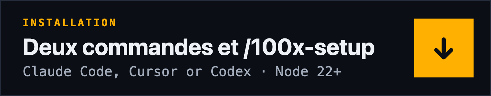
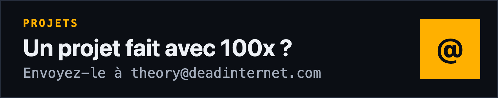
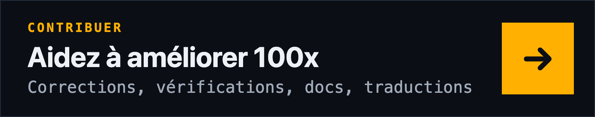

<div align="center">

<picture>
  <source media="(prefers-color-scheme: dark)" srcset="../docs/img/brand/mask-dark.png">
  
</picture>

# 100× ENGINEER SKILL

### Fini le code agentique qui « marche presque »

[](https://github.com/DeadInternetStudios/100x-engineer-skill/actions/workflows/ci.yml)
[](https://github.com/DeadInternetStudios/100x-engineer-skill/releases)
[](https://nodejs.org/)
[](../LICENSE)

[](https://github.com/DeadInternetStudios/100x-engineer-skill/stargazers)

*100x est un skill créé par un ancien ingénieur de Cursor qui transforme des prompts en code prêt pour la production.<br>Je m'en sers pour livrer plus de 1 000 PR en production chaque mois, avec un taux de rollback inférieur à 2 %.*

Les scores Terminal Bench 4.1 arrivent bientôt 😎

<sub><a href="../README.md">English</a> · <a href="README.es.md">Español</a> · <a href="README.zh.md">中文</a> · <a href="README.pt.md">Português</a> · <a href="README.ru.md">Русский</a> · <a href="README.ja.md">日本語</a> · <b>Français</b> · <a href="README.de.md">Deutsch</a> · <a href="README.ar.md">العربية</a> · <a href="README.hi.md">हिन्दी</a> · <a href="README.ko.md">한국어</a> · <a href="README.id.md">Bahasa Indonesia</a> · <a href="README.tr.md">Türkçe</a> · <a href="README.vi.md">Tiếng Việt</a> · <a href="README.bn.md">বাংলা</a> · <a href="README.it.md">Italiano</a> · <a href="README.pl.md">Polski</a> · <a href="README.th.md">ไทย</a> · <a href="README.uk.md">Українська</a> · <a href="README.nl.md">Nederlands</a></sub>

</div>

> **100x engineer**<br>
> /ˈwən ˈhən-drəd eks ˌen-jə-ˈnir/<br>
> *nom*
>
> Ingénieur logiciel réputé produire autant que cent ingénieurs ordinaires, sans les réunions, les questions ni les tests qui échouent.

Votre agent dit qu'il a terminé. Vous ouvrez le résultat et ça marche *à peu près*. Tout a l'air correct, mais ce n'est jamais vraiment prêt à livrer.

**100x fait résoudre à votre agent de code les derniers 10 % du développement.**

<p align="center">
  
</p>

<p align="center"><b>136B de tokens en 30 jours · 1 ingénieur · Des projets sérieux · Plus de 1 000 PR · $250k d'économies de cache</b></p>

C'est un skill open source pour Claude Code, Cursor et Codex. Donnez-lui une tâche, comme ajouter une fonctionnalité à votre app ou créer une petite app de zéro. Il planifie le travail, le réalise, le peaufine et teste la partie qui compte le plus. Un second modèle d'IA le relit. Vous recevez un rapport avec des captures d'écran, les résultats des tests et tout ce qui reste en suspens.

<p align="center">
  <a href="#installation"></a>
</p>

<!-- Benchmark headline goes here: one line and one picture, the same agent with and without 100x, with a link to the method. -->

## Pourquoi les agents s'arrêtent à « ça marche presque »

Trois choses tournent mal, et 100x a une réponse pour chacune. Tous les exemples ci-dessous partent de la même demande :

> Permets-moi de comparer n'importe quelle action avec le S&P 500 dans mon app d'analyse boursière

### 1. Personne n'a écrit ce que « ça marche » veut vraiment dire

La demande tient en une ligne. Avant de construire quoi que ce soit, 100x écrit le prompt que vous auriez écrit avec une heure devant vous. Il fixe l'objectif, les règles, la partie la plus risquée et la façon de vérifier chaque exigence. Ici, il repère le piège tout de suite : une division d'actions ressemble à une perte si le graphique ne la corrige pas.

<p align="center">
  
</p>

<p align="center"><a href="../docs/examples/stock-comparison-prompt.md">Lire le prompt complet</a></p>

### 2. L'agent vérifie son propre travail

Un modèle qui vérifie son propre travail ne voit pas ses propres erreurs. 100x fait relire le code et les écrans par un second modèle, en plusieurs tours. Celui qui construit corrige chaque remarque ou note pourquoi il n'est pas d'accord. Ici, le prompt citait le cas d'une action tout juste cotée et demandait au relecteur d'insister dessus, mais les tests du constructeur n'utilisaient que des actions plus anciennes. Le relecteur a essayé une action cotée cette année et a vu que la courbe de l'indice commençait cinq mois trop tôt.

<p align="center">
  
</p>

Cet exemple est illustré. Un vrai : ce README est passé par 100x avant que vous le lisiez. Son relecteur a relevé 9 problèmes au premier tour, de 20 liens de langue cassés à des libellés trop petits pour un téléphone. 7 ont été corrigés et 2 attendent le lancement public. [Voir ce qu'il a trouvé](../docs/examples/readme-review.md).

### 3. Le résumé vient de la mémoire

Quand un agent dit « terminé », il rapporte ce dont il se souvient. 100x garde les preuves au fur et à mesure : captures d'écran, sortie des tests, remarques du relecteur. À la fin, c'est du code qui écrit le résumé à partir de ces fichiers, et `100x finish` refuse de l'écrire tant qu'une exigence n'a pas de preuve ou qu'une vérification manque. Voici le message de fin du run du graphique d'actions. L'app d'analyse est inventée, donc le run est illustré.

<p align="center">
  
</p>

<details>
<summary>Le même message en texte brut</summary>

```text
Compare with the S&P 500: A chart in a research app that shows how any stock has moved against the S&P 500 since the first day both have prices. Verdict: ready to ship. The split math matches a hand count and both lines start on the same day. Dividends are not counted yet.
The moment: Type a ticker and both lines start at 0% on the same day, so the gap is the whole story
Run: npm run dev, then open http://localhost:5173/compare
Try first: 1) Type a ticker you hold and read the gap to the index 2) Pick a stock that split two for one and check the split day shows no drop 3) Pick a stock listed this year and see where both lines start
Must not break: numbers passed (Percent change across a two-for-one split matches a hand count on 40 split cases, 0 failing)
Review (claude-opus-5-5): 9 flagged, 7 fixed, 1 rejected, 1 deferred
Judge rounds: 5 of 5 done, on the code and how it behaves, the UI and UX and whether it is ready to ship, and the last word was ready to ship
Screen sizes: 0 broken, 2 weak, 15 sizes and 148 elements checked
Asks: 9 of 9 closed
Report: file:///Users/you/projects/research-app/.100x/REPORT.html
Next likely asks: Count dividends in the comparison; Show the gap for several stocks in one table
```

</details>

- **The moment :** la chose qui devrait vous donner envie de l'avoir
- **Must not break :** le test difficile, et s'il est passé
- **Review :** ce que le second modèle a relevé, et ce que le constructeur en a fait
- **Asks :** les exigences du prompt, chacune close uniquement avec une preuve
- **Next likely asks :** ce que vous demanderiez sans doute ensuite, déjà construit ou listé

## Envoyez un message et partez

La même demande sous forme de chronologie. À la main, vous revenez sans cesse pour répondre à des questions et repérer des erreurs. Avec 100x, vous envoyez un message et lisez le rapport à votre retour. Le bleu, c'est vous, et l'ambre, c'est le second modèle. Les horaires sont inventés.

<p align="center">
  
</p>

<details>
<summary>La même chose sur une petite app créée de zéro</summary>

<p align="center">
  
</p>

Le prompt de l'app de budget, écrit à partir de quatre mots : [make me a budget app](../docs/examples/budget-app-prompt.md).

</details>

<details>
<summary>Les huit étapes d'un run</summary>

| Étape | Ce qui se passe |
|---|---|
| 1. Plan | Votre agent écrit un prompt détaillé. Il précise quoi construire et comment vérifier chaque demande. |
| 2. Cœur | Il s'attaque d'abord à la partie la plus risquée, tant qu'il est encore temps de changer de plan. |
| 3. Construction | Il construit la première version et les extras que vous demanderez sans doute ensuite. |
| 4. Finitions | Il travaille la mise en page et les détails. Un second modèle regarde des captures après chaque passe et signale ce qui est faible. |
| 5. Test | L'agent teste la seule chose qui ruinerait le travail si elle cassait, comme un graphique qui se trompe sur une division d'actions. Il montre d'abord que le test sait attraper une erreur. |
| 6. Relecture | Le second modèle relit le code et les écrans. Le constructeur corrige chaque problème ou note pourquoi il peut attendre ou pourquoi il n'est pas d'accord. |
| 7. Clôture | La commande `100x finish` vérifie les preuves enregistrées avant d'écrire le rapport. |
| 8. Rapport | Vous voyez le résultat, l'essayez vous-même et lisez ce que le relecteur a trouvé. |

Si vous êtes absent, l'agent note chaque décision qu'il prend et continue à travailler. [Lire le déroulé complet](../docs/pipeline.md).

</details>

## Ce que vous obtenez

<div align="center">


<sub>La page de rapport, générée à partir de trois runs inventés. Un vrai run met ses propres captures sur chaque carte.</sub>

</div>

- **La fonctionnalité ou l'app**, et comment l'essayer vous-même
- **Des captures à de nombreuses tailles d'écran**, vérifiées pour le texte qui déborde, les boutons minuscules, les images floues et les erreurs du navigateur
- **Une page de rapport** (`.100x/REPORT.html`) et une galerie de tous les runs terminés dans `~/.100x`
- **Un journal des décisions** : chaque choix fait par 100x pendant votre absence, et pourquoi
- **Le message final** montré plus haut

Chaque run reçoit un verdict : **Prêt à livrer**, **Correct** ou **À retravailler**. Quand quelque chose bloque un verdict, la carte dit quoi, en rouge quand 100x a trouvé un problème et en ambre quand une vérification manque.

---

<div align="center">

## De vrais produits faits avec 100x

<table align="left"><tr><td>
<a href="https://dollarflow.com/"></a><br>
<a href="https://dollarflow.com/"><b>DollarFlow</b></a><br>
Un screener d'actions, fait<br>
avec l'aide de 100x
</td></tr></table>
<table align="left"><tr><td>
<a href="https://springtails.wiki/"></a><br>
<a href="https://springtails.wiki/"><b>Springtails Wiki</b></a><br>
Un wiki sur les collemboles, fait<br>
entièrement avec 100x
</td></tr></table>
<br clear="all">

<table align="left"><tr><td>
<a href="https://bubblewrapapp.com/"></a><br>
<a href="https://bubblewrapapp.com/"><b>BubbleWrap</b></a><br>
Une app musicale en pixel art,<br>
faite entièrement avec 100x
</td></tr></table>
<table align="left"><tr><td>
<a href="https://goldtraderdesk.com/"></a><br>
<a href="https://goldtraderdesk.com/"><b>Gold Trader Desk</b></a><br>
Une app de trading de l'or, faite<br>
entièrement avec 100x
</td></tr></table>
<br clear="all">

<table align="left"><tr><td>
<br>
<b>Phantom</b><br>
Une app Mac en Swift que des experts<br>
en écritures utilisent pour analyser<br>
l'écriture manuscrite, faite avec<br>
l'aide de 100x
</td></tr></table>
<table align="left"><tr><td>
<br>
<b>OptionsFlow</b><br>
Un outil de chaîne d'options en<br>
temps réel en React utilisé par des<br>
sociétés quant, fait avec l'aide de 100x
</td></tr></table>
<br clear="all">

<table align="left"><tr><td>
<br>
<b>Skynet</b><br>
Un outil de gestion de projet construit<br>
sur Blueprint et Encore, avec l'aide<br>
de 100x
</td></tr></table>
<table align="left"><tr><td>
<br>
<b>Boneworks</b><br>
Un pipeline texte vers 3D qui modélise,<br>
habille, rigge et anime des personnages,<br>
fait avec l'aide de 100x
</td></tr></table>
<br clear="all">

<p align="center">
  <a href="mailto:theory@deadinternet.com"></a>
</p>

</div>

---

## Ce que ça coûte

100x échange du temps et de l'usage contre des preuves.

- **Un run normal prend des heures.** Chaque passe de finitions et chaque tour de relecture fait travailler un modèle de plus, donc un run consomme une bonne partie de votre forfait.
- **Pour un premier aperçu**, `/100x-mockup` prend environ 15 minutes. Il saute la relecture et le dit.
- **Avec un petit forfait**, `100x config preset lite --global` fait une passe de finitions et deux tours de relecture au lieu de trois et cinq. Les vérifications des preuves restent.
- **Pas pour les petites choses.** Pour une correction d'une ligne ou une question, demandez directement à votre agent. 100x est fait pour une tâche qui mérite un plan, un test et une relecture.

## Installation

Il vous faut Claude Code, Cursor ou Codex, et Node.js 22 ou plus récent.

**1. Installez l'outil et les skills**

Choisissez-en une :

**npm**

```bash
npm install -g github:DeadInternetStudios/100x-engineer-skill
100x install
```

**skills.sh**

```bash
npm install -g github:DeadInternetStudios/100x-engineer-skill
npx skills add DeadInternetStudios/100x-engineer-skill --skill '*' -g
100x install
```

L'outil `skills` ne copie que les skills, donc l'outil `100x` vient toujours de npm. `100x install` repère ensuite les copies et n'y touche pas. Mettez-les à jour avec `npx skills update -g`.

**2. Configurez-le, dans votre agent**

```text
/100x-setup
```

Il vous demande votre forfait (Claude Pro, Max ou Ultra, ou OpenAI Go, Plus ou Pro) et choisit quel modèle construit et lequel juge. Si votre forfait est petit, dites-le et il active le preset lite. Plus de détails : [docs/plans-and-setup.md](../docs/plans-and-setup.md).

**3. Donnez-lui une tâche**

```text
/100x Permets-moi de comparer n'importe quelle action avec le S&P 500 dans mon app d'analyse boursière
```

Claude Code et Cursor lancent un skill avec `/`. Codex utilise `$`, comme dans `$100x-setup` et `$100x`. Utilisez `/100x-overnight` quand vous partez pour la nuit, ou `/100x-mockup` pour un premier aperçu.

### Autres façons d'installer

**Depuis un clone** (c'est comme ça que nous testons ce repo)

```bash
./scripts/install.sh --dry-run   # preview
./scripts/install.sh
```

100x se compose de deux parties : les skills que lit votre agent, et l'outil en ligne de commande `100x`. L'outil fait ce qu'un modèle ne sait pas faire de façon fiable tout seul. Il tient l'horloge, prend les captures, lance le juge, vérifie les preuves et écrit le rapport. Les captures passent par Playwright. S'il manque, `100x browsers` l'installe.

L'installeur ne crée que des raccourcis (liens symboliques), quelques petits fichiers et leurs dossiers. Il n'écrase jamais un vrai fichier. `100x doctor` vérifie le résultat, et `./scripts/install.sh --uninstall` le supprime. Tous les fichiers qu'il touche : [docs/cli.md](../docs/cli.md).

## Modes

100x est un ensemble de skills, appelés modes. Tapez le nom d'un mode pour l'utiliser. Les mots de votre message ne choisissent jamais un mode, donc `/100x an overnight oats app` construit une app de porridge.

| Tapez ceci | Pour | Ce que ça fait |
|---|---|---|
| `/100x` | Construire | Le run normal : construction, finitions, tests, relecture par un second modèle. |
| `/100x-mockup` | Construire | Un premier aperçu rapide en 15 minutes environ. Seul le moment clé fonctionne. Pas de relecture, et il le dit (UNREVIEWED). |
| `/100x-overnight` | Construire | Pour quand vous partez. Lance une idée ou plusieurs, pendant une durée fixée, et relance l'agent s'il se bloque. |
| `/100x-wrapup` | Construire | Pour les échéances. Fait marcher le parcours principal et masque le reste. |
| `/100x-judge` | Relire | Relit quelque chose de déjà construit. Ne construit rien de nouveau. |
| `/100x-grind` | Relire | Relire, corriger, relire encore jusqu'à ce qu'un juge dise que c'est prêt à livrer. S'arrête si trois relectures d'affilée ne trouvent rien de mieux, à 15 tours, ou quand le temps est écoulé. |
| `/100x-status` | Un run | Où en est le run, en six lignes ou moins. |
| `/100x-continue` | Un run | Reprend un run qui s'est arrêté, par exemple à cause d'une limite d'usage. |
| `/100x-report` | Un run | Montre tout ce qui est terminé, le meilleur d'abord. Ne construit rien. |
| `/100x-adhd` | Planifier | Un court échange, une question à la fois, qui transforme une idée floue en plan. Rien ne se construit tant que vous n'avez pas donné le feu vert. |
| `/100x-setup` | Configuration | Pose une question sur votre forfait, puis décide quel modèle fait quel travail. |
| `/100x-bakeoff` | Tester 100x | Teste 100x lui-même : le même agent construit les mêmes idées avec et sans lui, et un juge à l'aveugle les compare. Ne construit rien. |

### Phrases avec des nombres

Ajoutez-les à votre message pour modifier un run. Elles marchent avec `/100x` et `/100x-overnight`. Les autres mots, comme « fast » ou « quick », ne font rien.

| Vous écrivez | Ce qui se passe |
|---|---|
| `3 versions` | Construit 3 versions de l'idée et termine la meilleure. N'importe quel nombre fonctionne. |
| `for 10 hours`, `for 2 days`, `until 6am` | Utilise tout ce temps. Le run ne finira pas plus tôt. |
| `5 rounds of judging` | Fait autant de tours de relecture. |
| `max 5 subagents` | Au plus 5 sous-agents à la fois. Par défaut, c'est 1. |

```text
/100x-overnight 3 versions of a farming game, for 8 hours, max 3 subagents
```

Chaque run commence par lister les phrases qu'il a comprises, pour que vous repériez une erreur de lecture.

Donnez-lui une horloge et il continue à travailler par tours jusqu'à la fin du temps imparti. Chaque tour regarde le projet sous un nouvel angle, garde le changement s'il a aidé et l'annule sinon. Un nouveau second modèle vérifie chaque tour.

<p align="center">
  
</p>

## FAQ

**Pourquoi un second modèle ?** Des modèles différents ont des angles morts différents. Si aucun n'est disponible, le run se termine quand même et affiche UNREVIEWED. Avec un seul forfait, un modèle plus petit de la même entreprise peut juger, avec moins d'intérêt qu'un modèle d'une autre entreprise.

**Est-ce qu'il va mettre mon projet en ligne ?** Non. Il ne crée une préversion que si le projet en a déjà une. La mise en ligne attend votre accord.

**Et si j'atteins une limite d'usage en plein run ?** 100x enregistre la progression dans `.100x/STATE.md`. Quand la limite se réinitialise, tapez `/100x-continue` dans le même dossier.

**Est-ce qu'il change mon modèle ou mes réglages ?** Non. Il ne change jamais votre modèle, votre niveau d'effort ni votre connexion. `/100x-setup` n'écrit que les réglages propres à 100x.

**Où sont stockés les runs ?** Dans un dossier caché `.100x/` dans chaque projet (git l'ignore), et dans une galerie des runs terminés dans `~/.100x`.

<p align="center">
  <a href="https://github.com/DeadInternetStudios/100x-engineer-skill/issues/new"></a>
</p>

## Documentation

| Page | Ce qu'elle contient |
|---|---|
| [Installation en détail](../docs/install.md) | toutes les options d'installation, et tous les fichiers que l'installeur touche |
| [Utiliser 100x](../docs/using.md) | une nuit d'absence, la page de rapport, le skill d'aide |
| [Pipeline et message final](../docs/pipeline.md) | chaque étape en détail, et ce que vérifie `100x finish` |
| [Configuration et forfaits](../docs/plans-and-setup.md) | la configuration recommandée de Claude Code, le preset lite, une configuration pour chaque forfait |
| [Réglages](../docs/settings.md) | toutes les clés de configuration |
| [CLI et organisation des fichiers](../docs/cli.md) | toutes les commandes `100x`, et où vivent les fichiers |
| [Dans les skills, vérification](../docs/contributing.md) | comment le repo est organisé, et comment le tester |
| [Notes de conception](../docs/design.md) | pourquoi 100x fonctionne ainsi |

## Contribuer

Les rapports de bugs, les corrections et les idées sont les bienvenus. Les petites corrections peuvent aller directement dans une pull request. Pour quelque chose de plus gros, ouvrez d'abord une issue pour qu'on se mette d'accord. [Comment contribuer](../CONTRIBUTING.md).

<p align="center">
  <a href="../CONTRIBUTING.md"></a>
</p>

## Crédits

100x s'appuie sur les principes de travail de [pstack](https://github.com/cursor/plugins/tree/main/pstack) de Lauren Tan (MIT), retravaillés pour les prototypes et pour une seule conversation avec votre agent. Ce qui change :

- Chaque run se termine par une page de rapport.
- `100x finish` refuse les affirmations qu'il ne peut pas vérifier.
- Un second modèle relit le travail en plusieurs tours.

Voir [NOTICE.md](../NOTICE.md) et [UPSTREAM.md](../UPSTREAM.md).

MIT. Voir [LICENSE](../LICENSE).

<p align="center">
  <a href="https://star-history.com/#DeadInternetStudios/100x-engineer-skill&Date">
    <picture>
      <source media="(prefers-color-scheme: dark)" srcset="https://api.star-history.com/svg?repos=deadinternetstudios/100x-engineer-skill&type=Date&theme=dark">
      
    </picture>
  </a>
</p>
