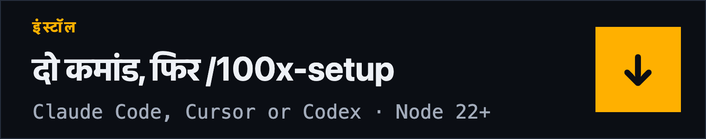
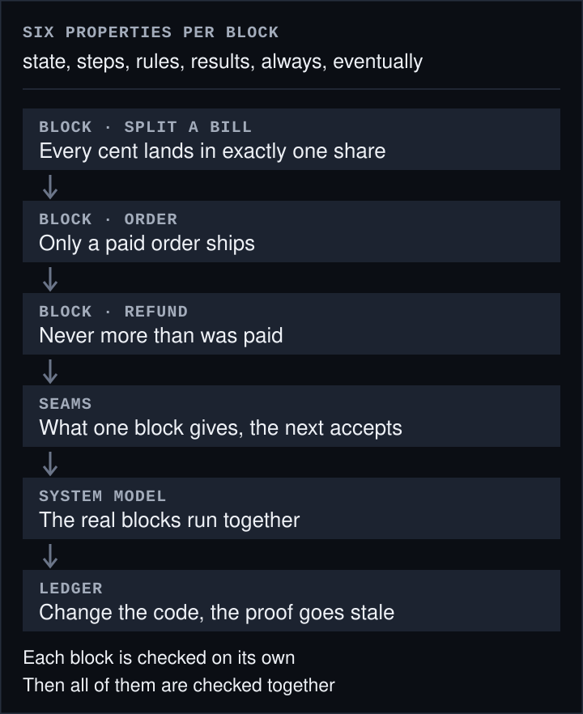
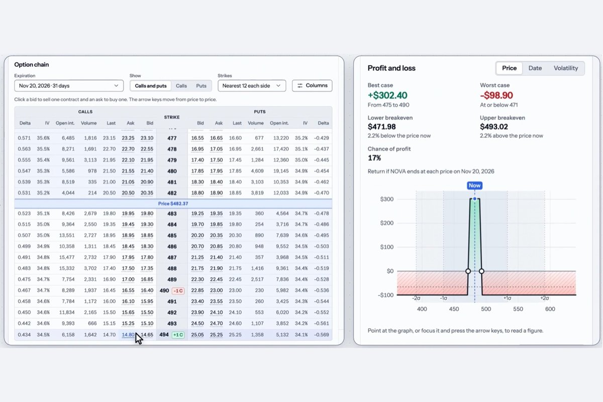

<div align="center">

<picture>
  <source media="(prefers-color-scheme: dark)" srcset="../docs/img/brand/mask-dark.png">
  
</picture>

# 100× ENGINEER SKILL

### एजेंटिक कोडिंग में अब "लगभग चलता है" नहीं

[](https://github.com/DeadInternetStudios/100x-engineer-skill/actions/workflows/ci.yml)
[](https://github.com/DeadInternetStudios/100x-engineer-skill/releases)
[](https://nodejs.org/)
[](../LICENSE)

[](https://github.com/DeadInternetStudios/100x-engineer-skill/stargazers)

*100x, Cursor के एक पूर्व इंजीनियर की एक स्किल है जो प्रॉम्प्ट को औपचारिक रूप से सत्यापित, प्रोडक्शन-रेडी कोड में बदल देती है।<br>मेरे यहाँ इसके ज़रिए हर महीने 1,000 से ज़्यादा PR प्रोडक्शन में जाते हैं, और रोलबैक रेट 2% से कम रहता है।*

Terminal Bench 4.1 के स्कोर जल्द आ रहे हैं 😎

<sub><a href="../README.md">English</a> · <a href="README.es.md">Español</a> · <a href="README.zh.md">中文</a> · <a href="README.pt.md">Português</a> · <a href="README.ru.md">Русский</a> · <a href="README.ja.md">日本語</a> · <a href="README.fr.md">Français</a> · <a href="README.de.md">Deutsch</a> · <a href="README.ar.md">العربية</a> · <b>हिन्दी</b> · <a href="README.ko.md">한국어</a> · <a href="README.id.md">Bahasa Indonesia</a> · <a href="README.tr.md">Türkçe</a> · <a href="README.vi.md">Tiếng Việt</a> · <a href="README.bn.md">বাংলা</a> · <a href="README.it.md">Italiano</a> · <a href="README.pl.md">Polski</a> · <a href="README.th.md">ไทย</a> · <a href="README.uk.md">Українська</a> · <a href="README.nl.md">Nederlands</a></sub>

</div>

> **100x engineer**<br>
> /ˈwən ˈhən-drəd eks ˌen-jə-ˈnir/<br>
> *संज्ञा*
>
> ऐसा सॉफ़्टवेयर इंजीनियर, जिसके बारे में कहा जाता है कि वह सौ आम इंजीनियरों जितना काम करता है, वह भी बिना मीटिंग, सवालों या फ़ेल होते टेस्ट के।

आपका एजेंट कहता है कि काम हो गया। आप खोलकर देखते हैं, तो वह *कुछ-कुछ* चलता है। देखने में हमेशा ठीक लगता है, पर शिप करने लायक कभी पूरा नहीं होता।

**100x आपके कोडिंग एजेंट से डेवलपमेंट का आख़िरी 10% पूरा करवाता है।**

**यह काम को छोटे ब्लॉकों में बाँटती है, हर ब्लॉक को औपचारिक रूप से सत्यापित करती है, और फिर जाँचती है कि ब्लॉक साथ मिलकर काम करते हैं।**

<p align="center">
  
</p>

<p align="center"><b>30 दिनों में 136B टोकन · 1 इंजीनियर · गंभीर प्रोजेक्ट · 1,000 से ज़्यादा PR · $250k की कैश बचत</b></p>

यह Claude Code, Cursor और Codex के लिए एक ओपन-सोर्स स्किल है। इसे एक काम दें, जैसे आपके ऐप में कोई फ़ीचर जोड़ना या शुरू से एक छोटा ऐप बनाना। यह काम की योजना बनाता है, उसे बनाता है, निखारता है और सबसे ज़रूरी हिस्से को टेस्ट करता है। एक दूसरा AI मॉडल उसकी समीक्षा करता है। आपको एक रिपोर्ट मिलती है, जिसमें स्क्रीनशॉट, टेस्ट के नतीजे और जो कुछ अभी बाकी है, सब होता है।

<p align="center">
  <a href="#इंस्टॉल"></a>
</p>

<!-- Benchmark headline goes here: one line and one picture, the same agent with and without 100x, with a link to the method. -->

## औपचारिक सत्यापन, एक बार में एक छोटा ब्लॉक

कोई भी पूरे ऐप को एक बार में औपचारिक रूप से सत्यापित नहीं करता। लेकिन लगभग हर अच्छी तरह डिज़ाइन किया गया सॉफ़्टवेयर छोटे ब्लॉकों से बना होता है, और एक छोटे ब्लॉक में ऐसी बातें होती हैं जिन्हें ठीक-ठीक कहा जा सकता है और पूरी तरह जाँचा जा सकता है। 100x उन्हें लिखता है, हर एक को जाँचता है, फिर जाँचता है कि ब्लॉक साथ मिलकर काम करते हैं। यह डिफ़ॉल्ट रूप से होता है।

### हर ब्लॉक के लिए छह सवाल

| सवाल | क्या लिखा जाता है |
|---|---|
| स्टेट | क्या मौजूद हो सकता है |
| ट्रांज़िशन | यह कैसे बदल सकता है |
| प्रीकंडीशन | कोई कदम कब अनुमत है |
| पोस्टकंडीशन | एक कदम के बाद क्या सच है |
| इन्वेरिएंट | क्या हमेशा सच रहता है |
| लाइवनेस | अंत में क्या होना ही चाहिए, और उसके लिए क्या मान लिया गया है |

प्रॉम्प्ट छहों का जवाब सीधे वाक्यों में देता है। फिर 100x एक छोटा मॉडल बनाता है जो आपके असली फ़ंक्शन चलाता है, और एक चेकर मॉडल की पहुँच वाली हर स्थिति को देखता है। जब कुछ टूटता है, तो वह वहाँ तक पहुँचाने वाले कदमों की सबसे छोटी सूची छापता है।

### छोटे ब्लॉक मिलकर बड़ा सिस्टम बनाते हैं

<p align="center">
  
</p>

हर ब्लॉक अकेले जाँचा जाता है, इसलिए कोई विफलता एक छोटी चीज़ की ओर इशारा करती है। जोड़ भी जाँचे जाते हैं: एक ब्लॉक जो सौंपता है, उसे अगले ब्लॉक के नियम पूरे करने होते हैं। फिर असली ब्लॉक एक मॉडल में साथ चलते हैं, और चेकर पूरे की हर स्थिति देखता है। जाँचे हुए ब्लॉक और जाँचे हुए जोड़ मिलकर ऐसा सॉफ़्टवेयर बनाते हैं जिस पर आप भरोसा कर सकते हैं। जोड़ ब्लॉकों से मुफ़्त में सिद्ध नहीं होते, इसलिए 100x दोनों जाँचता है।

### यह सच बना रहता है

लेजर `verify/ledger.tsv` है, आपके रिपॉज़िटरी में, इसलिए यह हर ब्रांच के साथ चलता है। हर पंक्ति अपने कवर किए कोड का एक हैश रखती है। उस कोड को बदलिए और पंक्ति तब तक पुरानी रहती है जब तक कोई बदलाव पढ़कर जाँच चलाए और उसे सिंक न कर दे। हर गुण को गिना जाने से पहले जानबूझकर डाले गए बग पर एक बार फ़ेल होना पड़ता है। `100x finish` ऐसे गुण को ठुकरा देता है जो पुराना, टूटा हुआ या कभी फ़ेल न हुआ हो। जब कोई एजेंट ऐसे कोड को छूने वाला होता है जिसे कोई नियम कवर नहीं करता, तो `100x verify cover` `NO RULE` कहता है, और इससे प्रक्रिया शुरू होती है।

```text
$ 100x verify run
pass  split-keeps-every-cent. invariant, exhaustive, exit 0

# someone swaps Math.floor for Math.round in the split
$ 100x verify status
stale   split-keeps-every-cent  the covered code changed after the last sync

$ 100x verify run
FAIL  inv:shares-keep-every-cent. a cent was lost or made. Steps: set-bill(1), set-people(2), compute
```

<sub>एक छोटे टिप स्प्लिटर से, एक टेस्ट रिपॉज़िटरी में हाथ से चलाया गया</sub>

### यहाँ सत्यापित का मतलब

- **संपूर्ण** (`exhaustive`): मॉडल की हर स्थिति देखी गई, इसलिए गुण उस मॉडल और उसकी सीमाओं के लिए सही है
- **सीमित** (`bounded`): खोज एक सीमा पर रुक गई और जो देखा उसमें कुछ नहीं मिला, जो कोई प्रमाण नहीं है, और लाइवनेस पर इससे कभी फ़ैसला नहीं होता
- **नमूना** (`sampled`): चुने हुए या रैंडम मामले, बग ढूँढने में अच्छे और बाकी के बारे में चुप

पास होना मॉडल और उन असली फ़ंक्शनों को कवर करता है जिन्हें जाँचें चलाती हैं। लेआउट और कॉपी में कहने को कुछ नहीं होता, इसलिए उन्हें कारण के साथ दर्ज छूट मिलती है, और `100x finish` बताता है कि हर छूट किस कोड को माफ़ करती है। यह सब छोड़ने के लिए अपने संदेश में `no verification` लिखें या `100x config set verify.enabled false` चलाएँ। तब रिपोर्ट कहती है कि कुछ भी सत्यापित नहीं हुआ। [विवरण](../docs/verification.md)।

## एजेंट "लगभग चलता है" पर क्यों रुक जाते हैं

तीन चीज़ें गड़बड़ होती हैं, और 100x के पास हर एक का जवाब है। नीचे के सभी उदाहरण एक ही अनुरोध पर हैं:

> मेरे स्टॉक मार्केट रिसर्च ऐप में मुझे किसी भी स्टॉक की तुलना S&P 500 से करने दो

### 1. किसी ने लिखा ही नहीं कि "चलता है" का असल मतलब क्या है

अनुरोध एक लाइन का है। कुछ भी बनाने से पहले 100x वह प्रॉम्प्ट लिखता है, जो आप एक घंटे की फ़ुरसत होने पर लिखते। वह लक्ष्य, नियम, सबसे जोखिम भरा हिस्सा और हर माँग को जाँचने का तरीका तय करता है। यहाँ वह जाल पहले ही पकड़ लेता है: अगर चार्ट स्टॉक स्प्लिट को एडजस्ट न करे, तो स्प्लिट नुकसान जैसा दिखता है।

<p align="center">
  
</p>

<p align="center"><a href="../docs/examples/stock-comparison-prompt.md">पूरा प्रॉम्प्ट पढ़ें</a></p>

### 2. एजेंट अपना काम ख़ुद जाँचता है

जो मॉडल अपना काम ख़ुद जाँचता है, वह अपनी ही गलतियाँ नहीं पकड़ पाता। 100x एक दूसरे मॉडल से कोड और स्क्रीनों की समीक्षा कई राउंड में करवाता है। बिल्डर हर फ़ाइंडिंग ठीक करता है या लिख देता है कि वह असहमत क्यों है। यहाँ प्रॉम्प्ट में हाल ही में लिस्ट हुए स्टॉक का केस बताया गया था और समीक्षक से उस पर ख़ास ज़ोर देने को कहा गया था, पर बिल्डर के टेस्ट सिर्फ़ पुराने स्टॉक पर चले। समीक्षक ने इसी साल लिस्ट हुआ एक स्टॉक आज़माया और पाया कि इंडेक्स की लाइन पाँच महीने पहले से शुरू हो रही है।

<p align="center">
  
</p>

यह उदाहरण काल्पनिक है। एक असली उदाहरण: यह README आपके पढ़ने से पहले 100x से होकर गुज़रा। इसके समीक्षक ने पहले राउंड में 9 समस्याएँ पकड़ीं, 20 टूटे भाषा लिंक से लेकर फ़ोन पर पढ़ने के लिए बहुत छोटे लेबल तक। 7 ठीक की गईं और 2 पब्लिक लॉन्च तक रोकी गईं। [देखें कि उसे क्या मिला](../docs/examples/readme-review.md)।

### 3. सारांश याद्दाश्त से लिखा जाता है

जब एजेंट कहता है "हो गया", तो वह वही बताता है जो उसे याद है। 100x काम के साथ-साथ सबूत सहेजता जाता है: स्क्रीनशॉट, टेस्ट आउटपुट, समीक्षक की फ़ाइंडिंग। आख़िर में कोड इन्हीं फ़ाइलों से सारांश लिखता है, और जब तक किसी माँग का सबूत न हो या कोई जाँच छूटी हो, `100x finish` उसे लिखने से मना कर देता है। स्टॉक चार्ट वाले रन के आख़िर में यही संदेश आता है। रिसर्च ऐप काल्पनिक है, इसलिए यह रन भी काल्पनिक है।

<p align="center">
  
</p>

<details>
<summary>यही संदेश सादे टेक्स्ट में</summary>

```text
Compare with the S&P 500: ready to ship.
The split math matches a hand count and both lines start on the same day. Dividends are not counted yet.

The moment: Type a ticker and both lines start at 0% on the same day, so the gap is the whole story
Run: npm run dev, then open http://localhost:5173/compare
Try first:
1) Type a ticker you hold and read the gap to the index
2) Pick a stock that split two for one and check the split day shows no drop
3) Pick a stock listed this year and see where both lines start

Must not break: numbers passed (Percent change across a two-for-one split matches a hand count on 40 split cases, 0 failing)
Review (claude-opus-5-5): 9 flagged, 7 fixed, 1 rejected, 1 deferred
Judge rounds: 5 of 5 done, and the last word was ready to ship
Looked at: the code and how it behaves, the UI and UX and whether it is ready to ship
Screen sizes: 0 broken, 2 weak, 15 sizes and 148 elements checked
Asks: 9 of 9 closed

Report: file:///Users/you/projects/research-app/.100x/REPORT.html
Next likely asks: Count dividends in the comparison; Show the gap for several stocks in one table
```

</details>

- **पल:** वह एक चीज़ जो आपको इसे चाहने पर मजबूर करे
- **जो नहीं टूटना चाहिए:** कठिन टेस्ट, और क्या वह पास हुआ
- **समीक्षा:** दूसरे मॉडल ने क्या पकड़ा, और बिल्डर ने उसका क्या किया
- **माँगें:** प्रॉम्प्ट की ज़रूरतें, जिनमें से हर एक सिर्फ़ सबूत के साथ बंद होती है
- **अगली संभावित माँगें:** जो आप शायद आगे माँगेंगे, पहले से बना हुआ या सूची में दर्ज

## एक संदेश भेजें और निकल जाएँ

वही अनुरोध, एक टाइमलाइन के रूप में। हाथ से करने पर आपको बार-बार लौटकर सवालों के जवाब देने पड़ते हैं और गलतियाँ पकड़नी पड़ती हैं। 100x के साथ आप एक संदेश भेजते हैं और लौटकर रिपोर्ट पढ़ लेते हैं। नीला रंग आप हैं और एम्बर दूसरा मॉडल। समय हमने अपने मन से रखे हैं।

<p align="center">
  
</p>

<details>
<summary>शुरू से बनाए गए एक छोटे ऐप पर भी यही</summary>

<p align="center">
  
</p>

बजट ऐप का प्रॉम्प्ट, चार शब्दों से लिखा गया: [मेरे लिए बजट ऐप बनाओ](../docs/examples/budget-app-prompt.md)।

</details>

<details>
<summary>एक रन के सभी आठ चरण</summary>

| चरण | क्या होता है |
|---|---|
| 1. योजना | आपका एजेंट एक विस्तृत प्रॉम्प्ट लिखता है। उसमें साफ़ लिखा होता है कि क्या बनाना है और हर अनुरोध को कैसे जाँचना है। |
| 2. कोर | वह सबसे जोखिम भरा हिस्सा पहले आज़माता है, जब तक योजना बदलने का समय बचा है। |
| 3. बिल्ड | वह पहला वर्ज़न बनाता है, और साथ में वे अतिरिक्त चीज़ें भी जो आप शायद आगे माँगेंगे। |
| 4. पॉलिश | वह लेआउट और बारीकियों पर काम करता है। हर पास के बाद एक दूसरा मॉडल स्क्रीनशॉट देखता है और कमज़ोर जगहें बताता है। |
| 5. टेस्ट | एजेंट उस एक चीज़ को टेस्ट करता है जो टूटने पर पूरा काम बिगाड़ दे, जैसे चार्ट का स्प्लिट गलत गिनना। पहले वह दिखाता है कि टेस्ट गलती पकड़ सकता है। |
| 6. समीक्षा | दूसरा मॉडल कोड और स्क्रीनों की समीक्षा करता है। बिल्डर हर समस्या ठीक करता है या लिखता है कि वह क्यों रुक सकती है या वह असहमत क्यों है। |
| 7. फ़िनिश | `100x finish` कमांड रिपोर्ट लिखने से पहले सहेजे गए सबूत जाँचती है। |
| 8. रिपोर्ट | आप नतीजा देख सकते हैं, उसे ख़ुद आज़मा सकते हैं, और पढ़ सकते हैं कि समीक्षक को क्या मिला। |

अगर आप दूर हैं, तो एजेंट अपना हर फ़ैसला लिखता जाता है और काम जारी रखता है। [पूरा वर्कफ़्लो पढ़ें](../docs/pipeline.md)।

</details>

## आपको क्या मिलता है

<div align="center">


<sub>रिपोर्ट पेज, तीन काल्पनिक रन से बना। असली रन हर कार्ड पर अपने स्क्रीनशॉट लगाता है।</sub>

</div>

- **फ़ीचर या ऐप**, और उसे ख़ुद आज़माने का तरीका
- **कई स्क्रीन साइज़ पर स्क्रीनशॉट**, जिनमें बाहर निकलता टेक्स्ट, बहुत छोटे बटन, धुंधली तस्वीरें और ब्राउज़र एरर जाँचे जाते हैं
- **एक रिपोर्ट पेज** (`.100x/REPORT.html`) और `~/.100x` में हर पूरे हुए रन की गैलरी
- **सत्यापन लेजर** आपके रिपॉज़िटरी में: हर ब्लॉक के गुण, हर एक सही है या नहीं, और वह कौन-सा कोड कवर करता है
- **फ़ैसलों का लॉग**: आपकी ग़ैरमौजूदगी में 100x ने जो भी चुनाव किया, और क्यों
- **अंतिम संदेश**, जो ऊपर दिखाया गया है

हर रन को एक फ़ैसला मिलता है: **शिप के लिए तैयार**, **ठीक है** या **और काम चाहिए**। जब कोई चीज़ फ़ैसले को रोकती है, तो कार्ड बताता है कि क्या रोक रहा है, लाल रंग में जब 100x को कोई समस्या मिली और एम्बर में जब कोई जाँच छूटी है।

---

<div align="center">

## 100x से बने असली प्रोडक्ट

<table align="left"><tr><td>
<a href="https://dollarflow.com/"></a><br>
<a href="https://dollarflow.com/"><b>DollarFlow</b></a><br>
एक स्टॉक स्क्रीनर, 100x की<br>
मदद से बना
</td></tr></table>
<table align="left"><tr><td>
<a href="https://springtails.wiki/"></a><br>
<a href="https://springtails.wiki/"><b>Springtails Wiki</b></a><br>
स्प्रिंगटेल पर एक विकी, पूरी<br>
तरह 100x से बना
</td></tr></table>
<br clear="all">

<table align="left"><tr><td>
<a href="https://bubblewrapapp.com/"></a><br>
<a href="https://bubblewrapapp.com/"><b>BubbleWrap</b></a><br>
एक पिक्सेल आर्ट म्यूज़िक ऐप,<br>
पूरी तरह 100x से बना
</td></tr></table>
<table align="left"><tr><td>
<a href="https://goldtraderdesk.com/"></a><br>
<a href="https://goldtraderdesk.com/"><b>Gold Trader Desk</b></a><br>
सोने की ट्रेडिंग का एक ऐप, पूरी<br>
तरह 100x से बना
</td></tr></table>
<br clear="all">

<table align="left"><tr><td>
<br>
<b>Phantom</b><br>
Swift में बना एक Mac ऐप, जिससे<br>
फ़ोरेंसिक विशेषज्ञ लिखावट का<br>
विश्लेषण करते हैं, 100x की<br>
मदद से बना
</td></tr></table>
<table align="left"><tr><td>
<br>
<b>OptionsFlow</b><br>
React में बना रियल-टाइम ऑप्शन<br>
चेन टूल, जिसे क्वांट फ़र्में इस्तेमाल<br>
करती हैं, 100x की मदद से बना
</td></tr></table>
<br clear="all">

<table align="left"><tr><td>
<br>
<b>Skynet</b><br>
Blueprint और Encore पर बना एक<br>
प्रोजेक्ट मैनेजमेंट टूल, 100x की<br>
मदद से
</td></tr></table>
<table align="left"><tr><td>
<br>
<b>Boneworks</b><br>
टेक्स्ट से 3D बनाने वाली पाइपलाइन, जो<br>
किरदारों को मॉडल, स्किन, रिग और एनिमेट<br>
करती है, 100x की मदद से बनी
</td></tr></table>
<br clear="all">

<p align="center">
  <a href="mailto:theory@deadinternet.com"></a>
</p>

</div>

---

## इसकी क़ीमत क्या है

100x सबूत के बदले समय और यूसेज लेता है।

- **एक आम रन में घंटों लगते हैं।** हर पॉलिश पास और हर समीक्षा राउंड में एक और मॉडल काम करता है, इसलिए एक रन आपके प्लान का अच्छा-ख़ासा हिस्सा ले लेता है।
- **पहली झलक के लिए**, `/100x-mockup` में लगभग 15 मिनट लगते हैं। यह समीक्षा छोड़ देता है और यह बात बता भी देता है।
- **छोटे प्लान पर**, `100x config preset lite --global` तीन और पाँच की जगह एक पॉलिश पास और दो समीक्षा राउंड करता है। सबूत की जाँचें बनी रहती हैं।
- **छोटी चीज़ों के लिए नहीं।** एक लाइन के फ़िक्स या किसी सवाल के लिए सीधे अपने एजेंट से पूछें। 100x उस काम के लिए है जिसके लिए योजना, टेस्ट और समीक्षा बनती हो।

## इंस्टॉल

आपको Claude Code, Cursor या Codex, और Node.js 22 या नया चाहिए।

**1. टूल और स्किल इंस्टॉल करें**

कोई एक चुनें:

**npm**

```bash
npm install -g github:DeadInternetStudios/100x-engineer-skill
100x install
```

**skills.sh**

```bash
npm install -g github:DeadInternetStudios/100x-engineer-skill
npx skills add DeadInternetStudios/100x-engineer-skill --skill '*' -g
100x install
```

`skills` टूल सिर्फ़ स्किल कॉपी करता है, इसलिए `100x` टूल अब भी npm से आता है। इसके बाद `100x install` इन कॉपियों को देखता है और उन्हें छेड़ता नहीं। अपडेट के लिए `npx skills update -g` चलाएँ।

**2. अपने एजेंट में सेटअप करें**

```text
/100x-setup
```

यह पूछता है कि आप कौन-सा प्लान इस्तेमाल करते हैं (Claude Pro, Max या Ultra, या OpenAI Go, Plus या Pro) और तय करता है कि कौन-सा मॉडल बनाएगा और कौन-सा जज करेगा। छोटे प्लान पर हैं तो बता दें, यह lite प्रीसेट चालू कर देगा। और जानकारी: [docs/plans-and-setup.md](../docs/plans-and-setup.md)।

**3. इसे एक काम दें**

```text
/100x मेरे स्टॉक मार्केट रिसर्च ऐप में मुझे किसी भी स्टॉक की तुलना S&P 500 से करने दो
```

Claude Code और Cursor में स्किल `/` से शुरू होती है। Codex `$` इस्तेमाल करता है, जैसे `$100x-setup` और `$100x`। रात भर के लिए जा रहे हों तो `/100x-overnight` इस्तेमाल करें, या पहली झलक के लिए `/100x-mockup`।

### इंस्टॉल के दूसरे तरीके

**क्लोन से** (हम इस रिपो को इसी तरह टेस्ट करते हैं)

```bash
./scripts/install.sh --dry-run   # preview
./scripts/install.sh
```

100x के दो हिस्से हैं: स्किल, जिन्हें आपका एजेंट पढ़ता है, और `100x` कमांड लाइन टूल। टूल वह करता है जो मॉडल अकेले भरोसेमंद ढंग से नहीं कर पाता। वह घड़ी संभालता है, स्क्रीनशॉट लेता है, जज चलाता है, सबूत जाँचता है और रिपोर्ट लिखता है। स्क्रीनशॉट Playwright से लिए जाते हैं। अगर वह नहीं है, तो `100x browsers` उसे इंस्टॉल कर देता है।

इंस्टॉलर सिर्फ़ शॉर्टकट (सिम्बॉलिक लिंक), कुछ छोटी फ़ाइलें और उनके फ़ोल्डर बनाता है। यह किसी असली फ़ाइल को कभी ओवरराइट नहीं करता। `100x doctor` नतीजा जाँचता है, और `./scripts/install.sh --uninstall` उसे हटा देता है। यह जिन-जिन फ़ाइलों को छूता है: [docs/cli.md](../docs/cli.md)।

## मोड

100x स्किल का एक सेट है, जिन्हें मोड कहते हैं। किसी मोड को इस्तेमाल करने के लिए उसका नाम लिखें। आपके संदेश के शब्द कभी मोड नहीं चुनते, इसलिए `/100x an overnight oats app` ओट्स का एक ऐप बनाता है।

| यह लिखें | किसलिए | क्या करता है |
|---|---|---|
| `/100x` | बिल्ड | आम रन: बिल्ड, पॉलिश, टेस्ट, दूसरे मॉडल से समीक्षा। |
| `/100x-mockup` | बिल्ड | लगभग 15 मिनट में तेज़ पहली झलक। सिर्फ़ मुख्य पल काम करता है। कोई समीक्षा नहीं, और यह बात बताई जाती है (UNREVIEWED)। |
| `/100x-overnight` | बिल्ड | जब आप जा रहे हों। एक या कई आइडिया तय समय तक चलाता है, और एजेंट अटक जाए तो उसे आगे बढ़ाता है। |
| `/100x-wrapup` | बिल्ड | डेडलाइन के लिए। मुख्य रास्ता चालू करता है और बाकी छिपा देता है। |
| `/100x-solo` | बिल्ड | पूरा रन एक ही चैट में, बिना सबएजेंट, बिना सहायकों और बिना दूसरे मॉडल के। वह अपने काम को लिखकर, दूसरे नज़रिए से परखता है, और रिपोर्ट में साफ़ लिखा होता है कि किसी और ने नहीं देखा। |
| `/100x-judge` | समीक्षा | पहले से बनी चीज़ की समीक्षा करता है। नया कुछ नहीं बनाता। |
| `/100x-grind` | समीक्षा | समीक्षा, फ़िक्स, फिर समीक्षा, जब तक जज न कहे कि शिप के लिए तैयार है। लगातार तीन समीक्षाओं में कुछ बेहतर न मिले, 15 राउंड हो जाएँ या समय ख़त्म हो जाए, तो रुक जाता है। |
| `/100x-status` | रन | रन कहाँ है, छह या उससे कम लाइनों में। |
| `/100x-continue` | रन | रुका हुआ रन फिर से शुरू करता है, जैसे यूसेज लिमिट पर रुका रन। |
| `/100x-report` | रन | जो कुछ पूरा हुआ, सब दिखाता है, सबसे अच्छा पहले। कुछ नहीं बनाता। |
| `/100x-adhd` | योजना | छोटी-छोटी बातचीत, एक बार में एक सवाल, जो धुंधले आइडिया को योजना में बदल देती है। जब तक आप शुरू करने को न कहें, कुछ नहीं बनता। |
| `/100x-setup` | सेटअप | आपके प्लान के बारे में एक सवाल पूछता है, फिर तय करता है कि कौन-सा मॉडल कौन-सा काम करेगा। |
| `/100x-bakeoff` | 100x का टेस्ट | ख़ुद 100x को टेस्ट करता है: वही एजेंट वही आइडिया 100x के साथ और उसके बिना बनाता है, और एक ब्लाइंड जज दोनों की तुलना करता है। कुछ नहीं बनाता। |

### संख्या वाले वाक्यांश

रन बदलने के लिए इन्हें अपने संदेश में जोड़ें। ये `/100x` और `/100x-overnight` के साथ काम करते हैं। दूसरे शब्द, जैसे "तेज़" या "जल्दी", कुछ नहीं करते।

| आप लिखें | क्या होता है |
|---|---|
| `3 versions` | आइडिया के 3 वर्ज़न बनाता है और सबसे अच्छे को पूरा करता है। कोई भी संख्या चलेगी। |
| `for 10 hours`, `for 2 days`, `until 6am` | पूरा समय इस्तेमाल करता है। रन जल्दी ख़त्म नहीं होगा। |
| `5 rounds of judging` | उतने ही समीक्षा राउंड चलाता है। |
| `max 5 subagents` | एक साथ ज़्यादा से ज़्यादा 5 सबएजेंट। डिफ़ॉल्ट 1 है। |

```text
/100x-overnight 3 versions of a farming game, for 8 hours, max 3 subagents
```

हर रन शुरुआत में उन वाक्यांशों की सूची देता है जो उसने समझे, ताकि आप गलत समझी गई बात पकड़ सकें।

इसे समय दें, और यह समय पूरा होने तक राउंड में काम करता रहता है। हर राउंड प्रोजेक्ट को नए ढंग से देखता है, बदलाव से फ़ायदा हो तो उसे रखता है, और न हो तो वापस ले लेता है। हर राउंड को एक नया दूसरा मॉडल जाँचता है।

<p align="center">
  
</p>

## अक्सर पूछे जाने वाले सवाल

**दूसरा मॉडल क्यों?** अलग-अलग मॉडल के ब्लाइंड स्पॉट अलग होते हैं। अगर कोई दूसरा मॉडल उपलब्ध न हो, तब भी रन पूरा होता है और UNREVIEWED बताता है। एक ही प्लान हो, तो उसी कंपनी का छोटा मॉडल जज कर सकता है, हालाँकि उससे दूसरी कंपनी के मॉडल जितना फ़ायदा नहीं होता।

**क्या यह मेरा प्रोजेक्ट ऑनलाइन डाल देगा?** नहीं। यह प्रीव्यू तभी बनाता है जब प्रोजेक्ट में पहले से प्रीव्यू हो। लाइव करने के लिए आपको ख़ुद कहना होगा।

**रन के बीच में यूसेज लिमिट आ जाए तो?** 100x प्रगति `.100x/STATE.md` में सहेजता है। लिमिट रीसेट होने पर उसी फ़ोल्डर में `/100x-continue` लिखें।

**क्या यह मेरा मॉडल या सेटिंग बदलता है?** नहीं। यह कभी आपका मॉडल, effort लेवल या साइन-इन नहीं बदलता। `/100x-setup` सिर्फ़ 100x की अपनी सेटिंग लिखता है।

**रन कहाँ रहते हैं?** हर प्रोजेक्ट के एक छिपे `.100x/` फ़ोल्डर में (git उसे अनदेखा करता है), और पूरे हुए रन की गैलरी `~/.100x` में।

<p align="center">
  <a href="https://github.com/DeadInternetStudios/100x-engineer-skill/issues/new"></a>
</p>

## डॉक्स

| पेज | इसमें क्या है |
|---|---|
| [इंस्टॉल, विस्तार से](../docs/install.md) | इंस्टॉल के सारे विकल्प, और हर वह फ़ाइल जिसे इंस्टॉलर छूता है |
| [100x का इस्तेमाल](../docs/using.md) | एक रात की ग़ैरमौजूदगी, रिपोर्ट पेज, हेल्पर स्किल |
| [औपचारिक सत्यापन](../docs/verification.md) | छह गुण, लेजर, सत्यापित का मतलब, और ब्लॉक कैसे मिलकर एक सिस्टम बनाते हैं |
| [पाइपलाइन और अंतिम संदेश](../docs/pipeline.md) | हर चरण विस्तार से, और `100x finish` क्या जाँचता है |
| [सेटअप और प्लान](../docs/plans-and-setup.md) | Claude Code का सुझाया गया सेटअप, lite प्रीसेट, हर प्लान के लिए सेटअप |
| [सेटिंग](../docs/settings.md) | हर कॉन्फ़िग की |
| [CLI और फ़ाइल लेआउट](../docs/cli.md) | हर `100x` कमांड, और फ़ाइलें कहाँ रहती हैं |
| [स्किल के अंदर, जाँच](../docs/contributing.md) | रिपो कैसे व्यवस्थित है, और उसे कैसे टेस्ट करें |
| [डिज़ाइन नोट्स](../docs/design.md) | 100x इस तरह क्यों काम करता है |

## योगदान

बग रिपोर्ट, फ़िक्स और आइडिया का स्वागत है। छोटे फ़िक्स सीधे पुल रिक्वेस्ट में भेजे जा सकते हैं। कुछ बड़ा हो, तो पहले इशू खोलें, ताकि हम उस पर सहमत हो सकें। [योगदान कैसे करें](../CONTRIBUTING.md)।

<p align="center">
  <a href="../CONTRIBUTING.md"></a>
</p>

## श्रेय

100x, Lauren Tan के [pstack](https://github.com/cursor/plugins/tree/main/pstack) (MIT) के कामकाजी सिद्धांतों पर बना है, जिन्हें प्रोटोटाइप और आपके एजेंट के साथ एक ही बातचीत के लिए नए सिरे से ढाला गया है। क्या अलग है:

- हर रन एक रिपोर्ट पेज पर ख़त्म होता है।
- `100x finish` ऐसे दावे ठुकरा देता है जिन्हें वह जाँच नहीं सकता।
- एक दूसरा मॉडल कई राउंड में काम की समीक्षा करता है।

देखें [NOTICE.md](../NOTICE.md) और [UPSTREAM.md](../UPSTREAM.md)।

MIT। देखें [LICENSE](../LICENSE)।

<p align="center">
  <a href="https://star-history.com/#DeadInternetStudios/100x-engineer-skill&Date">
    <picture>
      <source media="(prefers-color-scheme: dark)" srcset="https://api.star-history.com/svg?repos=deadinternetstudios/100x-engineer-skill&type=Date&theme=dark">
      
    </picture>
  </a>
</p>
