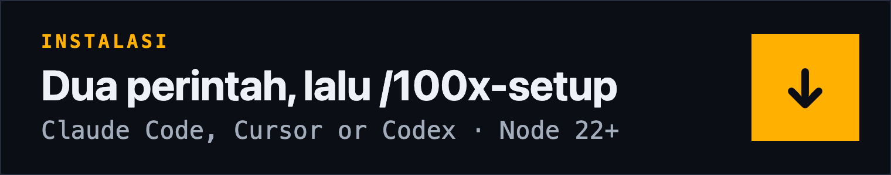
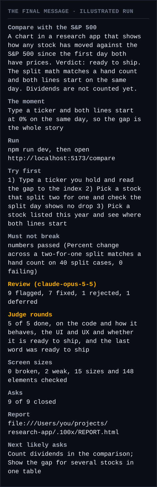
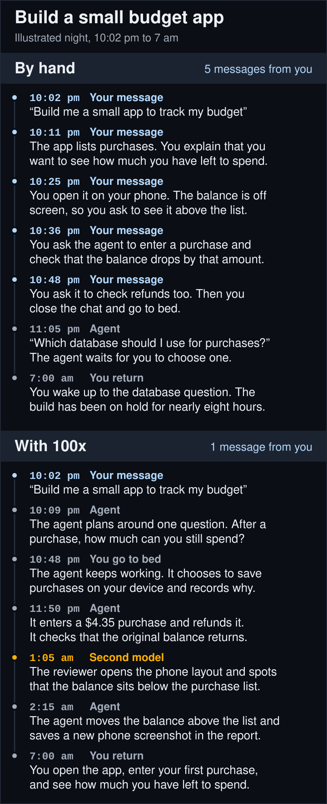
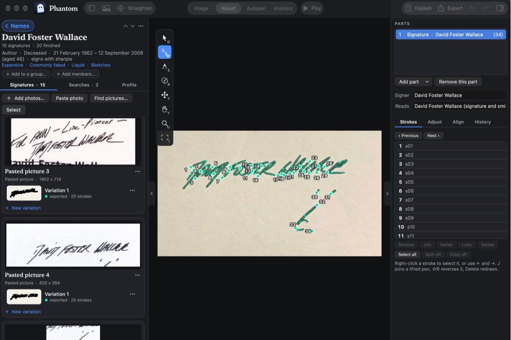
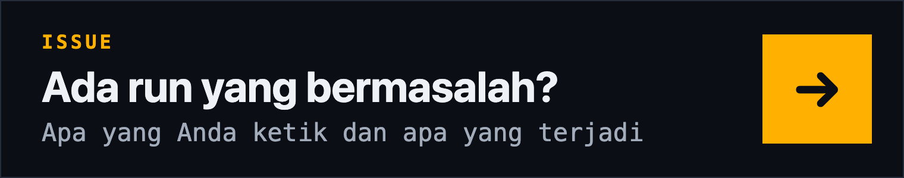
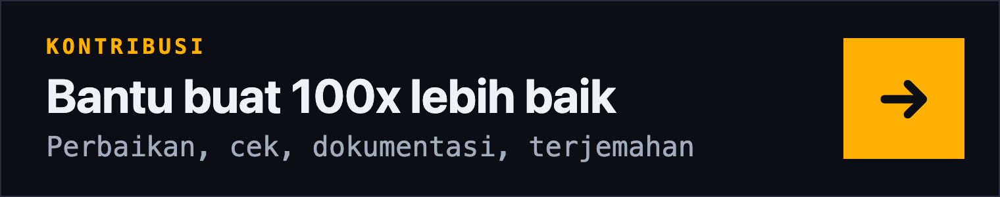

<div align="center">

<picture>
  <source media="(prefers-color-scheme: dark)" srcset="../docs/img/brand/mask-dark.png">
  
</picture>

# 100× ENGINEER SKILL

### SELAMAT TINGGAL AGENTIC CODING YANG "HAMPIR JALAN"

[](https://github.com/DeadInternetStudios/100x-engineer-skill/actions/workflows/ci.yml)
[](https://github.com/DeadInternetStudios/100x-engineer-skill/stargazers)
[](https://github.com/DeadInternetStudios/100x-engineer-skill/releases)
[](../LICENSE)


<sub><a href="../README.md">English</a> · <a href="README.es.md">Español</a> · <a href="README.zh.md">中文</a> · <a href="README.pt.md">Português</a> · <a href="README.ru.md">Русский</a> · <a href="README.ja.md">日本語</a> · <a href="README.fr.md">Français</a> · <a href="README.de.md">Deutsch</a> · <a href="README.ar.md">العربية</a> · <a href="README.hi.md">हिन्दी</a> · <a href="README.ko.md">한국어</a> · <b>Bahasa Indonesia</b> · <a href="README.tr.md">Türkçe</a> · <a href="README.vi.md">Tiếng Việt</a> · <a href="README.bn.md">বাংলা</a> · <a href="README.it.md">Italiano</a> · <a href="README.pl.md">Polski</a> · <a href="README.th.md">ไทย</a> · <a href="README.uk.md">Українська</a> · <a href="README.nl.md">Nederlands</a></sub>

</div>

> **100x engineer**<br>
> /ˈwən ˈhən-drəd eks ˌen-jə-ˈnir/<br>
> *nomina*
>
> Insinyur perangkat lunak yang konon hasil kerjanya setara seratus insinyur biasa, tanpa rapat, tanpa pertanyaan, dan tanpa tes yang gagal.

Agen Anda bilang sudah selesai. Anda buka, dan hasilnya *lumayan* jalan. Selalu kelihatan beres, tapi tidak pernah benar-benar siap rilis.

**100x membuat agen coding Anda menuntaskan 10% terakhir pengembangan.**

Ini skill open source untuk Claude Code, Cursor, dan Codex. Beri satu tugas, misalnya menambahkan fitur ke aplikasi Anda atau membuat aplikasi kecil dari nol. Skill ini merencanakan pekerjaannya, membangunnya, memolesnya, dan menguji bagian yang paling penting. Model AI kedua meninjaunya. Anda mendapat laporan berisi screenshot, hasil tes, dan semua yang masih terbuka.

<p align="center">
  <a href="#instalasi"></a>
</p>

<!-- Benchmark headline goes here: one line and one picture, the same agent with and without 100x, with a link to the method. -->

## Kenapa agen berhenti di "hampir jalan"

Ada tiga hal yang salah, dan 100x punya jawaban untuk masing-masing. Semua contoh di bawah memakai permintaan yang sama:

> Aku mau bisa membandingkan saham apa saja dengan S&P 500 di aplikasi riset pasar sahamku

### 1. Tidak ada yang menuliskan apa arti "jalan" sebenarnya

Permintaannya cuma satu baris. Sebelum membangun apa pun, 100x menulis prompt yang akan Anda tulis sendiri kalau punya waktu luang satu jam. Isinya tujuan, aturan, bagian paling berisiko, dan cara memeriksa tiap permintaan. Di sini ia menemukan jebakannya sejak awal: stock split terlihat seperti rugi kalau grafiknya tidak menyesuaikan.

<p align="center">
  
</p>

<p align="center"><a href="../docs/examples/stock-comparison-prompt.md">Baca prompt lengkapnya</a></p>

### 2. Agen memeriksa pekerjaannya sendiri

Model yang memeriksa pekerjaannya sendiri akan melewatkan kesalahannya sendiri. Di 100x, model kedua meninjau kode dan tampilan layarnya dalam beberapa ronde. Model pembangun memperbaiki tiap temuan atau menuliskan alasan ia tidak setuju. Di sini prompt sudah menyebut kasus saham yang baru melantai di bursa dan meminta peninjau menekan kasus itu, tapi tes dari pembangun hanya memakai saham lama. Peninjau mencoba saham yang melantai tahun ini dan menemukan garis indeks mulai lima bulan terlalu awal.

<p align="center">
  
</p>

Yang tadi hanya ilustrasi. Ini yang nyata: README ini sudah melewati 100x sebelum Anda membacanya. Peninjaunya menandai 9 masalah di ronde pertama, dari 20 tautan bahasa yang mati sampai label yang terlalu kecil untuk ponsel. 7 diperbaiki dan 2 menunggu peluncuran publik. [Baca apa yang ditemukannya](../docs/examples/readme-review.md).

### 3. Ringkasannya ditulis dari ingatan

Saat agen bilang "selesai", ia melaporkan apa yang diingatnya. 100x menyimpan bukti sambil jalan: screenshot, output tes, temuan peninjau. Di akhir, kode menulis ringkasan dari file-file itu, dan `100x finish` menolak menulisnya selama ada permintaan tanpa bukti atau ada pemeriksaan yang kurang. Ini pesan di akhir run grafik saham tadi. Aplikasi risetnya rekaan, jadi run-nya juga ilustrasi.

<p align="center">
  
</p>

<details>
<summary>Pesan yang sama sebagai teks biasa</summary>

```text
Compare with the S&P 500: A chart in a research app that shows how any stock has moved against the S&P 500 since the first day both have prices. Verdict: ready to ship. The split math matches a hand count and both lines start on the same day. Dividends are not counted yet.
The moment: Type a ticker and both lines start at 0% on the same day, so the gap is the whole story
Run: npm run dev, then open http://localhost:5173/compare
Try first: 1) Type a ticker you hold and read the gap to the index 2) Pick a stock that split two for one and check the split day shows no drop 3) Pick a stock listed this year and see where both lines start
Must not break: numbers passed (Percent change across a two-for-one split matches a hand count on 40 split cases, 0 failing)
Review (claude-opus-5-5): 9 flagged, 7 fixed, 1 rejected, 1 deferred
Judge rounds: 5 of 5 done, on the code and how it behaves, the UI and UX and whether it is ready to ship, and the last word was ready to ship
Screen sizes: 0 broken, 2 weak, 15 sizes and 148 elements checked
Asks: 9 of 9 closed
Report: file:///Users/you/projects/research-app/.100x/REPORT.html
Next likely asks: Count dividends in the comparison; Show the gap for several stocks in one table
```

</details>

- **The moment:** satu hal yang seharusnya membuat Anda menginginkannya
- **Must not break:** tes sulitnya, dan apakah lulus
- **Review:** apa yang ditandai model kedua, dan apa yang dilakukan pembangun terhadapnya
- **Asks:** kebutuhan dari prompt, masing-masing baru ditutup dengan bukti
- **Next likely asks:** apa yang mungkin Anda minta berikutnya, sudah dibangun atau sudah dicatat

## Kirim satu pesan lalu tinggalkan

Permintaan yang sama dalam bentuk linimasa. Kalau manual, Anda terus kembali untuk menjawab pertanyaan dan menangkap kesalahan. Dengan 100x, Anda kirim satu pesan dan membaca laporannya saat kembali. Biru itu Anda dan kuning amber itu model kedua. Waktunya kami karang.

<p align="center">
  
</p>

<details>
<summary>Hal yang sama untuk aplikasi kecil dari nol</summary>

<p align="center">
  
</p>

Prompt aplikasi anggaran itu, ditulis dari empat kata: [make me a budget app](../docs/examples/budget-app-prompt.md).

</details>

<details>
<summary>Kedelapan langkah sebuah run</summary>

| Langkah | Apa yang terjadi |
|---|---|
| 1. Rencana | Agen Anda menulis prompt yang detail. Isinya menjabarkan apa yang dibangun dan cara memeriksa tiap permintaan. |
| 2. Inti | Ia mencoba bagian paling berisiko lebih dulu, selagi masih ada waktu untuk mengubah rencana. |
| 3. Bangun | Ia membangun versi pertama dan tambahan yang kemungkinan Anda minta berikutnya. |
| 4. Poles | Ia menggarap tata letak dan detail. Model kedua melihat screenshot setelah tiap putaran dan menunjukkan bagian yang lemah. |
| 5. Tes | Agen menguji satu hal yang akan merusak seluruh pekerjaan kalau gagal, misalnya grafik yang salah menghitung split. Ia lebih dulu menunjukkan bahwa tesnya bisa menangkap kesalahan. |
| 6. Tinjauan | Model kedua meninjau kode dan tampilan layar. Pembangun memperbaiki tiap masalah atau menuliskan kenapa itu bisa menunggu atau kenapa ia tidak setuju. |
| 7. Selesai | Perintah `100x finish` memeriksa bukti yang tersimpan sebelum menulis laporan. |
| 8. Laporan | Anda bisa melihat hasilnya, mencobanya sendiri, dan membaca apa yang ditemukan peninjau. |

Kalau Anda sedang pergi, agen mencatat setiap keputusan yang diambilnya dan terus bekerja. [Baca alur kerja lengkapnya](../docs/pipeline.md).

</details>

## Apa yang Anda dapat

<div align="center">


<sub>Halaman laporan, dibuat dari tiga run rekaan. Run sungguhan memasang screenshot-nya sendiri di tiap kartu.</sub>

</div>

- **Fitur atau aplikasinya**, dan cara mencobanya sendiri
- **Screenshot di banyak ukuran layar**, diperiksa dari teks yang meluber, tombol yang terlalu kecil, gambar buram, dan error browser
- **Halaman laporan** (`.100x/REPORT.html`) dan galeri semua run yang selesai di `~/.100x`
- **Log keputusan**: setiap pilihan yang dibuat 100x saat Anda pergi, beserta alasannya
- **Pesan akhir** yang ditunjukkan di atas

Setiap run mendapat satu verdict: **Siap rilis**, **Lumayan**, atau **Perlu digarap**. Kalau ada yang menghalangi verdict, kartunya menyebutkan apa itu, merah kalau 100x menemukan masalah dan amber kalau ada pemeriksaan yang kurang.

---

<div align="center">

## Produk nyata yang dibuat dengan 100x

<table align="left"><tr><td>
<a href="https://dollarflow.com/"></a><br>
<a href="https://dollarflow.com/"><b>DollarFlow</b></a><br>
Stock screener, dibuat<br>
dengan bantuan 100x
</td></tr></table>
<table align="left"><tr><td>
<a href="https://springtails.wiki/"></a><br>
<a href="https://springtails.wiki/"><b>Springtails Wiki</b></a><br>
Wiki tentang springtail, dibuat<br>
sepenuhnya dengan 100x
</td></tr></table>
<br clear="all">

<table align="left"><tr><td>
<a href="https://bubblewrapapp.com/"></a><br>
<a href="https://bubblewrapapp.com/"><b>BubbleWrap</b></a><br>
Aplikasi musik pixel art,<br>
dibuat sepenuhnya dengan 100x
</td></tr></table>
<table align="left"><tr><td>
<a href="https://goldtraderdesk.com/"></a><br>
<a href="https://goldtraderdesk.com/"><b>Gold Trader Desk</b></a><br>
Aplikasi trading emas, dibuat<br>
sepenuhnya dengan 100x
</td></tr></table>
<br clear="all">

<table align="left"><tr><td>
<br>
<b>Phantom</b><br>
Aplikasi Mac berbasis Swift yang<br>
dipakai ahli forensik untuk<br>
menganalisis tulisan tangan, dibuat<br>
dengan bantuan 100x
</td></tr></table>
<table align="left"><tr><td>
<br>
<b>OptionsFlow</b><br>
Alat option chain real-time di<br>
React yang dipakai firma kuant,<br>
dibuat dengan bantuan 100x
</td></tr></table>
<br clear="all">

<table align="left"><tr><td>
<br>
<b>Skynet</b><br>
Alat manajemen proyek di atas<br>
Blueprint dan Encore, dibuat<br>
dengan bantuan 100x
</td></tr></table>
<table align="left"><tr><td>
<br>
<b>Boneworks</b><br>
Pipeline text-to-3D yang memodelkan,<br>
memberi skin, me-rig, dan menganimasikan<br>
karakter, dibuat dengan bantuan 100x
</td></tr></table>
<br clear="all">

<p align="center">
  <a href="mailto:theory@deadinternet.com"></a>
</p>

</div>

---

## Berapa biayanya

100x menukar waktu dan kuota pemakaian dengan bukti.

- **Run normal makan waktu berjam-jam.** Setiap putaran poles dan setiap ronde tinjauan berarti satu model lagi yang bekerja, jadi satu run memakai cukup banyak jatah paket Anda.
- **Untuk lihat sekilas**, `/100x-mockup` butuh sekitar 15 menit. Ia melewatkan tinjauan dan mengatakannya terus terang.
- **Di paket yang lebih kecil**, `100x config preset lite --global` menjalankan satu putaran poles dan dua ronde tinjauan, bukan tiga dan lima. Pemeriksaan buktinya tetap ada.
- **Bukan untuk hal kecil.** Untuk perbaikan satu baris atau sebuah pertanyaan, langsung tanya agen Anda. 100x untuk pekerjaan yang layak mendapat rencana, tes, dan tinjauan.

## Instalasi

Anda butuh Claude Code, Cursor, atau Codex, dan Node.js 22 atau lebih baru.

**1. Instal tool dan skill-nya**

```bash
npm install -g github:DeadInternetStudios/100x-engineer-skill
100x install
```

**2. Atur di dalam agen Anda**

```text
/100x-setup
```

Ia akan bertanya paket apa yang Anda pakai (Claude Pro, Max, atau Ultra, atau OpenAI Go, Plus, atau Pro), lalu memilih model mana yang membangun dan mana yang menilai. Kalau paket Anda kecil, bilang saja dan ia akan menyalakan preset lite. Selengkapnya: [docs/plans-and-setup.md](../docs/plans-and-setup.md).

**3. Beri tugas**

```text
/100x Aku mau bisa membandingkan saham apa saja dengan S&P 500 di aplikasi riset pasar sahamku
```

Claude Code dan Cursor menjalankan skill dengan `/`. Codex memakai `$`, seperti `$100x-setup` dan `$100x`. Pakai `/100x-overnight` kalau Anda mau pergi semalaman, atau `/100x-mockup` untuk lihat sekilas.

### Cara instalasi lain

**Dari clone** (cara kami menguji repo ini)

```bash
./scripts/install.sh --dry-run   # preview
./scripts/install.sh
```

Sudah memakai skills.sh? `npx skills add DeadInternetStudios/100x-engineer-skill --skill '*' -g` menambahkan skill-nya. Anda tetap butuh tool command line dari langkah 1.

100x terdiri dari dua bagian: skill yang dibaca agen Anda, dan tool command line `100x`. Tool ini mengerjakan hal yang tidak bisa diandalkan dari model sendirian. Ia mengatur waktu, mengambil screenshot, menjalankan juri, memeriksa bukti, dan menulis laporan. Screenshot memakai Playwright. Kalau belum ada, `100x browsers` akan memasangnya.

Installer hanya membuat shortcut (symbolic link), beberapa file kecil, dan foldernya. Ia tidak pernah menimpa file sungguhan. `100x doctor` memeriksa hasilnya, dan `./scripts/install.sh --uninstall` menghapusnya. Semua file yang disentuhnya: [docs/cli.md](../docs/cli.md).

## Mode

100x adalah sekumpulan skill yang disebut mode. Ketik nama mode untuk memakainya. Kata-kata dalam pesan Anda tidak pernah memilih mode, jadi `/100x an overnight oats app` membangun aplikasi overnight oats.

| Ketik ini | Untuk | Apa yang dilakukan |
|---|---|---|
| `/100x` | Bangun | Run normal: bangun, poles, tes, tinjauan model kedua. |
| `/100x-mockup` | Bangun | Lihat sekilas dengan cepat, sekitar 15 menit. Hanya momen kuncinya yang jalan. Tanpa tinjauan, dan ia mengatakannya (UNREVIEWED). |
| `/100x-overnight` | Bangun | Untuk saat Anda pergi. Menjalankan satu ide atau beberapa, selama waktu yang ditentukan, dan menyenggol agen kalau macet. |
| `/100x-wrapup` | Bangun | Untuk tenggat. Membuat jalur utama berfungsi dan menyembunyikan sisanya. |
| `/100x-judge` | Tinjauan | Meninjau sesuatu yang sudah dibangun. Tidak membangun hal baru. |
| `/100x-grind` | Tinjauan | Tinjau, perbaiki, tinjau lagi sampai juri bilang siap rilis. Berhenti kalau tiga tinjauan berturut-turut tidak menemukan yang lebih baik, di ronde ke-15, atau saat waktunya habis. |
| `/100x-status` | Sebuah run | Posisi run saat ini, dalam enam baris atau kurang. |
| `/100x-continue` | Sebuah run | Melanjutkan run yang berhenti, misalnya karena batas pemakaian. |
| `/100x-report` | Sebuah run | Menampilkan semua yang sudah selesai, yang terbaik lebih dulu. Tidak membangun apa pun. |
| `/100x-adhd` | Rencana | Tanya jawab singkat, satu pertanyaan setiap kali, yang mengubah ide mentah menjadi rencana. Tidak ada yang dibangun sampai Anda bilang mulai. |
| `/100x-setup` | Pengaturan | Mengajukan satu pertanyaan soal paket Anda, lalu menentukan model mana mengerjakan tugas apa. |
| `/100x-bakeoff` | Uji 100x | Menguji 100x itu sendiri: agen yang sama membangun ide yang sama dengan dan tanpa 100x, lalu juri buta membandingkannya. Tidak membangun apa pun. |

### Frasa angka

Tambahkan ini ke pesan Anda untuk mengubah sebuah run. Frasa ini berlaku untuk `/100x` dan `/100x-overnight`. Kata lain, seperti "cepat" atau "kilat", tidak berpengaruh apa-apa.

| Anda menulis | Apa yang terjadi |
|---|---|
| `3 versions` | Membangun 3 versi dari ide itu dan menuntaskan yang terbaik. Angka berapa pun bisa. |
| `for 10 hours`, `for 2 days`, `until 6am` | Memakai seluruh waktu itu. Run tidak akan selesai lebih awal. |
| `5 rounds of judging` | Menjalankan ronde tinjauan sebanyak itu. |
| `max 5 subagents` | Paling banyak 5 subagen sekaligus. Bawaannya 1. |

```text
/100x-overnight 3 versions of a farming game, for 8 hours, max 3 subagents
```

Setiap run dimulai dengan menyebutkan frasa yang dipahaminya, jadi Anda bisa melihat kalau ada yang salah baca.

Beri ia waktu, dan ia akan terus bekerja dalam ronde sampai waktunya habis. Setiap ronde melihat proyek dengan cara baru, mempertahankan perubahan kalau membantu, dan membatalkannya kalau tidak. Model kedua yang masih segar memeriksa setiap ronde.

<p align="center">
  
</p>

## FAQ

**Kenapa perlu model kedua?** Model yang berbeda punya titik buta yang berbeda. Kalau tidak ada yang tersedia, run tetap selesai dan menyatakan UNREVIEWED. Kalau Anda hanya punya satu paket, model yang lebih kecil dari perusahaan yang sama bisa menjadi juri, meski manfaatnya lebih kecil dibanding model dari perusahaan lain.

**Apakah proyek saya akan dipublikasikan?** Tidak. Ia hanya membuat preview kalau proyeknya memang sudah punya. Untuk live, Anda sendiri yang harus bilang.

**Bagaimana kalau kena batas pemakaian di tengah run?** 100x menyimpan progres di `.100x/STATE.md`. Saat batasnya di-reset, ketik `/100x-continue` di folder yang sama.

**Apakah ia mengubah model atau pengaturan saya?** Tidak. Ia tidak pernah mengganti model, tingkat effort, atau akun login Anda. `/100x-setup` hanya menulis pengaturan milik 100x sendiri.

**Di mana run disimpan?** Di folder tersembunyi `.100x/` di tiap proyek (diabaikan git), dan galeri run yang selesai di `~/.100x`.

<p align="center">
  <a href="https://github.com/DeadInternetStudios/100x-engineer-skill/issues/new"></a>
</p>

## Dokumentasi

| Halaman | Isinya |
|---|---|
| [Instalasi lengkap](../docs/install.md) | semua opsi instalasi, dan semua file yang disentuh installer |
| [Memakai 100x](../docs/using.md) | semalam ditinggal, halaman laporan, skill pembantu |
| [Pipeline dan pesan akhir](../docs/pipeline.md) | setiap langkah secara lengkap, dan apa yang diperiksa `100x finish` |
| [Pengaturan dan paket](../docs/plans-and-setup.md) | setup Claude Code yang disarankan, preset lite, setup untuk tiap paket |
| [Pengaturan](../docs/settings.md) | semua kunci konfigurasi |
| [CLI dan struktur file](../docs/cli.md) | semua perintah `100x`, dan di mana file disimpan |
| [Isi skill, verifikasi](../docs/contributing.md) | susunan repo, dan cara mengujinya |
| [Catatan desain](../docs/design.md) | kenapa 100x bekerja dengan cara ini |

## Berkontribusi

Laporan bug, perbaikan, dan ide sangat diterima. Perbaikan kecil bisa langsung jadi pull request. Untuk yang lebih besar, buka issue dulu supaya kita bisa sepakat. [Cara berkontribusi](../CONTRIBUTING.md).

<p align="center">
  <a href="../CONTRIBUTING.md"></a>
</p>

## Kredit

100x dibangun di atas prinsip kerja [pstack](https://github.com/cursor/plugins/tree/main/pstack) karya Lauren Tan (MIT), yang dirombak untuk prototipe dan untuk satu percakapan dengan agen Anda. Bedanya:

- Setiap run diakhiri dengan halaman laporan.
- `100x finish` menolak klaim yang tidak bisa diperiksanya.
- Model kedua meninjau pekerjaan dalam beberapa ronde.

Lihat [NOTICE.md](../NOTICE.md) dan [UPSTREAM.md](../UPSTREAM.md).

MIT. Lihat [LICENSE](../LICENSE).

<p align="center">
  <a href="https://star-history.com/#DeadInternetStudios/100x-engineer-skill&Date">
    <picture>
      <source media="(prefers-color-scheme: dark)" srcset="https://api.star-history.com/svg?repos=deadinternetstudios/100x-engineer-skill&type=Date&theme=dark">
      
    </picture>
  </a>
</p>

---

<sub>Gambar topeng: <a target="_blank" href="https://www.vexels.com/png-svg/preview/229802/guy-fawkes-mask-bonfire-night-stroke">www.vexels.com</a></sub>
