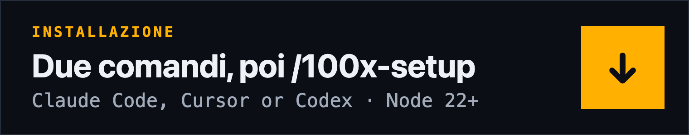
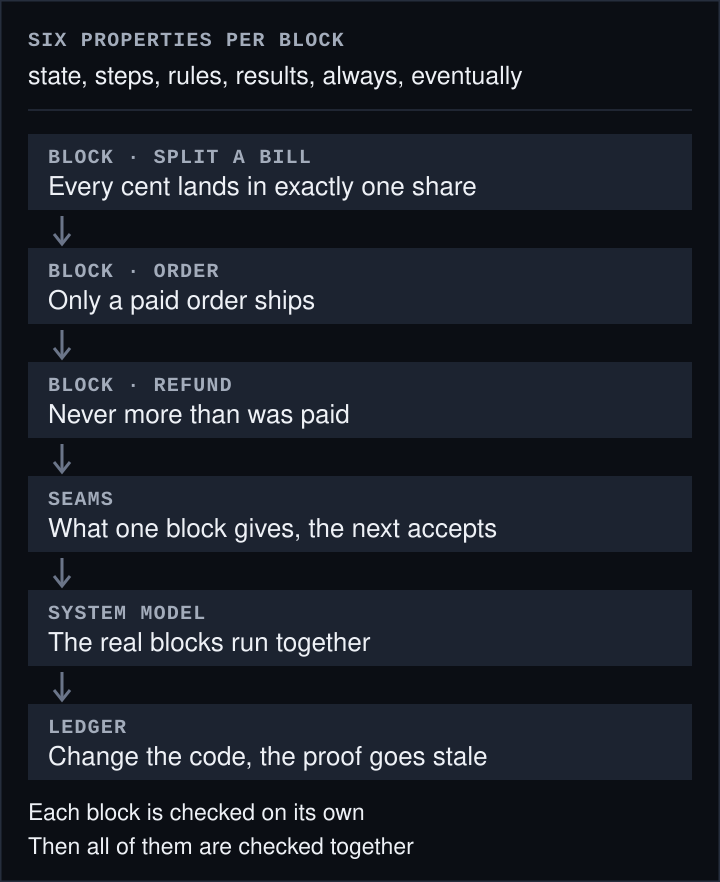
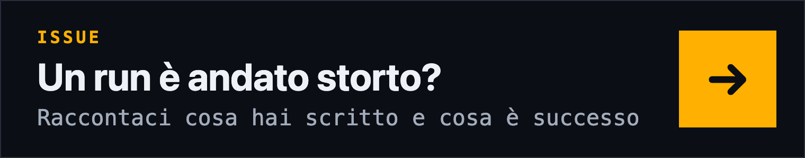

<div align="center">

<picture>
  <source media="(prefers-color-scheme: dark)" srcset="../docs/img/brand/mask-dark.png">
  
</picture>

# 100× ENGINEER SKILL

<p align="center">
  
  
</p>

<p align="center">
  <picture>
    <source media="(prefers-color-scheme: dark)" srcset="https://upstar.dev/badge/DeadInternetStudios/100x-engineer-skill/day/agent-skills-dark.svg">
    
  </picture>
</p>

### Basta codice con gli agenti che "quasi funziona"

[](https://github.com/DeadInternetStudios/100x-engineer-skill/actions/workflows/ci.yml)
[](https://github.com/DeadInternetStudios/100x-engineer-skill/releases)
[](https://nodejs.org/)
[](../LICENSE)

[](https://github.com/DeadInternetStudios/100x-engineer-skill/stargazers)

*100x è una skill di un ex ingegnere di Cursor che trasforma i prompt in codice pronto per la produzione e verificato formalmente.<br>Lo uso per portare in produzione oltre 1.000 PR ogni mese, con un tasso di rollback sotto il 2%.*

<sub><a href="../README.md">English</a> · <a href="README.es.md">Español</a> · <a href="README.zh.md">中文</a> · <a href="README.pt.md">Português</a> · <a href="README.ru.md">Русский</a> · <a href="README.ja.md">日本語</a> · <a href="README.fr.md">Français</a> · <a href="README.de.md">Deutsch</a> · <a href="README.ar.md">العربية</a> · <a href="README.hi.md">हिन्दी</a> · <a href="README.ko.md">한국어</a> · <a href="README.id.md">Bahasa Indonesia</a> · <a href="README.tr.md">Türkçe</a> · <a href="README.vi.md">Tiếng Việt</a> · <a href="README.bn.md">বাংলা</a> · <b>Italiano</b> · <a href="README.pl.md">Polski</a> · <a href="README.th.md">ไทย</a> · <a href="README.uk.md">Українська</a> · <a href="README.nl.md">Nederlands</a></sub>

</div>

> **100x engineer**<br>
> /ˈwən ˈhən-drəd eks ˌen-jə-ˈnir/<br>
> *sostantivo*
>
> Ingegnere del software a cui si attribuisce la produttività di cento ingegneri normali, senza le riunioni, le domande o i test che falliscono.

Il tuo agente dice di aver finito. Lo apri e *più o meno* funziona. Sembra sempre a posto, ma non è mai davvero pronto da rilasciare.

**100x fa risolvere al tuo coding agent l'ultimo 10% dello sviluppo.**

**Divide il lavoro in piccoli blocchi, verifica formalmente ciascuno e controlla che i blocchi funzionino insieme.**

<p align="center">
  
</p>

<p align="center"><b>136B di token in 30 giorni · 1 ingegnere · Progetti seri · Oltre 1.000 PR · $250k di risparmio sulla cache</b></p>

È una skill open source per Claude Code, Cursor e Codex. Dagli un compito, come aggiungere una funzione alla tua app o creare una piccola app da zero. Pianifica il lavoro, lo costruisce, lo rifinisce e testa la parte che conta di più. Un secondo modello di IA lo revisiona. Ricevi un report con screenshot, risultati dei test e tutto ciò che resta aperto.

<p align="center">
  <a href="#installazione"></a>
</p>

<!-- Benchmark headline goes here: one line and one picture, the same agent with and without 100x, with a link to the method. -->

## Verifica formale, un piccolo blocco alla volta

Nessuno verifica formalmente un'app intera in un colpo solo. Ma quasi ogni software ben progettato è fatto di piccoli blocchi, e un piccolo blocco ha cose che si possono enunciare con precisione e controllare per intero. 100x le scrive, controlla ciascuna e poi controlla che i blocchi funzionino insieme. Lo fa per impostazione predefinita.

### Sei domande per ogni blocco

| Domanda | Cosa si scrive |
|---|---|
| Stato | cosa può esistere |
| Transizioni | come può cambiare |
| Precondizioni | quando un passo è consentito |
| Postcondizioni | cosa è vero dopo un passo |
| Invarianti | cosa vale sempre |
| Vivacità | cosa deve prima o poi accadere, e cosa presuppone |

Il prompt risponde a tutte e sei con frasi semplici. Poi 100x costruisce un piccolo modello che esegue le tue funzioni reali, e un verificatore visita ogni stato che il modello può raggiungere. Quando qualcosa si rompe, stampa la lista più breve di passi che porta lì.

### I piccoli blocchi formano un grande sistema

<p align="center">
  
</p>

Ogni blocco viene controllato da solo, quindi un errore punta a una cosa piccola. Anche le giunzioni vengono controllate: ciò che un blocco consegna deve rispettare le regole del successivo. Poi i blocchi reali girano insieme in un modello, e il verificatore visita ogni stato dell'insieme. Blocchi controllati più giunzioni controllate formano un software di cui ti puoi fidare. I blocchi non dimostrano le giunzioni gratis, quindi 100x controlla entrambi.

### Resta vero

Il registro è `verify/ledger.tsv`, nel tuo repo, quindi viaggia con ogni branch. Ogni riga conserva un hash del codice che copre. Cambia quel codice e la riga diventa scaduta finché qualcuno non legge la modifica, esegue il controllo e la sincronizza. Ogni proprietà deve fallire una volta su un bug piantato prima di contare. `100x finish` rifiuta una proprietà scaduta, rotta o che non ha mai fallito. Quando un agente sta per toccare codice che nessuna regola copre, `100x verify cover` risponde `NO RULE`, e questo avvia la procedura.

```text
$ 100x verify run
pass  split-keeps-every-cent. invariant, exhaustive, exit 0

# someone swaps Math.floor for Math.round in the split
$ 100x verify status
stale   split-keeps-every-cent  the covered code changed after the last sync

$ 100x verify run
FAIL  inv:shares-keep-every-cent. a cent was lost or made. Steps: set-bill(1), set-people(2), compute
```

<sub>Da un piccolo divisore di mance, eseguito a mano in un repo di prova</sub>

### Cosa significa verificato qui

- **Esaustivo** (`exhaustive`): ogni stato del modello è stato visitato, quindi la proprietà vale per quel modello e i suoi limiti
- **Limitato** (`bounded`): la ricerca ha toccato un limite e non ha trovato nulla in ciò che ha visto, il che non è una dimostrazione, e la vivacità non viene mai decisa su questa base
- **Campionato** (`sampled`): casi scelti o casuali, bravi a trovare bug e muti sul resto

Un esito positivo copre il modello e le funzioni reali che i controlli eseguono. Layout e testi non hanno nulla da enunciare, quindi ricevono un'esenzione registrata con il motivo, e `100x finish` nomina il codice che ogni esenzione scusa. Per saltare tutto, scrivi `no verification` nel messaggio o esegui `100x config set verify.enabled false`. Il report dice allora che nulla è stato verificato. [I dettagli](../docs/verification.md).

## Perché gli agenti si fermano a "quasi funziona"

Tre cose vanno storte, e 100x ha una risposta per ognuna. Tutti gli esempi qui sotto usano la stessa richiesta:

> Fammi confrontare qualsiasi titolo con l'S&P 500 nella mia app di analisi di borsa

### 1. Nessuno ha scritto cosa vuol dire davvero "funziona"

La richiesta è una riga. Prima di costruire qualsiasi cosa, 100x scrive il prompt che avresti scritto tu con un'ora libera. Fissa l'obiettivo, le regole, la parte più rischiosa e come verificare ogni requisito. Qui individua subito la trappola: un frazionamento azionario sembra una perdita se il grafico non ne tiene conto.

<p align="center">
  
</p>

<p align="center"><a href="../docs/examples/stock-comparison-prompt.md">Leggi il prompt completo</a></p>

### 2. L'agente controlla il proprio lavoro

Un modello che controlla il proprio lavoro non vede i propri errori. 100x fa revisionare il codice e le schermate da un secondo modello, a round. Chi costruisce corregge ogni segnalazione o scrive perché non è d'accordo. Qui il prompt citava il caso di un titolo appena quotato e chiedeva al revisore di insistere su quello, ma i test del builder usavano solo titoli più vecchi. Il revisore ha provato un titolo quotato quest'anno e ha visto che la linea dell'indice partiva cinque mesi prima.

<p align="center">
  
</p>

Questo esempio è illustrato. Uno vero: questo README è passato per 100x prima che tu lo leggessi. Il revisore ha segnalato 9 problemi nel primo round, da 20 link alle lingue non funzionanti a etichette troppo piccole per un telefono. 7 sono stati corretti e 2 sono rimasti in attesa del lancio pubblico. [Leggi cosa ha trovato](../docs/examples/readme-review.md).

### 3. Il riepilogo viene dalla memoria

Quando un agente dice "fatto", riporta quello che ricorda. 100x salva le prove man mano: screenshot, output dei test, le segnalazioni del revisore. Alla fine è il codice a scrivere il riepilogo a partire da quei file, e `100x finish` si rifiuta di scriverlo se un requisito non ha prove o manca un controllo. Questo è il messaggio alla fine del run del grafico dei titoli. L'app di analisi è inventata, quindi il run è illustrato.

<p align="center">
  
</p>

<details>
<summary>Lo stesso messaggio in testo semplice</summary>

```text
Compare with the S&P 500: ready to ship.
The split math matches a hand count and both lines start on the same day. Dividends are not counted yet.

The moment: Type a ticker and both lines start at 0% on the same day, so the gap is the whole story
Run: npm run dev
Open: http://localhost:5173/compare
Try first:
1) Type a ticker you hold and read the gap to the index
2) Pick a stock that split two for one and check the split day shows no drop
3) Pick a stock listed this year and see where both lines start

Must not break: numbers passed (Percent change across a two-for-one split matches a hand count on 40 split cases, 0 failing)
Review (claude-opus-5-5): 9 flagged, 7 fixed, 1 rejected, 1 deferred
Judge rounds: 5 of 5 done, and the last word was ready to ship
Looked at: the code and how it behaves, the UI and UX and whether it is ready to ship
Screen sizes: 0 broken, 2 weak, 15 sizes and 148 elements checked
Asks: 9 of 9 closed

Report: file:///Users/you/projects/research-app/.100x/REPORT.html
Next likely asks: Count dividends in the comparison; Show the gap for several stocks in one table
```

</details>

- **The moment:** l'unica cosa che dovrebbe fartelo desiderare
- **Must not break:** il test difficile, e se è passato
- **Review:** cosa ha segnalato il secondo modello e cosa ne ha fatto il builder
- **Asks:** i requisiti del prompt, ognuno chiuso solo con delle prove
- **Next likely asks:** cosa probabilmente chiederesti dopo, già costruito o messo in lista

## Manda un messaggio e vattene

La stessa richiesta come timeline. A mano, devi tornare di continuo per rispondere alle domande e scovare errori. Con 100x, mandi un messaggio e leggi il report quando torni. Il blu sei tu e l'ambra è il secondo modello. Gli orari sono inventati.

<p align="center">
  
</p>

<details>
<summary>Lo stesso con una piccola app creata da zero</summary>

<p align="center">
  
</p>

Il prompt dell'app per il budget, scritto a partire da quattro parole: [make me a budget app](../docs/examples/budget-app-prompt.md).

</details>

<details>
<summary>Tutti gli otto passi di un run</summary>

| Passo | Cosa succede |
|---|---|
| 1. Piano | Il tuo agente scrive un prompt dettagliato. Spiega cosa costruire e come verificare ogni richiesta. |
| 2. Nucleo | Prova prima la parte più rischiosa, finché c'è ancora tempo per cambiare il piano. |
| 3. Build | Costruisce la prima versione e gli extra che probabilmente chiederai dopo. |
| 4. Rifinitura | Lavora su layout e dettagli. Un secondo modello guarda gli screenshot dopo ogni passata e indica cosa non va. |
| 5. Test | L'agente testa l'unica cosa che rovinerebbe il lavoro se si rompesse, come un grafico che sbaglia un frazionamento. Prima dimostra che il test sa cogliere un errore. |
| 6. Revisione | Il secondo modello revisiona codice e schermate. Il builder corregge ogni problema o scrive perché può aspettare o perché non è d'accordo. |
| 7. Chiusura | Il comando `100x finish` controlla le prove salvate prima di scrivere il report. |
| 8. Report | Puoi vedere il risultato, provarlo tu stesso e leggere cosa ha trovato il revisore. |

Se non ci sei, l'agente annota ogni decisione che prende e continua a lavorare. [Leggi il flusso di lavoro completo](../docs/pipeline.md).

</details>

## Cosa ottieni

<div align="center">


<sub>La pagina del report, generata da tre run inventati. Un run vero mette i propri screenshot su ogni scheda.</sub>

</div>

- **La funzione o l'app**, e come provarla tu stesso
- **Screenshot a molte dimensioni di schermo**, controllati per testo che esce dai bordi, pulsanti minuscoli, immagini sfocate ed errori del browser
- **Una pagina di report** (`.100x/REPORT.html`) e una galleria di tutti i run finiti in `~/.100x`
- **Un registro di verifica** nel tuo repo: le proprietà di ogni blocco, se ciascuna vale, e il codice che copre
- **Un registro delle decisioni**: ogni scelta che 100x ha fatto mentre eri via, e perché
- **Il messaggio finale** mostrato sopra

Ogni run riceve un verdetto: **Pronto da rilasciare**, **Va bene** o **Da sistemare**. Quando qualcosa blocca un verdetto, la scheda dice cosa, in rosso se 100x ha trovato un problema e in ambra se manca un controllo.

---

<div align="center">

## Prodotti reali creati con 100x

<table align="left"><tr><td>
<a href="https://dollarflow.com/"></a><br>
<a href="https://dollarflow.com/"><b>DollarFlow</b></a><br>
Uno stock screener, creato<br>
con l'aiuto di 100x
</td></tr></table>
<table align="left"><tr><td>
<a href="https://springtails.wiki/"></a><br>
<a href="https://springtails.wiki/"><b>Springtails Wiki</b></a><br>
Una wiki sui collemboli, creata<br>
interamente con 100x
</td></tr></table>
<br clear="all">

<table align="left"><tr><td>
<a href="https://bubblewrapapp.com/"></a><br>
<a href="https://bubblewrapapp.com/"><b>BubbleWrap</b></a><br>
Un'app musicale in pixel art,<br>
creata interamente con 100x
</td></tr></table>
<table align="left"><tr><td>
<a href="https://goldtraderdesk.com/"></a><br>
<a href="https://goldtraderdesk.com/"><b>Gold Trader Desk</b></a><br>
Un'app per fare trading sull'oro,<br>
creata interamente con 100x
</td></tr></table>
<br clear="all">

<table align="left"><tr><td>
<br>
<b>Phantom</b><br>
Un'app per Mac in Swift che i periti<br>
forensi usano per analizzare<br>
la scrittura a mano, creata con<br>
l'aiuto di 100x
</td></tr></table>
<table align="left"><tr><td>
<br>
<b>OptionsFlow</b><br>
Uno strumento per la catena di opzioni<br>
in tempo reale in React usato da società<br>
quant, creato con l'aiuto di 100x
</td></tr></table>
<br clear="all">

<table align="left"><tr><td>
<br>
<b>Skynet</b><br>
Uno strumento di project management<br>
basato su Blueprint ed Encore, creato<br>
con l'aiuto di 100x
</td></tr></table>
<table align="left"><tr><td>
<br>
<b>Boneworks</b><br>
Una pipeline da testo a 3D che modella,<br>
applica la skin, fa il rig e anima i personaggi,<br>
creata con l'aiuto di 100x
</td></tr></table>
<br clear="all">

<p align="center">
  <a href="mailto:theory@deadinternet.com"></a>
</p>

</div>

---

## Quanto costa

100x scambia tempo e consumo con delle prove.

- **Un run normale dura ore.** Ogni passata di rifinitura e ogni round di revisione è un altro modello al lavoro, quindi un run consuma una buona parte del tuo piano.
- **Per una prima occhiata**, `/100x-mockup` richiede circa 15 minuti. Salta la revisione e lo dice.
- **Con un piano più piccolo**, `100x config preset lite --global` fa una passata di rifinitura e due round di revisione invece di tre e cinque. I controlli sulle prove restano.
- **Non è per le cose piccole.** Per una correzione di una riga o una domanda, chiedi direttamente al tuo agente. 100x è per un lavoro che merita un piano, un test e una revisione.

## Installazione

Ti servono Claude Code, Cursor o Codex, e Node.js 22 o successivo.

**1. Installa lo strumento e le skill**

Scegline una:

**npm**

```bash
npm install -g github:DeadInternetStudios/100x-engineer-skill
100x install
```

**skills.sh**

```bash
npm install -g github:DeadInternetStudios/100x-engineer-skill
npx skills add DeadInternetStudios/100x-engineer-skill --skill '*' -g
100x install
```

Lo strumento `skills` copia solo le skill, quindi lo strumento `100x` arriva sempre da npm. Poi `100x install` vede le copie e non le tocca. Aggiornale con `npx skills update -g`.

**2. Configuralo, nel tuo agente**

```text
/100x-setup
```

Ti chiede che piano hai (Claude Pro, Max o Ultra, oppure OpenAI Go, Plus o Pro) e sceglie quale modello costruisce e quale giudica. Se il tuo piano è piccolo, diglielo e attiva il preset lite. Altro: [docs/plans-and-setup.md](../docs/plans-and-setup.md).

**3. Dagli un compito**

```text
/100x Fammi confrontare qualsiasi titolo con l'S&P 500 nella mia app di analisi di borsa
```

Claude Code e Cursor avviano una skill con `/`. Codex usa `$`, come in `$100x-setup` e `$100x`. Usa `/100x-overnight` quando stai per andartene per la notte, o `/100x-mockup` per una prima occhiata.

### Altri modi per installarlo

**Da un clone** (è così che testiamo questo repo)

```bash
./scripts/install.sh --dry-run   # preview
./scripts/install.sh
```

100x è fatto di due parti: le skill che legge il tuo agente e lo strumento da riga di comando `100x`. Lo strumento fa ciò che un modello non riesce a fare in modo affidabile da solo. Tiene il tempo, fa gli screenshot, avvia il giudice, controlla le prove e scrive il report. Gli screenshot usano Playwright. Se manca, `100x browsers` lo installa.

L'installer crea solo collegamenti (link simbolici), qualche piccolo file e le relative cartelle. Non sovrascrive mai un file vero. `100x doctor` controlla il risultato, e `./scripts/install.sh --uninstall` lo rimuove. Tutti i file che tocca: [docs/cli.md](../docs/cli.md).

## Modalità

100x è un insieme di skill, chiamate modalità. Scrivi il nome di una modalità per usarla. Le parole nel tuo messaggio non scelgono mai una modalità, quindi `/100x an overnight oats app` crea un'app sul porridge d'avena.

| Scrivi questo | Per | Cosa fa |
|---|---|---|
| `/100x` | Costruire | Il run normale: costruire, rifinire, testare, revisione da parte di un secondo modello. |
| `/100x-mockup` | Costruire | Una prima occhiata veloce in circa 15 minuti. Funziona solo il momento chiave. Nessuna revisione, e lo dice (UNREVIEWED). |
| `/100x-overnight` | Costruire | Per quando te ne vai. Lavora su una o più idee, per un tempo stabilito, e dà una spinta all'agente se si blocca. |
| `/100x-wrapup` | Costruire | Per le scadenze. Fa funzionare il percorso principale e nasconde il resto. |
| `/100x-solo` | Costruire | L'intero lavoro in una sola chat, senza sotto-agenti, senza aiutanti e senza un secondo modello. Giudica il proprio lavoro per iscritto, da un altro punto di vista, e il rapporto dice che nessun altro ha guardato. |
| `/100x-judge` | Revisionare | Revisiona qualcosa di già costruito. Non costruisce niente di nuovo. |
| `/100x-grind` | Revisionare | Revisiona, corregge e revisiona ancora finché un giudice non dice che è pronto da rilasciare. Si ferma se tre revisioni di fila non trovano niente di meglio, a 15 round o quando finisce il tempo. |
| `/100x-status` | Un run | A che punto è il run, in sei righe o meno. |
| `/100x-continue` | Un run | Riprende un run che si è fermato, per esempio per un limite di utilizzo. |
| `/100x-report` | Un run | Mostra tutto ciò che è finito, il migliore per primo. Non costruisce niente. |
| `/100x-adhd` | Pianificare | Un breve botta e risposta, una domanda alla volta, che trasforma un'idea vaga in un piano. Non si costruisce niente finché non dai il via. |
| `/100x-setup` | Configurazione | Fa una domanda sul tuo piano, poi decide quale modello fa quale lavoro. |
| `/100x-bakeoff` | Testare 100x | Testa 100x stesso: lo stesso agente costruisce le stesse idee con e senza, e un giudice alla cieca le confronta. Non costruisce niente. |

### Frasi con numeri

Aggiungile al tuo messaggio per cambiare un run. Funzionano con `/100x` e `/100x-overnight`. Altre parole, come "fast" o "quick", non fanno niente.

| Scrivi | Cosa succede |
|---|---|
| `3 versions` | Costruisce 3 versioni dell'idea e finisce la migliore. Va bene qualsiasi numero. |
| `for 10 hours`, `for 2 days`, `until 6am` | Usa tutto quel tempo. Il run non finirà prima. |
| `5 rounds of judging` | Fa quel numero di round di revisione. |
| `max 5 subagents` | Al massimo 5 subagenti alla volta. Il valore predefinito è 1. |

```text
/100x-overnight 3 versions of a farming game, for 8 hours, max 3 subagents
```

Ogni run inizia elencando le frasi che ha capito, così puoi accorgerti se ha frainteso qualcosa.

Dagli un orario e continua a lavorare a round finché il tempo non scade. Ogni round guarda il progetto in un modo nuovo, tiene la modifica se è servita e la annulla se no. Un secondo modello nuovo controlla ogni round.

<p align="center">
  
</p>

## Domande frequenti

**Perché un secondo modello?** Modelli diversi hanno punti ciechi diversi. Se non ce n'è nessuno disponibile, il run finisce comunque e dice UNREVIEWED. Con un solo piano, può giudicare un modello più piccolo della stessa azienda, con meno vantaggi rispetto a un modello di un'altra azienda.

**Metterà online il mio progetto?** No. Crea un'anteprima solo se il progetto ne ha già una. Per andare online devi dirlo tu.

**E se raggiungo un limite di utilizzo a metà run?** 100x salva i progressi in `.100x/STATE.md`. Quando il limite si azzera, scrivi `/100x-continue` nella stessa cartella.

**Cambia il mio modello o le mie impostazioni?** No. Non cambia mai il tuo modello, il livello di effort o l'accesso. `/100x-setup` scrive solo le impostazioni di 100x.

**Dove vengono salvati i run?** In una cartella nascosta `.100x/` in ogni progetto (git la ignora), e in una galleria dei run finiti in `~/.100x`.

<p align="center">
  <a href="https://github.com/DeadInternetStudios/100x-engineer-skill/issues/new"></a>
</p>

## Documentazione

| Pagina | Cosa contiene |
|---|---|
| [Installazione completa](../docs/install.md) | tutte le opzioni di installazione e tutti i file che l'installer tocca |
| [Usare 100x](../docs/using.md) | una notte fuori, la pagina del report, la skill di aiuto |
| [Verifica formale](../docs/verification.md) | le sei proprietà, il registro, cosa significa verificato e come i blocchi formano un sistema |
| [Pipeline e messaggio finale](../docs/pipeline.md) | ogni passo nel dettaglio, e cosa controlla `100x finish` |
| [Configurazione e piani](../docs/plans-and-setup.md) | la configurazione consigliata di Claude Code, il preset lite, configurazioni per ogni piano |
| [Impostazioni](../docs/settings.md) | tutte le chiavi di configurazione |
| [CLI e struttura dei file](../docs/cli.md) | tutti i comandi `100x` e dove si trovano i file |
| [Dentro le skill, verifica](../docs/contributing.md) | come è organizzato il repo e come testarlo |
| [Note di design](../docs/design.md) | perché 100x funziona così |

## Contribuire

Segnalazioni di bug, correzioni e idee sono benvenute. Le piccole correzioni possono andare direttamente in una pull request. Per qualcosa di più grande, apri prima una issue così ci mettiamo d'accordo. [Come contribuire](../CONTRIBUTING.md).

<p align="center">
  <a href="../CONTRIBUTING.md"></a>
</p>

## Crediti

100x si basa sui principi di lavoro di [pstack](https://github.com/cursor/plugins/tree/main/pstack) di Lauren Tan (MIT), rielaborati per i prototipi e per una sola conversazione con il tuo agente. Cosa cambia:

- Ogni run finisce con una pagina di report.
- `100x finish` rifiuta le affermazioni che non può verificare.
- Un secondo modello revisiona il lavoro a round.

Vedi [NOTICE.md](../NOTICE.md) e [UPSTREAM.md](../UPSTREAM.md).

MIT. Vedi [LICENSE](../LICENSE).

<p align="center">
  <a href="https://star-history.com/#DeadInternetStudios/100x-engineer-skill&Date">
    <picture>
      <source media="(prefers-color-scheme: dark)" srcset="https://api.star-history.com/svg?repos=deadinternetstudios/100x-engineer-skill&type=Date&theme=dark">
      
    </picture>
  </a>
</p>
