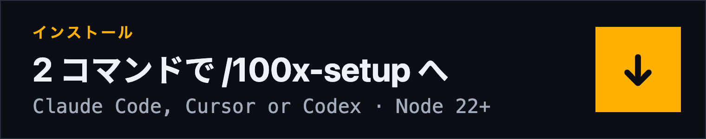
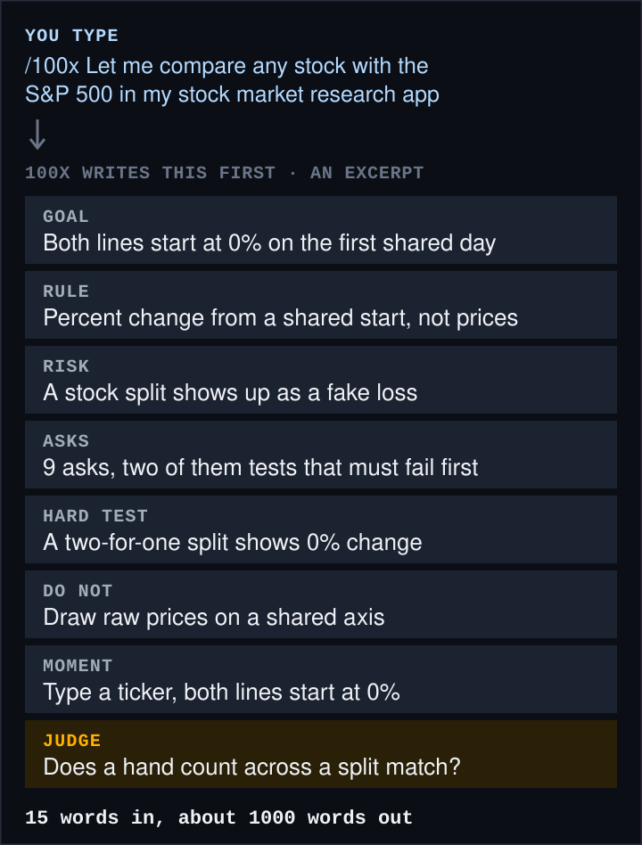
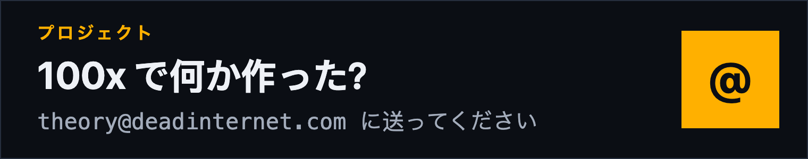
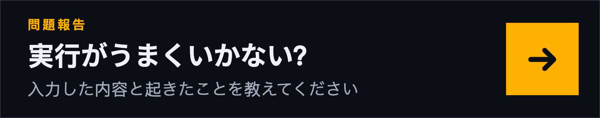
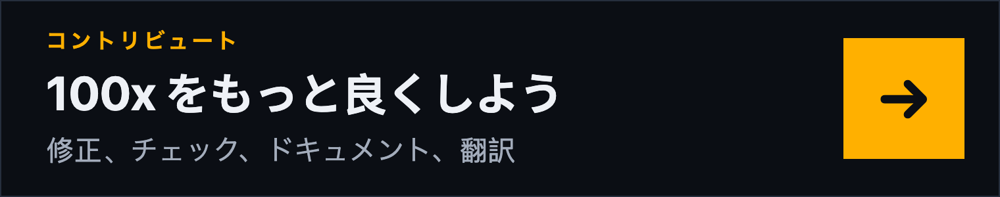

<div align="center">

<picture>
  <source media="(prefers-color-scheme: dark)" srcset="../docs/img/brand/mask-dark.png">
  
</picture>

# 100× ENGINEER SKILL

### もう「ほぼ動く」で終わらせない AI コーディング

[](https://github.com/DeadInternetStudios/100x-engineer-skill/actions/workflows/ci.yml)
[](https://github.com/DeadInternetStudios/100x-engineer-skill/stargazers)
[](https://github.com/DeadInternetStudios/100x-engineer-skill/releases)
[](https://nodejs.org/)
[](../LICENSE)


<sub><a href="../README.md">English</a> · <a href="README.es.md">Español</a> · <a href="README.zh.md">中文</a> · <a href="README.pt.md">Português</a> · <a href="README.ru.md">Русский</a> · <b>日本語</b> · <a href="README.fr.md">Français</a> · <a href="README.de.md">Deutsch</a> · <a href="README.ar.md">العربية</a> · <a href="README.hi.md">हिन्दी</a> · <a href="README.ko.md">한국어</a> · <a href="README.id.md">Bahasa Indonesia</a> · <a href="README.tr.md">Türkçe</a> · <a href="README.vi.md">Tiếng Việt</a> · <a href="README.bn.md">বাংলা</a> · <a href="README.it.md">Italiano</a> · <a href="README.pl.md">Polski</a> · <a href="README.th.md">ไทย</a> · <a href="README.uk.md">Українська</a> · <a href="README.nl.md">Nederlands</a></sub>

</div>

> **100x engineer**<br>
> /ˈwən ˈhən-drəd eks ˌen-jə-ˈnir/<br>
> *名詞*
>
> 普通のエンジニア百人分の成果を、会議も質問も失敗するテストもなしに出すと言われるソフトウェアエンジニア。

エージェントは「できました」と言います。開いてみると、*一応*動きます。見た目はいつも問題なさそうなのに、そのままリリースできる状態にはなっていません。

**100x は、開発の最後の 10% をコーディングエージェントに片付けさせます。**

Claude Code、Cursor、Codex 向けのオープンソースのスキルです。アプリへの機能追加や、小さなアプリのゼロからの作成など、仕事をひとつ任せてください。作業を計画し、作り、仕上げ、いちばん大事な部分をテストします。それを別の AI モデルがレビューします。最後に、スクリーンショット、テスト結果、未解決の点をまとめたレポートが届きます。

<p align="center">
  <a href="#インストール"></a>
</p>

<!-- Benchmark headline goes here: one line and one picture, the same agent with and without 100x, with a link to the method. -->

## エージェントが「ほぼ動く」で止まる理由

うまくいかない原因は 3 つあり、100x はそれぞれに答えを用意しています。以下の例では、すべて同じ依頼を使います。

> 株式リサーチアプリで、どの銘柄でも S&P 500 と比較できるようにして

### 1. 「動く」の意味を誰も書いていない

依頼は 1 行です。100x は何かを作る前に、1 時間の余裕があればあなたが書いたはずのプロンプトを書きます。ゴール、ルール、いちばんリスクの高い部分、そして各要件の確認方法を決めます。この例では、早い段階で落とし穴に気づきます。チャートが株式分割を調整しないと、分割が損失のように見えてしまうのです。

<p align="center">
  
</p>

<p align="center"><a href="../docs/examples/stock-comparison-prompt.md">プロンプト全文を読む</a></p>

### 2. エージェントが自分の仕事を自分でチェックしている

自分の仕事をチェックするモデルは、自分のミスを見逃します。100x では、別のモデルがコードと画面を何ラウンドかに分けてレビューします。作り手は指摘をひとつずつ直すか、同意しない理由を書き残します。この例では、プロンプトが上場したばかりの銘柄のケースを挙げ、レビュー担当にそこを突くよう指示していましたが、作り手のテストは古い銘柄しか使っていませんでした。レビュー担当が今年上場した銘柄を試すと、指数の線が 5 か月早く始まっていました。

<p align="center">
  
</p>

これは図解です。本物の例もあります。この README は、あなたが読む前に 100x を通っています。レビュー担当は最初のラウンドで 9 件の問題を指摘しました。20 個の切れた言語リンクから、スマホでは小さすぎるラベルまでです。7 件を直し、2 件は一般公開まで保留にしました。[指摘内容を読む](../docs/examples/readme-review.md)。

### 3. まとめが記憶頼り

エージェントが「完了」と言うとき、報告しているのは覚えていることです。100x は作業しながら証拠を保存します。スクリーンショット、テスト出力、レビュー担当の指摘です。最後にコードがそれらのファイルからまとめを書きます。証拠のない要件や欠けているチェックがあるあいだは、`100x finish` が書くのを拒否します。以下は株価チャートの実行が終わったときのメッセージです。リサーチアプリは架空なので、この実行は図解です。

<p align="center">
  
</p>

<details>
<summary>同じメッセージのプレーンテキスト</summary>

```text
Compare with the S&P 500: A chart in a research app that shows how any stock has moved against the S&P 500 since the first day both have prices. Verdict: ready to ship. The split math matches a hand count and both lines start on the same day. Dividends are not counted yet.
The moment: Type a ticker and both lines start at 0% on the same day, so the gap is the whole story
Run: npm run dev, then open http://localhost:5173/compare
Try first: 1) Type a ticker you hold and read the gap to the index 2) Pick a stock that split two for one and check the split day shows no drop 3) Pick a stock listed this year and see where both lines start
Must not break: numbers passed (Percent change across a two-for-one split matches a hand count on 40 split cases, 0 failing)
Review (claude-opus-5-5): 9 flagged, 7 fixed, 1 rejected, 1 deferred
Judge rounds: 5 of 5 done, on the code and how it behaves, the UI and UX and whether it is ready to ship, and the last word was ready to ship
Screen sizes: 0 broken, 2 weak, 15 sizes and 148 elements checked
Asks: 9 of 9 closed
Report: file:///Users/you/projects/research-app/.100x/REPORT.html
Next likely asks: Count dividends in the comparison; Show the gap for several stocks in one table
```

</details>

- **決め手の瞬間（The moment）：** それが欲しくなる、たったひとつのこと
- **壊してはいけないもの（Must not break）：** 厳しいテストと、それが通ったかどうか
- **レビュー（Review）：** 別のモデルが何を指摘し、作り手がそれをどう扱ったか
- **要件（Asks）：** プロンプトに書かれた要件。どれも証拠があって初めて完了になる
- **次に頼みそうなこと（Next likely asks）：** 次にたぶん頼むもの。作成済みか、リストに載っている

## メッセージを 1 つ送って、あとは任せる

同じ依頼をタイムラインで見てみます。手作業だと、質問に答えたりミスを見つけたりするために何度も戻ってくることになります。100x なら、メッセージを 1 つ送って、戻ったらレポートを読むだけです。青があなた、琥珀色が別のモデルです。時刻は架空です。

<p align="center">
  
</p>

<details>
<summary>小さなアプリをゼロから作る場合も同じ</summary>

<p align="center">
  
</p>

4 語から書かれた家計簿アプリのプロンプト：[make me a budget app](../docs/examples/budget-app-prompt.md)。

</details>

<details>
<summary>実行の 8 ステップすべて</summary>

| ステップ | 何が起きるか |
|---|---|
| 1. 計画 | エージェントが詳しいプロンプトを書きます。何を作り、各依頼をどう確認するかを明確にします。 |
| 2. 核心 | まだ計画を変える時間があるうちに、いちばんリスクの高い部分を先に試します。 |
| 3. 構築 | 最初のバージョンと、次に頼まれそうな追加機能を作ります。 |
| 4. 仕上げ | レイアウトと細部を仕上げます。パスのたびに別のモデルがスクリーンショットを見て、弱い点を指摘します。 |
| 5. テスト | 壊れたら全体が台無しになる、ひとつのことをテストします。たとえばチャートが株式分割を間違えるようなことです。まず、そのテストがミスを捕まえられることを示します。 |
| 6. レビュー | 別のモデルがコードと画面をレビューします。作り手は問題をひとつずつ直すか、後回しにできる理由や同意しない理由を書き残します。 |
| 7. 完了 | `100x finish` コマンドが、レポートを書く前に保存された証拠をチェックします。 |
| 8. レポート | 結果を見て、自分で試し、レビュー担当の指摘を読めます。 |

あなたが離れているあいだ、エージェントは下した判断をすべて書き残しながら作業を続けます。[ワークフロー全体を読む](../docs/pipeline.md)。

</details>

## 手に入るもの

<div align="center">


<sub>架空の 3 回の実行から作ったレポートページ。実際の実行では、各カードにその実行のスクリーンショットが入ります。</sub>

</div>

- **機能やアプリそのもの**と、自分で試す方法
- **さまざまな画面サイズのスクリーンショット**。はみ出した文字、小さすぎるボタン、ぼやけた画像、ブラウザのエラーをチェック済み
- **レポートページ**（`.100x/REPORT.html`）と、`~/.100x` にある完了した全実行のギャラリー
- **判断ログ**：あなたが離れているあいだに 100x が下したすべての選択と、その理由
- 上に載せた**最終メッセージ**

各実行には判定がひとつ付きます。**リリース可**、**まずまず**、**要改善**のいずれかです。判定を妨げるものがあると、カードにその内容が表示されます。100x が問題を見つけた場合は赤、チェックが欠けている場合は琥珀色です。

---

<div align="center">

## 100x で作られた実際のプロダクト

<table align="left"><tr><td>
<a href="https://dollarflow.com/"></a><br>
<a href="https://dollarflow.com/"><b>DollarFlow</b></a><br>
株式スクリーナー。<br>
100x の支援で構築
</td></tr></table>
<table align="left"><tr><td>
<a href="https://springtails.wiki/"></a><br>
<a href="https://springtails.wiki/"><b>Springtails Wiki</b></a><br>
トビムシの Wiki。<br>
すべて 100x で構築
</td></tr></table>
<br clear="all">
<table align="left"><tr><td>
<a href="https://bubblewrapapp.com/"></a><br>
<a href="https://bubblewrapapp.com/"><b>BubbleWrap</b></a><br>
ピクセルアートの音楽アプリ。<br>
すべて 100x で構築
</td></tr></table>
<table align="left"><tr><td>
<a href="https://goldtraderdesk.com/"></a><br>
<a href="https://goldtraderdesk.com/"><b>Gold Trader Desk</b></a><br>
金取引アプリ。<br>
すべて 100x で構築
</td></tr></table>
<br clear="all">
<table align="left"><tr><td>
<br>
<b>Phantom</b><br>
法科学の専門家が筆跡の<br>
分析に使う Swift の Mac アプリ。<br>
100x の支援で構築
</td></tr></table>
<table align="left"><tr><td>
<br>
<b>OptionsFlow</b><br>
クオンツ企業が使う React 製の<br>
リアルタイムのオプションチェーンツール。<br>
100x の支援で構築
</td></tr></table>
<br clear="all">
<table align="left"><tr><td>
<br>
<b>Skynet</b><br>
Blueprint と Encore で作った<br>
プロジェクト管理ツール。<br>
100x の支援で構築
</td></tr></table>
<table align="left"><tr><td>
<br>
<b>Boneworks</b><br>
キャラクターのモデリング、スキニング、<br>
リギング、アニメーションを行う<br>
テキストから 3D へのパイプライン。<br>
100x の支援で構築
</td></tr></table>
<br clear="all">

<p align="center">
  <a href="mailto:theory@deadinternet.com"></a>
</p>

</div>

---

## コスト

100x は時間と使用量を、証拠と引き換えにします。

- **通常の実行には数時間かかります。** 仕上げのパスもレビューのラウンドも、そのたびに別のモデルが働くので、1 回の実行でプランのかなりの部分を使います。
- **まず見てみたいなら**、`/100x-mockup` は約 15 分です。レビューを省き、そのことを明示します。
- **小さめのプランなら**、`100x config preset lite --global` で仕上げのパスを 3 回から 1 回に、レビューを 5 ラウンドから 2 ラウンドに減らせます。証拠のチェックはそのまま残ります。
- **小さな作業には向きません。** 1 行の修正や質問なら、エージェントに直接頼んでください。100x は、計画とテストとレビューに見合う仕事のためのものです。

## インストール

Claude Code、Cursor または Codex と、Node.js 22 以降が必要です。

**1. ツールとスキルをインストールする**

どちらか1つを選びます:

**npm**

```bash
npm install -g github:DeadInternetStudios/100x-engineer-skill
100x install
```

**skills.sh**

```bash
npm install -g github:DeadInternetStudios/100x-engineer-skill
npx skills add DeadInternetStudios/100x-engineer-skill --skill '*' -g
100x install
```

`skills` ツールはスキルをコピーするだけなので、`100x` ツールは引き続き npm から入れます。そのあと `100x install` がコピーを見つけ、手を加えずにそのままにします。更新は `npx skills update -g` で行います。

**2. エージェントの中でセットアップする**

```text
/100x-setup
```

どのプランを使っているか（Claude Pro、Max、Ultra、または OpenAI Go、Plus、Pro）を聞かれ、どのモデルが作り、どのモデルが審査するかが決まります。小さめのプランなら、そう伝えると lite プリセットが有効になります。詳しくは [docs/plans-and-setup.md](../docs/plans-and-setup.md)。

**3. 仕事を任せる**

```text
/100x 株式リサーチアプリで、どの銘柄でも S&P 500 と比較できるようにして
```

Claude Code と Cursor では `/` でスキルを始めます。Codex では `$` を使い、`$100x-setup` や `$100x` のように書きます。夜のあいだ離れるときは `/100x-overnight`、まず見てみたいときは `/100x-mockup` を使ってください。

### その他のインストール方法

**クローンから**（このリポジトリのテストではこの方法を使っています）

```bash
./scripts/install.sh --dry-run   # preview
./scripts/install.sh
```

100x は 2 つの部分でできています。エージェントが読むスキルと、`100x` コマンドラインツールです。ツールは、モデルだけでは確実にこなせないことを受け持ちます。時間を管理し、スクリーンショットを撮り、審査を実行し、証拠をチェックし、レポートを書きます。スクリーンショットには Playwright を使います。入っていなければ `100x browsers` がインストールします。

インストーラーが作るのは、ショートカット（シンボリックリンク）といくつかの小さなファイル、それらのフォルダーだけです。実際のファイルを上書きすることはありません。`100x doctor` で結果を確認でき、`./scripts/install.sh --uninstall` で削除できます。触れるファイルの一覧：[docs/cli.md](../docs/cli.md)。

## モード

100x はスキルの集まりで、それぞれをモードと呼びます。使うにはモード名を入力します。メッセージ中の単語でモードが選ばれることはないので、`/100x an overnight oats app` はオーバーナイトオーツのアプリを作ります。

| 入力するもの | 用途 | 内容 |
|---|---|---|
| `/100x` | 構築 | 通常の実行：構築、仕上げ、テスト、別モデルによるレビュー。 |
| `/100x-mockup` | 構築 | 約 15 分でまず見てみるための高速版。肝心の瞬間だけが動きます。レビューはなく、そのことを明示します（UNREVIEWED）。 |
| `/100x-overnight` | 構築 | 離れるとき用。1 つまたは複数のアイデアを決めた時間だけ実行し、エージェントが止まったら背中を押します。 |
| `/100x-wrapup` | 構築 | 締め切り用。メインの流れを動くようにして、残りは隠します。 |
| `/100x-judge` | レビュー | すでに作ったものをレビューします。新しいものは作りません。 |
| `/100x-grind` | レビュー | 審査がリリース可と言うまで、レビュー、修正、再レビューを繰り返します。3 回続けてレビューで改善が見つからないとき、15 ラウンドに達したとき、または時間切れで止まります。 |
| `/100x-status` | 実行 | 実行がどこまで進んだかを 6 行以内で。 |
| `/100x-continue` | 実行 | 止まった実行を再開します。たとえば使用量の上限で止まった場合です。 |
| `/100x-report` | 実行 | 完了したものをすべて、良い順に表示します。何も作りません。 |
| `/100x-adhd` | 計画 | 1 回に 1 つずつ質問する短いやりとりで、ぼんやりしたアイデアを計画にします。あなたが「始めて」と言うまで何も作りません。 |
| `/100x-setup` | セットアップ | プランについて 1 つ質問し、どのモデルがどの仕事をするかを設定します。 |
| `/100x-bakeoff` | 100x のテスト | 100x 自体をテストします。同じエージェントが 100x ありとなしで同じアイデアを作り、ブラインドの審査が比較します。何も作りません。 |

### 数字フレーズ

メッセージにこれを加えると実行が変わります。`/100x` と `/100x-overnight` で使えます。「fast」や「quick」のような他の単語は何もしません。

| 書くもの | 何が起きるか |
|---|---|
| `3 versions` | アイデアを 3 バージョン作り、いちばん良いものを仕上げます。数字はいくつでも構いません。 |
| `for 10 hours`、`for 2 days`、`until 6am` | その時間を使い切ります。早く終わることはありません。 |
| `5 rounds of judging` | その回数だけレビューのラウンドを行います。 |
| `max 5 subagents` | 同時に動くサブエージェントは最大 5 つ。デフォルトは 1 です。 |

```text
/100x-overnight 3 versions of a farming game, for 8 hours, max 3 subagents
```

各実行は最初に、理解したフレーズを一覧にします。読み違いがあればすぐ気づけます。

時間を指定すると、時間切れまでラウンドを重ねて作業を続けます。各ラウンドはプロジェクトを新しい角度から見て、良くなった変更は残し、良くならなければ元に戻します。毎ラウンド、新しい別のモデルがチェックします。

<p align="center">
  
</p>

## よくある質問

**なぜ別のモデルを使うのですか？** モデルによって死角が違うからです。使えるモデルがなくても実行は完了し、UNREVIEWED と表示されます。プランが 1 つだけなら、同じ会社の小さめのモデルが審査できますが、別の会社のモデルほどの効果はありません。

**プロジェクトを公開してしまいますか？** いいえ。プレビューを作るのは、プロジェクトにすでにプレビューがある場合だけです。公開するにはあなたの指示が必要です。

**実行中に使用量の上限に達したら？** 100x は進捗を `.100x/STATE.md` に保存します。上限がリセットされたら、同じフォルダーで `/100x-continue` と入力してください。

**モデルや設定を変えられてしまいますか？** いいえ。モデル、推論の強さ、サインインを切り替えることはありません。`/100x-setup` が書き込むのは 100x 自身の設定だけです。

**実行のデータはどこにありますか？** 各プロジェクトの隠しフォルダー `.100x/`（git は無視します）と、完了した実行のギャラリーがある `~/.100x` です。

<p align="center">
  <a href="https://github.com/DeadInternetStudios/100x-engineer-skill/issues/new"></a>
</p>

## ドキュメント

| ページ | 内容 |
|---|---|
| [インストールの詳細](../docs/install.md) | すべてのインストール方法と、インストーラーが触れるすべてのファイル |
| [100x の使い方](../docs/using.md) | 一晩離れるとき、レポートページ、ヘルパースキル |
| [パイプラインと最終メッセージ](../docs/pipeline.md) | 各ステップの詳細と、`100x finish` がチェックする内容 |
| [セットアップとプラン](../docs/plans-and-setup.md) | おすすめの Claude Code の設定、lite プリセット、プランごとの設定 |
| [設定](../docs/settings.md) | すべての設定キー |
| [CLI とファイル構成](../docs/cli.md) | すべての `100x` コマンドと、ファイルの置き場所 |
| [スキルの中身と検証](../docs/contributing.md) | リポジトリの構成と、そのテスト方法 |
| [設計メモ](../docs/design.md) | 100x がこう動く理由 |

## コントリビュート

バグ報告、修正、アイデアを歓迎します。小さな修正はそのままプルリクエストを送ってください。大きめの変更は、まず Issue を立てて合意してからにしましょう。[コントリビュートの方法](../CONTRIBUTING.md)。

<p align="center">
  <a href="../CONTRIBUTING.md"></a>
</p>

## クレジット

100x は、Lauren Tan による [pstack](https://github.com/cursor/plugins/tree/main/pstack)（MIT）の作業原則をもとに、プロトタイプ向け、そしてエージェントとの 1 回の会話向けに作り直したものです。違いは次のとおりです。

- どの実行もレポートページで終わります。
- `100x finish` は確認できない主張を受け付けません。
- 別のモデルが何ラウンドかに分けて作業をレビューします。

[NOTICE.md](../NOTICE.md) と [UPSTREAM.md](../UPSTREAM.md) を参照してください。

MIT ライセンス。[LICENSE](../LICENSE) を参照してください。

<p align="center">
  <a href="https://star-history.com/#DeadInternetStudios/100x-engineer-skill&Date">
    <picture>
      <source media="(prefers-color-scheme: dark)" srcset="https://api.star-history.com/svg?repos=deadinternetstudios/100x-engineer-skill&type=Date&theme=dark">
      
    </picture>
  </a>
</p>

---

<sub>仮面のイラスト： <a target="_blank" href="https://www.vexels.com/png-svg/preview/229802/guy-fawkes-mask-bonfire-night-stroke">www.vexels.com</a></sub>
