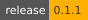
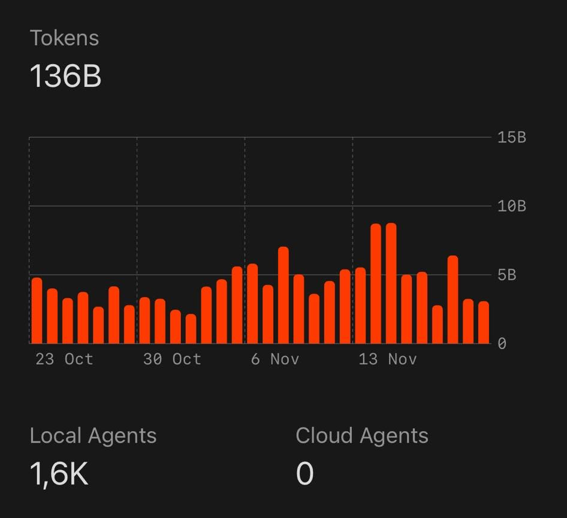
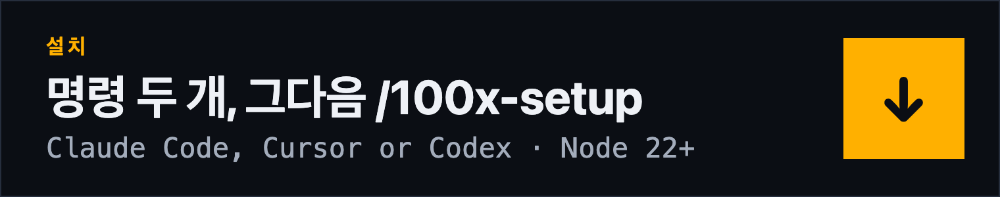
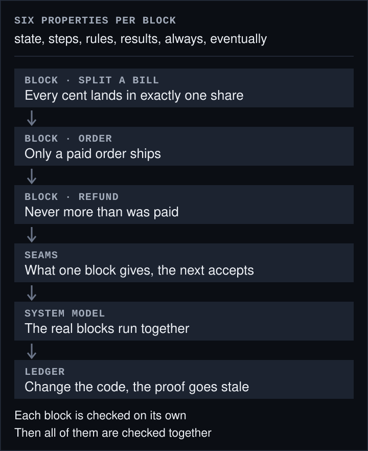
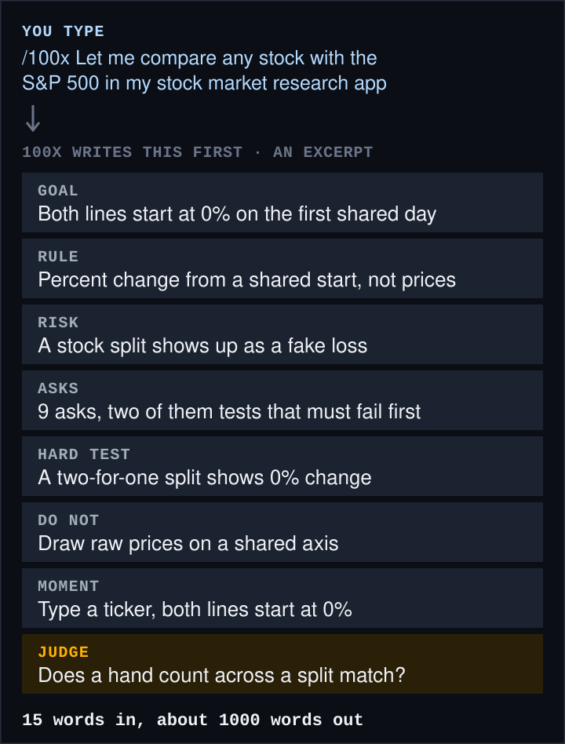
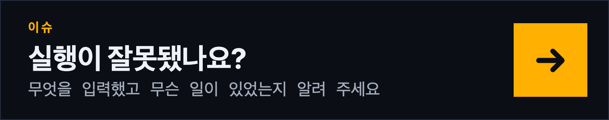
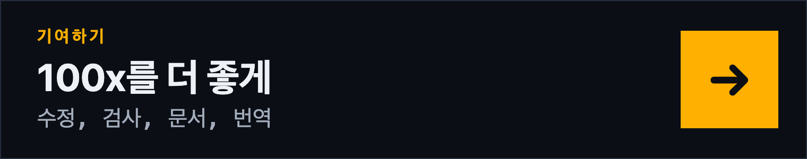

<div align="center">

<picture>
  <source media="(prefers-color-scheme: dark)" srcset="../docs/img/brand/mask-dark.png">
  
</picture>

# 100× ENGINEER SKILL

<p align="center">
  
  
</p>

<p align="center">
  <picture>
    <source media="(prefers-color-scheme: dark)" srcset="https://upstar.dev/badge/DeadInternetStudios/100x-engineer-skill/day/agent-skills-dark.svg">
    
  </picture>
</p>

### 이제 “거의 돌아가는” 에이전트 코딩은 그만

[](https://github.com/DeadInternetStudios/100x-engineer-skill/actions/workflows/ci.yml)
[](https://github.com/DeadInternetStudios/100x-engineer-skill/releases)
[](https://nodejs.org/)
[](../LICENSE)

[](https://github.com/DeadInternetStudios/100x-engineer-skill/stargazers)

*100x는 Cursor의 전직 엔지니어가 만든 스킬로, 프롬프트를 형식 검증을 거친 프로덕션용 코드로 바꿔 줍니다.<br>저는 이것으로 매달 1,000개가 넘는 PR을 프로덕션에 배포하고 있으며, 롤백 비율은 2% 미만입니다.*

<sub><a href="../README.md">English</a> · <a href="README.es.md">Español</a> · <a href="README.zh.md">中文</a> · <a href="README.pt.md">Português</a> · <a href="README.ru.md">Русский</a> · <a href="README.ja.md">日本語</a> · <a href="README.fr.md">Français</a> · <a href="README.de.md">Deutsch</a> · <a href="README.ar.md">العربية</a> · <a href="README.hi.md">हिन्दी</a> · <b>한국어</b> · <a href="README.id.md">Bahasa Indonesia</a> · <a href="README.tr.md">Türkçe</a> · <a href="README.vi.md">Tiếng Việt</a> · <a href="README.bn.md">বাংলা</a> · <a href="README.it.md">Italiano</a> · <a href="README.pl.md">Polski</a> · <a href="README.th.md">ไทย</a> · <a href="README.uk.md">Українська</a> · <a href="README.nl.md">Nederlands</a></sub>

</div>

> **100x engineer**<br>
> /ˈwən ˈhən-drəd eks ˌen-jə-ˈnir/<br>
> *명사*
>
> 회의도, 질문도, 실패하는 테스트도 없이 평범한 엔지니어 백 명 몫을 해낸다고 하는 소프트웨어 엔지니어.

에이전트가 다 됐다고 합니다. 열어 보면 *대충* 돌아갑니다. 겉보기엔 늘 괜찮은데, 바로 출시할 수 있는 상태는 아닙니다.

**100x는 코딩 에이전트가 개발의 마지막 10%를 해결하게 만듭니다.**

**작업을 작은 블록으로 나누고, 각 블록을 형식 검증한 다음, 블록들이 함께 동작하는지 확인합니다.**

<p align="center">
  
</p>

<p align="center"><b>30일간 136B 토큰 · 엔지니어 1명 · 본격적인 프로젝트 · PR 1,000개 이상 · 캐시로 $250k 절감</b></p>

Claude Code, Cursor, Codex용 오픈소스 스킬입니다. 앱에 기능을 추가하거나 작은 앱을 처음부터 만드는 것처럼 일을 하나 맡기세요. 작업을 계획하고, 만들고, 다듬고, 가장 중요한 부분을 테스트합니다. 그다음 두 번째 AI 모델이 검토합니다. 마지막에는 스크린샷, 테스트 결과, 아직 남은 문제가 담긴 보고서를 받습니다.

<p align="center">
  <a href="#설치"></a>
</p>

<!-- Benchmark headline goes here: one line and one picture, the same agent with and without 100x, with a link to the method. -->

## 형식 검증, 작은 블록 하나씩

앱 전체를 한 번에 형식 검증하는 사람은 없습니다. 하지만 잘 설계된 소프트웨어는 거의 다 작은 블록으로 이루어져 있고, 작은 블록에는 정확히 말로 적고 완전히 확인할 수 있는 것들이 있습니다. 100x는 그것들을 적어 두고, 하나하나 확인한 다음, 블록들이 함께 동작하는지 확인합니다. 기본으로 이렇게 동작합니다.

### 블록마다 던지는 여섯 가지 질문

| 질문 | 적는 내용 |
|---|---|
| 상태 | 무엇이 존재할 수 있는가 |
| 전이 | 어떻게 바뀔 수 있는가 |
| 사전 조건 | 언제 한 단계가 허용되는가 |
| 사후 조건 | 한 단계 뒤에 무엇이 참인가 |
| 불변식 | 항상 성립하는 것은 무엇인가 |
| 활성 | 결국 무엇이 일어나야 하며, 그것이 무엇을 가정하는가 |

프롬프트가 여섯 가지에 모두 쉬운 문장으로 답합니다. 그다음 100x가 실제 함수를 실행하는 작은 모델을 만들고, 검사기가 모델이 도달할 수 있는 모든 상태를 방문합니다. 무언가 깨지면, 거기에 이르는 가장 짧은 단계 목록을 출력합니다.

### 작은 블록이 모여 큰 시스템이 됩니다

<p align="center">
  
</p>

각 블록은 따로 검사되므로, 실패는 작은 한 곳을 가리킵니다. 이음새도 검사됩니다. 한 블록이 넘기는 것은 다음 블록의 규칙을 만족해야 합니다. 그다음 실제 블록들이 하나의 모델에서 함께 실행되고, 검사기가 전체의 모든 상태를 방문합니다. 검사된 블록에 검사된 이음새를 더하면 믿을 수 있는 소프트웨어가 됩니다. 블록이 이음새까지 공짜로 증명해 주지는 않으므로, 100x는 둘 다 검사합니다.

### 계속 참으로 유지됩니다

장부는 `verify/ledger.tsv`이며 저장소 안에 있어서 모든 브랜치와 함께 움직입니다. 각 행은 그 행이 다루는 코드의 해시를 보관합니다. 그 코드를 바꾸면 누군가 변경을 읽고, 검사를 실행하고, 동기화할 때까지 그 행은 오래된 것이 됩니다. 모든 속성은 인정받기 전에 일부러 심은 버그에서 한 번 실패해야 합니다. `100x finish`는 오래되었거나, 깨졌거나, 한 번도 실패한 적 없는 속성을 거부합니다. 에이전트가 어떤 규칙도 다루지 않는 코드를 건드리려 하면 `100x verify cover`가 `NO RULE`이라고 답하고, 이것이 절차를 시작합니다.

```text
$ 100x verify run
pass  split-keeps-every-cent. invariant, exhaustive, exit 0

# someone swaps Math.floor for Math.round in the split
$ 100x verify status
stale   split-keeps-every-cent  the covered code changed after the last sync

$ 100x verify run
FAIL  inv:shares-keep-every-cent. a cent was lost or made. Steps: set-bill(1), set-people(2), compute
```

<sub>작은 팁 계산기에서, 테스트용 저장소에서 직접 실행한 결과</sub>

### 여기서 검증됨이 뜻하는 것

- **전수**(`exhaustive`): 모델의 모든 상태를 방문했으므로, 그 속성은 그 모델과 그 범위에서 성립합니다
- **제한적**(`bounded`): 탐색이 한계에 닿았고 본 범위에서는 아무것도 찾지 못했습니다. 이것은 증명이 아니며, 활성은 이 결과로 판정하지 않습니다
- **표본**(`sampled`): 고른 사례나 무작위 사례, 버그를 찾는 데는 좋고 나머지에 대해서는 말이 없습니다

통과는 모델과, 검사가 실행하는 실제 함수를 다룹니다. 레이아웃과 문구는 서술할 것이 없으므로 사유가 적힌 면제를 기록하며, `100x finish`는 각 면제가 넘어가는 코드를 이름으로 알려 줍니다. 이 모든 것을 건너뛰려면 메시지에 `no verification`이라고 쓰거나 `100x config set verify.enabled false`를 실행하세요. 그러면 보고서에 아무것도 검증하지 않았다고 적힙니다.[자세한 내용](../docs/verification.md).

## 에이전트가 “거의 돌아가는” 데서 멈추는 이유

문제는 세 가지이고, 100x는 각각에 대한 답을 갖고 있습니다. 아래 예시는 모두 같은 요청을 씁니다.

> 내 주식 리서치 앱에서 아무 종목이나 S&P 500과 비교할 수 있게 해 줘

### 1. “돌아간다”가 무슨 뜻인지 아무도 적지 않았다

요청은 한 줄입니다. 100x는 무엇이든 만들기 전에, 한 시간쯤 여유가 있었다면 당신이 썼을 프롬프트를 씁니다. 목표, 규칙, 가장 위험한 부분, 그리고 각 요구 사항을 확인하는 방법을 정합니다. 이 예시에서는 함정을 일찍 찾아냅니다. 차트가 주식 분할을 보정하지 않으면 분할이 손실처럼 보인다는 점입니다.

<p align="center">
  
</p>

<p align="center"><a href="../docs/examples/stock-comparison-prompt.md">전체 프롬프트 읽기</a></p>

### 2. 에이전트가 자기 작업을 스스로 검사한다

자기 작업을 검사하는 모델은 자기 실수를 놓칩니다. 100x에서는 두 번째 모델이 코드와 화면을 여러 라운드에 걸쳐 검토합니다. 빌더는 지적 사항을 하나씩 고치거나, 동의하지 않는 이유를 적어 둡니다. 이 예시에서 프롬프트는 새로 상장한 종목의 경우를 짚고 검토자에게 그 부분을 파고들라고 했지만, 빌더의 테스트는 오래된 종목만 썼습니다. 검토자가 올해 상장한 종목을 넣어 보니 지수 선이 다섯 달 일찍 시작하고 있었습니다.

<p align="center">
  
</p>

이건 예시입니다. 진짜 사례도 있습니다. 지금 읽고 있는 이 README도 100x를 거쳤습니다. 검토자는 첫 라운드에서 문제 9개를 지적했습니다. 죽은 언어 링크 20개부터 휴대폰에서 너무 작은 라벨까지요. 7개는 고쳤고 2개는 공개 출시 때로 미뤘습니다. [무엇을 찾았는지 읽기](../docs/examples/readme-review.md)

### 3. 요약이 기억에 의존한다

에이전트가 “완료”라고 할 때 보고하는 건 기억하는 내용입니다. 100x는 작업하면서 증거를 저장합니다. 스크린샷, 테스트 출력, 검토자의 지적 사항입니다. 마지막에는 코드가 그 파일들로 요약을 쓰고, 증거 없는 요구 사항이나 빠진 검사가 있으면 `100x finish`가 요약 작성을 거부합니다. 아래는 주식 차트 실행이 끝났을 때의 메시지입니다. 리서치 앱은 지어낸 것이라 이 실행도 예시입니다.

<p align="center">
  
</p>

<details>
<summary>같은 메시지를 일반 텍스트로</summary>

```text
Compare with the S&P 500: ready to ship.
The split math matches a hand count and both lines start on the same day. Dividends are not counted yet.

The moment: Type a ticker and both lines start at 0% on the same day, so the gap is the whole story
Run: npm run dev
Open: http://localhost:5173/compare
Try first:
1) Type a ticker you hold and read the gap to the index
2) Pick a stock that split two for one and check the split day shows no drop
3) Pick a stock listed this year and see where both lines start

Must not break: numbers passed (Percent change across a two-for-one split matches a hand count on 40 split cases, 0 failing)
Review (claude-opus-5-5): 9 flagged, 7 fixed, 1 rejected, 1 deferred
Judge rounds: 5 of 5 done, and the last word was ready to ship
Looked at: the code and how it behaves, the UI and UX and whether it is ready to ship
Screen sizes: 0 broken, 2 weak, 15 sizes and 148 elements checked
Asks: 9 of 9 closed

Report: file:///Users/you/projects/research-app/.100x/REPORT.html
Next likely asks: Count dividends in the comparison; Show the gap for several stocks in one table
```

</details>

- **핵심 순간(The moment):** 이걸 갖고 싶게 만드는 단 하나
- **깨지면 안 되는 것(Must not break):** 어려운 테스트와 통과 여부
- **검토(Review):** 두 번째 모델이 지적한 것과 빌더가 그걸 어떻게 처리했는지
- **요구 사항(Asks):** 프롬프트에 있는 요구 사항. 각각 증거가 있어야만 닫힌다
- **다음에 요청할 만한 것(Next likely asks):** 다음에 요청할 가능성이 높은 것. 이미 만들었거나 목록에 있다

## 메시지 하나 보내고 자리를 비우세요

같은 요청을 타임라인으로 보면 이렇습니다. 직접 하면 질문에 답하고 실수를 잡으려고 계속 돌아와야 합니다. 100x를 쓰면 메시지 하나를 보내고, 돌아와서 보고서를 읽으면 됩니다. 파란색은 당신, 호박색은 두 번째 모델입니다. 시간은 지어낸 것입니다.

<p align="center">
  
</p>

<details>
<summary>작은 앱을 처음부터 만들 때도 마찬가지</summary>

<p align="center">
  
</p>

단어 네 개로 쓴 가계부 앱의 프롬프트: [make me a budget app](../docs/examples/budget-app-prompt.md)

</details>

<details>
<summary>실행의 여덟 단계 전체</summary>

| 단계 | 하는 일 |
|---|---|
| 1. 계획 | 에이전트가 자세한 프롬프트를 씁니다. 무엇을 만들고 각 요청을 어떻게 확인할지 분명히 적습니다. |
| 2. 핵심 | 아직 계획을 바꿀 시간이 있을 때 가장 위험한 부분부터 시도합니다. |
| 3. 빌드 | 첫 버전과, 다음에 요청할 만한 추가 기능을 만듭니다. |
| 4. 다듬기 | 레이아웃과 세부 사항을 다듬습니다. 패스가 끝날 때마다 두 번째 모델이 스크린샷을 보고 약한 부분을 짚습니다. |
| 5. 테스트 | 망가지면 작업 전체를 망칠 단 하나를 테스트합니다. 예를 들어 차트가 주식 분할을 잘못 계산하는 경우입니다. 먼저 그 테스트가 실수를 잡아낼 수 있다는 걸 보여 줍니다. |
| 6. 검토 | 두 번째 모델이 코드와 화면을 검토합니다. 빌더는 각 문제를 고치거나, 미뤄도 되는 이유나 동의하지 않는 이유를 적어 둡니다. |
| 7. 마무리 | `100x finish` 명령이 보고서를 쓰기 전에 저장된 증거를 검사합니다. |
| 8. 보고서 | 결과를 보고, 직접 써 보고, 검토자가 찾은 내용을 읽을 수 있습니다. |

당신이 자리에 없으면 에이전트는 내린 결정을 하나하나 적어 두고 계속 작업합니다. [전체 워크플로 읽기](../docs/pipeline.md)

</details>

## 받게 되는 것

<div align="center">


<sub>지어낸 실행 세 개로 그린 보고서 페이지입니다. 실제 실행에서는 각 카드에 그 실행의 스크린샷이 들어갑니다.</sub>

</div>

- **기능 또는 앱**, 그리고 직접 써 보는 방법
- **여러 화면 크기의 스크린샷**. 넘치는 글자, 너무 작은 버튼, 흐릿한 이미지, 브라우저 오류를 검사함
- **보고서 페이지**(`.100x/REPORT.html`)와 `~/.100x`에 있는 완료된 모든 실행의 갤러리
- 저장소 안의 **검증 장부**: 각 블록의 속성, 각각이 성립하는지, 그리고 그것이 다루는 코드
- **결정 로그**: 당신이 자리를 비운 동안 100x가 내린 모든 선택과 그 이유
- 위에서 본 **최종 메시지**

실행마다 판정이 하나 붙습니다. **출시 가능**, **괜찮음**, **작업 필요** 중 하나입니다. 판정을 막는 것이 있으면 카드에 그게 무엇인지 나옵니다. 100x가 문제를 찾았으면 빨간색, 검사가 빠졌으면 호박색입니다.

---

<div align="center">

## 100x로 만든 실제 제품

<table align="left"><tr><td>
<a href="https://dollarflow.com/"></a><br>
<a href="https://dollarflow.com/"><b>DollarFlow</b></a><br>
주식 스크리너,<br>
100x의 도움으로 제작
</td></tr></table>
<table align="left"><tr><td>
<a href="https://springtails.wiki/"></a><br>
<a href="https://springtails.wiki/"><b>Springtails Wiki</b></a><br>
톡토기 위키,<br>
전부 100x로 제작
</td></tr></table>
<br clear="all">
<table align="left"><tr><td>
<a href="https://bubblewrapapp.com/"></a><br>
<a href="https://bubblewrapapp.com/"><b>BubbleWrap</b></a><br>
픽셀 아트 음악 앱,<br>
전부 100x로 제작
</td></tr></table>
<table align="left"><tr><td>
<a href="https://goldtraderdesk.com/"></a><br>
<a href="https://goldtraderdesk.com/"><b>Gold Trader Desk</b></a><br>
금 트레이딩 앱,<br>
전부 100x로 제작
</td></tr></table>
<br clear="all">
<table align="left"><tr><td>
<br>
<b>Phantom</b><br>
법과학 전문가가 필적 분석에<br>
쓰는 Swift Mac 앱,<br>
100x의 도움으로 제작
</td></tr></table>
<table align="left"><tr><td>
<br>
<b>OptionsFlow</b><br>
퀀트 회사들이 쓰는 React 기반<br>
실시간 옵션 체인 도구,<br>
100x의 도움으로 제작
</td></tr></table>
<br clear="all">
<table align="left"><tr><td>
<br>
<b>Skynet</b><br>
Blueprint와 Encore 기반의<br>
프로젝트 관리 도구,<br>
100x의 도움으로 제작
</td></tr></table>
<table align="left"><tr><td>
<br>
<b>Boneworks</b><br>
캐릭터를 모델링하고 스킨을 입히고<br>
리깅하고 애니메이션까지 하는<br>
텍스트-3D 파이프라인,<br>
100x의 도움으로 제작
</td></tr></table>
<br clear="all">

<p align="center">
  <a href="mailto:theory@deadinternet.com"></a>
</p>

</div>

---

## 비용

100x는 시간과 사용량을 들여 증거를 얻습니다.

- **일반 실행은 몇 시간 걸립니다.** 다듬기 패스와 검토 라운드마다 모델이 하나 더 일하므로, 실행 한 번에 요금제의 상당 부분을 씁니다.
- **먼저 한번 보고 싶다면** `/100x-mockup`이 약 15분 걸립니다. 검토를 건너뛰고, 건너뛰었다고 밝힙니다.
- **작은 요금제라면** `100x config preset lite --global`로 다듬기 3번과 검토 5라운드 대신 다듬기 1번과 검토 2라운드만 합니다. 증거 검사는 그대로 남습니다.
- **작은 일에는 맞지 않습니다.** 한 줄 수정이나 질문이라면 에이전트에게 바로 물어보세요. 100x는 계획, 테스트, 검토를 들일 만한 일을 위한 것입니다.

## 설치

Claude Code, Cursor 또는 Codex와 Node.js 22 이상이 필요합니다.

**1. 도구와 스킬 설치**

둘 중 하나를 고르세요:

**npm**

```bash
npm install -g github:DeadInternetStudios/100x-engineer-skill
100x install
```

**skills.sh**

```bash
npm install -g github:DeadInternetStudios/100x-engineer-skill
npx skills add DeadInternetStudios/100x-engineer-skill --skill '*' -g
100x install
```

`skills` 도구는 스킬만 복사하므로 `100x` 도구는 여전히 npm으로 설치합니다. 이후 `100x install`이 복사본을 확인하고 그대로 둡니다. 업데이트는 `npx skills update -g`로 합니다.

**2. 에이전트 안에서 설정**

```text
/100x-setup
```

어떤 요금제를 쓰는지 묻고(Claude Pro, Max, Ultra 또는 OpenAI Go, Plus, Pro), 어떤 모델이 만들고 어떤 모델이 심사할지 정합니다. 작은 요금제라면 그렇다고 말하면 lite 프리셋을 켭니다. 자세히: [docs/plans-and-setup.md](../docs/plans-and-setup.md)

**3. 일 맡기기**

```text
/100x 내 주식 리서치 앱에서 아무 종목이나 S&P 500과 비교할 수 있게 해 줘
```

Claude Code와 Cursor에서는 `/`로 스킬을 시작합니다. Codex는 `$`를 써서 `$100x-setup`, `$100x`처럼 씁니다. 밤새 자리를 비울 때는 `/100x-overnight`, 먼저 한번 보고 싶을 때는 `/100x-mockup`을 쓰세요.

### 다른 설치 방법

**클론해서 설치**(이 저장소를 테스트할 때 쓰는 방법)

```bash
./scripts/install.sh --dry-run   # preview
./scripts/install.sh
```

100x는 두 부분으로 되어 있습니다. 에이전트가 읽는 스킬과 `100x` 명령줄 도구입니다. 이 도구는 모델 혼자서는 확실하게 할 수 없는 일을 맡습니다. 시간을 재고, 스크린샷을 찍고, 심사를 돌리고, 증거를 검사하고, 보고서를 씁니다. 스크린샷에는 Playwright를 씁니다. 없으면 `100x browsers`가 설치합니다.

설치 프로그램은 바로 가기(심볼릭 링크), 작은 파일 몇 개와 그 폴더만 만듭니다. 실제 파일을 덮어쓰는 일은 없습니다. `100x doctor`로 결과를 확인하고, `./scripts/install.sh --uninstall`로 제거합니다. 건드리는 모든 파일: [docs/cli.md](../docs/cli.md)

## 모드

100x는 모드라고 부르는 스킬 묶음입니다. 모드 이름을 입력하면 그 모드를 씁니다. 메시지에 들어 있는 단어로 모드가 골라지지는 않으므로, `/100x an overnight oats app`은 오버나이트 오트 앱을 만듭니다.

| 입력 | 용도 | 하는 일 |
|---|---|---|
| `/100x` | 빌드 | 일반 실행: 빌드, 다듬기, 테스트, 두 번째 모델의 검토. |
| `/100x-mockup` | 빌드 | 약 15분 만에 먼저 보는 빠른 버전. 핵심 순간만 작동합니다. 검토가 없고, 그렇다고 밝힙니다(UNREVIEWED). |
| `/100x-overnight` | 빌드 | 자리를 비울 때. 아이디어 하나나 여러 개를 정한 시간 동안 돌리고, 에이전트가 멈추면 다시 움직이게 합니다. |
| `/100x-wrapup` | 빌드 | 마감용. 주요 흐름이 작동하게 하고 나머지는 숨깁니다. |
| `/100x-solo` | 빌드 | 전체 실행을 하나의 채팅에서 합니다. 서브에이전트도, 도우미도, 두 번째 모델도 없습니다. 자기 작업을 다른 관점에서 글로 평가하고, 다른 누구도 보지 않았다고 보고서에 밝힙니다. |
| `/100x-judge` | 검토 | 이미 만든 것을 검토합니다. 새로 만드는 건 없습니다. |
| `/100x-grind` | 검토 | 심사가 출시 가능이라고 할 때까지 검토, 수정, 재검토를 반복합니다. 검토 세 번 연속으로 나아진 게 없거나, 15라운드에 이르거나, 시간이 다 되면 멈춥니다. |
| `/100x-status` | 실행 | 실행이 어디까지 왔는지 여섯 줄 이내로. |
| `/100x-continue` | 실행 | 멈춘 실행을 이어 갑니다. 예를 들어 사용량 한도에 걸려 멈춘 경우. |
| `/100x-report` | 실행 | 끝난 것을 모두 좋은 순서대로 보여 줍니다. 아무것도 만들지 않습니다. |
| `/100x-adhd` | 계획 | 한 번에 질문 하나씩 짧게 주고받으며 막연한 아이디어를 계획으로 만듭니다. 당신이 시작하라고 할 때까지 아무것도 만들지 않습니다. |
| `/100x-setup` | 설정 | 요금제에 관해 질문 하나를 한 뒤, 어떤 모델이 어떤 일을 할지 정합니다. |
| `/100x-bakeoff` | 100x 테스트 | 100x 자체를 테스트합니다. 같은 에이전트가 100x를 쓸 때와 안 쓸 때 같은 아이디어를 만들고, 블라인드 심사가 비교합니다. 아무것도 만들지 않습니다. |

### 숫자 문구

메시지에 이런 문구를 넣으면 실행이 달라집니다. `/100x`와 `/100x-overnight`에서 작동합니다. “fast”나 “quick” 같은 다른 단어는 아무 효과가 없습니다.

| 이렇게 쓰면 | 일어나는 일 |
|---|---|
| `3 versions` | 아이디어를 3가지 버전으로 만들고 가장 좋은 것을 완성합니다. 숫자는 무엇이든 됩니다. |
| `for 10 hours`, `for 2 days`, `until 6am` | 그 시간을 다 씁니다. 실행이 일찍 끝나지 않습니다. |
| `5 rounds of judging` | 그만큼 검토 라운드를 돌립니다. |
| `max 5 subagents` | 동시에 최대 5개의 서브에이전트. 기본값은 1입니다. |

```text
/100x-overnight 3 versions of a farming game, for 8 hours, max 3 subagents
```

실행은 처음에 알아들은 문구를 나열하므로, 잘못 읽은 게 있으면 바로 알 수 있습니다.

시간을 주면 시간이 다 될 때까지 라운드를 거듭하며 계속 일합니다. 각 라운드는 프로젝트를 새로운 방식으로 살펴보고, 도움이 된 변경은 남기고 아니면 되돌립니다. 매 라운드를 새로운 두 번째 모델이 검사합니다.

<p align="center">
  
</p>

## 자주 묻는 질문

**왜 두 번째 모델인가요?** 모델마다 사각지대가 다르기 때문입니다. 쓸 수 있는 모델이 없어도 실행은 끝나고, UNREVIEWED라고 표시합니다. 요금제가 하나뿐이라면 같은 회사의 더 작은 모델이 심사할 수 있지만, 다른 회사 모델만큼의 효과는 없습니다.

**내 프로젝트를 배포하나요?** 아니요. 프로젝트에 이미 미리보기가 있을 때만 미리보기를 만듭니다. 실제로 공개하려면 당신이 직접 그렇게 하라고 해야 합니다.

**실행 중에 사용량 한도에 걸리면요?** 100x는 진행 상황을 `.100x/STATE.md`에 저장합니다. 한도가 초기화되면 같은 폴더에서 `/100x-continue`를 입력하세요.

**내 모델이나 설정을 바꾸나요?** 아니요. 모델, 추론 강도, 로그인 방식을 바꾸지 않습니다. `/100x-setup`은 100x 자체 설정만 씁니다.

**실행 기록은 어디에 있나요?** 각 프로젝트의 숨김 폴더 `.100x/`(git이 무시합니다)에 있고, 끝난 실행의 갤러리는 `~/.100x`에 있습니다.

<p align="center">
  <a href="https://github.com/DeadInternetStudios/100x-engineer-skill/issues/new"></a>
</p>

## 문서

| 페이지 | 내용 |
|---|---|
| [설치 전체 안내](../docs/install.md) | 모든 설치 방법, 설치 프로그램이 건드리는 모든 파일 |
| [100x 사용하기](../docs/using.md) | 밤새 자리 비우기, 보고서 페이지, 도우미 스킬 |
| [형식 검증](../docs/verification.md) | 여섯 가지 속성, 장부, 검증됨의 의미, 블록이 시스템이 되는 방식 |
| [파이프라인과 최종 메시지](../docs/pipeline.md) | 모든 단계 자세히, 그리고 `100x finish`가 검사하는 것 |
| [설정과 요금제](../docs/plans-and-setup.md) | 권장 Claude Code 설정, lite 프리셋, 요금제별 설정 |
| [설정 항목](../docs/settings.md) | 모든 설정 키 |
| [CLI와 파일 구조](../docs/cli.md) | 모든 `100x` 명령과 파일 위치 |
| [스킬 내부, 검증](../docs/contributing.md) | 저장소 구성과 테스트 방법 |
| [설계 노트](../docs/design.md) | 100x가 이렇게 작동하는 이유 |

## 기여하기

버그 제보, 수정, 아이디어 모두 환영합니다. 작은 수정은 바로 풀 리퀘스트로 보내도 됩니다. 더 큰 일이라면 먼저 이슈를 열어 합의부터 해 주세요. [기여 방법](../CONTRIBUTING.md)

<p align="center">
  <a href="../CONTRIBUTING.md"></a>
</p>

## 크레딧

100x는 Lauren Tan의 [pstack](https://github.com/cursor/plugins/tree/main/pstack)(MIT)이 가진 작업 원칙을 바탕으로, 프로토타입과 에이전트와의 대화 한 번에 맞게 다시 만든 것입니다. 다른 점:

- 모든 실행은 보고서 페이지로 끝납니다.
- `100x finish`는 확인할 수 없는 주장을 거부합니다.
- 두 번째 모델이 여러 라운드에 걸쳐 작업을 검토합니다.

[NOTICE.md](../NOTICE.md)와 [UPSTREAM.md](../UPSTREAM.md)를 참고하세요.

MIT. [LICENSE](../LICENSE)를 참고하세요.

<p align="center">
  <a href="https://star-history.com/#DeadInternetStudios/100x-engineer-skill&Date">
    <picture>
      <source media="(prefers-color-scheme: dark)" srcset="https://api.star-history.com/svg?repos=deadinternetstudios/100x-engineer-skill&type=Date&theme=dark">
      
    </picture>
  </a>
</p>
