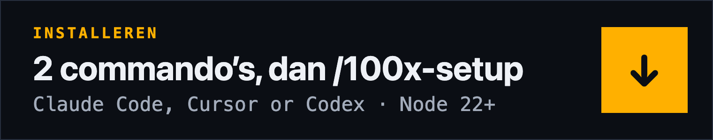
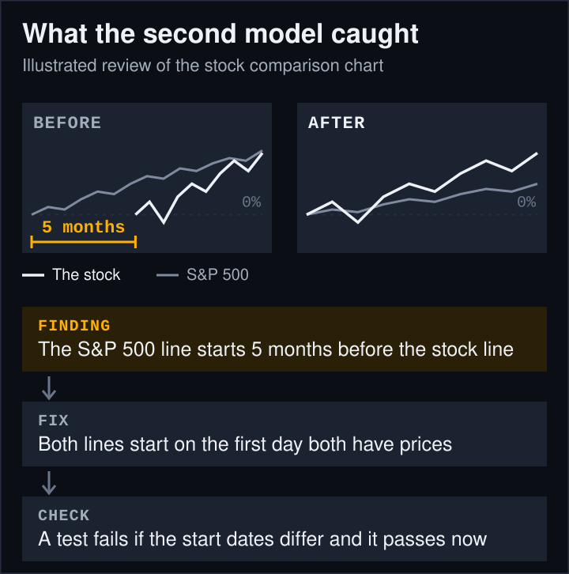
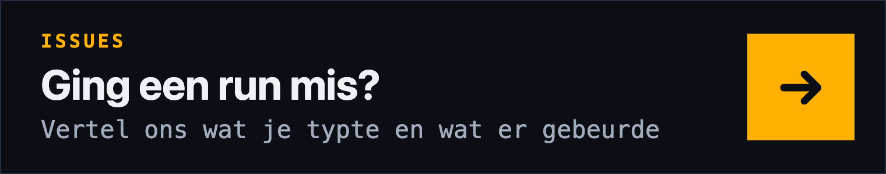
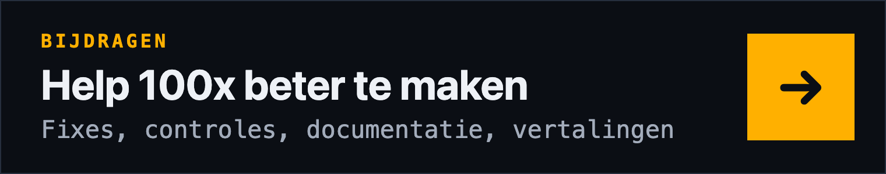

<div align="center">

<picture>
  <source media="(prefers-color-scheme: dark)" srcset="../docs/img/brand/mask-dark.png">
  
</picture>

# 100× ENGINEER SKILL

### NOOIT MEER "WERKT BIJNA" BIJ AGENTIC CODING

[](https://github.com/DeadInternetStudios/100x-engineer-skill/actions/workflows/ci.yml)
[](https://github.com/DeadInternetStudios/100x-engineer-skill/stargazers)
[](https://github.com/DeadInternetStudios/100x-engineer-skill/releases)
[](https://nodejs.org/)
[](../LICENSE)


<sub><a href="../README.md">English</a> · <a href="README.es.md">Español</a> · <a href="README.zh.md">中文</a> · <a href="README.pt.md">Português</a> · <a href="README.ru.md">Русский</a> · <a href="README.ja.md">日本語</a> · <a href="README.fr.md">Français</a> · <a href="README.de.md">Deutsch</a> · <a href="README.ar.md">العربية</a> · <a href="README.hi.md">हिन्दी</a> · <a href="README.ko.md">한국어</a> · <a href="README.id.md">Bahasa Indonesia</a> · <a href="README.tr.md">Türkçe</a> · <a href="README.vi.md">Tiếng Việt</a> · <a href="README.bn.md">বাংলা</a> · <a href="README.it.md">Italiano</a> · <a href="README.pl.md">Polski</a> · <a href="README.th.md">ไทย</a> · <a href="README.uk.md">Українська</a> · <b>Nederlands</b></sub>

</div>

> **100x engineer**<br>
> /ˈwən ˈhən-drəd eks ˌen-jə-ˈnir/<br>
> *zelfstandig naamwoord*
>
> Een software-engineer van wie gezegd wordt dat hij evenveel levert als honderd gewone engineers, zonder de meetings, de vragen of de falende tests.

Je agent zegt dat hij klaar is. Je opent het en het werkt *zo'n beetje*. Het ziet er altijd goed uit, maar het is nooit helemaal klaar om te shippen.

**100x zorgt dat je coding agent ook de laatste 10% van de ontwikkeling oplost.**

Het is een open-source skill voor Claude Code, Cursor en Codex. Geef het één taak, zoals een feature toevoegen aan je app of een kleine app vanaf nul bouwen. Het plant het werk, bouwt het, werkt het af en test het onderdeel dat het meest telt. Een tweede AI-model reviewt het. Je krijgt een rapport met screenshots, testresultaten en alles wat nog openstaat.

<p align="center">
  <a href="#installeren"></a>
</p>

<!-- Benchmark headline goes here: one line and one picture, the same agent with and without 100x, with a link to the method. -->

## Waarom agents blijven hangen bij "werkt bijna"

Er gaan drie dingen mis, en 100x heeft voor elk een antwoord. Elk voorbeeld hieronder gebruikt hetzelfde verzoek:

> Laat me in mijn app voor aandelenonderzoek elk aandeel vergelijken met de S&P 500

### 1. Niemand heeft opgeschreven wat "werkt" eigenlijk betekent

Het verzoek is één regel. Voordat het iets bouwt, schrijft 100x de prompt die jij zou schrijven als je een uur over had. Het legt het doel vast, de regels, het riskantste deel en hoe elke eis wordt gecontroleerd. Hier ziet het de valkuil al vroeg: een aandelensplitsing lijkt een verlies, tenzij de grafiek ervoor corrigeert.

<p align="center">
  
</p>

<p align="center"><a href="../docs/examples/stock-comparison-prompt.md">Lees de hele prompt</a></p>

### 2. De agent controleert zijn eigen werk

Een model dat zijn eigen werk controleert, mist zijn eigen fouten. Bij 100x reviewt een tweede model de code en de schermen, in rondes. De bouwer lost elke bevinding op of schrijft op waarom hij het er niet mee eens is. Hier noemde de prompt het geval van een pas genoteerd aandeel en vroeg de reviewer daar stevig op te drukken, maar de tests van de bouwer gebruikten alleen oudere aandelen. De reviewer probeerde een aandeel dat dit jaar naar de beurs ging en zag dat de indexlijn vijf maanden te vroeg begon.

<p align="center">
  
</p>

Dat voorbeeld is geïllustreerd. Een echt voorbeeld: deze README is door 100x gegaan voordat jij hem las. De reviewer vond in de eerste ronde 9 problemen, van 20 dode taallinks tot labels die te klein waren voor een telefoon. Er werden er 7 opgelost en 2 wachtten op de publieke lancering. [Lees wat hij vond](../docs/examples/readme-review.md).

### 3. De samenvatting komt uit het geheugen

Als een agent "klaar" zegt, meldt hij wat hij zich herinnert. 100x bewaart het bewijs onderweg: screenshots, testoutput, de bevindingen van de reviewer. Aan het eind schrijft code de samenvatting op basis van die bestanden, en `100x finish` weigert die te schrijven zolang een eis geen bewijs heeft of een controle ontbreekt. Dit is het bericht aan het eind van de run met de aandelengrafiek. De onderzoeksapp is verzonnen, dus de run is geïllustreerd.

<p align="center">
  
</p>

<details>
<summary>Hetzelfde bericht als platte tekst</summary>

```text
Compare with the S&P 500: A chart in a research app that shows how any stock has moved against the S&P 500 since the first day both have prices. Verdict: ready to ship. The split math matches a hand count and both lines start on the same day. Dividends are not counted yet.
The moment: Type a ticker and both lines start at 0% on the same day, so the gap is the whole story
Run: npm run dev, then open http://localhost:5173/compare
Try first: 1) Type a ticker you hold and read the gap to the index 2) Pick a stock that split two for one and check the split day shows no drop 3) Pick a stock listed this year and see where both lines start
Must not break: numbers passed (Percent change across a two-for-one split matches a hand count on 40 split cases, 0 failing)
Review (claude-opus-5-5): 9 flagged, 7 fixed, 1 rejected, 1 deferred
Judge rounds: 5 of 5 done, on the code and how it behaves, the UI and UX and whether it is ready to ship, and the last word was ready to ship
Screen sizes: 0 broken, 2 weak, 15 sizes and 148 elements checked
Asks: 9 of 9 closed
Report: file:///Users/you/projects/research-app/.100x/REPORT.html
Next likely asks: Count dividends in the comparison; Show the gap for several stocks in one table
```

</details>

- **The moment:** het ene ding waardoor je het wilt hebben
- **Must not break:** de zware test, en of die slaagde
- **Review:** wat het tweede model signaleerde, en wat de bouwer ermee deed
- **Asks:** de eisen uit de prompt, elk pas afgesloten met bewijs
- **Next likely asks:** wat je waarschijnlijk hierna vraagt, al gebouwd of al op een lijst gezet

## Stuur één bericht en loop weg

Hetzelfde verzoek als tijdlijn. Met de hand kom je steeds terug om vragen te beantwoorden en fouten op te vangen. Met 100x stuur je één bericht en lees je het rapport als je terug bent. Blauw ben jij en amber is het tweede model. De tijden hebben we verzonnen.

<p align="center">
  
</p>

<details>
<summary>Hetzelfde voor een kleine app vanaf nul</summary>

<p align="center">
  
</p>

De prompt van de budgetapp, geschreven op basis van vier woorden: [make me a budget app](../docs/examples/budget-app-prompt.md).

</details>

<details>
<summary>Alle acht stappen van een run</summary>

| Stap | Wat er gebeurt |
|---|---|
| 1. Plan | Je agent schrijft een gedetailleerde prompt. Daarin staat wat er gebouwd wordt en hoe elk verzoek wordt gecontroleerd. |
| 2. Kern | Hij probeert eerst het riskantste deel, zolang er nog tijd is om het plan te veranderen. |
| 3. Bouwen | Hij bouwt de eerste versie en de extra's waar je waarschijnlijk hierna om vraagt. |
| 4. Afwerken | Hij werkt aan de lay-out en de details. Na elke ronde bekijkt een tweede model screenshots en wijst aan wat zwak is. |
| 5. Testen | De agent test het ene ding dat het werk zou verpesten als het stukging, zoals een grafiek die een splitsing verkeerd verwerkt. Eerst laat hij zien dat de test een fout kan vangen. |
| 6. Review | Het tweede model reviewt de code en de schermen. De bouwer lost elk probleem op of schrijft op waarom het kan wachten of waarom hij het er niet mee eens is. |
| 7. Afronden | Het commando `100x finish` controleert het bewaarde bewijs voordat het het rapport schrijft. |
| 8. Rapport | Je ziet het resultaat, kunt het zelf proberen en leest wat de reviewer vond. |

Ben je weg, dan schrijft de agent elke beslissing op die hij neemt en werkt hij door. [Lees de volledige workflow](../docs/pipeline.md).

</details>

## Wat je krijgt

<div align="center">


<sub>De rapportpagina, gemaakt op basis van drie verzonnen runs. Een echte run zet zijn eigen screenshots op elke kaart.</sub>

</div>

- **De feature of app**, en hoe je die zelf uitprobeert
- **Screenshots op veel schermformaten**, gecontroleerd op overlopende tekst, piepkleine knoppen, wazige afbeeldingen en browserfouten
- **Een rapportpagina** (`.100x/REPORT.html`) en een galerij van elke afgeronde run in `~/.100x`
- **Een beslislogboek**: elke keuze die 100x maakte terwijl je weg was, en waarom
- **Het eindbericht** van hierboven

Elke run krijgt één oordeel: **Klaar om te shippen**, **Prima** of **Moet beter**. Als iets een oordeel tegenhoudt, staat op de kaart wat het is: in rood als 100x een probleem vond en in amber als een controle ontbreekt.

---

<div align="center">

## Echte producten gebouwd met 100x

<table align="left"><tr><td>
<a href="https://dollarflow.com/"></a><br>
<a href="https://dollarflow.com/"><b>DollarFlow</b></a><br>
Een aandelenscreener, gebouwd<br>
met hulp van 100x
</td></tr></table>
<table align="left"><tr><td>
<a href="https://springtails.wiki/"></a><br>
<a href="https://springtails.wiki/"><b>Springtails Wiki</b></a><br>
Een wiki over springstaarten,<br>
volledig gebouwd met 100x
</td></tr></table>
<br clear="all">

<table align="left"><tr><td>
<a href="https://bubblewrapapp.com/"></a><br>
<a href="https://bubblewrapapp.com/"><b>BubbleWrap</b></a><br>
Een muziekapp in pixelart,<br>
volledig gebouwd met 100x
</td></tr></table>
<table align="left"><tr><td>
<a href="https://goldtraderdesk.com/"></a><br>
<a href="https://goldtraderdesk.com/"><b>Gold Trader Desk</b></a><br>
Een app voor goudhandel,<br>
volledig gebouwd met 100x
</td></tr></table>
<br clear="all">

<table align="left"><tr><td>
<br>
<b>Phantom</b><br>
Een Mac-app in Swift waarmee<br>
forensisch experts handschrift<br>
analyseren, gebouwd met hulp<br>
van 100x
</td></tr></table>
<table align="left"><tr><td>
<br>
<b>OptionsFlow</b><br>
Een realtime tool voor optieketens in<br>
React, gebruikt door quant-firma’s,<br>
gebouwd met hulp van 100x
</td></tr></table>
<br clear="all">

<table align="left"><tr><td>
<br>
<b>Skynet</b><br>
Een tool voor projectmanagement op<br>
basis van Blueprint en Encore, gebouwd<br>
met hulp van 100x
</td></tr></table>
<table align="left"><tr><td>
<br>
<b>Boneworks</b><br>
Een tekst-naar-3D-pipeline die personages<br>
modelleert, skint, rigt en animeert,<br>
gebouwd met hulp van 100x
</td></tr></table>
<br clear="all">

<p align="center">
  <a href="mailto:theory@deadinternet.com"></a>
</p>

</div>

---

## Wat het kost

100x ruilt tijd en verbruik in voor bewijs.

- **Een normale run duurt uren.** Elke afwerkronde en elke reviewronde is weer een model aan het werk, dus een run gebruikt een flink deel van je abonnement.
- **Voor een eerste indruk** duurt `/100x-mockup` ongeveer 15 minuten. Het slaat de review over en zegt dat ook.
- **Met een kleiner abonnement** doet `100x config preset lite --global` één afwerkronde en twee reviewrondes in plaats van drie en vijf. De bewijscontroles blijven.
- **Niet voor kleine dingen.** Voor een fix van één regel of een vraag vraag je het je agent gewoon direct. 100x is voor een taak die een plan, een test en een review verdient.

## Installeren

Je hebt Claude Code, Cursor of Codex nodig, en Node.js 22 of nieuwer.

**1. Installeer de tool en de skills**

Kies er één:

**npm**

```bash
npm install -g github:DeadInternetStudios/100x-engineer-skill
100x install
```

**skills.sh**

```bash
npm install -g github:DeadInternetStudios/100x-engineer-skill
npx skills add DeadInternetStudios/100x-engineer-skill --skill '*' -g
100x install
```

De `skills`-tool kopieert alleen de skills, dus de `100x`-tool komt nog steeds van npm. `100x install` ziet daarna de kopieën en laat ze met rust. Werk ze bij met `npx skills update -g`.

**2. Stel het in, in je agent**

```text
/100x-setup
```

Het vraagt welk abonnement je hebt (Claude Pro, Max of Ultra, of OpenAI Go, Plus of Pro) en kiest welk model bouwt en welk model beoordeelt. Heb je een klein abonnement, zeg dat dan, en het zet de lite-preset aan. Meer: [docs/plans-and-setup.md](../docs/plans-and-setup.md).

**3. Geef het een taak**

```text
/100x Laat me in mijn app voor aandelenonderzoek elk aandeel vergelijken met de S&P 500
```

Claude Code en Cursor starten een skill met `/`. Codex gebruikt `$`, zoals in `$100x-setup` en `$100x`. Gebruik `/100x-overnight` als je weggaat voor de nacht, of `/100x-mockup` voor een eerste indruk.

### Andere manieren om te installeren

**Vanuit een clone** (zo testen wij deze repo)

```bash
./scripts/install.sh --dry-run   # preview
./scripts/install.sh
```

100x bestaat uit twee delen: skills die je agent leest, en de command-line tool `100x`. De tool doet wat een model in zijn eentje niet betrouwbaar kan. Hij houdt de klok bij, maakt screenshots, start de beoordelaar, controleert het bewijs en schrijft het rapport. Voor screenshots gebruikt hij Playwright. Ontbreekt dat, dan installeert `100x browsers` het.

De installer maakt alleen snelkoppelingen (symbolische links), een paar kleine bestanden en hun mappen. Hij overschrijft nooit een echt bestand. `100x doctor` controleert het resultaat, en `./scripts/install.sh --uninstall` haalt het weer weg. Elk bestand dat hij aanraakt: [docs/cli.md](../docs/cli.md).

## Modi

100x is een set skills, die we modi noemen. Typ de naam van een modus om hem te gebruiken. Woorden in je bericht kiezen nooit een modus, dus `/100x an overnight oats app` bouwt een app over overnight oats.

| Typ dit | Voor | Wat het doet |
|---|---|---|
| `/100x` | Bouwen | De normale run: bouwen, afwerken, testen, review door een tweede model. |
| `/100x-mockup` | Bouwen | Een snelle eerste indruk in ongeveer 15 minuten. Alleen het belangrijkste moment werkt. Geen review, en dat staat er ook bij (UNREVIEWED). |
| `/100x-overnight` | Bouwen | Voor als je weggaat. Werkt één of meer ideeën uit, een vaste tijd lang, en geeft de agent een duwtje als hij vastloopt. |
| `/100x-wrapup` | Bouwen | Voor deadlines. Zorgt dat het hoofdpad werkt en verbergt de rest. |
| `/100x-judge` | Review | Reviewt iets dat al gebouwd is. Bouwt niets nieuws. |
| `/100x-grind` | Review | Reviewen, fixen en opnieuw reviewen tot een beoordelaar zegt dat het klaar is om te shippen. Stopt als drie reviews op rij niets beters vinden, na 15 rondes, of als de tijd op is. |
| `/100x-status` | Een run | Waar de run staat, in hooguit zes regels. |
| `/100x-continue` | Een run | Pakt een gestopte run weer op, bijvoorbeeld na een gebruikslimiet. |
| `/100x-report` | Een run | Toont alles wat af is, het beste eerst. Bouwt niets. |
| `/100x-adhd` | Plannen | Kort heen en weer, één vraag tegelijk, waarmee een los idee een plan wordt. Er wordt niets gebouwd tot jij zegt dat het mag. |
| `/100x-setup` | Instellen | Stelt één vraag over je abonnement en bepaalt dan welk model welke taak doet. |
| `/100x-bakeoff` | 100x testen | Test 100x zelf: dezelfde agent bouwt dezelfde ideeën met en zonder 100x, en een blinde beoordelaar vergelijkt ze. Bouwt niets. |

### Getallen in je bericht

Zet deze in je bericht om een run aan te passen. Ze werken met `/100x` en `/100x-overnight`. Andere woorden, zoals "snel" of "vlug", doen niets.

| Je schrijft | Wat er gebeurt |
|---|---|
| `3 versions` | Bouwt 3 versies van het idee en werkt de beste af. Elk getal werkt. |
| `for 10 hours`, `for 2 days`, `until 6am` | Gebruikt al die tijd. De run stopt niet eerder. |
| `5 rounds of judging` | Draait zoveel reviewrondes. |
| `max 5 subagents` | Hooguit 5 subagents tegelijk. Standaard is dat 1. |

```text
/100x-overnight 3 versions of a farming game, for 8 hours, max 3 subagents
```

Elke run begint met een lijst van wat hij begrepen heeft, zodat je meteen ziet als iets verkeerd gelezen is.

Geef hem een tijd en hij blijft in rondes werken tot de tijd om is. Elke ronde bekijkt het project op een nieuwe manier, houdt de wijziging als die hielp en draait hem terug als dat niet zo was. Een fris tweede model controleert elke ronde.

<p align="center">
  
</p>

## Veelgestelde vragen

**Waarom een tweede model?** Verschillende modellen hebben verschillende blinde vlekken. Is er geen beschikbaar, dan rondt de run toch af en meldt hij UNREVIEWED. Met één abonnement kan een kleiner model van hetzelfde bedrijf beoordelen, maar dat levert minder op dan een model van een ander bedrijf.

**Zet het mijn project online?** Nee. Het maakt alleen een preview als het project er al een heeft. Live gaan gebeurt alleen als jij dat zegt.

**Wat als ik halverwege een run een gebruikslimiet bereik?** 100x bewaart de voortgang in `.100x/STATE.md`. Als de limiet is gereset, typ je `/100x-continue` in dezelfde map.

**Verandert het mijn model of instellingen?** Nee. Het verandert nooit je model, je effort-niveau of je login. `/100x-setup` schrijft alleen de eigen instellingen van 100x.

**Waar staan de runs?** In een verborgen map `.100x/` in elk project (git negeert die), en in een galerij van afgeronde runs in `~/.100x`.

<p align="center">
  <a href="https://github.com/DeadInternetStudios/100x-engineer-skill/issues/new"></a>
</p>

## Documentatie

| Pagina | Wat erin staat |
|---|---|
| [Installeren, volledig](../docs/install.md) | elke installatieoptie, en elk bestand dat de installer aanraakt |
| [100x gebruiken](../docs/using.md) | een nacht weg, de rapportpagina, de helper-skill |
| [Pipeline en eindbericht](../docs/pipeline.md) | elke stap volledig, en wat `100x finish` controleert |
| [Setup en abonnementen](../docs/plans-and-setup.md) | aanbevolen setup voor Claude Code, de lite-preset, setups per abonnement |
| [Instellingen](../docs/settings.md) | elke config-sleutel |
| [CLI en bestandsindeling](../docs/cli.md) | elk `100x`-commando, en waar bestanden staan |
| [De skills van binnen, verifiëren](../docs/contributing.md) | hoe de repo is opgebouwd, en hoe je hem test |
| [Ontwerpnotities](../docs/design.md) | waarom 100x zo werkt |

## Bijdragen

Bugmeldingen, fixes en ideeën zijn welkom. Kleine fixes kunnen direct als pull request. Voor alles wat groter is, open je eerst een issue, zodat we het eens kunnen worden. [Zo draag je bij](../CONTRIBUTING.md).

<p align="center">
  <a href="../CONTRIBUTING.md"></a>
</p>

## Met dank aan

100x bouwt voort op de werkprincipes van [pstack](https://github.com/cursor/plugins/tree/main/pstack) van Lauren Tan (MIT), herwerkt voor prototypes en voor één gesprek met je agent. Wat er anders is:

- Elke run eindigt met een rapportpagina.
- `100x finish` weigert beweringen die het niet kan controleren.
- Een tweede model reviewt het werk in rondes.

Zie [NOTICE.md](../NOTICE.md) en [UPSTREAM.md](../UPSTREAM.md).

MIT. Zie [LICENSE](../LICENSE).

<p align="center">
  <a href="https://star-history.com/#DeadInternetStudios/100x-engineer-skill&Date">
    <picture>
      <source media="(prefers-color-scheme: dark)" srcset="https://api.star-history.com/svg?repos=deadinternetstudios/100x-engineer-skill&type=Date&theme=dark">
      
    </picture>
  </a>
</p>

---

<sub>Afbeelding van het masker: <a target="_blank" href="https://www.vexels.com/png-svg/preview/229802/guy-fawkes-mask-bonfire-night-stroke">www.vexels.com</a></sub>
