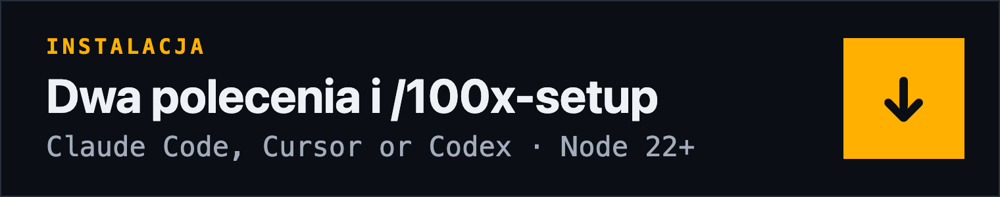
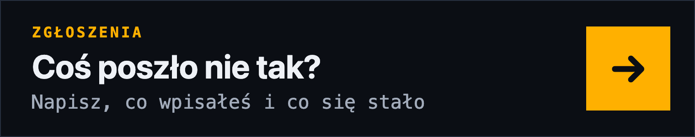
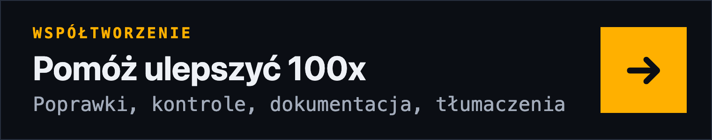

<div align="center">

<picture>
  <source media="(prefers-color-scheme: dark)" srcset="../docs/img/brand/mask-dark.png">
  
</picture>

# 100× ENGINEER SKILL

### KONIEC Z AGENTIC CODINGIEM, KTÓRY „PRAWIE DZIAŁA”

[](https://github.com/DeadInternetStudios/100x-engineer-skill/actions/workflows/ci.yml)
[](https://github.com/DeadInternetStudios/100x-engineer-skill/stargazers)
[](https://github.com/DeadInternetStudios/100x-engineer-skill/releases)
[](../LICENSE)


<sub><a href="../README.md">English</a> · <a href="README.es.md">Español</a> · <a href="README.zh.md">中文</a> · <a href="README.pt.md">Português</a> · <a href="README.ru.md">Русский</a> · <a href="README.ja.md">日本語</a> · <a href="README.fr.md">Français</a> · <a href="README.de.md">Deutsch</a> · <a href="README.ar.md">العربية</a> · <a href="README.hi.md">हिन्दी</a> · <a href="README.ko.md">한국어</a> · <a href="README.id.md">Bahasa Indonesia</a> · <a href="README.tr.md">Türkçe</a> · <a href="README.vi.md">Tiếng Việt</a> · <a href="README.bn.md">বাংলা</a> · <a href="README.it.md">Italiano</a> · <b>Polski</b> · <a href="README.th.md">ไทย</a> · <a href="README.uk.md">Українська</a> · <a href="README.nl.md">Nederlands</a></sub>

</div>

> **100x engineer**<br>
> /ˈwən ˈhən-drəd eks ˌen-jə-ˈnir/<br>
> *rzeczownik*
>
> Inżynier oprogramowania, o którym mówi się, że wykonuje pracę stu zwykłych inżynierów, bez spotkań, pytań i nieprzechodzących testów.

Agent mówi, że skończył. Otwierasz i *jakoś* działa. Zawsze wygląda dobrze, ale nigdy nie jest do końca gotowe do wydania.

**100x sprawia, że twój agent kodujący domyka ostatnie 10% pracy.**

To skill open source dla Claude Code, Cursor i Codex. Daj mu jedno zadanie, na przykład dodanie funkcji do aplikacji albo zbudowanie małej aplikacji od zera. Planuje pracę, buduje, dopracowuje i testuje to, co jest najważniejsze. Drugi model AI robi przegląd. Dostajesz raport ze zrzutami ekranu, wynikami testów i wszystkim, co jeszcze zostało otwarte.

<p align="center">
  <a href="#instalacja"></a>
</p>

<!-- Benchmark headline goes here: one line and one picture, the same agent with and without 100x, with a link to the method. -->

## Dlaczego agenci zatrzymują się na „prawie działa”

Psują się trzy rzeczy, a 100x ma odpowiedź na każdą. Wszystkie przykłady poniżej używają tej samej prośby:

> Chcę w mojej aplikacji do analizy giełdowej porównać dowolną spółkę z S&P 500

### 1. Nikt nie zapisał, co właściwie znaczy „działa”

Prośba ma jedną linijkę. Zanim cokolwiek zbuduje, 100x pisze prompt, który sam byś napisał, gdybyś miał wolną godzinę. Ustala cel, zasady, najbardziej ryzykowną część i sposób sprawdzenia każdego wymagania. Tutaj wcześnie wychwytuje pułapkę: split akcji wygląda jak strata, jeśli wykres go nie uwzględnia.

<p align="center">
  
</p>

<p align="center"><a href="../docs/examples/stock-comparison-prompt.md">Przeczytaj cały prompt</a></p>

### 2. Agent sprawdza własną pracę

Model, który sprawdza własną pracę, przeocza własne błędy. W 100x drugi model w kolejnych rundach przegląda kod i ekrany. Model budujący poprawia każde znalezisko albo zapisuje, dlaczego się z nim nie zgadza. Tutaj prompt wymienił przypadek świeżo notowanej spółki i kazał recenzentowi szczególnie go sprawdzić, ale testy modelu budującego używały tylko starszych spółek. Recenzent sprawdził spółkę, która weszła na giełdę w tym roku, i zauważył, że linia indeksu zaczyna się pięć miesięcy za wcześnie.

<p align="center">
  
</p>

To był przykład ilustracyjny. A teraz prawdziwy: ten README przeszedł przez 100x, zanim go przeczytałeś. Recenzent zgłosił w pierwszej rundzie 9 problemów, od 20 martwych linków do wersji językowych po etykiety za małe na telefon. 7 poprawiono, a 2 czekały na publiczną premierę. [Zobacz, co znalazł](../docs/examples/readme-review.md).

### 3. Podsumowanie powstaje z pamięci

Kiedy agent mówi „gotowe”, relacjonuje to, co pamięta. 100x na bieżąco zapisuje dowody: zrzuty ekranu, wyniki testów, uwagi recenzenta. Na końcu kod pisze podsumowanie z tych plików, a `100x finish` odmawia jego napisania, dopóki któreś wymaganie nie ma dowodu albo brakuje jakiejś kontroli. Tak wygląda wiadomość na końcu przebiegu z wykresem giełdowym. Aplikacja jest zmyślona, więc przebieg jest ilustracją.

<p align="center">
  
</p>

<details>
<summary>Ta sama wiadomość jako zwykły tekst</summary>

```text
Compare with the S&P 500: A chart in a research app that shows how any stock has moved against the S&P 500 since the first day both have prices. Verdict: ready to ship. The split math matches a hand count and both lines start on the same day. Dividends are not counted yet.
The moment: Type a ticker and both lines start at 0% on the same day, so the gap is the whole story
Run: npm run dev, then open http://localhost:5173/compare
Try first: 1) Type a ticker you hold and read the gap to the index 2) Pick a stock that split two for one and check the split day shows no drop 3) Pick a stock listed this year and see where both lines start
Must not break: numbers passed (Percent change across a two-for-one split matches a hand count on 40 split cases, 0 failing)
Review (claude-opus-5-5): 9 flagged, 7 fixed, 1 rejected, 1 deferred
Judge rounds: 5 of 5 done, on the code and how it behaves, the UI and UX and whether it is ready to ship, and the last word was ready to ship
Screen sizes: 0 broken, 2 weak, 15 sizes and 148 elements checked
Asks: 9 of 9 closed
Report: file:///Users/you/projects/research-app/.100x/REPORT.html
Next likely asks: Count dividends in the comparison; Show the gap for several stocks in one table
```

</details>

- **The moment:** ta jedna rzecz, przez którą zechcesz to mieć
- **Must not break:** trudny test i to, czy przeszedł
- **Review:** co zgłosił drugi model i co zrobił z tym model budujący
- **Asks:** wymagania z promptu, każde zamknięte dopiero z dowodem
- **Next likely asks:** o co pewnie poprosisz w następnej kolejności, już zbudowane albo zapisane

## Wyślij jedną wiadomość i idź

Ta sama prośba na osi czasu. Ręcznie ciągle wracasz, żeby odpowiadać na pytania i wyłapywać błędy. Z 100x wysyłasz jedną wiadomość i czytasz raport, kiedy wrócisz. Niebieski to ty, bursztynowy to drugi model. Czasy wymyśliliśmy.

<p align="center">
  
</p>

<details>
<summary>To samo przy małej aplikacji od zera</summary>

<p align="center">
  
</p>

Prompt aplikacji budżetowej, napisany z czterech słów: [make me a budget app](../docs/examples/budget-app-prompt.md).

</details>

<details>
<summary>Wszystkie osiem kroków przebiegu</summary>

| Krok | Co się dzieje |
|---|---|
| 1. Plan | Agent pisze szczegółowy prompt. Określa w nim, co zbudować i jak sprawdzić każde wymaganie. |
| 2. Rdzeń | Najpierw próbuje najbardziej ryzykownej części, póki jest jeszcze czas zmienić plan. |
| 3. Budowa | Buduje pierwszą wersję i dodatki, o które pewnie poprosisz w następnej kolejności. |
| 4. Dopracowanie | Pracuje nad układem i szczegółami. Po każdym przejściu drugi model ogląda zrzuty ekranu i wskazuje słabe miejsca. |
| 5. Test | Agent testuje tę jedną rzecz, której awaria zrujnowałaby całą pracę, na przykład wykres, który źle liczy split. Najpierw pokazuje, że test potrafi wychwycić błąd. |
| 6. Przegląd | Drugi model przegląda kod i ekrany. Model budujący poprawia każdy problem albo zapisuje, dlaczego może poczekać lub dlaczego się nie zgadza. |
| 7. Zakończenie | Polecenie `100x finish` sprawdza zapisane dowody, zanim napisze raport. |
| 8. Raport | Widzisz wynik, możesz go sam wypróbować i przeczytać, co znalazł recenzent. |

Kiedy cię nie ma, agent zapisuje każdą podjętą decyzję i pracuje dalej. [Przeczytaj o całym procesie](../docs/pipeline.md).

</details>

## Co dostajesz

<div align="center">


<sub>Strona raportu zbudowana z trzech zmyślonych przebiegów. Prawdziwy przebieg umieszcza na każdej karcie własne zrzuty ekranu.</sub>

</div>

- **Funkcja albo aplikacja** i sposób, żeby samemu ją wypróbować
- **Zrzuty ekranu w wielu rozmiarach ekranu**, sprawdzone pod kątem wylewającego się tekstu, malutkich przycisków, rozmytych obrazów i błędów przeglądarki
- **Strona raportu** (`.100x/REPORT.html`) i galeria wszystkich ukończonych przebiegów w `~/.100x`
- **Dziennik decyzji**: każdy wybór, którego 100x dokonał pod twoją nieobecność, i dlaczego
- **Końcowa wiadomość** pokazana wyżej

Każdy przebieg dostaje jeden werdykt: **Gotowe do wydania**, **W porządku** albo **Wymaga pracy**. Gdy coś blokuje werdykt, karta mówi co: na czerwono, gdy 100x znalazł problem, i na bursztynowo, gdy brakuje jakiejś kontroli.

---

<div align="center">

## Prawdziwe produkty zbudowane z 100x

<table align="left" width="48%"><tr><td>
<a href="https://dollarflow.com/"></a><br>
<a href="https://dollarflow.com/"><b>DollarFlow</b></a><br>
Skaner akcji zbudowany<br>
z pomocą 100x
</td></tr></table>
<table align="left" width="48%"><tr><td>
<a href="https://springtails.wiki/"></a><br>
<a href="https://springtails.wiki/"><b>Springtails Wiki</b></a><br>
Wiki o skoczogonkach,<br>
zbudowana w całości z 100x
</td></tr></table>
<br clear="all">

<table align="left" width="48%"><tr><td>
<a href="https://bubblewrapapp.com/"></a><br>
<a href="https://bubblewrapapp.com/"><b>BubbleWrap</b></a><br>
Aplikacja muzyczna w pixel arcie,<br>
zbudowana w całości z 100x
</td></tr></table>
<table align="left" width="48%"><tr><td>
<a href="https://goldtraderdesk.com/"></a><br>
<a href="https://goldtraderdesk.com/"><b>Gold Trader Desk</b></a><br>
Aplikacja do handlu złotem,<br>
zbudowana w całości z 100x
</td></tr></table>
<br clear="all">

<table align="left" width="48%"><tr><td>
<br>
<b>Phantom</b><br>
Aplikacja na Maca w Swifcie,<br>
której biegli używają do analizy<br>
pisma ręcznego, zbudowana<br>
z pomocą 100x
</td></tr></table>
<table align="left" width="48%"><tr><td>
<br>
<b>OptionsFlow</b><br>
Narzędzie do łańcucha opcji w czasie<br>
rzeczywistym w React, używane przez firmy<br>
quantowe, zbudowane z pomocą 100x
</td></tr></table>
<br clear="all">

<table align="left" width="48%"><tr><td>
<br>
<b>Skynet</b><br>
Narzędzie do zarządzania projektami<br>
oparte na Blueprint i Encore, zbudowane<br>
z pomocą 100x
</td></tr></table>
<table align="left" width="48%"><tr><td>
<br>
<b>Boneworks</b><br>
Pipeline tekst-do-3D, który modeluje,<br>
skinuje, riguje i animuje postacie,<br>
zbudowany z pomocą 100x
</td></tr></table>
<br clear="all">

<p align="center">
  <a href="mailto:theory@deadinternet.com"></a>
</p>

</div>

---

## Ile to kosztuje

100x wymienia czas i zużycie limitów na dowody.

- **Zwykły przebieg trwa godzinami.** Każde przejście dopracowania i każda runda przeglądu to kolejny model przy pracy, więc przebieg zużywa sporą część twojego planu.
- **Na pierwszy rzut oka** `/100x-mockup` potrzebuje około 15 minut. Pomija przegląd i mówi o tym wprost.
- **Na mniejszym planie** `100x config preset lite --global` robi jedno przejście dopracowania i dwie rundy przeglądu zamiast trzech i pięciu. Kontrole dowodów zostają.
- **Nie do drobnych rzeczy.** Przy poprawce w jednej linijce albo pytaniu zapytaj agenta bezpośrednio. 100x jest do zadania, które zasługuje na plan, test i przegląd.

## Instalacja

Potrzebujesz Claude Code, Cursor albo Codex oraz Node.js 22 lub nowszego.

**1. Zainstaluj narzędzie i skille**

```bash
npm install -g github:DeadInternetStudios/100x-engineer-skill
100x install
```

**2. Skonfiguruj, w swoim agencie**

```text
/100x-setup
```

Zapyta, jaki masz plan (Claude Pro, Max lub Ultra albo OpenAI Go, Plus lub Pro), i wybierze, który model buduje, a który ocenia. Jeśli masz mały plan, powiedz to, a włączy preset lite. Więcej: [docs/plans-and-setup.md](../docs/plans-and-setup.md).

**3. Daj mu zadanie**

```text
/100x Chcę w mojej aplikacji do analizy giełdowej porównać dowolną spółkę z S&P 500
```

Claude Code i Cursor uruchamiają skill przez `/`. Codex używa `$`, jak w `$100x-setup` i `$100x`. Użyj `/100x-overnight`, gdy wychodzisz na noc, albo `/100x-mockup` na pierwszy rzut oka.

### Inne sposoby instalacji

**Z klonu repozytorium** (tak testujemy to repo)

```bash
./scripts/install.sh --dry-run   # preview
./scripts/install.sh
```

Już używasz skills.sh? `npx skills add DeadInternetStudios/100x-engineer-skill --skill '*' -g` dodaje skille. Narzędzie wiersza poleceń z kroku 1 i tak jest potrzebne.

100x składa się z dwóch części: skilli, które czyta twój agent, i narzędzia wiersza poleceń `100x`. Narzędzie robi to, czego model sam nie zrobi niezawodnie. Pilnuje czasu, robi zrzuty ekranu, uruchamia sędziego, sprawdza dowody i pisze raport. Do zrzutów ekranu służy Playwright. Jeśli go brakuje, `100x browsers` go zainstaluje.

Instalator tworzy tylko skróty (dowiązania symboliczne), kilka małych plików i ich foldery. Nigdy nie nadpisuje prawdziwego pliku. `100x doctor` sprawdza wynik, a `./scripts/install.sh --uninstall` wszystko usuwa. Każdy plik, którego dotyka: [docs/cli.md](../docs/cli.md).

## Tryby

100x to zestaw skilli nazywanych trybami. Wpisz nazwę trybu, żeby go użyć. Słowa w wiadomości nigdy nie wybierają trybu, więc `/100x an overnight oats app` zbuduje aplikację o owsiance nocnej.

| Wpisz | Do czego | Co robi |
|---|---|---|
| `/100x` | Budowa | Zwykły przebieg: budowa, dopracowanie, test, przegląd przez drugi model. |
| `/100x-mockup` | Budowa | Szybki pierwszy podgląd w około 15 minut. Działa tylko kluczowy moment. Bez przeglądu i mówi o tym wprost (UNREVIEWED). |
| `/100x-overnight` | Budowa | Na czas, gdy wychodzisz. Realizuje jeden pomysł lub kilka przez ustalony czas i szturcha agenta, gdy utknie. |
| `/100x-wrapup` | Budowa | Na deadline. Sprawia, że główna ścieżka działa, a resztę ukrywa. |
| `/100x-judge` | Przegląd | Przegląda coś, co już jest zbudowane. Nie buduje niczego nowego. |
| `/100x-grind` | Przegląd | Przegląd, poprawki i kolejny przegląd, aż sędzia uzna, że jest gotowe do wydania. Kończy, gdy trzy przeglądy z rzędu nie znajdą niczego lepszego, po 15 rundach albo gdy skończy się czas. |
| `/100x-status` | Przebieg | Gdzie jest przebieg, w najwyżej sześciu linijkach. |
| `/100x-continue` | Przebieg | Wznawia przebieg, który stanął, na przykład na limicie użycia. |
| `/100x-report` | Przebieg | Pokazuje wszystko, co się skończyło, od najlepszego. Niczego nie buduje. |
| `/100x-adhd` | Plan | Krótka rozmowa, po jednym pytaniu, która zamienia luźny pomysł w plan. Nic się nie buduje, dopóki nie dasz zielonego światła. |
| `/100x-setup` | Konfiguracja | Zadaje jedno pytanie o twój plan, a potem ustala, który model robi które zadanie. |
| `/100x-bakeoff` | Test 100x | Testuje sam 100x: ten sam agent buduje te same pomysły z nim i bez niego, a sędzia na ślepo je porównuje. Niczego nie buduje. |

### Liczby w wiadomości

Dodaj je do wiadomości, żeby zmienić przebieg. Działają z `/100x` i `/100x-overnight`. Inne słowa, jak „szybko” czy „na szybko”, nic nie zmieniają.

| Piszesz | Co się dzieje |
|---|---|
| `3 versions` | Buduje 3 wersje pomysłu i kończy najlepszą. Działa każda liczba. |
| `for 10 hours`, `for 2 days`, `until 6am` | Wykorzystuje cały ten czas. Przebieg nie skończy się wcześniej. |
| `5 rounds of judging` | Przeprowadza tyle rund przeglądu. |
| `max 5 subagents` | Najwyżej 5 subagentów naraz. Domyślnie 1. |

```text
/100x-overnight 3 versions of a farming game, for 8 hours, max 3 subagents
```

Każdy przebieg zaczyna się od listy fraz, które zrozumiał, więc łatwo zauważysz pomyłkę.

Daj mu czas, a będzie pracował w rundach, aż czas minie. Każda runda patrzy na projekt w nowy sposób, zostawia zmianę, jeśli pomogła, i cofa ją, jeśli nie. Każdą rundę sprawdza świeży drugi model.

<p align="center">
  
</p>

## Najczęstsze pytania

**Po co drugi model?** Różne modele mają różne martwe pola. Jeśli żaden nie jest dostępny, przebieg i tak się kończy i zgłasza UNREVIEWED. Przy jednym planie oceniać może mniejszy model tej samej firmy, choć daje to mniej niż model innej firmy.

**Czy opublikuje mój projekt w sieci?** Nie. Tworzy podgląd tylko wtedy, gdy projekt już go ma. Publikacja wymaga twojej wyraźnej zgody.

**Co, jeśli w trakcie przebiegu trafię na limit użycia?** 100x zapisuje postęp w `.100x/STATE.md`. Gdy limit się odnowi, wpisz `/100x-continue` w tym samym folderze.

**Czy zmienia mój model albo ustawienia?** Nie. Nigdy nie zmienia twojego modelu, poziomu effort ani logowania. `/100x-setup` zapisuje tylko własne ustawienia 100x.

**Gdzie są przebiegi?** W ukrytym folderze `.100x/` w każdym projekcie (git go ignoruje) oraz w galerii ukończonych przebiegów w `~/.100x`.

<p align="center">
  <a href="https://github.com/DeadInternetStudios/100x-engineer-skill/issues/new"></a>
</p>

## Dokumentacja

| Strona | Co zawiera |
|---|---|
| [Instalacja w całości](../docs/install.md) | każda opcja instalacji i każdy plik, którego dotyka instalator |
| [Korzystanie z 100x](../docs/using.md) | noc poza domem, strona raportu, skill pomocniczy |
| [Pipeline i końcowa wiadomość](../docs/pipeline.md) | każdy krok w całości i to, co sprawdza `100x finish` |
| [Konfiguracja i plany](../docs/plans-and-setup.md) | zalecana konfiguracja Claude Code, preset lite, konfiguracje dla każdego planu |
| [Ustawienia](../docs/settings.md) | każdy klucz konfiguracji |
| [CLI i układ plików](../docs/cli.md) | każde polecenie `100x` i miejsce, gdzie leżą pliki |
| [Skille od środka, weryfikacja](../docs/contributing.md) | jak zbudowane jest repo i jak je testować |
| [Notatki projektowe](../docs/design.md) | dlaczego 100x działa w ten sposób |

## Współtworzenie

Zgłoszenia błędów, poprawki i pomysły są mile widziane. Małe poprawki mogą trafić prosto do pull requesta. Przy czymś większym najpierw otwórz zgłoszenie, żebyśmy mogli się dogadać. [Jak pomóc](../CONTRIBUTING.md).

<p align="center">
  <a href="../CONTRIBUTING.md"></a>
</p>

## Podziękowania

100x opiera się na zasadach pracy z [pstack](https://github.com/cursor/plugins/tree/main/pstack) autorstwa Lauren Tan (MIT), przerobionych pod prototypy i jedną rozmowę z agentem. Co jest inne:

- Każdy przebieg kończy się stroną raportu.
- `100x finish` odrzuca twierdzenia, których nie może sprawdzić.
- Drugi model przegląda pracę w rundach.

Zobacz [NOTICE.md](../NOTICE.md) i [UPSTREAM.md](../UPSTREAM.md).

MIT. Zobacz [LICENSE](../LICENSE).

---

<sub>Grafika maski: <a target="_blank" href="https://www.vexels.com/png-svg/preview/229802/guy-fawkes-mask-bonfire-night-stroke">www.vexels.com</a></sub>
