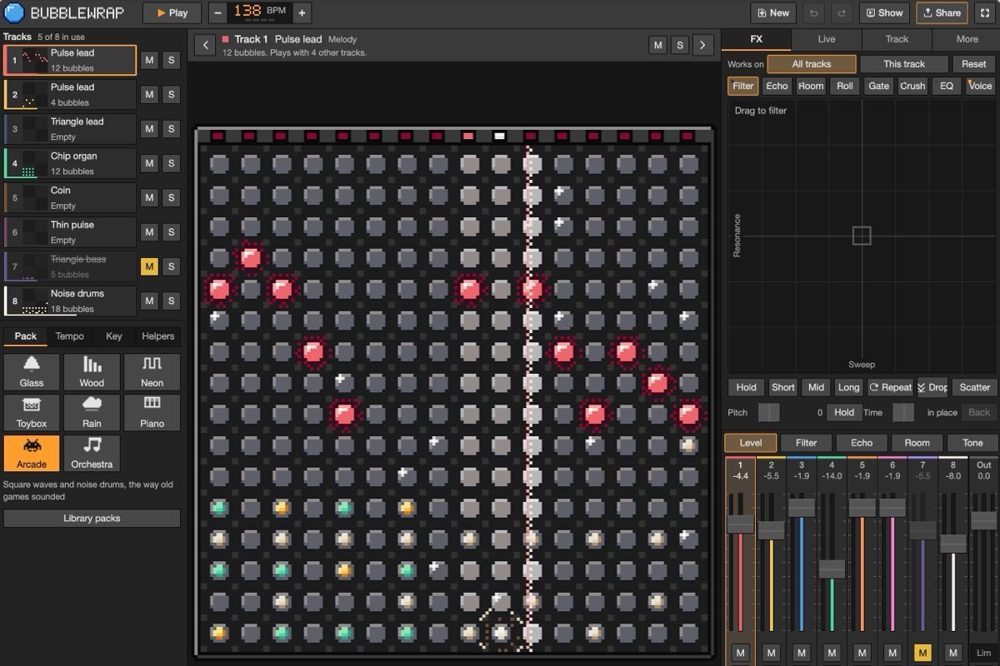
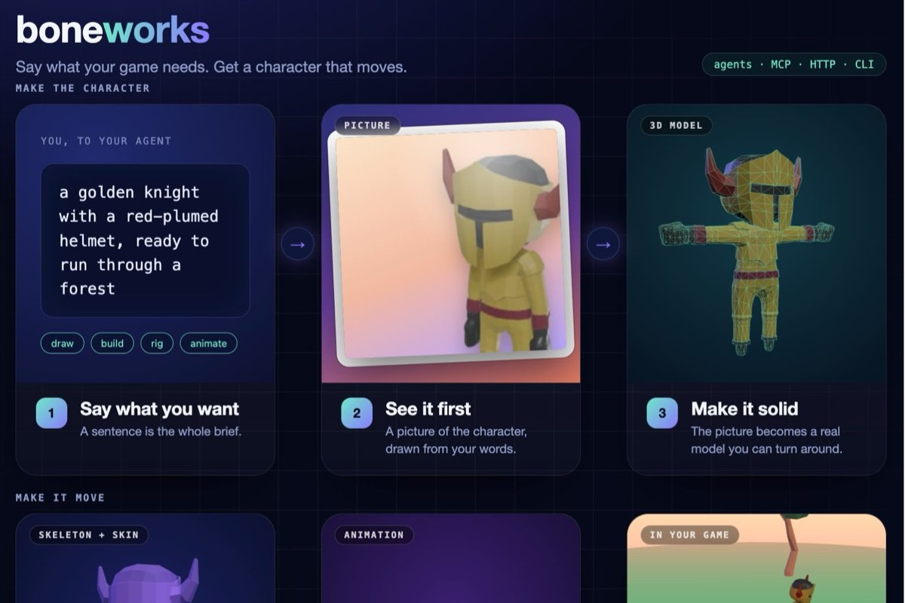

<div align="center">

<picture>
  <source media="(prefers-color-scheme: dark)" srcset="../docs/img/brand/mask-dark.png">
  
</picture>

# 100× ENGINEER SKILL

### ХВАТИТ АГЕНТНОГО КОДА, КОТОРЫЙ «ПОЧТИ РАБОТАЕТ»

[](https://github.com/DeadInternetStudios/100x-engineer-skill/actions/workflows/ci.yml)
[](https://github.com/DeadInternetStudios/100x-engineer-skill/stargazers)
[](https://github.com/DeadInternetStudios/100x-engineer-skill/releases)
[](../LICENSE)


<sub><a href="../README.md">English</a> · <a href="README.es.md">Español</a> · <a href="README.zh.md">中文</a> · <a href="README.pt.md">Português</a> · <b>Русский</b> · <a href="README.ja.md">日本語</a> · <a href="README.fr.md">Français</a> · <a href="README.de.md">Deutsch</a> · <a href="README.ar.md">العربية</a> · <a href="README.hi.md">हिन्दी</a> · <a href="README.ko.md">한국어</a> · <a href="README.id.md">Bahasa Indonesia</a> · <a href="README.tr.md">Türkçe</a> · <a href="README.vi.md">Tiếng Việt</a> · <a href="README.bn.md">বাংলা</a> · <a href="README.it.md">Italiano</a> · <a href="README.pl.md">Polski</a> · <a href="README.th.md">ไทย</a> · <a href="README.uk.md">Українська</a> · <a href="README.nl.md">Nederlands</a></sub>

</div>

> **100x engineer**<br>
> /ˈwən ˈhən-drəd eks ˌen-jə-ˈnir/<br>
> *сущ.*
>
> Инженер-программист, который, как говорят, выдаёт столько же, сколько сто обычных инженеров, только без созвонов, вопросов и падающих тестов.

Агент говорит, что всё готово. Вы открываете, и оно *вроде как* работает. Выглядит всегда нормально, но до релиза всё время чуть-чуть не дотягивает.

**100x заставляет вашего агента довести до конца последние 10% разработки.**

Это скилл с открытым исходным кодом для Claude Code, Cursor и Codex. Дайте ему одну задачу, например добавить фичу в приложение или собрать небольшое приложение с нуля. Он планирует работу, делает её, доводит до ума и тестирует то, что важнее всего. Вторая ИИ-модель проверяет результат. Вы получаете отчёт со скриншотами, результатами тестов и всем, что ещё осталось открытым.

<p align="center">
  <a href="#установка"></a>
</p>

<!-- Benchmark headline goes here: one line and one picture, the same agent with and without 100x, with a link to the method. -->

## Почему агенты останавливаются на «почти работает»

Ломаются три вещи, и на каждую у 100x есть ответ. Во всех примерах ниже один и тот же запрос:

> Хочу сравнивать любую акцию с S&P 500 в моём приложении для анализа фондового рынка

### 1. Никто не записал, что на самом деле значит «работает»

Запрос занимает одну строку. Прежде чем что-то строить, 100x пишет промпт, который вы написали бы сами, будь у вас свободный час. В нём цель, правила, самая рискованная часть и способ проверить каждое требование. Здесь он заранее замечает ловушку: сплит акций выглядит как убыток, если график его не учитывает.

<p align="center">
  
</p>

<p align="center"><a href="../docs/examples/stock-comparison-prompt.md">Прочитать промпт целиком</a></p>

### 2. Агент сам проверяет свою работу

Модель, которая проверяет собственную работу, не замечает собственных ошибок. В 100x код и экраны раундами проверяет вторая модель. Исполнитель исправляет каждое замечание или записывает, почему он не согласен. Здесь промпт упоминал случай с акцией, которая недавно вышла на биржу, и просил ревьюера проверить его как следует, но тесты исполнителя брали только старые акции. Ревьюер попробовал акцию, вышедшую на биржу в этом году, и увидел, что линия индекса начинается на пять месяцев раньше.

<p align="center">
  
</p>

Этот пример нарисован. А вот настоящий: этот README прошёл через 100x, прежде чем вы его прочитали. В первом раунде ревьюер нашёл 9 проблем, от 20 битых ссылок на языки до подписей, слишком мелких для телефона. 7 исправили, а 2 отложили до публичного запуска. [Что он нашёл](../docs/examples/readme-review.md).

### 3. Итог пишется по памяти

Когда агент говорит «готово», он пересказывает то, что помнит. 100x сохраняет доказательства по ходу работы: скриншоты, вывод тестов, замечания ревьюера. В конце итог пишет код по этим файлам, и `100x finish` отказывается его писать, пока у какого-то требования нет доказательств или не хватает проверки. Вот сообщение в конце запуска с графиком акций. Приложение для анализа выдуманное, поэтому и запуск нарисован.

<p align="center">
  
</p>

<details>
<summary>То же сообщение обычным текстом</summary>

```text
Compare with the S&P 500: A chart in a research app that shows how any stock has moved against the S&P 500 since the first day both have prices. Verdict: ready to ship. The split math matches a hand count and both lines start on the same day. Dividends are not counted yet.
The moment: Type a ticker and both lines start at 0% on the same day, so the gap is the whole story
Run: npm run dev, then open http://localhost:5173/compare
Try first: 1) Type a ticker you hold and read the gap to the index 2) Pick a stock that split two for one and check the split day shows no drop 3) Pick a stock listed this year and see where both lines start
Must not break: numbers passed (Percent change across a two-for-one split matches a hand count on 40 split cases, 0 failing)
Review (claude-opus-5-5): 9 flagged, 7 fixed, 1 rejected, 1 deferred
Judge rounds: 5 of 5 done, on the code and how it behaves, the UI and UX and whether it is ready to ship, and the last word was ready to ship
Screen sizes: 0 broken, 2 weak, 15 sizes and 148 elements checked
Asks: 9 of 9 closed
Report: file:///Users/you/projects/research-app/.100x/REPORT.html
Next likely asks: Count dividends in the comparison; Show the gap for several stocks in one table
```

</details>

- **The moment:** то единственное, из-за чего вам захочется это получить
- **Must not break:** жёсткий тест и прошёл ли он
- **Review:** что отметила вторая модель и что исполнитель с этим сделал
- **Asks:** требования из промпта, каждое закрывается только с доказательствами
- **Next likely asks:** что вы, скорее всего, попросите дальше, уже сделанное или записанное

## Отправьте одно сообщение и занимайтесь своими делами

Тот же запрос на временной шкале. Вручную вы то и дело возвращаетесь, чтобы отвечать на вопросы и ловить ошибки. С 100x вы отправляете одно сообщение и читаете отчёт, когда вернётесь. Синий цвет — это вы, янтарный — вторая модель. Время мы выдумали.

<p align="center">
  
</p>

<details>
<summary>То же самое на небольшом приложении с нуля</summary>

<p align="center">
  
</p>

Промпт приложения для бюджета, написанный по четырём словам: [make me a budget app](../docs/examples/budget-app-prompt.md).

</details>

<details>
<summary>Все восемь шагов запуска</summary>

| Шаг | Что происходит |
|---|---|
| 1. План | Агент пишет подробный промпт. В нём расписано, что строить и как проверить каждое требование. |
| 2. Ядро | Сначала он пробует самую рискованную часть, пока ещё есть время поменять план. |
| 3. Сборка | Он делает первую версию и то, что вы, скорее всего, попросите следующим. |
| 4. Полировка | Он работает над вёрсткой и деталями. После каждого прохода вторая модель смотрит скриншоты и указывает на слабые места. |
| 5. Тест | Агент тестирует то единственное, что погубит всю работу, если сломается, например график, который неправильно учитывает сплит. Сначала он показывает, что тест способен поймать ошибку. |
| 6. Ревью | Вторая модель проверяет код и экраны. Исполнитель исправляет каждую проблему или записывает, почему она может подождать или почему он не согласен. |
| 7. Завершение | Команда `100x finish` проверяет сохранённые доказательства, прежде чем написать отчёт. |
| 8. Отчёт | Вы видите результат, можете сами его попробовать и прочитать, что нашёл ревьюер. |

Пока вас нет, агент записывает каждое принятое решение и продолжает работать. [Весь процесс подробно](../docs/pipeline.md).

</details>

## Что вы получаете

<div align="center">


<sub>Страница отчёта, собранная из трёх выдуманных запусков. Настоящий запуск кладёт на каждую карточку свои скриншоты.</sub>

</div>

- **Фича или приложение** и как попробовать их самому
- **Скриншоты на множестве размеров экрана** с проверкой на вылезающий текст, крошечные кнопки, размытые картинки и ошибки браузера
- **Страница отчёта** (`.100x/REPORT.html`) и галерея всех завершённых запусков в `~/.100x`
- **Журнал решений**: каждый выбор, который 100x сделал без вас, и почему
- **Итоговое сообщение**, показанное выше

У каждого запуска один вердикт: **Готово к релизу**, **Нормально** или **Нужна доработка**. Если что-то мешает вердикту, на карточке написано что: красным, когда 100x нашёл проблему, и янтарным, когда не хватает проверки.

---

<div align="center">

## Реальные продукты, сделанные с 100x

<table align="left"><tr><td>
<a href="https://dollarflow.com/"></a><br>
<a href="https://dollarflow.com/"><b>DollarFlow</b></a><br>
Скринер акций, сделанный<br>
с помощью 100x
</td></tr></table>
<table align="left"><tr><td>
<a href="https://springtails.wiki/"></a><br>
<a href="https://springtails.wiki/"><b>Springtails Wiki</b></a><br>
Вики о ногохвостках, целиком<br>
сделанная на 100x
</td></tr></table>
<br clear="all">

<table align="left"><tr><td>
<a href="https://bubblewrapapp.com/"></a><br>
<a href="https://bubblewrapapp.com/"><b>BubbleWrap</b></a><br>
Музыкальное приложение в пиксель-арте,<br>
целиком сделанное на 100x
</td></tr></table>
<table align="left"><tr><td>
<a href="https://goldtraderdesk.com/"></a><br>
<a href="https://goldtraderdesk.com/"><b>Gold Trader Desk</b></a><br>
Приложение для торговли золотом,<br>
целиком сделанное на 100x
</td></tr></table>
<br clear="all">

<table align="left"><tr><td>
<br>
<b>Phantom</b><br>
Приложение для Mac на Swift,<br>
которым эксперты-криминалисты<br>
анализируют почерк, сделанное<br>
с помощью 100x
</td></tr></table>
<table align="left"><tr><td>
<br>
<b>OptionsFlow</b><br>
Опционная цепочка в реальном<br>
времени на React для квант-фирм,<br>
сделанная с помощью 100x
</td></tr></table>
<br clear="all">

<table align="left"><tr><td>
<br>
<b>Skynet</b><br>
Инструмент управления проектами<br>
на Blueprint и Encore, сделанный<br>
с помощью 100x
</td></tr></table>
<table align="left"><tr><td>
<br>
<b>Boneworks</b><br>
Пайплайн text-to-3D, который моделирует,<br>
скинит, ригает и анимирует персонажей,<br>
сделанный с помощью 100x
</td></tr></table>
<br clear="all">

<p align="center">
  <a href="mailto:theory@deadinternet.com"></a>
</p>

</div>

---

## Сколько это стоит

100x платит временем и лимитами за доказательства.

- **Обычный запуск занимает часы.** Каждый проход полировки и каждый раунд ревью — это ещё одна модель за работой, так что запуск съедает заметную часть вашего тарифа.
- **Для первого взгляда** есть `/100x-mockup`, это около 15 минут. Он пропускает ревью и прямо об этом говорит.
- **На тарифе поменьше** `100x config preset lite --global` делает один проход полировки и два раунда ревью вместо трёх и пяти. Проверки доказательств остаются.
- **Не для мелочей.** С правкой в одну строку или вопросом идите прямо к агенту. 100x нужен для задачи, которая заслуживает плана, теста и ревью.

## Установка

Нужны Claude Code, Cursor или Codex и Node.js 22 или новее.

**1. Установите инструмент и скиллы**

```bash
npm install -g github:DeadInternetStudios/100x-engineer-skill
100x install
```

**2. Настройте, прямо в агенте**

```text
/100x-setup
```

Он спросит, какой у вас тариф (Claude Pro, Max или Ultra либо OpenAI Go, Plus или Pro), и выберет, какая модель строит, а какая судит. Если тариф маленький, скажите об этом, и он включит пресет lite. Подробнее: [docs/plans-and-setup.md](../docs/plans-and-setup.md).

**3. Дайте ему задачу**

```text
/100x Хочу сравнивать любую акцию с S&P 500 в моём приложении для анализа фондового рынка
```

В Claude Code и Cursor скилл запускается через `/`. В Codex используется `$`, например `$100x-setup` и `$100x`. Если уходите на ночь, берите `/100x-overnight`, а для первого взгляда `/100x-mockup`.

### Другие способы установки

**Из клона** (так мы тестируем этот репозиторий)

```bash
./scripts/install.sh --dry-run   # preview
./scripts/install.sh
```

Уже пользуетесь skills.sh? `npx skills add DeadInternetStudios/100x-engineer-skill --skill '*' -g` добавит скиллы. Инструмент командной строки из шага 1 всё равно нужен.

100x состоит из двух частей: скиллов, которые читает агент, и инструмента командной строки `100x`. Инструмент делает то, что модель сама надёжно сделать не может. Он следит за временем, делает скриншоты, запускает судью, проверяет доказательства и пишет отчёт. Скриншоты делаются через Playwright. Если его нет, `100x browsers` его установит.

Установщик создаёт только ярлыки (символические ссылки), несколько небольших файлов и папки для них. Он никогда не перезаписывает настоящий файл. `100x doctor` проверяет результат, а `./scripts/install.sh --uninstall` всё удаляет. Все файлы, которые он трогает: [docs/cli.md](../docs/cli.md).

## Режимы

100x — это набор скиллов, которые называются режимами. Чтобы включить режим, введите его имя. Слова в сообщении никогда не выбирают режим, так что `/100x an overnight oats app` соберёт приложение про ленивую овсянку.

| Что ввести | Для чего | Что делает |
|---|---|---|
| `/100x` | Сборка | Обычный запуск: сборка, полировка, тест, ревью второй моделью. |
| `/100x-mockup` | Сборка | Быстрый первый взгляд примерно за 15 минут. Работает только ключевой момент. Без ревью, и он об этом говорит (UNREVIEWED). |
| `/100x-overnight` | Сборка | Когда вы уходите. Запускает одну идею или несколько на заданное время и подталкивает агента, если тот застрял. |
| `/100x-wrapup` | Сборка | Для дедлайнов. Доводит до рабочего состояния основной путь, а остальное прячет. |
| `/100x-judge` | Ревью | Проверяет то, что уже сделано. Ничего нового не строит. |
| `/100x-grind` | Ревью | Ревью, исправления и снова ревью, пока судья не скажет, что готово к релизу. Останавливается, если три ревью подряд не находят ничего лучше, на 15 раундах или когда кончается время. |
| `/100x-status` | Запуск | Где сейчас запуск, не больше чем в шести строках. |
| `/100x-continue` | Запуск | Продолжает остановившийся запуск, например после лимита использования. |
| `/100x-report` | Запуск | Показывает всё завершённое, лучшее первым. Ничего не строит. |
| `/100x-adhd` | План | Короткий диалог по одному вопросу за раз, который превращает смутную идею в план. Ничего не строится, пока вы не скажете «поехали». |
| `/100x-setup` | Настройка | Задаёт один вопрос о вашем тарифе и решает, какая модель какую работу делает. |
| `/100x-bakeoff` | Тест 100x | Тестирует сам 100x: один и тот же агент строит одни и те же идеи с ним и без него, а слепой судья их сравнивает. Ничего не строит. |

### Фразы с числами

Добавьте их в сообщение, чтобы изменить запуск. Они работают с `/100x` и `/100x-overnight`. Другие слова, например «быстро» или «по-быстрому», ничего не делают.

| Что вы пишете | Что происходит |
|---|---|
| `3 versions` | Строит 3 версии идеи и доводит до конца лучшую. Подойдёт любое число. |
| `for 10 hours`, `for 2 days`, `until 6am` | Использует всё это время. Раньше запуск не закончится. |
| `5 rounds of judging` | Проводит столько раундов ревью. |
| `max 5 subagents` | Не больше 5 сабагентов одновременно. По умолчанию 1. |

```text
/100x-overnight 3 versions of a farming game, for 8 hours, max 3 subagents
```

Каждый запуск начинается со списка фраз, которые он понял, так что неверное прочтение легко заметить.

Дайте ему время, и он будет работать раундами, пока оно не кончится. Каждый раунд смотрит на проект по-новому, оставляет изменение, если оно помогло, и откатывает, если нет. Каждый раунд проверяет свежая вторая модель.

<p align="center">
  
</p>

## Частые вопросы

**Зачем вторая модель?** У разных моделей разные слепые пятна. Если другой модели нет, запуск всё равно завершается и пишет UNREVIEWED. Если у вас тариф только одной компании, судить может модель поменьше от той же компании, но пользы от этого меньше, чем от модели другой компании.

**Он выложит мой проект в сеть?** Нет. Он делает превью, только если в проекте оно уже есть. Чтобы выкатить проект, нужно ваше прямое слово.

**Что, если посреди запуска я упрусь в лимит?** 100x сохраняет прогресс в `.100x/STATE.md`. Когда лимит сбросится, введите `/100x-continue` в той же папке.

**Он меняет мою модель или настройки?** Нет. Он никогда не переключает модель, уровень effort или аккаунт. `/100x-setup` записывает только собственные настройки 100x.

**Где хранятся запуски?** В скрытой папке `.100x/` в каждом проекте (git её игнорирует) и в галерее завершённых запусков в `~/.100x`.

<p align="center">
  <a href="https://github.com/DeadInternetStudios/100x-engineer-skill/issues/new"></a>
</p>

## Документация

| Страница | Что в ней |
|---|---|
| [Установка целиком](../docs/install.md) | все варианты установки и все файлы, которые трогает установщик |
| [Как пользоваться 100x](../docs/using.md) | ночь без вас, страница отчёта, вспомогательный скилл |
| [Пайплайн и итоговое сообщение](../docs/pipeline.md) | каждый шаг подробно и что проверяет `100x finish` |
| [Настройка и тарифы](../docs/plans-and-setup.md) | рекомендуемая настройка Claude Code, пресет lite, настройки для каждого тарифа |
| [Настройки](../docs/settings.md) | все ключи конфигурации |
| [CLI и расположение файлов](../docs/cli.md) | все команды `100x` и где лежат файлы |
| [Устройство скиллов, проверка](../docs/contributing.md) | как устроен репозиторий и как его тестировать |
| [Заметки о дизайне](../docs/design.md) | почему 100x работает именно так |

## Участие

Сообщения об ошибках, исправления и идеи приветствуются. Небольшие исправления можно сразу присылать пул-реквестом. Если что-то крупнее, сначала откройте issue, чтобы мы договорились. [Как поучаствовать](../CONTRIBUTING.md).

<p align="center">
  <a href="../CONTRIBUTING.md"></a>
</p>

## Благодарности

100x построен на принципах работы [pstack](https://github.com/cursor/plugins/tree/main/pstack) Лорен Тан (MIT), переработанных под прототипы и под один разговор с агентом. Чем он отличается:

- Каждый запуск заканчивается страницей отчёта.
- `100x finish` отклоняет утверждения, которые не может проверить.
- Вторая модель проверяет работу раундами.

См. [NOTICE.md](../NOTICE.md) и [UPSTREAM.md](../UPSTREAM.md).

MIT. См. [LICENSE](../LICENSE).

<p align="center">
  <a href="https://star-history.com/#DeadInternetStudios/100x-engineer-skill&Date">
    <picture>
      <source media="(prefers-color-scheme: dark)" srcset="https://api.star-history.com/svg?repos=deadinternetstudios/100x-engineer-skill&type=Date&theme=dark">
      
    </picture>
  </a>
</p>

---

<sub>Рисунок маски: <a target="_blank" href="https://www.vexels.com/png-svg/preview/229802/guy-fawkes-mask-bonfire-night-stroke">www.vexels.com</a></sub>
