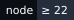
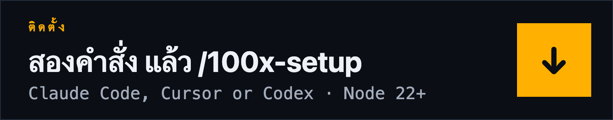
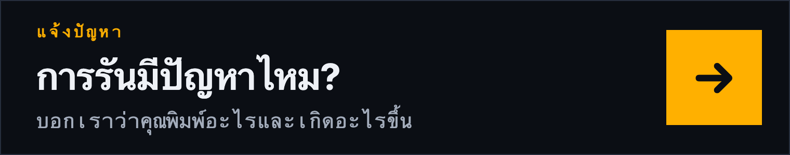

<div align="center">

<picture>
  <source media="(prefers-color-scheme: dark)" srcset="../docs/img/brand/mask-dark.png">
  
</picture>

# 100× ENGINEER SKILL

### เลิกเขียนโค้ดกับเอเจนต์แบบ “เกือบใช้ได้”

[](https://github.com/DeadInternetStudios/100x-engineer-skill/actions/workflows/ci.yml)
[](https://github.com/DeadInternetStudios/100x-engineer-skill/stargazers)
[](https://github.com/DeadInternetStudios/100x-engineer-skill/releases)
[](https://nodejs.org/)
[](../LICENSE)

[](https://github.com/DeadInternetStudios/100x-engineer-skill/stargazers)

*100x คือสกิลที่ได้แรงบันดาลใจจาก pstack ช่วยเปลี่ยนพรอมต์ให้เป็นซอฟต์แวร์ที่พร้อมใช้งานจริง ผ่านการทดสอบและรีวิวแล้ว ใช้ส่ง PR ขึ้นโปรดักชันมากกว่า 1,000 รายการทุกเดือน โดยมีอัตรา rollback ต่ำกว่า 2%*

<sub><a href="../README.md">English</a> · <a href="README.es.md">Español</a> · <a href="README.zh.md">中文</a> · <a href="README.pt.md">Português</a> · <a href="README.ru.md">Русский</a> · <a href="README.ja.md">日本語</a> · <a href="README.fr.md">Français</a> · <a href="README.de.md">Deutsch</a> · <a href="README.ar.md">العربية</a> · <a href="README.hi.md">हिन्दी</a> · <a href="README.ko.md">한국어</a> · <a href="README.id.md">Bahasa Indonesia</a> · <a href="README.tr.md">Türkçe</a> · <a href="README.vi.md">Tiếng Việt</a> · <a href="README.bn.md">বাংলা</a> · <a href="README.it.md">Italiano</a> · <a href="README.pl.md">Polski</a> · <b>ไทย</b> · <a href="README.uk.md">Українська</a> · <a href="README.nl.md">Nederlands</a></sub>

</div>

> **100x engineer**<br>
> /ˈwən ˈhən-drəd eks ˌen-jə-ˈnir/<br>
> *คำนาม*
>
> วิศวกรซอฟต์แวร์ที่ว่ากันว่าทำงานได้เท่าวิศวกรธรรมดาร้อยคน โดยไม่ต้องประชุม ไม่ต้องถาม และไม่มีเทสต์ที่ล้ม

เอเจนต์บอกว่าเสร็จแล้ว คุณเปิดดูก็พบว่ามัน*ก็พอ*ใช้ได้ ดูเผินๆ ไม่มีปัญหาทุกครั้ง แต่ก็ไม่เคยพร้อมปล่อยจริงสักที

**100x ทำให้เอเจนต์เขียนโค้ดของคุณจัดการ 10% สุดท้ายของงานพัฒนาได้**

<p align="center">
  
</p>

<p align="center"><b>136B โทเคนใน 30 วัน · วิศวกร 1 คน · โปรเจกต์จริงจัง · มากกว่า 1,000 PR · ประหยัดแคช $250k</b></p>

เป็นสกิลโอเพนซอร์สสำหรับ Claude Code, Cursor และ Codex มอบงานให้มันหนึ่งอย่าง เช่น เพิ่มฟีเจอร์ในแอปของคุณ หรือสร้างแอปเล็กๆ ขึ้นมาใหม่ตั้งแต่ต้น มันจะวางแผน ลงมือสร้าง เก็บรายละเอียด และทดสอบส่วนที่สำคัญที่สุด จากนั้นโมเดล AI ตัวที่สองจะรีวิวงาน คุณจะได้รายงานที่มีภาพหน้าจอ ผลเทสต์ และทุกเรื่องที่ยังค้างอยู่

<p align="center">
  <a href="#ติดตั้ง"></a>
</p>

<!-- Benchmark headline goes here: one line and one picture, the same agent with and without 100x, with a link to the method. -->

## ทำไมเอเจนต์ถึงหยุดอยู่ที่ “เกือบใช้ได้”

มีสามเรื่องที่พลาด และ 100x มีคำตอบให้ทุกเรื่อง ตัวอย่างทั้งหมดด้านล่างใช้คำขอเดียวกัน:

> ให้ฉันเทียบหุ้นตัวไหนก็ได้กับ S&P 500 ในแอปวิจัยตลาดหุ้นของฉัน

### 1. ไม่มีใครเขียนไว้ว่า “ใช้ได้” หมายถึงอะไรกันแน่

คำขอมีแค่บรรทัดเดียว ก่อนจะสร้างอะไร 100x จะเขียนพรอมต์แบบที่คุณคงเขียนเองถ้ามีเวลาว่างสักชั่วโมง โดยกำหนดเป้าหมาย กฎ ส่วนที่เสี่ยงที่สุด และวิธีตรวจแต่ละข้อที่ขอ ในตัวอย่างนี้มันเห็นกับดักตั้งแต่แรก: การแตกหุ้นจะดูเหมือนขาดทุน ถ้ากราฟไม่ปรับค่าให้

<p align="center">
  
</p>

<p align="center"><a href="../docs/examples/stock-comparison-prompt.md">อ่านพรอมต์ฉบับเต็ม</a></p>

### 2. เอเจนต์ตรวจงานตัวเอง

โมเดลที่ตรวจงานตัวเองจะมองไม่เห็นความผิดพลาดของตัวเอง 100x ให้โมเดลตัวที่สองรีวิวโค้ดและหน้าจอเป็นรอบๆ ฝั่งที่สร้างจะแก้ทุกข้อที่ถูกชี้ หรือเขียนไว้ว่าทำไมถึงไม่เห็นด้วย ในตัวอย่างนี้ พรอมต์ระบุกรณีหุ้นที่เพิ่งเข้าตลาดและสั่งให้ผู้รีวิวเจาะจุดนี้ แต่เทสต์ของฝั่งที่สร้างใช้แต่หุ้นเก่า ผู้รีวิวลองหุ้นที่เข้าตลาดปีนี้ แล้วพบว่าเส้นดัชนีเริ่มเร็วไปห้าเดือน

<p align="center">
  
</p>

อันนั้นเป็นภาพประกอบ ส่วนของจริงคือ README นี้ผ่าน 100x มาก่อนที่คุณจะได้อ่าน ผู้รีวิวชี้ปัญหา 9 ข้อในรอบแรก ตั้งแต่ลิงก์ภาษาที่เสีย 20 ลิงก์ ไปจนถึงป้ายที่เล็กเกินไปบนมือถือ แก้ไปแล้ว 7 ข้อ อีก 2 ข้อรอไว้ตอนเปิดตัวสาธารณะ [อ่านสิ่งที่มันเจอ](../docs/examples/readme-review.md)

### 3. สรุปผลมาจากความจำ

เมื่อเอเจนต์บอกว่า “เสร็จแล้ว” มันรายงานสิ่งที่มันจำได้ 100x เก็บหลักฐานไว้ระหว่างทาง: ภาพหน้าจอ ผลลัพธ์ของเทสต์ และสิ่งที่ผู้รีวิวพบ ตอนจบ โค้ดจะเขียนสรุปจากไฟล์เหล่านั้น และ `100x finish` จะไม่ยอมเขียนถ้ายังมีข้อที่ขอซึ่งไม่มีหลักฐาน หรือยังขาดการตรวจ นี่คือข้อความตอนจบของการรันกราฟหุ้น แอปวิจัยนี้เป็นของสมมติ การรันนี้จึงเป็นภาพประกอบ

<p align="center">
  
</p>

<details>
<summary>ข้อความเดียวกันแบบข้อความธรรมดา</summary>

```text
Compare with the S&P 500: A chart in a research app that shows how any stock has moved against the S&P 500 since the first day both have prices. Verdict: ready to ship. The split math matches a hand count and both lines start on the same day. Dividends are not counted yet.
The moment: Type a ticker and both lines start at 0% on the same day, so the gap is the whole story
Run: npm run dev, then open http://localhost:5173/compare
Try first: 1) Type a ticker you hold and read the gap to the index 2) Pick a stock that split two for one and check the split day shows no drop 3) Pick a stock listed this year and see where both lines start
Must not break: numbers passed (Percent change across a two-for-one split matches a hand count on 40 split cases, 0 failing)
Review (claude-opus-5-5): 9 flagged, 7 fixed, 1 rejected, 1 deferred
Judge rounds: 5 of 5 done, on the code and how it behaves, the UI and UX and whether it is ready to ship, and the last word was ready to ship
Screen sizes: 0 broken, 2 weak, 15 sizes and 148 elements checked
Asks: 9 of 9 closed
Report: file:///Users/you/projects/research-app/.100x/REPORT.html
Next likely asks: Count dividends in the comparison; Show the gap for several stocks in one table
```

</details>

- **ช่วงเวลาสำคัญ (The moment):** สิ่งเดียวที่ควรทำให้คุณอยากได้มัน
- **ห้ามพัง (Must not break):** เทสต์ยาก และผลว่าผ่านหรือไม่
- **รีวิว (Review):** สิ่งที่โมเดลตัวที่สองชี้ และสิ่งที่ฝั่งที่สร้างทำกับมัน
- **ข้อที่ขอ (Asks):** ความต้องการจากพรอมต์ แต่ละข้อปิดได้ก็ต่อเมื่อมีหลักฐาน
- **สิ่งที่น่าจะขอต่อ (Next likely asks):** สิ่งที่คุณน่าจะขอต่อไป ซึ่งสร้างไว้แล้วหรือจดไว้แล้ว

## ส่งข้อความเดียว แล้วไปทำอย่างอื่นได้เลย

คำขอเดียวกันในรูปไทม์ไลน์ ถ้าทำเอง คุณต้องกลับมาตอบคำถามและจับข้อผิดพลาดอยู่เรื่อยๆ ถ้าใช้ 100x คุณส่งข้อความเดียว แล้วกลับมาอ่านรายงาน สีน้ำเงินคือคุณ สีอำพันคือโมเดลตัวที่สอง เวลาในภาพเราสมมติขึ้น

<p align="center">
  
</p>

<details>
<summary>แบบเดียวกันกับแอปเล็กๆ ที่สร้างตั้งแต่ต้น</summary>

<p align="center">
  
</p>

พรอมต์ของแอปจัดงบประมาณ ที่เขียนขึ้นจากสี่คำ: [make me a budget app](../docs/examples/budget-app-prompt.md)

</details>

<details>
<summary>ทั้งแปดขั้นตอนของการรัน</summary>

| ขั้นตอน | เกิดอะไรขึ้น |
|---|---|
| 1. วางแผน | เอเจนต์ของคุณเขียนพรอมต์อย่างละเอียด ระบุชัดว่าจะสร้างอะไร และจะตรวจแต่ละคำขออย่างไร |
| 2. แกนหลัก | ลองส่วนที่เสี่ยงที่สุดก่อน ตอนที่ยังมีเวลาเปลี่ยนแผน |
| 3. สร้าง | สร้างเวอร์ชันแรก และส่วนเสริมที่คุณน่าจะขอต่อ |
| 4. เก็บงาน | ปรับเลย์เอาต์และรายละเอียด หลังแต่ละรอบ โมเดลตัวที่สองจะดูภาพหน้าจอและชี้จุดที่ยังอ่อน |
| 5. ทดสอบ | เอเจนต์ทดสอบสิ่งเดียวที่ถ้าพังจะทำให้งานทั้งหมดเสีย เช่น กราฟคำนวณการแตกหุ้นผิด ก่อนอื่นมันจะแสดงให้เห็นว่าเทสต์นั้นจับความผิดพลาดได้จริง |
| 6. รีวิว | โมเดลตัวที่สองรีวิวโค้ดและหน้าจอ ฝั่งที่สร้างจะแก้แต่ละปัญหา หรือเขียนไว้ว่าทำไมรอได้หรือทำไมไม่เห็นด้วย |
| 7. ปิดงาน | คำสั่ง `100x finish` ตรวจหลักฐานที่บันทึกไว้ก่อนเขียนรายงาน |
| 8. รายงาน | คุณดูผลลัพธ์ ลองใช้เอง และอ่านสิ่งที่ผู้รีวิวพบได้ |

ถ้าคุณไม่อยู่ เอเจนต์จะจดทุกการตัดสินใจไว้และทำงานต่อไป [อ่านเวิร์กโฟลว์ฉบับเต็ม](../docs/pipeline.md)

</details>

## สิ่งที่คุณจะได้

<div align="center">


<sub>หน้ารายงาน วาดจากการรันสมมติสามครั้ง การรันจริงจะใส่ภาพหน้าจอของตัวเองในแต่ละการ์ด</sub>

</div>

- **ฟีเจอร์หรือแอป** และวิธีลองใช้เอง
- **ภาพหน้าจอหลายขนาดจอ** ตรวจหาข้อความล้น ปุ่มเล็กเกินไป ภาพเบลอ และข้อผิดพลาดของเบราว์เซอร์
- **หน้ารายงาน** (`.100x/REPORT.html`) และแกลเลอรีของทุกการรันที่เสร็จแล้วใน `~/.100x`
- **บันทึกการตัดสินใจ**: ทุกการตัดสินใจที่ 100x ทำตอนคุณไม่อยู่ พร้อมเหตุผล
- **ข้อความสุดท้าย** ที่แสดงไว้ด้านบน

แต่ละการรันได้ผลตัดสินเดียว: **พร้อมปล่อย** **พอใช้** หรือ **ต้องแก้อีก** ถ้ามีอะไรขวางผลตัดสินอยู่ การ์ดจะบอกว่าคืออะไร เป็นสีแดงเมื่อ 100x เจอปัญหา และสีอำพันเมื่อยังขาดการตรวจ

---

<div align="center">

## ผลงานจริงที่สร้างด้วย 100x

<table align="left"><tr><td>
<a href="https://dollarflow.com/"></a><br>
<a href="https://dollarflow.com/"><b>DollarFlow</b></a><br>
เครื่องมือคัดกรองหุ้น<br>
สร้างโดยมี 100x ช่วย
</td></tr></table>
<table align="left"><tr><td>
<a href="https://springtails.wiki/"></a><br>
<a href="https://springtails.wiki/"><b>Springtails Wiki</b></a><br>
วิกิแมลงหางดีด<br>
สร้างด้วย 100x ทั้งหมด
</td></tr></table>
<br clear="all">
<table align="left"><tr><td>
<a href="https://bubblewrapapp.com/"></a><br>
<a href="https://bubblewrapapp.com/"><b>BubbleWrap</b></a><br>
แอปดนตรีพิกเซลอาร์ต<br>
สร้างด้วย 100x ทั้งหมด
</td></tr></table>
<table align="left"><tr><td>
<a href="https://goldtraderdesk.com/"></a><br>
<a href="https://goldtraderdesk.com/"><b>Gold Trader Desk</b></a><br>
แอปเทรดทองคำ<br>
สร้างด้วย 100x ทั้งหมด
</td></tr></table>
<br clear="all">
<table align="left"><tr><td>
<br>
<b>Phantom</b><br>
แอป Mac ที่เขียนด้วย Swift<br>
ซึ่งผู้เชี่ยวชาญนิติวิทยาศาสตร์<br>
ใช้วิเคราะห์ลายมือ สร้างโดย<br>
มี 100x ช่วย
</td></tr></table>
<table align="left"><tr><td>
<br>
<b>OptionsFlow</b><br>
เครื่องมือ option chain แบบเรียลไทม์<br>
เขียนด้วย React ที่บริษัทควอนต์ใช้<br>
สร้างโดยมี 100x ช่วย
</td></tr></table>
<br clear="all">
<table align="left"><tr><td>
<br>
<b>Skynet</b><br>
เครื่องมือจัดการโปรเจกต์ที่สร้างบน<br>
Blueprint และ Encore โดยมี<br>
100x ช่วย
</td></tr></table>
<table align="left"><tr><td>
<br>
<b>Boneworks</b><br>
ไปป์ไลน์ข้อความเป็น 3D ที่ขึ้นโมเดล<br>
ทำสกิน ริก และแอนิเมชันให้ตัวละคร<br>
สร้างโดยมี 100x ช่วย
</td></tr></table>
<br clear="all">

<p align="center">
  <a href="mailto:theory@deadinternet.com"></a>
</p>

</div>

---

## ต้องจ่ายอะไรบ้าง

100x แลกเวลาและโควตาการใช้งานกับหลักฐาน

- **การรันปกติใช้เวลาหลายชั่วโมง** ทุกรอบเก็บงานและทุกรอบรีวิวคือโมเดลอีกตัวที่ต้องทำงาน การรันหนึ่งครั้งจึงใช้แพ็กเกจของคุณไปพอสมควร
- **ถ้าอยากดูเร็วๆ ก่อน** `/100x-mockup` ใช้เวลาราว 15 นาที มันข้ามการรีวิวและบอกไว้ชัดเจน
- **ถ้าใช้แพ็กเกจเล็ก** `100x config preset lite --global` จะเก็บงานหนึ่งรอบและรีวิวสองรอบ แทนที่จะเป็นสามรอบและห้ารอบ การตรวจหลักฐานยังอยู่ครบ
- **ไม่เหมาะกับงานเล็ก** ถ้าเป็นการแก้บรรทัดเดียวหรือคำถาม ถามเอเจนต์ของคุณตรงๆ ได้เลย 100x มีไว้สำหรับงานที่คุ้มกับการวางแผน การทดสอบ และการรีวิว

## ติดตั้ง

คุณต้องมี Claude Code, Cursor หรือ Codex และ Node.js 22 ขึ้นไป

**1. ติดตั้งเครื่องมือและสกิล**

เลือกวิธีใดวิธีหนึ่ง:

**npm**

```bash
npm install -g github:DeadInternetStudios/100x-engineer-skill
100x install
```

**skills.sh**

```bash
npm install -g github:DeadInternetStudios/100x-engineer-skill
npx skills add DeadInternetStudios/100x-engineer-skill --skill '*' -g
100x install
```

เครื่องมือ `skills` คัดลอกเฉพาะสกิล ดังนั้นเครื่องมือ `100x` ยังต้องมาจาก npm จากนั้น `100x install` จะเห็นสำเนาและไม่แตะต้อง อัปเดตด้วย `npx skills update -g`

**2. ตั้งค่าในเอเจนต์ของคุณ**

```text
/100x-setup
```

มันจะถามว่าคุณใช้แพ็กเกจไหน (Claude Pro, Max หรือ Ultra หรือ OpenAI Go, Plus หรือ Pro) แล้วเลือกว่าโมเดลไหนสร้างและโมเดลไหนตัดสิน ถ้าแพ็กเกจเล็ก บอกมันไป มันจะเปิดพรีเซ็ต lite ให้ ดูเพิ่มเติม: [docs/plans-and-setup.md](../docs/plans-and-setup.md)

**3. มอบงานให้มัน**

```text
/100x ให้ฉันเทียบหุ้นตัวไหนก็ได้กับ S&P 500 ในแอปวิจัยตลาดหุ้นของฉัน
```

Claude Code และ Cursor เริ่มสกิลด้วย `/` ส่วน Codex ใช้ `$` เช่น `$100x-setup` และ `$100x` ใช้ `/100x-overnight` ตอนที่คุณจะไม่อยู่ทั้งคืน หรือ `/100x-mockup` ถ้าอยากดูเร็วๆ ก่อน

### วิธีติดตั้งแบบอื่น

**จากโคลน** (วิธีที่เราใช้ทดสอบรีโปนี้)

```bash
./scripts/install.sh --dry-run   # preview
./scripts/install.sh
```

100x มีสองส่วน: สกิลที่เอเจนต์อ่าน และเครื่องมือบรรทัดคำสั่ง `100x` เครื่องมือนี้ทำสิ่งที่โมเดลทำเองได้ไม่แน่นอน มันจับเวลา ถ่ายภาพหน้าจอ รันผู้ตัดสิน ตรวจหลักฐาน และเขียนรายงาน ภาพหน้าจอใช้ Playwright ถ้ายังไม่มี `100x browsers` จะติดตั้งให้

ตัวติดตั้งสร้างแค่ทางลัด (symbolic link) ไฟล์เล็กๆ ไม่กี่ไฟล์ และโฟลเดอร์ของไฟล์เหล่านั้น มันไม่เขียนทับไฟล์จริงเลย `100x doctor` ตรวจผลลัพธ์ และ `./scripts/install.sh --uninstall` ถอนออก ทุกไฟล์ที่มันแตะ: [docs/cli.md](../docs/cli.md)

## โหมด

100x คือชุดสกิลที่เรียกว่าโหมด พิมพ์ชื่อโหมดเพื่อใช้งาน คำในข้อความของคุณไม่เคยเลือกโหมดให้ ดังนั้น `/100x an overnight oats app` จะสร้างแอปโอ๊ตแช่ข้ามคืน

| พิมพ์ | ใช้สำหรับ | ทำอะไร |
|---|---|---|
| `/100x` | สร้าง | การรันปกติ: สร้าง เก็บงาน ทดสอบ รีวิวโดยโมเดลตัวที่สอง |
| `/100x-mockup` | สร้าง | ดูเร็วๆ ก่อนในราว 15 นาที เฉพาะช่วงเวลาสำคัญที่ใช้ได้ ไม่มีรีวิว และบอกไว้ชัด (UNREVIEWED) |
| `/100x-overnight` | สร้าง | สำหรับตอนที่คุณจะไม่อยู่ รันไอเดียเดียวหรือหลายไอเดียตามเวลาที่กำหนด และกระตุ้นเอเจนต์ถ้ามันค้าง |
| `/100x-wrapup` | สร้าง | สำหรับงานใกล้เดดไลน์ ทำให้เส้นทางหลักใช้ได้ และซ่อนที่เหลือ |
| `/100x-judge` | รีวิว | รีวิวสิ่งที่สร้างไว้แล้ว ไม่สร้างอะไรใหม่ |
| `/100x-grind` | รีวิว | รีวิว แก้ รีวิวซ้ำ จนผู้ตัดสินบอกว่าพร้อมปล่อย หยุดถ้ารีวิวสามครั้งติดไม่เจออะไรที่ดีขึ้น ครบ 15 รอบ หรือหมดเวลา |
| `/100x-status` | การรัน | การรันไปถึงไหนแล้ว ไม่เกินหกบรรทัด |
| `/100x-continue` | การรัน | ทำการรันที่หยุดไปต่อ เช่น หยุดเพราะชนโควตาการใช้งาน |
| `/100x-report` | การรัน | แสดงทุกงานที่เสร็จแล้ว เรียงจากดีที่สุด ไม่สร้างอะไร |
| `/100x-adhd` | วางแผน | คุยโต้ตอบสั้นๆ ทีละคำถาม เพื่อเปลี่ยนไอเดียลางๆ ให้เป็นแผน ไม่มีอะไรถูกสร้างจนกว่าคุณจะบอกให้เริ่ม |
| `/100x-setup` | ตั้งค่า | ถามหนึ่งคำถามเรื่องแพ็กเกจของคุณ แล้วกำหนดว่าโมเดลไหนทำงานไหน |
| `/100x-bakeoff` | ทดสอบ 100x | ทดสอบตัว 100x เอง: เอเจนต์ตัวเดิมสร้างไอเดียเดียวกันทั้งแบบมีและไม่มี 100x แล้วผู้ตัดสินแบบปิดตาเปรียบเทียบ ไม่สร้างอะไร |

### วลีตัวเลข

เติมวลีเหล่านี้ในข้อความเพื่อปรับการรัน ใช้ได้กับ `/100x` และ `/100x-overnight` คำอื่นอย่าง “fast” หรือ “quick” ไม่มีผลอะไร

| คุณเขียน | เกิดอะไรขึ้น |
|---|---|
| `3 versions` | สร้างไอเดียนั้น 3 เวอร์ชัน แล้วทำตัวที่ดีที่สุดให้เสร็จ ใช้ตัวเลขไหนก็ได้ |
| `for 10 hours`, `for 2 days`, `until 6am` | ใช้เวลานั้นจนหมด การรันจะไม่จบก่อน |
| `5 rounds of judging` | รันรอบรีวิวตามจำนวนนั้น |
| `max 5 subagents` | ซับเอเจนต์พร้อมกันได้สูงสุด 5 ตัว ค่าเริ่มต้นคือ 1 |

```text
/100x-overnight 3 versions of a farming game, for 8 hours, max 3 subagents
```

ทุกการรันจะเริ่มด้วยการแสดงวลีที่มันเข้าใจ คุณจะได้เห็นถ้ามันอ่านผิด

ให้เวลามัน แล้วมันจะทำงานเป็นรอบๆ จนหมดเวลา แต่ละรอบมองโปรเจกต์ในมุมใหม่ เก็บการเปลี่ยนแปลงไว้ถ้าช่วยได้ และย้อนกลับถ้าไม่ช่วย ทุกรอบมีโมเดลตัวที่สองตัวใหม่คอยตรวจ

<p align="center">
  
</p>

## คำถามที่พบบ่อย

**ทำไมต้องมีโมเดลตัวที่สอง?** โมเดลต่างกันก็มีจุดบอดต่างกัน ถ้าไม่มีตัวไหนให้ใช้ การรันก็ยังจบ และแจ้งว่า UNREVIEWED ถ้ามีแพ็กเกจเดียว โมเดลที่เล็กกว่าจากบริษัทเดียวกันก็ตัดสินได้ แต่ได้ประโยชน์น้อยกว่าโมเดลจากอีกบริษัท

**มันจะเอาโปรเจกต์ของฉันขึ้นออนไลน์ไหม?** ไม่ มันทำพรีวิวเฉพาะเมื่อโปรเจกต์มีพรีวิวอยู่แล้ว การขึ้นจริงต้องให้คุณสั่งเอง

**ถ้าชนโควตาการใช้งานกลางการรันล่ะ?** 100x บันทึกความคืบหน้าไว้ใน `.100x/STATE.md` เมื่อโควตารีเซ็ต พิมพ์ `/100x-continue` ในโฟลเดอร์เดิม

**มันจะเปลี่ยนโมเดลหรือการตั้งค่าของฉันไหม?** ไม่ มันไม่เคยเปลี่ยนโมเดล ระดับ effort หรือการลงชื่อเข้าใช้ของคุณ `/100x-setup` เขียนแค่การตั้งค่าของ 100x เอง

**การรันเก็บไว้ที่ไหน?** ในโฟลเดอร์ `.100x/` ที่ซ่อนอยู่ในแต่ละโปรเจกต์ (git ไม่สนใจโฟลเดอร์นี้) และแกลเลอรีของการรันที่เสร็จแล้วใน `~/.100x`

<p align="center">
  <a href="https://github.com/DeadInternetStudios/100x-engineer-skill/issues/new"></a>
</p>

## เอกสาร

| หน้า | มีอะไรอยู่ข้างใน |
|---|---|
| [การติดตั้งแบบละเอียด](../docs/install.md) | ทุกตัวเลือกการติดตั้ง และทุกไฟล์ที่ตัวติดตั้งแตะ |
| [การใช้ 100x](../docs/using.md) | คืนที่คุณไม่อยู่ หน้ารายงาน สกิลผู้ช่วย |
| [ไปป์ไลน์และข้อความสุดท้าย](../docs/pipeline.md) | ทุกขั้นตอนแบบละเอียด และสิ่งที่ `100x finish` ตรวจ |
| [การตั้งค่าและแพ็กเกจ](../docs/plans-and-setup.md) | การตั้งค่า Claude Code ที่แนะนำ พรีเซ็ต lite การตั้งค่าสำหรับแต่ละแพ็กเกจ |
| [ค่าตั้ง](../docs/settings.md) | ทุกคีย์การตั้งค่า |
| [CLI และโครงสร้างไฟล์](../docs/cli.md) | ทุกคำสั่ง `100x` และไฟล์อยู่ที่ไหน |
| [เบื้องหลังสกิลและการตรวจสอบ](../docs/contributing.md) | รีโปจัดวางอย่างไร และทดสอบอย่างไร |
| [บันทึกการออกแบบ](../docs/design.md) | ทำไม 100x ถึงทำงานแบบนี้ |

## ร่วมพัฒนา

ยินดีรับรายงานบั๊ก การแก้ไข และไอเดีย การแก้เล็กๆ ส่งเป็น pull request ได้เลย ถ้าเป็นเรื่องใหญ่กว่านั้น เปิด issue ก่อนเพื่อตกลงกัน [วิธีร่วมพัฒนา](../CONTRIBUTING.md)

<p align="center">
  <a href="../CONTRIBUTING.md"></a>
</p>

## เครดิต

100x ต่อยอดจากหลักการทำงานของ [pstack](https://github.com/cursor/plugins/tree/main/pstack) โดย Lauren Tan (MIT) โดยปรับใหม่ให้เหมาะกับงานต้นแบบ และการคุยกับเอเจนต์ในบทสนทนาเดียว สิ่งที่ต่างออกไป:

- ทุกการรันจบด้วยหน้ารายงาน
- `100x finish` ปฏิเสธข้ออ้างที่มันตรวจไม่ได้
- โมเดลตัวที่สองรีวิวงานเป็นรอบๆ

ดู [NOTICE.md](../NOTICE.md) และ [UPSTREAM.md](../UPSTREAM.md)

MIT ดู [LICENSE](../LICENSE)

<p align="center">
  <a href="https://star-history.com/#DeadInternetStudios/100x-engineer-skill&Date">
    <picture>
      <source media="(prefers-color-scheme: dark)" srcset="https://api.star-history.com/svg?repos=deadinternetstudios/100x-engineer-skill&type=Date&theme=dark">
      
    </picture>
  </a>
</p>

---

<sub>ภาพหน้ากาก: <a target="_blank" href="https://www.vexels.com/png-svg/preview/229802/guy-fawkes-mask-bonfire-night-stroke">www.vexels.com</a></sub>
