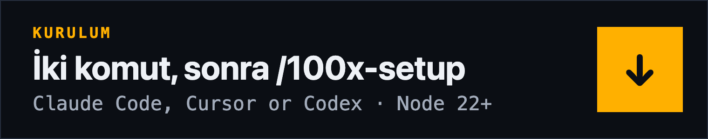
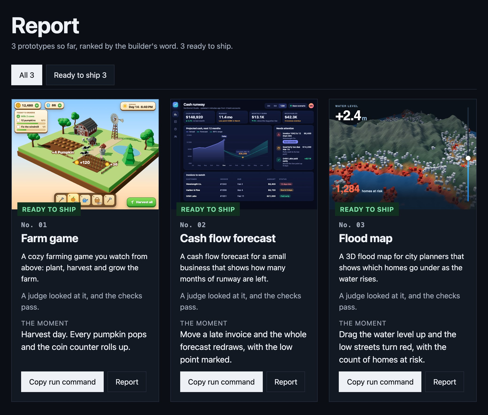
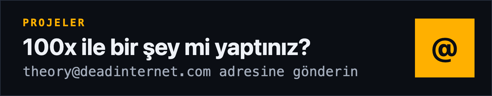
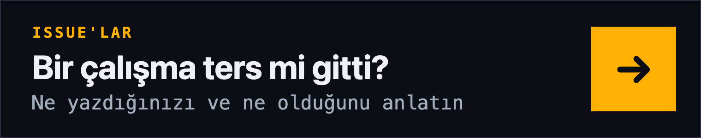
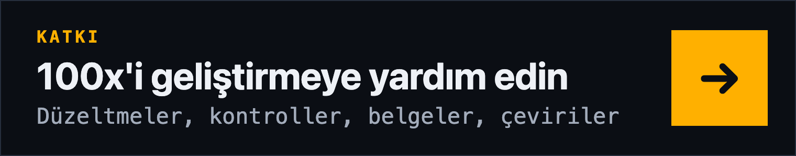

<div align="center">

<picture>
  <source media="(prefers-color-scheme: dark)" srcset="../docs/img/brand/mask-dark.png">
  
</picture>

# 100× ENGINEER SKILL

### "NEREDEYSE ÇALIŞIYOR" AJANLI KODLAMAYA SON

[](https://github.com/DeadInternetStudios/100x-engineer-skill/actions/workflows/ci.yml)
[](https://github.com/DeadInternetStudios/100x-engineer-skill/stargazers)
[](https://github.com/DeadInternetStudios/100x-engineer-skill/releases)
[](https://nodejs.org/)
[](../LICENSE)

[](https://github.com/DeadInternetStudios/100x-engineer-skill/stargazers)

**100x, pstack'ten ilham alan ve prompt'ları üretime hazır, test edilmiş ve gözden geçirilmiş yazılıma dönüştüren bir skill'dir. Onu her ay üretime 1.000'den fazla PR göndermek için kullanıyorum, geri alma oranım %2'nin altında.**

<sub><a href="../README.md">English</a> · <a href="README.es.md">Español</a> · <a href="README.zh.md">中文</a> · <a href="README.pt.md">Português</a> · <a href="README.ru.md">Русский</a> · <a href="README.ja.md">日本語</a> · <a href="README.fr.md">Français</a> · <a href="README.de.md">Deutsch</a> · <a href="README.ar.md">العربية</a> · <a href="README.hi.md">हिन्दी</a> · <a href="README.ko.md">한국어</a> · <a href="README.id.md">Bahasa Indonesia</a> · <b>Türkçe</b> · <a href="README.vi.md">Tiếng Việt</a> · <a href="README.bn.md">বাংলা</a> · <a href="README.it.md">Italiano</a> · <a href="README.pl.md">Polski</a> · <a href="README.th.md">ไทย</a> · <a href="README.uk.md">Українська</a> · <a href="README.nl.md">Nederlands</a></sub>

</div>

> **100x engineer**<br>
> /ˈwən ˈhən-drəd eks ˌen-jə-ˈnir/<br>
> *isim*
>
> Toplantısız, sorusuz ve kırmızı testsiz, tek başına yüz sıradan mühendis kadar iş çıkardığı söylenen yazılım mühendisi.

Ajanınız işin bittiğini söylüyor. Açıyorsunuz, *bir şekilde* çalışıyor. Hep iyi görünüyor ama bir türlü yayına hazır olmuyor.

**100x, kodlama ajanınıza geliştirmenin son %10'unu bitirtir.**

<p align="center">
  
</p>

<p align="center"><b>30 günde 136B token · 1 mühendis · Ciddi projeler · 1.000'den fazla PR · $250k önbellek tasarrufu</b></p>

Claude Code, Cursor ve Codex için açık kaynaklı bir skill. Ona tek bir iş verin; uygulamanıza bir özellik eklemek ya da sıfırdan küçük bir uygulama yazmak gibi. İşi planlar, yapar, cilalar ve en önemli kısmı test eder. İkinci bir yapay zekâ modeli işi inceler. Sonunda ekran görüntüleri, test sonuçları ve hâlâ açık kalan her şeyin yer aldığı bir rapor alırsınız.

<p align="center">
  <a href="#kurulum"></a>
</p>

<!-- Benchmark headline goes here: one line and one picture, the same agent with and without 100x, with a link to the method. -->

## Ajanlar neden "neredeyse çalışıyor"da kalıyor

Üç şey ters gidiyor ve 100x'in her biri için bir cevabı var. Aşağıdaki örneklerin hepsi aynı isteği kullanıyor:

> Borsa araştırma uygulamamda herhangi bir hisseyi S&P 500 ile karşılaştırabileyim

### 1. "Çalışıyor"un aslında ne demek olduğunu kimse yazmadı

İstek tek satır. 100x bir şey yapmadan önce, bir saatiniz olsa sizin yazacağınız prompt'u yazar. Hedefi, kuralları, en riskli kısmı ve her isteğin nasıl kontrol edileceğini belirler. Burada tuzağı erkenden fark ediyor: grafik hesaba katmazsa hisse bölünmesi zarar gibi görünür.

<p align="center">
  
</p>

<p align="center"><a href="../docs/examples/stock-comparison-prompt.md">Prompt'un tamamını okuyun</a></p>

### 2. Ajan kendi işini kendisi kontrol ediyor

Kendi işini kontrol eden bir model kendi hatalarını kaçırır. 100x'te kodu ve ekranları turlar halinde ikinci bir model inceler. Geliştirici model her bulguyu düzeltir ya da neden katılmadığını yazar. Burada prompt yeni halka arz olmuş bir hisse durumunu belirtmiş ve inceleyiciden bunun üstüne gitmesini istemişti, ama geliştiricinin testleri yalnızca eski hisseleri kullanıyordu. İnceleyici bu yıl halka arz olan bir hisseyi denedi ve endeks çizgisinin beş ay erken başladığını buldu.

<p align="center">
  
</p>

Bu örnek temsili. Gerçek bir örnek: bu README siz okumadan önce 100x'ten geçti. İnceleyicisi ilk turda, 20 ölü dil bağlantısından telefon için fazla küçük etiketlere kadar 9 sorun işaretledi. 7'si düzeltildi, 2'si herkese açık lansmana bırakıldı. [Neler bulduğunu okuyun](../docs/examples/readme-review.md).

### 3. Özet hafızadan yazılıyor

Bir ajan "bitti" dediğinde aklında kalanı anlatır. 100x kanıtları ilerledikçe kaydeder: ekran görüntüleri, test çıktıları, inceleyicinin bulguları. Sonunda özeti bu dosyalardan kod yazar ve bir isteğin kanıtı yokken ya da bir kontrol eksikken `100x finish` özeti yazmayı reddeder. Hisse grafiği çalışmasının sonundaki mesaj bu. Araştırma uygulaması uydurma, bu yüzden çalışma da temsili.

<p align="center">
  
</p>

<details>
<summary>Aynı mesaj düz metin olarak</summary>

```text
Compare with the S&P 500: A chart in a research app that shows how any stock has moved against the S&P 500 since the first day both have prices. Verdict: ready to ship. The split math matches a hand count and both lines start on the same day. Dividends are not counted yet.
The moment: Type a ticker and both lines start at 0% on the same day, so the gap is the whole story
Run: npm run dev, then open http://localhost:5173/compare
Try first: 1) Type a ticker you hold and read the gap to the index 2) Pick a stock that split two for one and check the split day shows no drop 3) Pick a stock listed this year and see where both lines start
Must not break: numbers passed (Percent change across a two-for-one split matches a hand count on 40 split cases, 0 failing)
Review (claude-opus-5-5): 9 flagged, 7 fixed, 1 rejected, 1 deferred
Judge rounds: 5 of 5 done, on the code and how it behaves, the UI and UX and whether it is ready to ship, and the last word was ready to ship
Screen sizes: 0 broken, 2 weak, 15 sizes and 148 elements checked
Asks: 9 of 9 closed
Report: file:///Users/you/projects/research-app/.100x/REPORT.html
Next likely asks: Count dividends in the comparison; Show the gap for several stocks in one table
```

</details>

- **The moment:** onu istemenizi sağlaması gereken tek şey
- **Must not break:** zor test ve geçip geçmediği
- **Review:** ikinci modelin işaretledikleri ve geliştiricinin bunlarla ne yaptığı
- **Asks:** prompt'taki gereksinimler, her biri yalnızca kanıtla kapanır
- **Next likely asks:** muhtemelen sonra isteyeceğiniz şeyler, ya yapılmış ya listelenmiş

## Tek mesaj gönderin ve işinize bakın

Aynı istek bir zaman çizelgesi olarak. Elle yaparken soruları cevaplamak ve hataları yakalamak için sürekli geri dönersiniz. 100x ile tek bir mesaj gönderir, döndüğünüzde raporu okursunuz. Mavi siz, kehribar rengi ikinci model. Süreleri biz uydurduk.

<p align="center">
  
</p>

<details>
<summary>Sıfırdan yazılan küçük bir uygulamada da aynısı</summary>

<p align="center">
  
</p>

Dört kelimeden yazılan bütçe uygulaması prompt'u: [make me a budget app](../docs/examples/budget-app-prompt.md).

</details>

<details>
<summary>Bir çalışmanın sekiz adımı</summary>

| Adım | Ne olur |
|---|---|
| 1. Plan | Ajanınız ayrıntılı bir prompt yazar. Neyin yapılacağını ve her isteğin nasıl kontrol edileceğini açıkça belirtir. |
| 2. Çekirdek | Planı değiştirmek için hâlâ zaman varken önce en riskli kısmı dener. |
| 3. Yapım | İlk sürümü ve muhtemelen sonra isteyeceğiniz ekstraları yapar. |
| 4. Cila | Yerleşim ve ayrıntılar üzerinde çalışır. Her geçişten sonra ikinci bir model ekran görüntülerine bakar ve zayıf yerleri gösterir. |
| 5. Test | Ajan, bozulursa bütün işi mahvedecek tek şeyi test eder; bölünmeyi yanlış hesaplayan bir grafik gibi. Önce testin bir hatayı yakalayabildiğini gösterir. |
| 6. İnceleme | İkinci model kodu ve ekranları inceler. Geliştirici her sorunu düzeltir ya da neden bekleyebileceğini veya neden katılmadığını yazar. |
| 7. Bitiş | `100x finish` komutu raporu yazmadan önce kaydedilen kanıtları kontrol eder. |
| 8. Rapor | Sonucu görür, kendiniz dener ve inceleyicinin neler bulduğunu okursunuz. |

Siz yokken ajan verdiği her kararı yazar ve çalışmaya devam eder. [İş akışının tamamını okuyun](../docs/pipeline.md).

</details>

## Elinize ne geçer

<div align="center">



<sub>Uydurma üç çalışmadan çizilmiş rapor sayfası. Gerçek bir çalışma her karta kendi ekran görüntülerini koyar.</sub>

</div>

- **Özellik ya da uygulama** ve kendiniz nasıl deneyeceğiniz
- **Birçok ekran boyutunda ekran görüntüleri**; taşan metin, minik düğmeler, bulanık görseller ve tarayıcı hataları için kontrol edilmiş
- **Bir rapor sayfası** (`.100x/REPORT.html`) ve `~/.100x` içinde bitmiş tüm çalışmaların galerisi
- **Bir karar günlüğü**: siz yokken 100x'in yaptığı her seçim ve nedeni
- **Yukarıda gösterilen son mesaj**

Her çalışma tek bir karar alır: **Yayına hazır**, **İyi** ya da **Geliştirilmeli**. Bir şey kararı engellediğinde kart bunun ne olduğunu söyler; 100x bir sorun bulduysa kırmızıyla, bir kontrol eksikse kehribar rengiyle.

---

<div align="center">

## 100x ile yapılmış gerçek ürünler

<table align="left"><tr><td>
<a href="https://dollarflow.com/"></a><br>
<a href="https://dollarflow.com/"><b>DollarFlow</b></a><br>
100x desteğiyle yapılmış<br>
bir hisse tarama aracı
</td></tr></table>
<table align="left"><tr><td>
<a href="https://springtails.wiki/"></a><br>
<a href="https://springtails.wiki/"><b>Springtails Wiki</b></a><br>
Tamamen 100x ile yapılmış<br>
bir kollembola wikisi
</td></tr></table>
<br clear="all">

<table align="left"><tr><td>
<a href="https://bubblewrapapp.com/"></a><br>
<a href="https://bubblewrapapp.com/"><b>BubbleWrap</b></a><br>
Tamamen 100x ile yapılmış,<br>
piksel sanatlı bir müzik uygulaması
</td></tr></table>
<table align="left"><tr><td>
<a href="https://goldtraderdesk.com/"></a><br>
<a href="https://goldtraderdesk.com/"><b>Gold Trader Desk</b></a><br>
Tamamen 100x ile yapılmış<br>
bir altın alım satım uygulaması
</td></tr></table>
<br clear="all">

<table align="left"><tr><td>
<br>
<b>Phantom</b><br>
Adli uzmanların el yazısı<br>
incelemek için kullandığı,<br>
100x desteğiyle yapılmış<br>
bir Swift Mac uygulaması
</td></tr></table>
<table align="left"><tr><td>
<br>
<b>OptionsFlow</b><br>
Kantitatif firmaların kullandığı,<br>
React ile gerçek zamanlı opsiyon zinciri<br>
aracı, 100x desteğiyle yapıldı
</td></tr></table>
<br clear="all">

<table align="left"><tr><td>
<br>
<b>Skynet</b><br>
Blueprint ve Encore üzerine kurulu,<br>
100x desteğiyle yapılmış bir<br>
proje yönetim aracı
</td></tr></table>
<table align="left"><tr><td>
<br>
<b>Boneworks</b><br>
Karakterleri modelleyen, kaplayan,<br>
rig'leyen ve canlandıran bir text-to-3D<br>
hattı, 100x desteğiyle yapıldı
</td></tr></table>
<br clear="all">

<p align="center">
  <a href="mailto:theory@deadinternet.com"></a>
</p>

</div>

---

## Maliyeti ne

100x, zaman ve kullanım karşılığında kanıt verir.

- **Normal bir çalışma saatler sürer.** Her cila geçişi ve her inceleme turu çalışan bir model daha demek, bu yüzden bir çalışma planınızın epey bir kısmını kullanır.
- **İlk bakış için** `/100x-mockup` yaklaşık 15 dakika sürer. İncelemeyi atlar ve bunu açıkça söyler.
- **Daha küçük bir planda** `100x config preset lite --global` üç ve beş yerine bir cila geçişi ve iki inceleme turu yapar. Kanıt kontrolleri yerinde kalır.
- **Küçük işler için değil.** Tek satırlık bir düzeltme ya da bir soru için doğrudan ajanınıza sorun. 100x; bir planı, bir testi ve bir incelemeyi hak eden işler için.

## Kurulum

Claude Code, Cursor ya da Codex ve Node.js 22 veya daha yenisi gerekir.

**1. Aracı ve skill'leri kurun**

Birini seçin:

**npm**

```bash
npm install -g github:DeadInternetStudios/100x-engineer-skill
100x install
```

**skills.sh**

```bash
npm install -g github:DeadInternetStudios/100x-engineer-skill
npx skills add DeadInternetStudios/100x-engineer-skill --skill '*' -g
100x install
```

`skills` aracı yalnızca skill'leri kopyalar, bu yüzden `100x` aracı yine npm'den gelir. Ardından `100x install` kopyaları görür ve onlara dokunmaz. Güncellemek için `npx skills update -g` çalıştırın.

**2. Ajanınızın içinde kurulumu yapın**

```text
/100x-setup
```

Hangi planı kullandığınızı sorar (Claude Pro, Max ya da Ultra veya OpenAI Go, Plus ya da Pro) ve hangi modelin geliştireceğini, hangisinin değerlendireceğini seçer. Planınız küçükse bunu söyleyin, lite ön ayarını açar. Daha fazlası: [docs/plans-and-setup.md](../docs/plans-and-setup.md).

**3. Ona bir iş verin**

```text
/100x Borsa araştırma uygulamamda herhangi bir hisseyi S&P 500 ile karşılaştırabileyim
```

Claude Code ve Cursor bir skill'i `/` ile başlatır. Codex `$` kullanır, örneğin `$100x-setup` ve `$100x`. Gece için çıkıyorsanız `/100x-overnight`, ilk bakış için `/100x-mockup` kullanın.

### Diğer kurulum yolları

**Bir klondan** (bu repoyu biz böyle test ediyoruz)

```bash
./scripts/install.sh --dry-run   # preview
./scripts/install.sh
```

100x iki parçadan oluşur: ajanınızın okuduğu skill'ler ve `100x` komut satırı aracı. Araç, bir modelin kendi başına güvenilir şekilde yapamadığı işleri yapar. Süreyi tutar, ekran görüntüsü alır, yargıcı çalıştırır, kanıtları kontrol eder ve raporu yazar. Ekran görüntüleri Playwright ile alınır. Eksikse `100x browsers` onu kurar.

Kurulum programı yalnızca kısayollar (sembolik bağlantılar), birkaç küçük dosya ve bunların klasörlerini oluşturur. Gerçek bir dosyanın üzerine asla yazmaz. `100x doctor` sonucu kontrol eder, `./scripts/install.sh --uninstall` ise kaldırır. Dokunduğu her dosya: [docs/cli.md](../docs/cli.md).

## Modlar

100x, mod adı verilen bir skill setidir. Bir modu kullanmak için adını yazın. Mesajınızdaki kelimeler asla mod seçmez; yani `/100x an overnight oats app` bir yulaf ezmesi uygulaması yapar.

| Bunu yazın | Ne için | Ne yapar |
|---|---|---|
| `/100x` | Yapım | Normal çalışma: yapım, cila, test, ikinci model incelemesi. |
| `/100x-mockup` | Yapım | Yaklaşık 15 dakikada hızlı bir ilk bakış. Yalnızca kilit an çalışır. İnceleme yok ve bunu söyler (UNREVIEWED). |
| `/100x-overnight` | Yapım | Çıkarken kullanmak için. Bir ya da birkaç fikri belirli bir süre boyunca çalıştırır ve ajan takılırsa dürter. |
| `/100x-wrapup` | Yapım | Teslim tarihleri için. Ana yolu çalışır hale getirir, gerisini gizler. |
| `/100x-judge` | İnceleme | Zaten yapılmış bir şeyi inceler. Yeni bir şey yapmaz. |
| `/100x-grind` | İnceleme | Bir yargıç yayına hazır diyene kadar incele, düzelt, yeniden incele. Üst üste üç inceleme daha iyi bir şey bulamazsa, 15 turda ya da süre dolunca durur. |
| `/100x-status` | Çalışma | Çalışmanın nerede olduğu, en fazla altı satırda. |
| `/100x-continue` | Çalışma | Durmuş bir çalışmayı kaldığı yerden sürdürür, örneğin bir kullanım sınırından sonra. |
| `/100x-report` | Çalışma | Biten her şeyi en iyisi başta olacak şekilde gösterir. Bir şey yapmaz. |
| `/100x-adhd` | Plan | Belirsiz bir fikri plana dönüştüren, her seferinde tek soruluk kısa bir karşılıklı konuşma. Siz başla diyene kadar hiçbir şey yapılmaz. |
| `/100x-setup` | Kurulum | Planınızla ilgili tek bir soru sorar, sonra hangi modelin hangi işi yapacağını ayarlar. |
| `/100x-bakeoff` | 100x testi | 100x'in kendisini test eder: aynı ajan aynı fikirleri 100x ile ve 100x olmadan yapar, kör bir yargıç ikisini karşılaştırır. Bir şey yapmaz. |

### Sayılı ifadeler

Bir çalışmayı değiştirmek için bunları mesajınıza ekleyin. `/100x` ve `/100x-overnight` ile çalışırlar. "Hızlı" ya da "çabuk" gibi başka kelimeler hiçbir şey yapmaz.

| Yazdığınız | Ne olur |
|---|---|
| `3 versions` | Fikrin 3 sürümünü yapar ve en iyisini bitirir. Her sayı çalışır. |
| `for 10 hours`, `for 2 days`, `until 6am` | O sürenin tamamını kullanır. Çalışma erken bitmez. |
| `5 rounds of judging` | O kadar inceleme turu yapar. |
| `max 5 subagents` | Aynı anda en fazla 5 alt ajan. Varsayılan 1. |

```text
/100x-overnight 3 versions of a farming game, for 8 hours, max 3 subagents
```

Her çalışma anladığı ifadeleri listeleyerek başlar, böylece yanlış okunan bir şeyi fark edebilirsiniz.

Ona bir süre verin, süre dolana kadar turlar halinde çalışmaya devam eder. Her tur projeye yeni bir açıdan bakar, işe yaradıysa değişikliği tutar, yaramadıysa geri alır. Her turu taze bir ikinci model kontrol eder.

<p align="center">
  
</p>

## SSS

**Neden ikinci bir model?** Farklı modellerin farklı kör noktaları var. Hiçbiri yoksa çalışma yine de biter ve UNREVIEWED der. Tek bir planınız varsa aynı şirketin daha küçük bir modeli değerlendirebilir, ama başka bir şirketin modeli kadar fayda sağlamaz.

**Projemi yayına alır mı?** Hayır. Önizlemeyi yalnızca projede zaten varsa yapar. Yayına almak için sizin söylemeniz gerekir.

**Çalışmanın ortasında kullanım sınırına takılırsam?** 100x ilerlemeyi `.100x/STATE.md` içine kaydeder. Sınır sıfırlandığında aynı klasörde `/100x-continue` yazın.

**Modelimi ya da ayarlarımı değiştirir mi?** Hayır. Modelinizi, effort seviyenizi ya da oturumunuzu asla değiştirmez. `/100x-setup` yalnızca 100x'in kendi ayarlarını yazar.

**Çalışmalar nerede durur?** Her projedeki gizli bir `.100x/` klasöründe (git bunu yok sayar) ve `~/.100x` içindeki bitmiş çalışmalar galerisinde.

<p align="center">
  <a href="https://github.com/DeadInternetStudios/100x-engineer-skill/issues/new"></a>
</p>

## Belgeler

| Sayfa | İçinde ne var |
|---|---|
| [Kurulumun tamamı](../docs/install.md) | her kurulum seçeneği ve kurulum programının dokunduğu her dosya |
| [100x'i kullanmak](../docs/using.md) | bir gece uzakta, rapor sayfası, yardımcı skill |
| [İş akışı ve son mesaj](../docs/pipeline.md) | her adım ayrıntılı olarak ve `100x finish` neleri kontrol eder |
| [Kurulum ve planlar](../docs/plans-and-setup.md) | önerilen Claude Code kurulumu, lite ön ayarı, her plan için kurulumlar |
| [Ayarlar](../docs/settings.md) | her yapılandırma anahtarı |
| [CLI ve dosya düzeni](../docs/cli.md) | her `100x` komutu ve dosyaların nerede durduğu |
| [Skill'lerin içi, doğrulama](../docs/contributing.md) | repo nasıl düzenlenmiş ve nasıl test edilir |
| [Tasarım notları](../docs/design.md) | 100x neden böyle çalışıyor |

## Katkıda bulunma

Hata raporları, düzeltmeler ve fikirler memnuniyetle karşılanır. Küçük düzeltmeler doğrudan pull request olarak gelebilir. Daha büyük bir şey için önce bir issue açın ki üzerinde anlaşalım. [Nasıl katkıda bulunulur](../CONTRIBUTING.md).

<p align="center">
  <a href="../CONTRIBUTING.md"></a>
</p>

## Teşekkürler

100x, Lauren Tan'ın [pstack](https://github.com/cursor/plugins/tree/main/pstack) projesinin (MIT) çalışma ilkeleri üzerine kurulu; prototipler ve ajanınızla tek bir konuşma için yeniden düzenlendi. Farkları:

- Her çalışma bir rapor sayfasıyla biter.
- `100x finish` kontrol edemediği iddiaları reddeder.
- İkinci bir model işi turlar halinde inceler.

Bkz. [NOTICE.md](../NOTICE.md) ve [UPSTREAM.md](../UPSTREAM.md).

MIT. Bkz. [LICENSE](../LICENSE).

<p align="center">
  <a href="https://star-history.com/#DeadInternetStudios/100x-engineer-skill&Date">
    <picture>
      <source media="(prefers-color-scheme: dark)" srcset="https://api.star-history.com/svg?repos=deadinternetstudios/100x-engineer-skill&type=Date&theme=dark">
      
    </picture>
  </a>
</p>

---

<sub>Maske çizimi: <a target="_blank" href="https://www.vexels.com/png-svg/preview/229802/guy-fawkes-mask-bonfire-night-stroke">www.vexels.com</a></sub>
