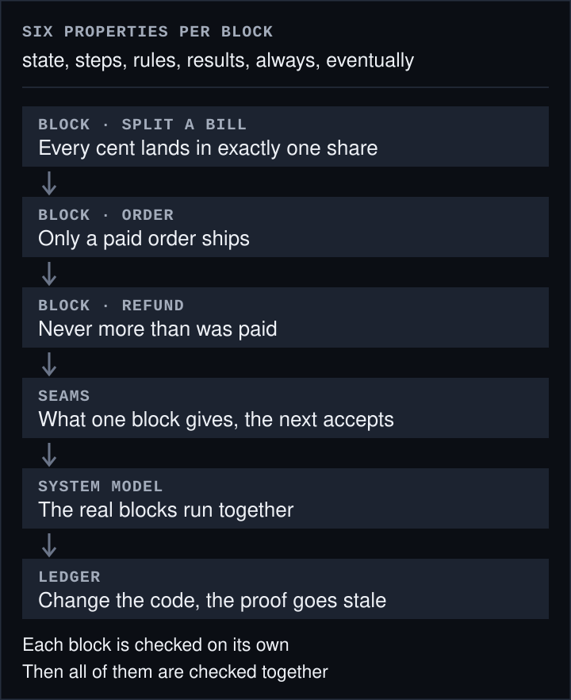
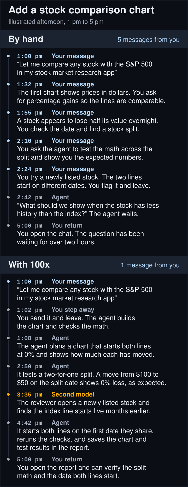
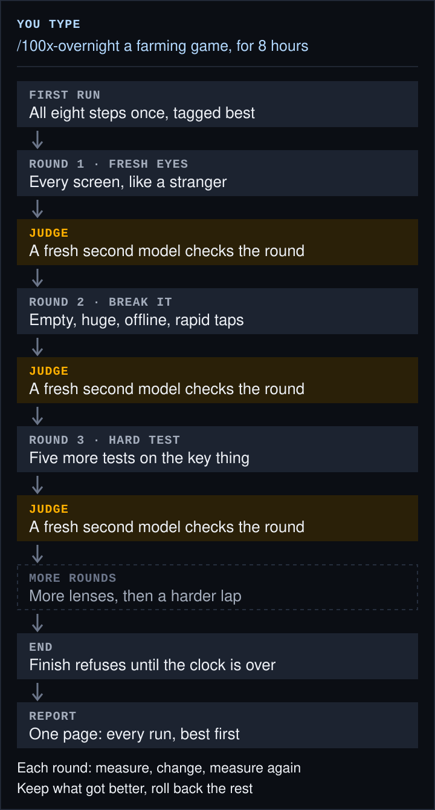

<div align="center">

<picture>
  <source media="(prefers-color-scheme: dark)" srcset="../docs/img/brand/mask-dark.png">
  
</picture>

# 100× ENGINEER SKILL

### Досить agentic coding, який «майже працює»

[](https://github.com/DeadInternetStudios/100x-engineer-skill/actions/workflows/ci.yml)
[](https://github.com/DeadInternetStudios/100x-engineer-skill/releases)
[](https://nodejs.org/)
[](../LICENSE)

[](https://github.com/DeadInternetStudios/100x-engineer-skill/stargazers)

*100x — це скіл від колишнього інженера Cursor, який перетворює промпти на формально верифікований, готовий до продакшену код.<br>Я використовую його, щоб щомісяця випускати в продакшен понад 1 000 PR, з часткою відкатів нижче 2%.*

Результати Terminal Bench 4.1 незабаром 😎

<sub><a href="../README.md">English</a> · <a href="README.es.md">Español</a> · <a href="README.zh.md">中文</a> · <a href="README.pt.md">Português</a> · <a href="README.ru.md">Русский</a> · <a href="README.ja.md">日本語</a> · <a href="README.fr.md">Français</a> · <a href="README.de.md">Deutsch</a> · <a href="README.ar.md">العربية</a> · <a href="README.hi.md">हिन्दी</a> · <a href="README.ko.md">한국어</a> · <a href="README.id.md">Bahasa Indonesia</a> · <a href="README.tr.md">Türkçe</a> · <a href="README.vi.md">Tiếng Việt</a> · <a href="README.bn.md">বাংলা</a> · <a href="README.it.md">Italiano</a> · <a href="README.pl.md">Polski</a> · <a href="README.th.md">ไทย</a> · <b>Українська</b> · <a href="README.nl.md">Nederlands</a></sub>

</div>

> **100x engineer**<br>
> /ˈwən ˈhən-drəd eks ˌen-jə-ˈnir/<br>
> *іменник*
>
> Розробник, про якого кажуть, що він видає стільки, скільки сто звичайних розробників, без нарад, запитань і тестів, що падають.

Агент каже, що все готово. Відкриваєш, а воно *ніби* працює. Виглядає завжди нормально, але до релізу ніколи не готове.

**100x допомагає твоєму агенту для кодування довести до кінця останні 10% розробки.**

**Він ділить роботу на невеликі блоки, формально верифікує кожен і перевіряє, що блоки працюють разом.**

<p align="center">
  
</p>

<p align="center"><b>136B токенів за 30 днів · 1 інженер · Серйозні проєкти · Понад 1 000 PR · $250k економії на кеші</b></p>

Це скіл з відкритим кодом для Claude Code, Cursor і Codex. Дай йому одне завдання, наприклад додати функцію в застосунок або зробити невеликий застосунок з нуля. Він планує роботу, будує, доводить до ладу й тестує те, що важить найбільше. Друга модель ШІ робить рев’ю. Ти отримуєш звіт зі скриншотами, результатами тестів і всім, що ще лишилося відкритим.

<p align="center">
  <a href="#встановлення"></a>
</p>

<!-- Benchmark headline goes here: one line and one picture, the same agent with and without 100x, with a link to the method. -->

## Формальна верифікація, по одному невеликому блоку

Цілий застосунок формально не верифікує ніхто. Але майже будь-яке добре спроєктоване програмне забезпечення складається з невеликих блоків, а в невеликого блока є те, що можна точно сформулювати і перевірити повністю. 100x записує це, перевіряє кожен пункт, а потім перевіряє, що блоки працюють разом. Робить він це за замовчуванням.

### Шість запитань до кожного блока

| Запитання | Що записується |
|---|---|
| Стан | що може існувати |
| Переходи | як воно може змінюватися |
| Передумови | коли крок дозволений |
| Післяумови | що правда після кроку |
| Інваріанти | що виконується завжди |
| Живість | що має зрештою статися і які припущення для цього потрібні |

Промпт відповідає на всі шість простими реченнями. Потім 100x будує невелику модель, яка запускає ваші справжні функції, а перевірник обходить кожен стан, до якого модель може дійти. Коли щось ламається, він друкує найкоротший список кроків, що до цього веде.

### Невеликі блоки складаються у велику систему

<p align="center">
  
</p>

Кожен блок перевіряється окремо, тому збій вказує на одну невелику річ. Стики теж перевіряються: те, що один блок передає, має відповідати правилам наступного. Потім справжні блоки запускаються разом в одній моделі, а перевірник обходить кожен стан цілого. Перевірені блоки плюс перевірені стики складаються в софт, якому можна довіряти. Стики самі собою не доводяться, тому 100x перевіряє і те, і те.

### Це лишається правдою

Реєстр — це `verify/ledger.tsv` у вашому репозиторії, тому він подорожує з кожною гілкою. Кожен рядок зберігає хеш коду, який він покриває. Змініть цей код, і рядок застаріє, доки хтось не прочитає зміну, не запустить перевірку й не синхронізує її. Кожна властивість має один раз впасти на навмисно внесеній помилці, перш ніж вона зарахується. `100x finish` відхиляє властивість, яка застаріла, зламана або жодного разу не падала. Коли агент збирається чіпати код, який не покритий жодним правилом, `100x verify cover` відповідає `NO RULE`, і це запускає процедуру.

```text
$ 100x verify run
pass  split-keeps-every-cent. invariant, exhaustive, exit 0

# someone swaps Math.floor for Math.round in the split
$ 100x verify status
stale   split-keeps-every-cent  the covered code changed after the last sync

$ 100x verify run
FAIL  inv:shares-keep-every-cent. a cent was lost or made. Steps: set-bill(1), set-people(2), compute
```

<sub>З невеликого калькулятора чайових, запущеного вручну в тестовому репозиторії</sub>

### Що тут означає «верифіковано»

- **Вичерпно** (`exhaustive`): відвідано кожен стан моделі, тому властивість виконується для цієї моделі та її меж
- **З обмеженням** (`bounded`): пошук дійшов до ліміту й нічого не знайшов у баченому, а це не доведення, і живість на цьому ніколи не вирішується
- **Вибірково** (`sampled`): вибрані або випадкові випадки: добре знаходять помилки і мовчать про решту

Успішний результат покриває модель і справжні функції, які запускають перевірки. Верстці й текстам нічого формулювати, тому вони отримують записане звільнення з причиною, а `100x finish` називає код, який кожне звільнення пропускає. Щоб пропустити все це, напишіть `no verification` у повідомленні або запустіть `100x config set verify.enabled false`. Тоді у звіті буде сказано, що нічого не верифікувалося. [Подробиці](../docs/verification.md).

## Чому агенти зупиняються на «майже працює»

Ламаються три речі, і 100x має відповідь на кожну. Усі приклади нижче використовують той самий запит:

> Дай мені порівнювати будь-яку акцію з S&P 500 у моєму застосунку для дослідження фондового ринку

### 1. Ніхто не записав, що насправді означає «працює»

Запит займає один рядок. Перш ніж щось будувати, 100x пише промпт, який ти написав би сам, якби мав зайву годину. Він задає мету, правила, найризикованішу частину і спосіб перевірити кожну вимогу. Тут він рано помічає пастку: спліт акцій виглядає як збиток, якщо графік його не враховує.

<p align="center">
  
</p>

<p align="center"><a href="../docs/examples/stock-comparison-prompt.md">Прочитати весь промпт</a></p>

### 2. Агент перевіряє власну роботу

Модель, яка перевіряє власну роботу, не помічає власних помилок. У 100x друга модель переглядає код і екрани, кілька раундів. Модель-виконавець виправляє кожне зауваження або записує, чому не погоджується. Тут промпт назвав випадок акції, яка щойно вийшла на біржу, і попросив рецензента перевірити саме його, але тести виконавця брали лише старіші акції. Рецензент спробував акцію, яка вийшла на біржу цього року, і побачив, що лінія індексу починається на п’ять місяців раніше.

<p align="center">
  
</p>

Цей приклад ілюстративний. А ось справжній: цей README пройшов через 100x, перш ніж ти його прочитав. Рецензент у першому раунді позначив 9 проблем, від 20 мертвих посилань на мовні версії до підписів, задрібних для телефона. 7 виправили, а 2 відклали до публічного запуску. [Що він знайшов](../docs/examples/readme-review.md).

### 3. Підсумок пишеться з пам’яті

Коли агент каже «готово», він звітує про те, що пам’ятає. 100x зберігає докази по ходу роботи: скриншоти, вивід тестів, зауваження рецензента. Наприкінці код пише підсумок із цих файлів, а `100x finish` відмовляється його писати, поки якась вимога не має доказу або бракує перевірки. Ось повідомлення в кінці запуску з графіком акцій. Застосунок вигаданий, тож запуск ілюстративний.

<p align="center">
  
</p>

<details>
<summary>Те саме повідомлення звичайним текстом</summary>

```text
Compare with the S&P 500: ready to ship.
The split math matches a hand count and both lines start on the same day. Dividends are not counted yet.

The moment: Type a ticker and both lines start at 0% on the same day, so the gap is the whole story
Run: npm run dev
Open: http://localhost:5173/compare
Try first:
1) Type a ticker you hold and read the gap to the index
2) Pick a stock that split two for one and check the split day shows no drop
3) Pick a stock listed this year and see where both lines start

Must not break: numbers passed (Percent change across a two-for-one split matches a hand count on 40 split cases, 0 failing)
Review (claude-opus-5-5): 9 flagged, 7 fixed, 1 rejected, 1 deferred
Judge rounds: 5 of 5 done, and the last word was ready to ship
Looked at: the code and how it behaves, the UI and UX and whether it is ready to ship
Screen sizes: 0 broken, 2 weak, 15 sizes and 148 elements checked
Asks: 9 of 9 closed

Report: file:///Users/you/projects/research-app/.100x/REPORT.html
Next likely asks: Count dividends in the comparison; Show the gap for several stocks in one table
```

</details>

- **The moment:** та одна річ, через яку тобі захочеться це мати
- **Must not break:** складний тест і чи він пройшов
- **Review:** що позначила друга модель і що з цим зробив виконавець
- **Asks:** вимоги з промпту, кожна закрита лише з доказом
- **Next likely asks:** про що ти, мабуть, попросиш далі, уже зроблене або записане

## Надішли одне повідомлення й займайся своїми справами

Той самий запит у вигляді таймлайну. Вручну ти постійно повертаєшся, щоб відповідати на запитання й ловити помилки. Із 100x ти надсилаєш одне повідомлення і читаєш звіт, коли повернешся. Синій колір позначає тебе, а бурштиновий другу модель. Час ми вигадали.

<p align="center">
  
</p>

<details>
<summary>Те саме для невеликого застосунку з нуля</summary>

<p align="center">
  
</p>

Промпт застосунку для бюджету, написаний із чотирьох слів: [make me a budget app](../docs/examples/budget-app-prompt.md).

</details>

<details>
<summary>Усі вісім кроків запуску</summary>

| Крок | Що відбувається |
|---|---|
| 1. План | Агент пише детальний промпт. У ньому сказано, що будувати і як перевірити кожну вимогу. |
| 2. Ядро | Спершу він пробує найризикованішу частину, поки ще є час змінити план. |
| 3. Збірка | Він будує першу версію і доповнення, про які ти, мабуть, попросиш далі. |
| 4. Шліфування | Він працює над макетом і деталями. Після кожного проходу друга модель дивиться на скриншоти й вказує на слабкі місця. |
| 5. Тест | Агент тестує ту одну річ, яка зіпсувала б усю роботу, якби зламалася, наприклад графік, що неправильно враховує спліт. Спершу він показує, що тест здатен виявити помилку. |
| 6. Рев’ю | Друга модель переглядає код і екрани. Виконавець виправляє кожну проблему або записує, чому вона може зачекати чи чому він не погоджується. |
| 7. Завершення | Команда `100x finish` перевіряє збережені докази, перш ніж писати звіт. |
| 8. Звіт | Ти бачиш результат, можеш сам його спробувати і прочитати, що знайшов рецензент. |

Поки тебе немає, агент записує кожне своє рішення і працює далі. [Прочитати про весь процес](../docs/pipeline.md).

</details>

## Що ти отримуєш

<div align="center">


<sub>Сторінка звіту, створена з трьох вигаданих запусків. Справжній запуск ставить на кожну картку власні скриншоти.</sub>

</div>

- **Функція або застосунок** і як спробувати це самому
- **Скриншоти на багатьох розмірах екрана**, перевірені на текст, що вилазить за межі, крихітні кнопки, розмиті зображення й помилки браузера
- **Сторінка звіту** (`.100x/REPORT.html`) і галерея всіх завершених запусків у `~/.100x`
- **Реєстр верифікації** у вашому репозиторії: властивості кожного блока, чи виконується кожна з них, і код, який вона покриває
- **Журнал рішень**: кожен вибір, який 100x зробив, поки тебе не було, і чому
- **Фінальне повідомлення**, показане вище

Кожен запуск отримує один вердикт: **Готово до релізу**, **Нормально** або **Потребує доробки**. Коли щось блокує вердикт, картка каже, що саме: червоним, коли 100x знайшов проблему, і бурштиновим, коли бракує перевірки.

---

<div align="center">

## Реальні продукти, створені за допомогою 100x

<table align="left"><tr><td>
<a href="https://dollarflow.com/"></a><br>
<a href="https://dollarflow.com/"><b>DollarFlow</b></a><br>
Скринер акцій, створений<br>
за допомогою 100x
</td></tr></table>
<table align="left"><tr><td>
<a href="https://springtails.wiki/"></a><br>
<a href="https://springtails.wiki/"><b>Springtails Wiki</b></a><br>
Вікі про ногохвісток,<br>
повністю створена в 100x
</td></tr></table>
<br clear="all">

<table align="left"><tr><td>
<a href="https://bubblewrapapp.com/"></a><br>
<a href="https://bubblewrapapp.com/"><b>BubbleWrap</b></a><br>
Музичний застосунок у піксель-арті,<br>
повністю створений у 100x
</td></tr></table>
<table align="left"><tr><td>
<a href="https://goldtraderdesk.com/"></a><br>
<a href="https://goldtraderdesk.com/"><b>Gold Trader Desk</b></a><br>
Застосунок для торгівлі золотом,<br>
повністю створений у 100x
</td></tr></table>
<br clear="all">

<table align="left"><tr><td>
<br>
<b>Phantom</b><br>
Mac-застосунок на Swift, яким<br>
криміналісти аналізують почерк,<br>
створений за допомогою 100x
</td></tr></table>
<table align="left"><tr><td>
<br>
<b>OptionsFlow</b><br>
Інструмент для опціонного ланцюга<br>
в реальному часі на React, яким<br>
користуються квант-фірми, створений<br>
за допомогою 100x
</td></tr></table>
<br clear="all">

<table align="left"><tr><td>
<br>
<b>Skynet</b><br>
Інструмент для керування проєктами<br>
на основі Blueprint і Encore, створений<br>
за допомогою 100x
</td></tr></table>
<table align="left"><tr><td>
<br>
<b>Boneworks</b><br>
Пайплайн text-to-3D, який моделює,<br>
скінить, рігить і анімує персонажів,<br>
створений за допомогою 100x
</td></tr></table>
<br clear="all">

<p align="center">
  <a href="mailto:theory@deadinternet.com"></a>
</p>

</div>

---

## Скільки це коштує

100x обмінює час і ліміти на докази.

- **Звичайний запуск триває години.** Кожен прохід шліфування і кожен раунд рев’ю означає ще одну модель за роботою, тож запуск з’їдає добру частину твого тарифу.
- **Для першого погляду** `/100x-mockup` потрібно близько 15 хвилин. Він пропускає рев’ю і прямо про це каже.
- **На меншому тарифі** `100x config preset lite --global` робить один прохід шліфування і два раунди рев’ю замість трьох і п’яти. Перевірки доказів лишаються.
- **Не для дрібниць.** Щоб виправити один рядок чи поставити запитання, звернися до агента напряму. 100x для завдання, яке варте плану, тесту й рев’ю.

## Встановлення

Потрібні Claude Code, Cursor або Codex і Node.js 22 або новіший.

**1. Встанови інструмент і скіли**

Обери один зі способів:

**npm**

```bash
npm install -g github:DeadInternetStudios/100x-engineer-skill
100x install
```

**skills.sh**

```bash
npm install -g github:DeadInternetStudios/100x-engineer-skill
npx skills add DeadInternetStudios/100x-engineer-skill --skill '*' -g
100x install
```

Інструмент `skills` копіює лише скіли, тож інструмент `100x` усе одно встановлюється через npm. Потім `100x install` бачить копії й не чіпає їх. Оновлюй їх командою `npx skills update -g`.

**2. Налаштуй, у своєму агенті**

```text
/100x-setup
```

Він спитає, який у тебе тариф (Claude Pro, Max чи Ultra, або OpenAI Go, Plus чи Pro), і вибере, яка модель будує, а яка оцінює. Якщо тариф малий, скажи про це, і він увімкне пресет lite. Більше: [docs/plans-and-setup.md](../docs/plans-and-setup.md).

**3. Дай йому завдання**

```text
/100x Дай мені порівнювати будь-яку акцію з S&P 500 у моєму застосунку для дослідження фондового ринку
```

Claude Code і Cursor запускають скіл через `/`. Codex використовує `$`, як у `$100x-setup` і `$100x`. Бери `/100x-overnight`, коли йдеш на ніч, або `/100x-mockup` для першого погляду.

### Інші способи встановлення

**З клону** (так ми тестуємо цей репозиторій)

```bash
./scripts/install.sh --dry-run   # preview
./scripts/install.sh
```

100x складається з двох частин: скілів, які читає твій агент, і інструмента командного рядка `100x`. Інструмент робить те, чого модель сама надійно не зробить. Він стежить за часом, робить скриншоти, запускає суддю, перевіряє докази й пише звіт. Скриншоти робляться через Playwright. Якщо його немає, `100x browsers` його встановить.

Інсталятор створює лише ярлики (символічні посилання), кілька невеликих файлів і їхні теки. Він ніколи не перезаписує справжній файл. `100x doctor` перевіряє результат, а `./scripts/install.sh --uninstall` усе прибирає. Кожен файл, якого він торкається: [docs/cli.md](../docs/cli.md).

## Режими

100x — це набір скілів, які називають режимами. Щоб скористатися режимом, введи його назву. Слова в повідомленні ніколи не вибирають режим, тож `/100x an overnight oats app` створить застосунок про нічну вівсянку.

| Введи | Для чого | Що робить |
|---|---|---|
| `/100x` | Збірка | Звичайний запуск: збірка, шліфування, тест, рев’ю другою моделлю. |
| `/100x-mockup` | Збірка | Швидкий перший погляд приблизно за 15 хвилин. Працює лише ключовий момент. Без рев’ю, і про це прямо сказано (UNREVIEWED). |
| `/100x-overnight` | Збірка | Для випадків, коли ти йдеш. Працює над однією ідеєю або кількома протягом заданого часу й підштовхує агента, якщо той застряг. |
| `/100x-wrapup` | Збірка | Для дедлайнів. Доводить до робочого стану основний шлях і ховає решту. |
| `/100x-solo` | Збірка | Увесь запуск в одному чаті, без субагентів, без помічників і без другої моделі. Вона письмово оцінює власну роботу з іншої точки зору, а у звіті сказано, що ніхто інший не дивився. |
| `/100x-judge` | Рев’ю | Робить рев’ю вже зробленого. Нічого нового не будує. |
| `/100x-grind` | Рев’ю | Рев’ю, виправлення і знову рев’ю, поки суддя не скаже, що готово до релізу. Зупиняється, якщо три рев’ю поспіль не знаходять нічого кращого, після 15 раундів або коли закінчується час. |
| `/100x-status` | Запуск | Де зараз запуск, не більше ніж у шести рядках. |
| `/100x-continue` | Запуск | Продовжує запуск, що зупинився, наприклад на ліміті використання. |
| `/100x-report` | Запуск | Показує все завершене, найкраще першим. Нічого не будує. |
| `/100x-adhd` | План | Коротка розмова, по одному запитанню, яка перетворює розмиту ідею на план. Нічого не будується, поки ти не даси команду. |
| `/100x-setup` | Налаштування | Ставить одне запитання про твій тариф, а потім визначає, яка модель яку роботу робить. |
| `/100x-bakeoff` | Тест 100x | Тестує сам 100x: той самий агент будує ті самі ідеї з ним і без нього, а суддя наосліп їх порівнює. Нічого не будує. |

### Фрази з числами

Додай їх у повідомлення, щоб змінити запуск. Вони працюють із `/100x` і `/100x-overnight`. Інші слова, як-от «швидко» чи «на швидку руку», нічого не дають.

| Ти пишеш | Що відбувається |
|---|---|
| `3 versions` | Будує 3 версії ідеї й доводить до кінця найкращу. Підходить будь-яке число. |
| `for 10 hours`, `for 2 days`, `until 6am` | Використовує весь цей час. Запуск не завершиться раніше. |
| `5 rounds of judging` | Проводить стільки раундів рев’ю. |
| `max 5 subagents` | Не більше 5 субагентів одночасно. За замовчуванням 1. |

```text
/100x-overnight 3 versions of a farming game, for 8 hours, max 3 subagents
```

Кожен запуск починається зі списку фраз, які він зрозумів, тож ти одразу помітиш, якщо щось прочитано не так.

Дай йому час, і він працюватиме раундами, доки час не вийде. Кожен раунд дивиться на проєкт по-новому, залишає зміну, якщо вона допомогла, і відкочує, якщо ні. Кожен раунд перевіряє свіжа друга модель.

<p align="center">
  
</p>

## Часті запитання

**Навіщо друга модель?** У різних моделей різні сліпі зони. Якщо жодна не доступна, запуск однаково завершується і показує UNREVIEWED. На одному тарифі оцінювати може менша модель тієї самої компанії, хоча користі від цього менше, ніж від моделі іншої компанії.

**Він викладе мій проєкт в інтернет?** Ні. Він робить прев’ю лише тоді, коли воно в проєкті вже є. Щоб проєкт став публічним, потрібна твоя пряма вказівка.

**Що, як я впруся в ліміт використання посеред запуску?** 100x зберігає прогрес у `.100x/STATE.md`. Коли ліміт оновиться, введи `/100x-continue` у тій самій теці.

**Він змінює мою модель чи налаштування?** Ні. Він ніколи не змінює модель, рівень effort чи вхід в акаунт. `/100x-setup` записує лише власні налаштування 100x.

**Де зберігаються запуски?** У прихованій теці `.100x/` у кожному проєкті (git її ігнорує) і в галереї завершених запусків у `~/.100x`.

<p align="center">
  <a href="https://github.com/DeadInternetStudios/100x-engineer-skill/issues/new"></a>
</p>

## Документація

| Сторінка | Що там |
|---|---|
| [Встановлення, повністю](../docs/install.md) | усі варіанти встановлення і кожен файл, якого торкається інсталятор |
| [Як користуватися 100x](../docs/using.md) | ніч без тебе, сторінка звіту, допоміжний скіл |
| [Формальна верифікація](../docs/verification.md) | шість властивостей, реєстр, що означає «верифіковано» і як блоки складаються в систему |
| [Пайплайн і фінальне повідомлення](../docs/pipeline.md) | кожен крок повністю і що перевіряє `100x finish` |
| [Налаштування і тарифи](../docs/plans-and-setup.md) | рекомендоване налаштування Claude Code, пресет lite, налаштування для кожного тарифу |
| [Параметри](../docs/settings.md) | кожен ключ конфігурації |
| [CLI і структура файлів](../docs/cli.md) | кожна команда `100x` і де лежать файли |
| [Скіли зсередини, перевірка](../docs/contributing.md) | як влаштований репозиторій і як його тестувати |
| [Нотатки про дизайн](../docs/design.md) | чому 100x працює саме так |

## Як долучитися

Звіти про баги, виправлення й ідеї вітаються. Дрібні виправлення можна надсилати одразу як pull request. Для чогось більшого спершу відкрий issue, щоб ми домовилися. [Як долучитися](../CONTRIBUTING.md).

<p align="center">
  <a href="../CONTRIBUTING.md"></a>
</p>

## Подяки

100x спирається на робочі принципи [pstack](https://github.com/cursor/plugins/tree/main/pstack) від Lauren Tan (MIT), перероблені для прототипів і для однієї розмови з агентом. Що змінилося:

- Кожен запуск закінчується сторінкою звіту.
- `100x finish` відкидає твердження, які не може перевірити.
- Друга модель переглядає роботу кількома раундами.

Див. [NOTICE.md](../NOTICE.md) і [UPSTREAM.md](../UPSTREAM.md).

MIT. Див. [LICENSE](../LICENSE).

<p align="center">
  <a href="https://star-history.com/#DeadInternetStudios/100x-engineer-skill&Date">
    <picture>
      <source media="(prefers-color-scheme: dark)" srcset="https://api.star-history.com/svg?repos=deadinternetstudios/100x-engineer-skill&type=Date&theme=dark">
      
    </picture>
  </a>
</p>
