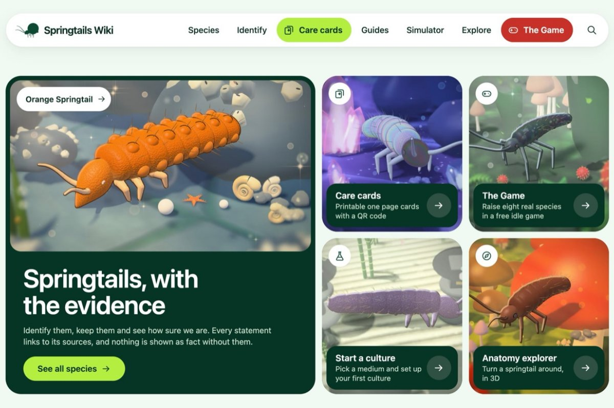

<div align="center">

<picture>
  <source media="(prefers-color-scheme: dark)" srcset="../docs/img/brand/mask-dark.png">
  
</picture>

# 100× ENGINEER SKILL

### Không còn lập trình với agent kiểu "gần chạy được"

[](https://github.com/DeadInternetStudios/100x-engineer-skill/actions/workflows/ci.yml)
[](https://github.com/DeadInternetStudios/100x-engineer-skill/releases)
[](https://nodejs.org/)
[](../LICENSE)

[](https://github.com/DeadInternetStudios/100x-engineer-skill/stargazers)

*100x là một skill lấy cảm hứng từ một cựu kỹ sư Cursor, biến prompt thành code sẵn sàng cho production.<br>Tôi dùng nó để đưa hơn 1.000 PR lên production mỗi tháng, với tỷ lệ rollback dưới 2%.*

<sub><a href="../README.md">English</a> · <a href="README.es.md">Español</a> · <a href="README.zh.md">中文</a> · <a href="README.pt.md">Português</a> · <a href="README.ru.md">Русский</a> · <a href="README.ja.md">日本語</a> · <a href="README.fr.md">Français</a> · <a href="README.de.md">Deutsch</a> · <a href="README.ar.md">العربية</a> · <a href="README.hi.md">हिन्दी</a> · <a href="README.ko.md">한국어</a> · <a href="README.id.md">Bahasa Indonesia</a> · <a href="README.tr.md">Türkçe</a> · <b>Tiếng Việt</b> · <a href="README.bn.md">বাংলা</a> · <a href="README.it.md">Italiano</a> · <a href="README.pl.md">Polski</a> · <a href="README.th.md">ไทย</a> · <a href="README.uk.md">Українська</a> · <a href="README.nl.md">Nederlands</a></sub>

</div>

> **100x engineer**<br>
> /ˈwən ˈhən-drəd eks ˌen-jə-ˈnir/<br>
> *danh từ*
>
> Một kỹ sư phần mềm được cho là làm ra khối lượng công việc của một trăm kỹ sư bình thường, mà không cần họp, không hỏi han và không có test nào fail.

Agent của bạn báo đã xong. Bạn mở ra thì nó *cũng tạm* chạy được. Lúc nào trông cũng ổn, nhưng chưa bao giờ thật sự sẵn sàng phát hành.

**100x giúp agent lập trình của bạn giải quyết nốt 10% cuối cùng của quá trình phát triển.**

<p align="center">
  
</p>

<p align="center"><b>136B token trong 30 ngày · 1 kỹ sư · Dự án nghiêm túc · Hơn 1.000 PR · Tiết kiệm $250k nhờ cache</b></p>

Đây là một skill mã nguồn mở cho Claude Code, Cursor và Codex. Hãy giao cho nó một việc, chẳng hạn thêm một tính năng vào ứng dụng của bạn hoặc làm một ứng dụng nhỏ từ đầu. Nó lên kế hoạch, xây dựng, trau chuốt và test phần quan trọng nhất. Một mô hình AI thứ hai sẽ review. Bạn nhận được một báo cáo có ảnh chụp màn hình, kết quả test và mọi thứ còn dang dở.

<p align="center">
  <a href="#cài-đặt"></a>
</p>

<!-- Benchmark headline goes here: one line and one picture, the same agent with and without 100x, with a link to the method. -->

## Vì sao agent dừng lại ở mức "gần chạy được"

Có ba chỗ hay hỏng, và 100x có cách xử lý cho từng chỗ. Mọi ví dụ dưới đây đều dùng cùng một yêu cầu:

> Cho tôi so sánh bất kỳ cổ phiếu nào với S&P 500 trong ứng dụng nghiên cứu chứng khoán của tôi

### 1. Không ai viết ra "chạy được" thực sự nghĩa là gì

Yêu cầu chỉ có một dòng. Trước khi xây bất cứ thứ gì, 100x viết ra cái prompt mà bạn sẽ tự viết nếu có dư một tiếng. Prompt đặt ra mục tiêu, các quy tắc, phần rủi ro nhất và cách kiểm tra từng yêu cầu. Ở đây nó phát hiện cái bẫy từ sớm: một đợt chia tách cổ phiếu trông như khoản lỗ nếu biểu đồ không điều chỉnh cho nó.

<p align="center">
  
</p>

<p align="center"><a href="../docs/examples/stock-comparison-prompt.md">Đọc toàn bộ prompt</a></p>

### 2. Agent tự kiểm tra công việc của chính nó

Một mô hình tự kiểm tra công việc của mình sẽ bỏ sót lỗi của chính nó. 100x để một mô hình thứ hai review code và giao diện, theo từng vòng. Mô hình xây dựng sửa từng phát hiện hoặc ghi lại lý do nó không đồng ý. Ở đây prompt đã nêu trường hợp cổ phiếu mới niêm yết và dặn người review xoáy vào đó, nhưng test của mô hình xây dựng chỉ dùng cổ phiếu cũ. Người review thử một cổ phiếu niêm yết năm nay và phát hiện đường chỉ số bắt đầu sớm hơn năm tháng.

<p align="center">
  
</p>

Ví dụ đó chỉ là minh họa. Còn đây là ví dụ thật: README này đã qua 100x trước khi bạn đọc. Người review đánh dấu 9 vấn đề ở vòng đầu, từ 20 liên kết ngôn ngữ bị hỏng đến nhãn quá nhỏ trên điện thoại. 7 vấn đề đã được sửa và 2 vấn đề chờ đến lúc ra mắt công khai. [Xem nó đã tìm thấy gì](../docs/examples/readme-review.md).

### 3. Bản tóm tắt được viết theo trí nhớ

Khi agent nói "xong rồi", nó báo lại những gì nó nhớ. 100x lưu bằng chứng trong lúc làm: ảnh chụp màn hình, output của test, các phát hiện của người review. Cuối cùng, code viết bản tóm tắt từ những file đó, và `100x finish` từ chối viết khi còn yêu cầu chưa có bằng chứng hoặc còn thiếu một bước kiểm tra. Đây là thông điệp ở cuối lần chạy làm biểu đồ cổ phiếu. Ứng dụng nghiên cứu là bịa ra, nên lần chạy này cũng chỉ là minh họa.

<p align="center">
  
</p>

<details>
<summary>Cùng thông điệp đó ở dạng văn bản thuần</summary>

```text
Compare with the S&P 500: A chart in a research app that shows how any stock has moved against the S&P 500 since the first day both have prices. Verdict: ready to ship. The split math matches a hand count and both lines start on the same day. Dividends are not counted yet.
The moment: Type a ticker and both lines start at 0% on the same day, so the gap is the whole story
Run: npm run dev, then open http://localhost:5173/compare
Try first: 1) Type a ticker you hold and read the gap to the index 2) Pick a stock that split two for one and check the split day shows no drop 3) Pick a stock listed this year and see where both lines start
Must not break: numbers passed (Percent change across a two-for-one split matches a hand count on 40 split cases, 0 failing)
Review (claude-opus-5-5): 9 flagged, 7 fixed, 1 rejected, 1 deferred
Judge rounds: 5 of 5 done, on the code and how it behaves, the UI and UX and whether it is ready to ship, and the last word was ready to ship
Screen sizes: 0 broken, 2 weak, 15 sizes and 148 elements checked
Asks: 9 of 9 closed
Report: file:///Users/you/projects/research-app/.100x/REPORT.html
Next likely asks: Count dividends in the comparison; Show the gap for several stocks in one table
```

</details>

- **The moment:** điều duy nhất khiến bạn muốn có nó
- **Must not break:** test khó, và nó có pass hay không
- **Review:** những gì mô hình thứ hai đánh dấu, và mô hình xây dựng đã xử lý ra sao
- **Asks:** các yêu cầu trong prompt, mỗi yêu cầu chỉ được đóng khi có bằng chứng
- **Next likely asks:** những gì có lẽ bạn sẽ hỏi tiếp, đã được làm hoặc đã được liệt kê

## Gửi một tin nhắn rồi cứ đi làm việc khác

Cùng yêu cầu đó, dưới dạng dòng thời gian. Làm thủ công, bạn phải liên tục quay lại để trả lời câu hỏi và bắt lỗi. Với 100x, bạn gửi một tin nhắn và đọc báo cáo khi quay lại. Màu xanh là bạn, màu hổ phách là mô hình thứ hai. Các mốc thời gian là do chúng tôi đặt ra.

<p align="center">
  
</p>

<details>
<summary>Điều tương tự với một ứng dụng nhỏ làm từ đầu</summary>

<p align="center">
  
</p>

Prompt của ứng dụng ngân sách, viết ra từ bốn chữ: [make me a budget app](../docs/examples/budget-app-prompt.md).

</details>

<details>
<summary>Cả tám bước của một lần chạy</summary>

| Bước | Điều gì xảy ra |
|---|---|
| 1. Lập kế hoạch | Agent viết một prompt chi tiết. Prompt nói rõ cần xây gì và cách kiểm tra từng yêu cầu. |
| 2. Phần lõi | Nó thử phần rủi ro nhất trước, khi vẫn còn thời gian đổi kế hoạch. |
| 3. Xây dựng | Nó làm phiên bản đầu tiên cùng những phần bổ sung bạn có thể sẽ hỏi tiếp. |
| 4. Trau chuốt | Nó chỉnh bố cục và chi tiết. Sau mỗi lượt, một mô hình thứ hai xem ảnh chụp màn hình và chỉ ra chỗ còn yếu. |
| 5. Test | Agent test đúng một thứ mà nếu hỏng sẽ phá hỏng cả công việc, như biểu đồ tính sai đợt chia tách. Trước tiên nó cho thấy test đó bắt được lỗi. |
| 6. Review | Mô hình thứ hai review code và giao diện. Mô hình xây dựng sửa từng vấn đề hoặc ghi lại vì sao nó có thể để sau hay vì sao nó không đồng ý. |
| 7. Hoàn tất | Lệnh `100x finish` kiểm tra các bằng chứng đã lưu trước khi viết báo cáo. |
| 8. Báo cáo | Bạn xem được kết quả, tự dùng thử và đọc những gì người review tìm ra. |

Nếu bạn vắng mặt, agent ghi lại từng quyết định nó đưa ra và tiếp tục làm. [Đọc toàn bộ quy trình](../docs/pipeline.md).

</details>

## Bạn nhận được gì

<div align="center">


<sub>Trang báo cáo, dựng từ ba lần chạy bịa ra. Một lần chạy thật sẽ đặt ảnh chụp màn hình của chính nó lên mỗi thẻ.</sub>

</div>

- **Tính năng hoặc ứng dụng**, cùng cách tự dùng thử
- **Ảnh chụp màn hình ở nhiều kích thước màn hình**, đã kiểm tra chữ tràn, nút quá nhỏ, ảnh mờ và lỗi trình duyệt
- **Một trang báo cáo** (`.100x/REPORT.html`) và bộ sưu tập mọi lần chạy đã xong trong `~/.100x`
- **Nhật ký quyết định**: mọi lựa chọn 100x đưa ra khi bạn vắng mặt, và lý do
- **Thông điệp cuối** như ở trên

Mỗi lần chạy nhận một kết luận: **Sẵn sàng phát hành**, **Ổn** hoặc **Cần làm thêm**. Khi có gì đó chặn kết luận, thẻ sẽ nói đó là gì, màu đỏ khi 100x tìm ra vấn đề và màu hổ phách khi còn thiếu một bước kiểm tra.

---

<div align="center">

## Sản phẩm thực tế làm bằng 100x

<table align="left"><tr><td>
<a href="https://dollarflow.com/"></a><br>
<a href="https://dollarflow.com/"><b>DollarFlow</b></a><br>
Công cụ lọc cổ phiếu, làm<br>
với sự hỗ trợ của 100x
</td></tr></table>
<table align="left"><tr><td>
<a href="https://springtails.wiki/"></a><br>
<a href="https://springtails.wiki/"><b>Springtails Wiki</b></a><br>
Wiki về bọ đuôi bật, làm<br>
hoàn toàn bằng 100x
</td></tr></table>
<br clear="all">

<table align="left"><tr><td>
<a href="https://bubblewrapapp.com/"></a><br>
<a href="https://bubblewrapapp.com/"><b>BubbleWrap</b></a><br>
Ứng dụng âm nhạc pixel art,<br>
làm hoàn toàn bằng 100x
</td></tr></table>
<table align="left"><tr><td>
<a href="https://goldtraderdesk.com/"></a><br>
<a href="https://goldtraderdesk.com/"><b>Gold Trader Desk</b></a><br>
Ứng dụng giao dịch vàng, làm<br>
hoàn toàn bằng 100x
</td></tr></table>
<br clear="all">

<table align="left"><tr><td>
<br>
<b>Phantom</b><br>
Ứng dụng Mac viết bằng Swift<br>
mà chuyên gia pháp y dùng để<br>
phân tích chữ viết tay, làm với<br>
sự hỗ trợ của 100x
</td></tr></table>
<table align="left"><tr><td>
<br>
<b>OptionsFlow</b><br>
Công cụ chuỗi quyền chọn thời gian<br>
thực bằng React mà các quỹ định lượng<br>
dùng, làm với sự hỗ trợ của 100x
</td></tr></table>
<br clear="all">

<table align="left"><tr><td>
<br>
<b>Skynet</b><br>
Công cụ quản lý dự án xây trên<br>
Blueprint và Encore, làm với<br>
sự hỗ trợ của 100x
</td></tr></table>
<table align="left"><tr><td>
<br>
<b>Boneworks</b><br>
Pipeline text-to-3D dựng mô hình,<br>
skin, rig và làm hoạt ảnh nhân vật,<br>
làm với sự hỗ trợ của 100x
</td></tr></table>
<br clear="all">

<p align="center">
  <a href="mailto:theory@deadinternet.com"></a>
</p>

</div>

---

## Chi phí ra sao

100x đổi thời gian và hạn mức sử dụng lấy bằng chứng.

- **Một lần chạy bình thường mất hàng giờ.** Mỗi lượt trau chuốt và mỗi vòng review là thêm một mô hình làm việc, nên một lần chạy tốn kha khá hạn mức gói của bạn.
- **Để xem thử nhanh**, `/100x-mockup` mất khoảng 15 phút. Nó bỏ qua review và nói rõ điều đó.
- **Với gói nhỏ hơn**, `100x config preset lite --global` chỉ chạy một lượt trau chuốt và hai vòng review thay vì ba và năm. Các bước kiểm tra bằng chứng vẫn giữ nguyên.
- **Không dành cho việc nhỏ.** Với một chỗ sửa một dòng hay một câu hỏi, cứ hỏi thẳng agent. 100x dành cho việc đáng có kế hoạch, test và review.

## Cài đặt

Bạn cần Claude Code, Cursor hoặc Codex, và Node.js 22 trở lên.

**1. Cài công cụ và các skill**

Chọn một cách:

**npm**

```bash
npm install -g github:DeadInternetStudios/100x-engineer-skill
100x install
```

**skills.sh**

```bash
npm install -g github:DeadInternetStudios/100x-engineer-skill
npx skills add DeadInternetStudios/100x-engineer-skill --skill '*' -g
100x install
```

Công cụ `skills` chỉ sao chép các skill, nên công cụ `100x` vẫn được cài từ npm. Sau đó `100x install` thấy các bản sao và không động đến chúng. Cập nhật bằng `npx skills update -g`.

**2. Thiết lập, ngay trong agent của bạn**

```text
/100x-setup
```

Nó sẽ hỏi bạn đang dùng gói nào (Claude Pro, Max hoặc Ultra, hay OpenAI Go, Plus hoặc Pro) rồi chọn mô hình nào xây dựng và mô hình nào chấm. Nếu gói của bạn nhỏ, cứ nói vậy và nó sẽ bật preset lite. Xem thêm: [docs/plans-and-setup.md](../docs/plans-and-setup.md).

**3. Giao việc cho nó**

```text
/100x Cho tôi so sánh bất kỳ cổ phiếu nào với S&P 500 trong ứng dụng nghiên cứu chứng khoán của tôi
```

Claude Code và Cursor gọi skill bằng `/`. Codex dùng `$`, như `$100x-setup` và `$100x`. Dùng `/100x-overnight` khi bạn sắp đi cả đêm, hoặc `/100x-mockup` để xem thử nhanh.

### Những cách cài khác

**Từ một bản clone** (cách chúng tôi test repo này)

```bash
./scripts/install.sh --dry-run   # preview
./scripts/install.sh
```

100x gồm hai phần: các skill mà agent đọc, và công cụ dòng lệnh `100x`. Công cụ này làm những việc mà một mô hình tự mình không làm được một cách đáng tin cậy. Nó canh giờ, chụp màn hình, chạy giám khảo, kiểm tra bằng chứng và viết báo cáo. Việc chụp màn hình dùng Playwright. Nếu chưa có, `100x browsers` sẽ cài nó.

Trình cài đặt chỉ tạo shortcut (liên kết tượng trưng), vài file nhỏ và thư mục chứa chúng. Nó không bao giờ ghi đè lên một file thật. `100x doctor` kiểm tra kết quả, còn `./scripts/install.sh --uninstall` gỡ bỏ. Mọi file nó đụng tới: [docs/cli.md](../docs/cli.md).

## Các chế độ

100x là một bộ skill, gọi là các chế độ. Gõ tên chế độ để dùng nó. Từ ngữ trong tin nhắn của bạn không bao giờ chọn chế độ, nên `/100x an overnight oats app` sẽ làm ra một ứng dụng về yến mạch ngâm qua đêm.

| Gõ lệnh này | Dùng cho | Nó làm gì |
|---|---|---|
| `/100x` | Xây dựng | Lần chạy bình thường: xây dựng, trau chuốt, test, mô hình thứ hai review. |
| `/100x-mockup` | Xây dựng | Bản xem thử nhanh trong khoảng 15 phút. Chỉ khoảnh khắc then chốt là chạy được. Không review, và nó nói rõ điều đó (UNREVIEWED). |
| `/100x-overnight` | Xây dựng | Cho lúc bạn sắp đi. Chạy một hoặc nhiều ý tưởng trong khoảng thời gian định sẵn, và nhắc agent nếu nó bị kẹt. |
| `/100x-wrapup` | Xây dựng | Cho lúc sát hạn chót. Làm cho luồng chính chạy được và ẩn phần còn lại. |
| `/100x-judge` | Review | Review thứ đã làm xong. Không làm gì mới. |
| `/100x-grind` | Review | Review, sửa, review lại cho đến khi giám khảo nói sẵn sàng phát hành. Dừng nếu ba lần review liên tiếp không tìm ra gì tốt hơn, khi tới 15 vòng, hoặc khi hết giờ. |
| `/100x-status` | Lần chạy | Lần chạy đang ở đâu, trong không quá sáu dòng. |
| `/100x-continue` | Lần chạy | Tiếp tục một lần chạy bị dừng, ví dụ do chạm hạn mức sử dụng. |
| `/100x-report` | Lần chạy | Hiện mọi thứ đã xong, tốt nhất xếp trước. Không làm gì mới. |
| `/100x-adhd` | Lên kế hoạch | Một cuộc trao đổi ngắn, mỗi lần một câu hỏi, biến một ý tưởng còn mơ hồ thành kế hoạch. Không xây gì cho đến khi bạn bảo bắt đầu. |
| `/100x-setup` | Thiết lập | Hỏi một câu về gói của bạn, rồi chọn mô hình nào làm việc nào. |
| `/100x-bakeoff` | Test 100x | Test chính 100x: cùng một agent làm cùng các ý tưởng khi có và không có nó, rồi một giám khảo mù so sánh. Không làm gì mới. |

### Cụm từ có số

Thêm các cụm này vào tin nhắn để thay đổi một lần chạy. Chúng dùng được với `/100x` và `/100x-overnight`. Những từ khác, như "nhanh" hay "gấp", không có tác dụng gì.

| Bạn viết | Điều gì xảy ra |
|---|---|
| `3 versions` | Làm 3 phiên bản của ý tưởng và hoàn thiện bản tốt nhất. Số nào cũng được. |
| `for 10 hours`, `for 2 days`, `until 6am` | Dùng hết khoảng thời gian đó. Lần chạy sẽ không kết thúc sớm. |
| `5 rounds of judging` | Chạy đúng chừng ấy vòng review. |
| `max 5 subagents` | Tối đa 5 subagent cùng lúc. Mặc định là 1. |

```text
/100x-overnight 3 versions of a farming game, for 8 hours, max 3 subagents
```

Mỗi lần chạy bắt đầu bằng việc liệt kê những cụm từ nó hiểu được, để bạn phát hiện chỗ đọc nhầm.

Cho nó một khoảng thời gian, nó sẽ làm theo từng vòng cho đến khi hết giờ. Mỗi vòng nhìn dự án theo một cách mới, giữ thay đổi nếu nó có ích và hoàn tác nếu không. Một mô hình thứ hai mới tinh kiểm tra từng vòng.

<p align="center">
  
</p>

## Câu hỏi thường gặp

**Vì sao cần mô hình thứ hai?** Mỗi mô hình có điểm mù khác nhau. Nếu không có mô hình nào khác, lần chạy vẫn hoàn tất và ghi UNREVIEWED. Nếu bạn chỉ có một gói, một mô hình nhỏ hơn của cùng công ty có thể làm giám khảo, dù lợi ích ít hơn so với mô hình của công ty khác.

**Nó có đưa dự án của tôi lên mạng không?** Không. Nó chỉ tạo bản preview nếu dự án vốn đã có sẵn. Muốn đưa lên chạy thật thì bạn phải tự nói.

**Nếu tôi chạm hạn mức sử dụng giữa chừng thì sao?** 100x lưu tiến độ trong `.100x/STATE.md`. Khi hạn mức được làm mới, gõ `/100x-continue` trong cùng thư mục.

**Nó có thay đổi mô hình hay cài đặt của tôi không?** Không. Nó không bao giờ đổi mô hình, mức effort hay tài khoản đăng nhập của bạn. `/100x-setup` chỉ ghi các cài đặt riêng của 100x.

**Các lần chạy được lưu ở đâu?** Trong một thư mục ẩn `.100x/` ở mỗi dự án (git bỏ qua nó), và một bộ sưu tập các lần chạy đã xong trong `~/.100x`.

<p align="center">
  <a href="https://github.com/DeadInternetStudios/100x-engineer-skill/issues/new"></a>
</p>

## Tài liệu

| Trang | Có gì trong đó |
|---|---|
| [Cài đặt đầy đủ](../docs/install.md) | mọi tùy chọn cài đặt, và mọi file trình cài đặt đụng tới |
| [Dùng 100x](../docs/using.md) | một đêm vắng nhà, trang báo cáo, skill trợ giúp |
| [Quy trình và thông điệp cuối](../docs/pipeline.md) | từng bước đầy đủ, và những gì `100x finish` kiểm tra |
| [Thiết lập và các gói](../docs/plans-and-setup.md) | thiết lập Claude Code khuyên dùng, preset lite, thiết lập cho từng gói |
| [Cài đặt](../docs/settings.md) | mọi khóa cấu hình |
| [CLI và bố cục file](../docs/cli.md) | mọi lệnh `100x`, và file nằm ở đâu |
| [Bên trong các skill, kiểm chứng](../docs/contributing.md) | repo được tổ chức thế nào, và cách test nó |
| [Ghi chú thiết kế](../docs/design.md) | vì sao 100x hoạt động theo cách này |

## Đóng góp

Chúng tôi hoan nghênh báo lỗi, bản sửa và ý tưởng. Bản sửa nhỏ có thể gửi thẳng thành pull request. Với thay đổi lớn hơn, hãy mở issue trước để chúng ta thống nhất. [Cách đóng góp](../CONTRIBUTING.md).

<p align="center">
  <a href="../CONTRIBUTING.md"></a>
</p>

## Ghi công

100x dựa trên các nguyên tắc làm việc của [pstack](https://github.com/cursor/plugins/tree/main/pstack) do Lauren Tan viết (MIT), được làm lại cho prototype và cho một cuộc trò chuyện duy nhất với agent của bạn. Điểm khác biệt:

- Mỗi lần chạy kết thúc bằng một trang báo cáo.
- `100x finish` từ chối những khẳng định nó không kiểm tra được.
- Một mô hình thứ hai review công việc theo từng vòng.

Xem [NOTICE.md](../NOTICE.md) và [UPSTREAM.md](../UPSTREAM.md).

MIT. Xem [LICENSE](../LICENSE).

<p align="center">
  <a href="https://star-history.com/#DeadInternetStudios/100x-engineer-skill&Date">
    <picture>
      <source media="(prefers-color-scheme: dark)" srcset="https://api.star-history.com/svg?repos=deadinternetstudios/100x-engineer-skill&type=Date&theme=dark">
      
    </picture>
  </a>
</p>

---

<sub>Hình mặt nạ: <a target="_blank" href="https://www.vexels.com/png-svg/preview/229802/guy-fawkes-mask-bonfire-night-stroke">www.vexels.com</a></sub>
