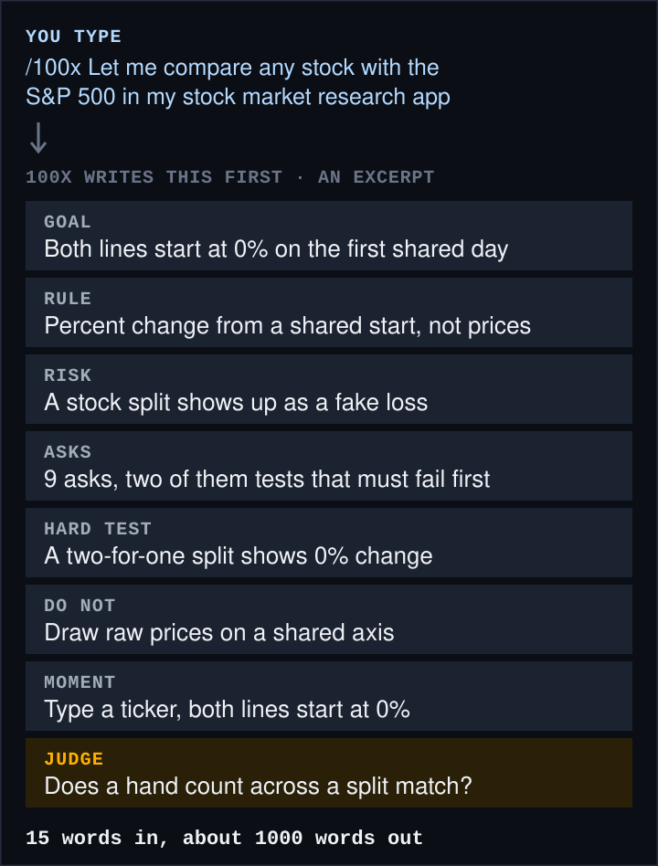
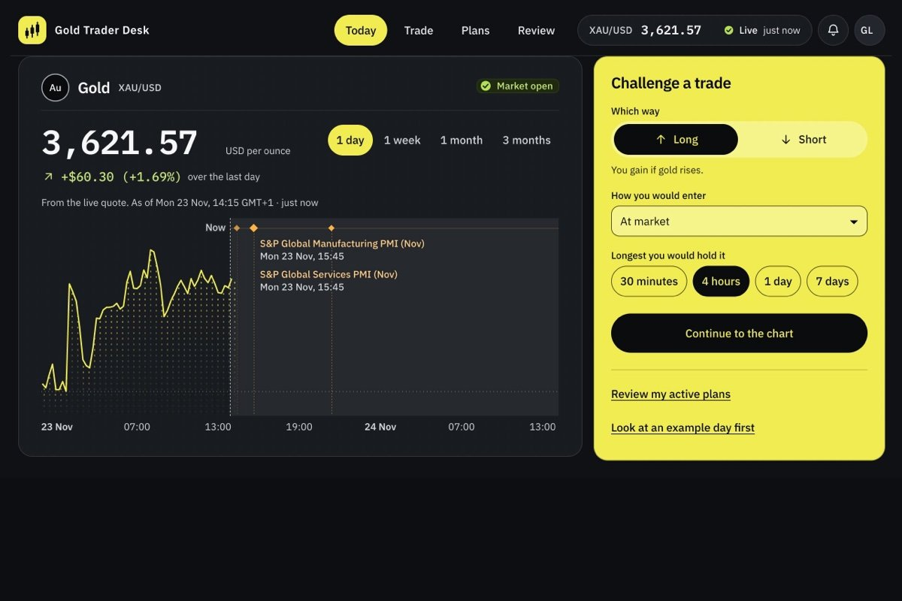
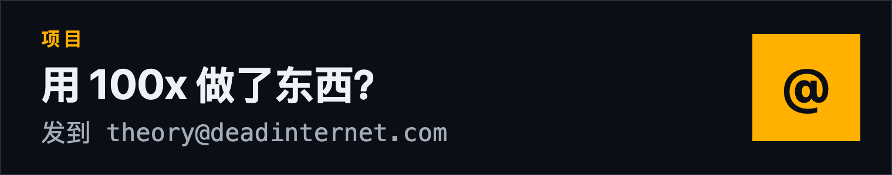
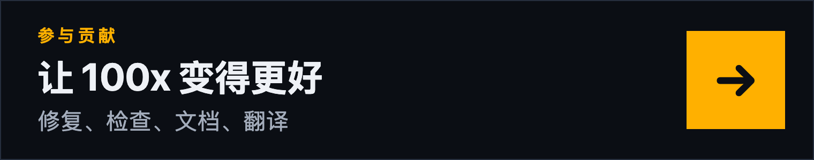

<div align="center">

<picture>
  <source media="(prefers-color-scheme: dark)" srcset="../docs/img/brand/mask-dark.png">
  
</picture>

# 100× ENGINEER SKILL

### 告别“差不多能用”的 AI 编程

[](https://github.com/DeadInternetStudios/100x-engineer-skill/actions/workflows/ci.yml)
[](https://github.com/DeadInternetStudios/100x-engineer-skill/releases)
[](https://nodejs.org/)
[](../LICENSE)

[](https://github.com/DeadInternetStudios/100x-engineer-skill/stargazers)

*100x 是一个受 pstack 启发的技能，能把提示词变成可用于生产、经过测试和评审的软件。<br>我用它每月向生产环境交付 1,000 多个 PR，回滚率低于 2%。*

<sub><a href="../README.md">English</a> · <a href="README.es.md">Español</a> · <b>中文</b> · <a href="README.pt.md">Português</a> · <a href="README.ru.md">Русский</a> · <a href="README.ja.md">日本語</a> · <a href="README.fr.md">Français</a> · <a href="README.de.md">Deutsch</a> · <a href="README.ar.md">العربية</a> · <a href="README.hi.md">हिन्दी</a> · <a href="README.ko.md">한국어</a> · <a href="README.id.md">Bahasa Indonesia</a> · <a href="README.tr.md">Türkçe</a> · <a href="README.vi.md">Tiếng Việt</a> · <a href="README.bn.md">বাংলা</a> · <a href="README.it.md">Italiano</a> · <a href="README.pl.md">Polski</a> · <a href="README.th.md">ไทย</a> · <a href="README.uk.md">Українська</a> · <a href="README.nl.md">Nederlands</a></sub>

</div>

> **100x engineer**<br>
> /ˈwən ˈhən-drəd eks ˌen-jə-ˈnir/<br>
> *名词*
>
> 据说一人能顶一百个普通工程师产出的软件工程师，而且不用开会、不提问，也没有失败的测试。

你的智能体说做完了。你打开一看，*好像*能用。看起来总是没问题，可就是差那么一点，没法直接上线。

**100x 让你的编程智能体搞定开发的最后 10%。**

<p align="center">
  
</p>

<p align="center"><b>30 天 136B tokens · 1 名工程师 · 严肃项目 · 超过 1,000 个 PR · 节省 $250k 缓存成本</b></p>

它是一个开源技能（skill），支持 Claude Code、Cursor 和 Codex。交给它一件事，比如给你的应用加一个功能，或者从零做一个小应用。它会规划、构建、打磨，并测试最关键的部分。再由第二个 AI 模型来审查。最后你会拿到一份报告，里面有截图、测试结果和所有还没解决的问题。

<p align="center">
  <a href="#安装"></a>
</p>

<!-- Benchmark headline goes here: one line and one picture, the same agent with and without 100x, with a link to the method. -->

## 为什么智能体总停在“差不多能用”

出问题的地方有三个，100x 对每个都有解法。下面的例子都用同一个请求：

> 在我的股市研究应用里，让我能把任意股票和标普 500 做对比

### 1. 没人写下“能用”到底指什么

请求只有一行。在动手之前，100x 会先写出你在有一小时空闲时才会写的那份提示词。它定下目标、规则、风险最大的部分，以及每项要求怎么检查。在这个例子里，它提前发现了一个坑：如果图表不按拆股做调整，拆股看起来就像亏损。

<p align="center">
  
</p>

<p align="center"><a href="../docs/examples/stock-comparison-prompt.md">阅读完整提示词</a></p>

### 2. 智能体自己检查自己的工作

模型检查自己的工作，会漏掉自己的错误。100x 让第二个模型分几轮审查代码和界面。构建者要么修复每条发现，要么写下为什么不同意。在这个例子里，提示词点名了新上市股票这种情况，并要求审查者重点施压，但构建者的测试只用了老股票。审查者试了一只今年上市的股票，发现指数线早了五个月开始。

<p align="center">
  
</p>

上面是示意。来个真实的：你正在读的这份 README 就经过了 100x。它的审查者在第一轮指出了 9 个问题，从 20 个失效的语言链接，到在手机上太小的标签。修好了 7 个，另外 2 个留到公开发布时处理。[看看它发现了什么](../docs/examples/readme-review.md)。

### 3. 总结靠记忆

智能体说“做完了”时，报告的是它记得的东西。100x 边做边保存证据：截图、测试输出、审查者的发现。最后由代码根据这些文件写总结；只要有一项要求没有证据，或者少了一项检查，`100x finish` 就拒绝写。下面是股票图表这次运行结束时的消息。这个研究应用是虚构的，所以这次运行是示意。

<p align="center">
  
</p>

<details>
<summary>同一条消息的纯文本</summary>

```text
Compare with the S&P 500: A chart in a research app that shows how any stock has moved against the S&P 500 since the first day both have prices. Verdict: ready to ship. The split math matches a hand count and both lines start on the same day. Dividends are not counted yet.
The moment: Type a ticker and both lines start at 0% on the same day, so the gap is the whole story
Run: npm run dev, then open http://localhost:5173/compare
Try first: 1) Type a ticker you hold and read the gap to the index 2) Pick a stock that split two for one and check the split day shows no drop 3) Pick a stock listed this year and see where both lines start
Must not break: numbers passed (Percent change across a two-for-one split matches a hand count on 40 split cases, 0 failing)
Review (claude-opus-5-5): 9 flagged, 7 fixed, 1 rejected, 1 deferred
Judge rounds: 5 of 5 done, on the code and how it behaves, the UI and UX and whether it is ready to ship, and the last word was ready to ship
Screen sizes: 0 broken, 2 weak, 15 sizes and 148 elements checked
Asks: 9 of 9 closed
Report: file:///Users/you/projects/research-app/.100x/REPORT.html
Next likely asks: Count dividends in the comparison; Show the gap for several stocks in one table
```

</details>

- **关键时刻（The moment）：** 让你想要它的那一件事
- **不能坏（Must not break）：** 硬测试，以及它是否通过
- **审查（Review）：** 第二个模型指出了什么，构建者又是怎么处理的
- **要求（Asks）：** 来自提示词的需求，每项都要有证据才能关闭
- **下一步可能的要求（Next likely asks）：** 你接下来大概会提的需求，已经做好或已列出

## 发一条消息，然后走开

把同一个请求画成时间线。手动做时，你要不停回来回答问题、抓错误。用 100x，你只发一条消息，回来时看报告就行。蓝色是你，琥珀色是第二个模型。时间是我们编的。

<p align="center">
  
</p>

<details>
<summary>从零做一个小应用也是一样</summary>

<p align="center">
  
</p>

记账应用的提示词，只从四个词写出来：[make me a budget app](../docs/examples/budget-app-prompt.md)。

</details>

<details>
<summary>一次运行的全部八个步骤</summary>

| 步骤 | 发生什么 |
|---|---|
| 1. 规划 | 你的智能体写一份详细的提示词，写清楚要做什么，以及每项请求怎么检查。 |
| 2. 核心 | 先尝试风险最大的部分，趁还有时间改计划。 |
| 3. 构建 | 做出第一个版本，以及你接下来可能会要的附加功能。 |
| 4. 打磨 | 打磨布局和细节。每一轮之后，第二个模型都会看截图，指出哪里还弱。 |
| 5. 测试 | 智能体测试那件一旦出错就会毁掉整个成果的事，比如图表把拆股算错。它先证明这个测试确实能抓到错误。 |
| 6. 审查 | 第二个模型审查代码和界面。构建者修复每个问题，或者写下为什么可以等、为什么不同意。 |
| 7. 收尾 | `100x finish` 命令在写报告前检查保存的证据。 |
| 8. 报告 | 你可以看到结果、亲手试用，并阅读审查者的发现。 |

如果你不在，智能体会记下它做的每个决定，然后继续工作。[阅读完整工作流程](../docs/pipeline.md)。

</details>

## 你会得到什么

<div align="center">


<sub>报告页面，取自三次虚构的运行。真实运行会在每张卡片上放自己的截图。</sub>

</div>

- **功能或应用本身**，以及如何亲手试用
- **多种屏幕尺寸下的截图**，检查文字溢出、按钮过小、图片模糊和浏览器错误
- **一个报告页面**（`.100x/REPORT.html`），以及 `~/.100x` 里所有已完成运行的图库
- **一份决策日志**：你不在时 100x 做的每个选择，以及原因
- **最终消息**，就是上面那条

每次运行只给一个结论：**可以上线**、**还行**或**需要改进**。如果有东西挡住了结论，卡片会写明是什么：100x 发现问题时显示红色，缺少检查时显示琥珀色。

---

<div align="center">

## 用 100x 做出的真实产品

<table align="left"><tr><td>
<a href="https://dollarflow.com/"></a><br>
<a href="https://dollarflow.com/"><b>DollarFlow</b></a><br>
股票筛选器，<br>
借助 100x 构建
</td></tr></table>
<table align="left"><tr><td>
<a href="https://springtails.wiki/"></a><br>
<a href="https://springtails.wiki/"><b>Springtails Wiki</b></a><br>
跳虫百科，<br>
完全用 100x 构建
</td></tr></table>
<br clear="all">
<table align="left"><tr><td>
<a href="https://bubblewrapapp.com/"></a><br>
<a href="https://bubblewrapapp.com/"><b>BubbleWrap</b></a><br>
像素风音乐应用，<br>
完全用 100x 构建
</td></tr></table>
<table align="left"><tr><td>
<a href="https://goldtraderdesk.com/"></a><br>
<a href="https://goldtraderdesk.com/"><b>Gold Trader Desk</b></a><br>
黄金交易应用，<br>
完全用 100x 构建
</td></tr></table>
<br clear="all">
<table align="left"><tr><td>
<br>
<b>Phantom</b><br>
法证专家用来分析<br>
笔迹的 Swift Mac 应用，<br>
借助 100x 构建
</td></tr></table>
<table align="left"><tr><td>
<br>
<b>OptionsFlow</b><br>
量化公司在用的 React<br>
实时期权链工具，<br>
借助 100x 构建
</td></tr></table>
<br clear="all">
<table align="left"><tr><td>
<br>
<b>Skynet</b><br>
基于 Blueprint 和 Encore<br>
的项目管理工具，<br>
借助 100x 构建
</td></tr></table>
<table align="left"><tr><td>
<br>
<b>Boneworks</b><br>
文字转 3D 流水线，为角色<br>
建模、蒙皮、绑定骨骼和制作动画，<br>
借助 100x 构建
</td></tr></table>
<br clear="all">

<p align="center">
  <a href="mailto:theory@deadinternet.com"></a>
</p>

</div>

---

## 代价是什么

100x 用时间和用量换取证据。

- **一次正常运行要几个小时。** 每一轮打磨、每一轮审查都是又一个模型在干活，所以一次运行会用掉你套餐里不少额度。
- **想先看一眼**，`/100x-mockup` 大约 15 分钟。它跳过审查，并会明说。
- **套餐较小时**，`100x config preset lite --global` 只做一轮打磨和两轮审查，而不是三轮和五轮。证据检查保留。
- **不适合小事。** 一行的修复或一个问题，直接问你的智能体就好。100x 适合值得规划、测试和审查的工作。

## 安装

你需要 Claude Code、Cursor 或 Codex，以及 Node.js 22 或更高版本。

**1. 安装工具和技能**

二选一：

**npm**

```bash
npm install -g github:DeadInternetStudios/100x-engineer-skill
100x install
```

**skills.sh**

```bash
npm install -g github:DeadInternetStudios/100x-engineer-skill
npx skills add DeadInternetStudios/100x-engineer-skill --skill '*' -g
100x install
```

`skills` 工具只复制技能，所以 `100x` 工具仍然通过 npm 安装。之后 `100x install` 会发现这些副本并保持原样。用 `npx skills update -g` 更新。

**2. 在你的智能体里完成设置**

```text
/100x-setup
```

它会问你用的是哪个套餐（Claude Pro、Max 或 Ultra，或者 OpenAI Go、Plus 或 Pro），然后选好哪个模型负责构建、哪个负责评审。如果套餐较小，告诉它，它就会打开 lite 预设。更多内容：[docs/plans-and-setup.md](../docs/plans-and-setup.md)。

**3. 交给它一件事**

```text
/100x 在我的股市研究应用里，让我能把任意股票和标普 500 做对比
```

Claude Code 和 Cursor 用 `/` 启动技能。Codex 用 `$`，比如 `$100x-setup` 和 `$100x`。晚上要离开时用 `/100x-overnight`，想先看一眼就用 `/100x-mockup`。

### 其他安装方式

**从克隆的仓库安装**（我们测试这个仓库就用这种方式）

```bash
./scripts/install.sh --dry-run   # preview
./scripts/install.sh
```

100x 由两部分组成：智能体读取的技能，以及 `100x` 命令行工具。这个工具负责模型自己做不可靠的事：计时、截图、运行评审、检查证据、写报告。截图用的是 Playwright。如果没装，`100x browsers` 会帮你装上。

安装程序只创建快捷方式（符号链接）、几个小文件和它们所在的文件夹。它从不覆盖真实文件。`100x doctor` 检查安装结果，`./scripts/install.sh --uninstall` 把它移除。它涉及的每个文件：[docs/cli.md](../docs/cli.md)。

## 模式

100x 是一组技能，叫作模式。输入模式名就能使用。消息里的词永远不会选中某个模式，所以 `/100x an overnight oats app` 会做一个隔夜燕麦应用。

| 输入 | 用途 | 作用 |
|---|---|---|
| `/100x` | 构建 | 正常运行：构建、打磨、测试、第二个模型审查。 |
| `/100x-mockup` | 构建 | 大约 15 分钟快速看一眼。只有关键时刻能用。没有审查，并会明说（UNREVIEWED）。 |
| `/100x-overnight` | 构建 | 适合你要离开的时候。在设定时间内跑一个或多个想法，智能体卡住时会推它一把。 |
| `/100x-wrapup` | 构建 | 适合赶截止时间。让主流程能用，把其余的藏起来。 |
| `/100x-judge` | 审查 | 审查已经做好的东西。不做新东西。 |
| `/100x-grind` | 审查 | 审查、修复、再审查，直到评审说可以上线。连续三次审查都没找到更好的、达到 15 轮或时间用完时停下。 |
| `/100x-status` | 运行 | 运行进行到哪了，最多六行。 |
| `/100x-continue` | 运行 | 接上停下的运行，比如因用量上限而停下的。 |
| `/100x-report` | 运行 | 列出所有已完成的运行，最好的排在前面。不构建任何东西。 |
| `/100x-adhd` | 规划 | 简短的来回对话，一次一个问题，把模糊的想法变成计划。你说开始之前，什么都不会构建。 |
| `/100x-setup` | 设置 | 问一个关于你套餐的问题，然后设定哪个模型做哪项工作。 |
| `/100x-bakeoff` | 测试 100x | 测试 100x 本身：同一个智能体在用和不用 100x 的情况下构建相同的想法，再由盲评评审比较。不构建任何东西。 |

### 数字短语

把这些加进消息，就能改变一次运行。它们对 `/100x` 和 `/100x-overnight` 有效。其他词，比如“fast”或“quick”，没有作用。

| 你写的 | 会发生什么 |
|---|---|
| `3 versions` | 构建这个想法的 3 个版本，并完成最好的那个。任何数字都行。 |
| `for 10 hours`、`for 2 days`、`until 6am` | 用满这些时间。运行不会提前结束。 |
| `5 rounds of judging` | 跑这么多轮审查。 |
| `max 5 subagents` | 同时最多 5 个子智能体。默认是 1。 |

```text
/100x-overnight 3 versions of a farming game, for 8 hours, max 3 subagents
```

每次运行开始时都会列出它理解到的短语，方便你发现误读。

给它一个时限，它就会一轮一轮地工作，直到时间用完。每一轮都换个角度看项目，有帮助就保留改动，没帮助就回滚。每一轮都由一个全新的第二个模型检查。

<p align="center">
  
</p>

## 常见问题

**为什么要第二个模型？** 不同模型有不同的盲点。如果没有可用的第二个模型，运行仍会完成，并标明 UNREVIEWED。如果只有一个套餐，可以由同一家公司的较小模型来评审，但效果不如另一家公司的模型。

**它会把我的项目发布上线吗？** 不会。只有项目本来就有预览时，它才会生成预览。上线需要你明确同意。

**运行中途碰到用量上限怎么办？** 100x 会把进度保存在 `.100x/STATE.md`。上限重置后，在同一个文件夹里输入 `/100x-continue`。

**它会改我的模型或设置吗？** 不会。它从不切换你的模型、推理强度或登录方式。`/100x-setup` 只写 100x 自己的设置。

**运行记录放在哪？** 在每个项目里一个隐藏的 `.100x/` 文件夹中（git 会忽略它），已完成运行的图库在 `~/.100x`。

<p align="center">
  <a href="https://github.com/DeadInternetStudios/100x-engineer-skill/issues/new"></a>
</p>

## 文档

| 页面 | 内容 |
|---|---|
| [完整安装说明](../docs/install.md) | 所有安装选项，以及安装程序涉及的每个文件 |
| [使用 100x](../docs/using.md) | 离开一晚、报告页面、辅助技能 |
| [流程与最终消息](../docs/pipeline.md) | 每个步骤的完整说明，以及 `100x finish` 检查什么 |
| [设置与套餐](../docs/plans-and-setup.md) | 推荐的 Claude Code 设置、lite 预设、各套餐的配置 |
| [配置项](../docs/settings.md) | 所有配置键 |
| [CLI 与文件布局](../docs/cli.md) | 每个 `100x` 命令，以及文件放在哪 |
| [技能内部与验证](../docs/contributing.md) | 仓库如何组织，以及如何测试 |
| [设计说明](../docs/design.md) | 100x 为什么这样工作 |

## 参与贡献

欢迎提交 bug 报告、修复和想法。小修复可以直接提 Pull Request。更大的改动请先开一个 Issue，我们先达成一致。[如何参与贡献](../CONTRIBUTING.md)。

<p align="center">
  <a href="../CONTRIBUTING.md"></a>
</p>

## 致谢

100x 基于 Lauren Tan 的 [pstack](https://github.com/cursor/plugins/tree/main/pstack)（MIT）的工作原则，并针对原型和与智能体的单次对话做了改造。不同之处：

- 每次运行都以一个报告页面结束。
- `100x finish` 拒绝它无法核实的说法。
- 第二个模型分几轮审查工作。

参见 [NOTICE.md](../NOTICE.md) 和 [UPSTREAM.md](../UPSTREAM.md)。

MIT 许可。参见 [LICENSE](../LICENSE)。

<p align="center">
  <a href="https://star-history.com/#DeadInternetStudios/100x-engineer-skill&Date">
    <picture>
      <source media="(prefers-color-scheme: dark)" srcset="https://api.star-history.com/svg?repos=deadinternetstudios/100x-engineer-skill&type=Date&theme=dark">
      
    </picture>
  </a>
</p>

---

<sub>面具图案： <a target="_blank" href="https://www.vexels.com/png-svg/preview/229802/guy-fawkes-mask-bonfire-night-stroke">www.vexels.com</a></sub>
